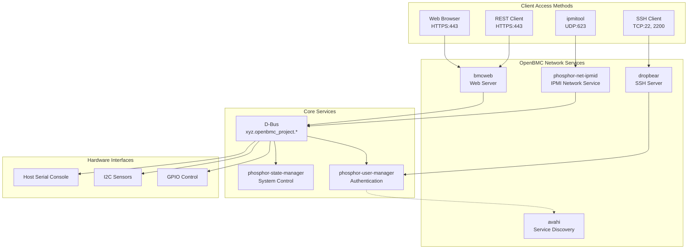
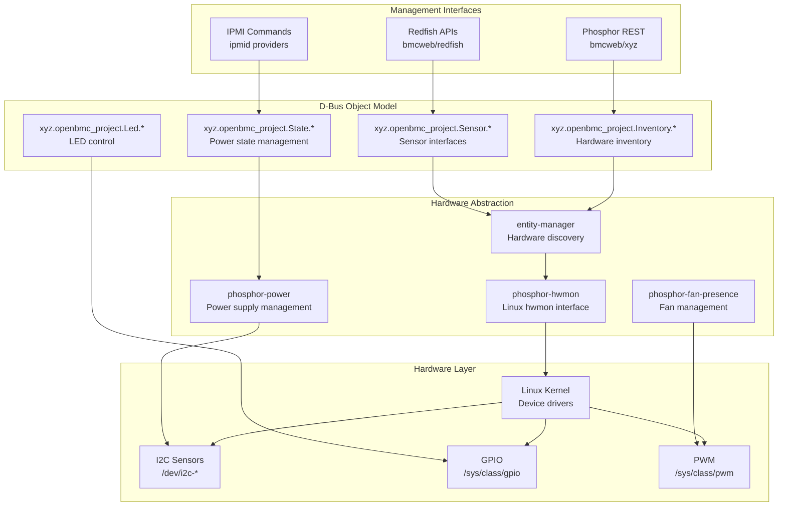
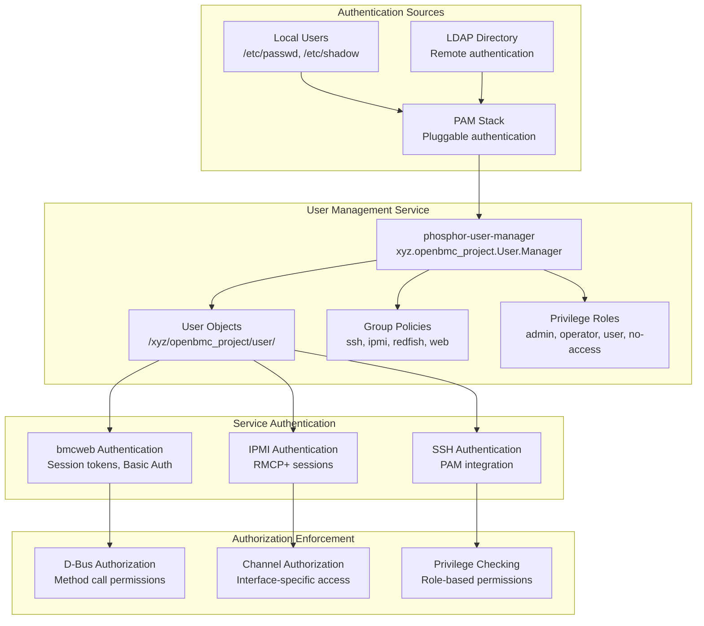
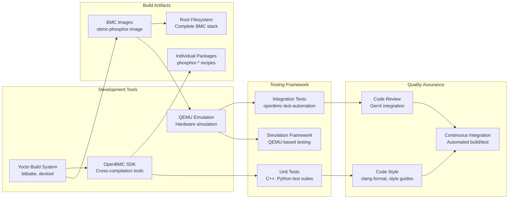

<!-- source: DeepWiki mcp.deepwiki.com · repo NVIDIA/nvbmc-docs · page 1.2 Core Features and Capabilities · fetched 2026-10-26 -->

# Core Features and Capabilities

Relevant source files

The following files were used as context for generating this wiki page:

- [architecture/ipmi-architecture.md](architecture/ipmi-architecture.md)
- [architecture/user-management.md](architecture/user-management.md)
- [features.md](features.md)
- [security/network-security-considerations.md](security/network-security-considerations.md)

This document provides an overview of OpenBMC's management capabilities, supported interfaces, and key features. It covers the functionality available to system administrators and integrators for managing BMC-enabled systems.

For detailed architectural information about internal components, see [Core Architecture](#3). For specific implementation details of management interfaces, see [Management Interfaces](#4).

## Management Capabilities Overview

OpenBMC provides comprehensive out-of-band management capabilities for server systems through multiple standardized and proprietary interfaces. The system supports both local and remote management scenarios with robust security and authentication mechanisms.

### Core Management Functions

| Feature Category | Capabilities | Key Components |
|------------------|-------------|----------------|
| **System Control** | Host power management, reset control, watchdog | `phosphor-state-manager`, `phosphor-watchdog` |
| **Hardware Monitoring** | Environmental sensors, inventory tracking, LED control | `phosphor-hwmon`, `entity-manager`, `phosphor-led-manager` |
| **User Management** | Local/LDAP authentication, role-based access control | `phosphor-user-manager`, PAM integration |
| **Firmware Management** | BMC and host firmware updates, version management | Code update infrastructure, PLDM update agents |
| **Console Access** | Host serial console, virtual media, KVM | `obmc-console`, `bmcweb` WebSocket services |
| **Network Services** | DHCP/static IP, certificate management, secure protocols | `systemd-networkd`, `phosphor-certificate-manager` |

Sources: [features.md:1-73](), [security/network-security-considerations.md:1-264]()

## Network Interfaces and Protocol Stack

OpenBMC exposes management functionality through multiple network protocols and interfaces, each serving different use cases and client types.

### Network Service Architecture

Sources: [security/network-security-considerations.md:129-264](), [features.md:5-28]()

### Protocol Support Matrix

| Protocol | Port | Service | Authentication | Primary Use Case |
|----------|------|---------|----------------|------------------|
| **HTTPS** | 443 | `bmcweb` | Session tokens, Basic Auth | REST APIs, Web UI, Redfish |
| **SSH** | 22 | `dropbear` | PAM, SSH keys | Shell access, SCP |
| **SSH Console** | 2200 | `dropbear` | PAM, SSH keys | Host serial console |
| **IPMI** | 623/UDP | `phosphor-net-ipmid` | RMCP+, Session-based | Traditional IPMI management |
| **mDNS** | 5355/UDP | `avahi-daemon` | None | Service discovery |

Sources: [security/network-security-considerations.md:131-264]()

## Hardware Management Features

OpenBMC provides comprehensive hardware monitoring and control capabilities through a modular sensor and inventory management system.

### Hardware Management Architecture

Sources: [features.md:15-25](), [architecture/user-management.md:1-528]()

### Sensor and Monitoring Capabilities

| Feature | Implementation | D-Bus Interface | Configuration |
|---------|----------------|-----------------|---------------|
| **Temperature Sensors** | `phosphor-hwmon` | `xyz.openbmc_project.Sensor.Value` | Device tree, entity-manager |
| **Voltage Sensors** | `phosphor-hwmon` | `xyz.openbmc_project.Sensor.Value` | Linux hwmon drivers |
| **Fan Control** | `phosphor-fan-presence` | `xyz.openbmc_project.Sensor.Value` | YAML configuration |
| **Power Supplies** | `phosphor-power` | `xyz.openbmc_project.Sensor.Value` | PMBus/I2C communication |
| **Inventory Tracking** | `entity-manager` | `xyz.openbmc_project.Inventory.Item` | JSON configuration |
| **LED Management** | `phosphor-led-manager` | `xyz.openbmc_project.Led.Group` | LED group definitions |

Sources: [features.md:15-25]()

## Security and User Management

OpenBMC implements a comprehensive security model with centralized user management, role-based access control, and secure communication protocols.

### User Management and Authentication Flow

Sources: [architecture/user-management.md:67-528](), [security/network-security-considerations.md:70-128]()

### Security Features

| Security Domain | Implementation | Key Components |
|----------------|----------------|----------------|
| **Transport Security** | TLS 1.2+, SSH protocols | OpenSSL, Dropbear SSH |
| **Authentication** | PAM, LDAP, local users | `phosphor-user-manager`, PAM modules |
| **Authorization** | Role-based access control | Group membership, privilege levels |
| **Session Management** | Token-based sessions, timeouts | `bmcweb` session handling |
| **Certificate Management** | X.509 certificates, CA support | `phosphor-certificate-manager` |
| **Audit Logging** | Authentication events, system changes | `phosphor-logging`, rsyslog |

Sources: [architecture/user-management.md:30-66](), [security/network-security-considerations.md:82-121]()

## Development and Testing Features

OpenBMC provides comprehensive development infrastructure supporting both embedded development and testing workflows.

### Development Infrastructure

Sources: [features.md:28-31]()

### Key Development Features

| Feature | Purpose | Implementation |
|---------|---------|----------------|
| **QEMU Simulation** | Hardware-independent testing | Full BMC stack emulation |
| **devtool Workflow** | Source code modification | Yocto development tool |
| **Automated Testing** | Continuous integration | `openbmc-test-automation` framework |
| **Cross-compilation** | ARM target development | OpenBMC SDK toolchain |
| **Style Enforcement** | Code quality | `clang-format`, automated checks |
| **Package Management** | Modular development | BitBake recipe system |

Sources: [features.md:28-31]()

## Integration Points and Extensibility

OpenBMC's modular architecture enables customization and extension for specific platform requirements through well-defined interfaces and configuration mechanisms.

### Platform Customization Points

| Customization Area | Mechanism | Configuration Method |
|-------------------|-----------|---------------------|
| **Hardware Detection** | Entity Manager | JSON configuration files |
| **Sensor Mapping** | Device tree, hwmon | Kernel device tree, hwmon bindings |
| **GPIO Configuration** | Device tree | Platform-specific device tree |
| **Fan Control** | YAML configuration | Fan presence and control definitions |
| **Power Control** | D-Bus services | Custom power control implementations |
| **LED Patterns** | LED group definitions | YAML LED group configurations |
| **IPMI Extensions** | Provider libraries | Custom IPMI command handlers |
| **Redfish Extensions** | bmcweb schemas | Additional Redfish resource definitions |

This extensibility allows OpenBMC to support diverse hardware platforms while maintaining a consistent management interface across different system types.

Sources: [features.md:1-73](), [architecture/ipmi-architecture.md:95-318]()

---

