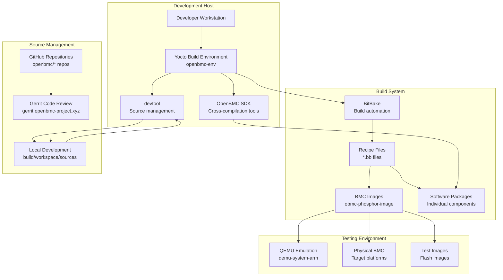
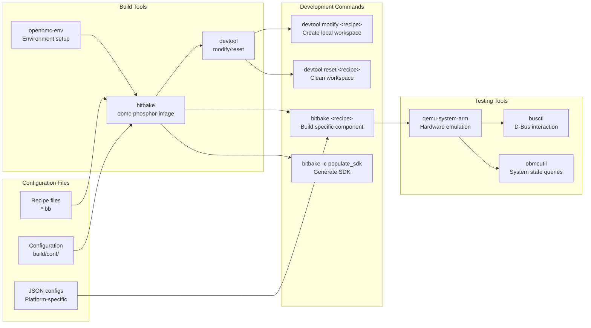

<!-- source: DeepWiki mcp.deepwiki.com · repo NVIDIA/nvbmc-docs · page 2 Getting Started · fetched 2026-10-26 -->

# Getting Started

<details>
<summary>Relevant source files</summary>

The following files were used as context for generating this wiki page:

- [cheatsheet.md](cheatsheet.md)
- [designs/management-console/VMI_Certificate_Exchange.md](designs/management-console/VMI_Certificate_Exchange.md)
- [designs/management-console/service-discovery.md](designs/management-console/service-discovery.md)
- [designs/mctp/mctp-kernel.md](designs/mctp/mctp-kernel.md)
- [designs/multihost-ipmi-design.md](designs/multihost-ipmi-design.md)
- [designs/phosphor-audit.md](designs/phosphor-audit.md)
- [development/dev-environment.md](development/dev-environment.md)

</details>


## Purpose and Scope

This page provides an introduction to OpenBMC development, covering the essential concepts, tools, and workflow needed to begin developing and testing OpenBMC firmware. It focuses on setting up a development environment and understanding the core build and testing processes.

For detailed environment setup instructions, see [Development Environment Setup](#2.1). For comprehensive building and QEMU testing procedures, see [Building and Testing with QEMU](#2.2). For information about OpenBMC's overall architecture and features, see [OpenBMC Overview](#1).

## OpenBMC Development Overview

OpenBMC is a Linux-based BMC (Baseboard Management Controller) firmware stack built using the Yocto Project framework. Development involves building custom firmware images, developing applications that communicate via D-Bus, and testing using both hardware platforms and QEMU emulation.

The development process centers around three key activities:
- **Building**: Using Yocto/BitBake to create OpenBMC images
- **Developing**: Using the SDK for cross-compilation and `devtool` for iterative development
- **Testing**: Using QEMU emulation for rapid testing and validation

**Development Architecture Overview**



Sources: [cheatsheet.md:1-376](), [development/dev-environment.md:1-233]()

## Quick Start Workflow

The typical OpenBMC development workflow follows these essential steps:

**1. Environment Preparation**
```bash
# Set up build environment
cd openbmc
TEMPLATECONF=meta-ibm/meta-palmetto/conf . openbmc-env
```

**2. Initial Build**
```bash
# Build complete OpenBMC image
bitbake obmc-phosphor-image
```

**3. SDK Generation and Installation**
```bash
# Build SDK for cross-compilation
bitbake -c populate_sdk obmc-phosphor-image

# Install SDK
./tmp/deploy/sdk/openbmc-phosphor-glibc-x86_64-obmc-phosphor-image-armv5e-toolchain-2.1.sh
```

**4. Development with devtool**
```bash
# Modify existing component
devtool modify phosphor-ipmi-host
cd build/workspace/sources/phosphor-ipmi-host
# Make changes...

# Build with changes
bitbake obmc-phosphor-image
```

**5. QEMU Testing**
```bash
# Download QEMU
wget https://jenkins.openbmc.org/job/latest-qemu-x86/lastSuccessfulBuild/artifact/qemu/build/qemu-system-arm

# Run OpenBMC in emulation
./qemu-system-arm -m 256 -M palmetto-bmc -nographic \
    -drive file=./flash-palmetto,format=raw,if=mtd \
    -net nic \
    -net user,hostfwd=:127.0.0.1:2222-:22,hostfwd=:127.0.0.1:2443-:443,hostname=qemu
```

Sources: [cheatsheet.md:25-123](), [development/dev-environment.md:92-197]()

**Development Tools and Key Commands**



Sources: [cheatsheet.md:258-275](), [cheatsheet.md:83-98]()

## Platform-Specific Building

OpenBMC supports multiple hardware platforms through machine configurations. Each platform has its own template configuration:

| Platform | Template Configuration | Machine Target |
|----------|----------------------|----------------|
| Palmetto | `meta-ibm/meta-palmetto/conf` | `palmetto` |
| Zaius | `meta-ingrasys/meta-zaius/conf` | `zaius` |
| Romulus | Default CI platform | `romulus` |

**Platform Build Example:**
```bash
# Building for specific platform
cd openbmc
TEMPLATECONF=meta-ibm/meta-palmetto/conf . openbmc-env
export MACHINE="palmetto"
bitbake obmc-phosphor-image
```

**Build Configuration Override:**
```bash
# Using different machine in existing build
export MACHINE="machineB"
bitbake obmc-phosphor-image
```

Sources: [cheatsheet.md:25-61](), [development/dev-environment.md:32-33]()

## Essential Development Utilities

**D-Bus Interaction with busctl**
```bash
# Execute D-Bus methods directly
busctl call <path> <interface> <object> <method> <parameters>

# Example: Power control
busctl call xyz.openbmc_project.State.Host \
    xyz.openbmc_project.State.Host.Transition \
    RequestedHostTransition s "xyz.openbmc_project.State.Host.Transition.On"
```

**System State Monitoring**
```bash
# Check OpenBMC state
obmcutil state
# Output:
# CurrentBMCState     : xyz.openbmc_project.State.BMC.BMCState.Ready
# CurrentPowerState   : xyz.openbmc_project.State.Chassis.PowerState.Off  
# CurrentHostState    : xyz.openbmc_project.State.Host.HostState.Off
```

**Development Performance Optimization**
- **Shared Downloads**: Configure `DL_DIR` in `build/conf/local.conf` to share downloaded sources across builds
- **Git Proxy**: Use `GIT_PROXY_COMMAND` for faster repository access in restricted networks
- **Incremental Builds**: Use `devtool modify` for iterative development without full rebuilds

Sources: [cheatsheet.md:83-98](), [cheatsheet.md:211-256](), [development/dev-environment.md:184-195]()

## Next Steps

Once you understand these basic concepts and have experimented with the quick start workflow:

1. **Set up your development environment** following the detailed instructions in [Development Environment Setup](#2.1)

2. **Learn the complete build and testing process** including QEMU setup and advanced devtool usage in [Building and Testing with QEMU](#2.2)

3. **Explore the core architecture** to understand D-Bus communication, state management, and hardware interfaces in [Core Architecture](#3)

4. **Study management interfaces** for REST API, Redfish, and IPMI development in [Management Interfaces](#4)

The OpenBMC development ecosystem provides powerful tools for firmware development, but mastering the Yocto build system and D-Bus architecture is essential for effective development.

Sources: [cheatsheet.md:1-376](), [development/dev-environment.md:1-233]()

---

