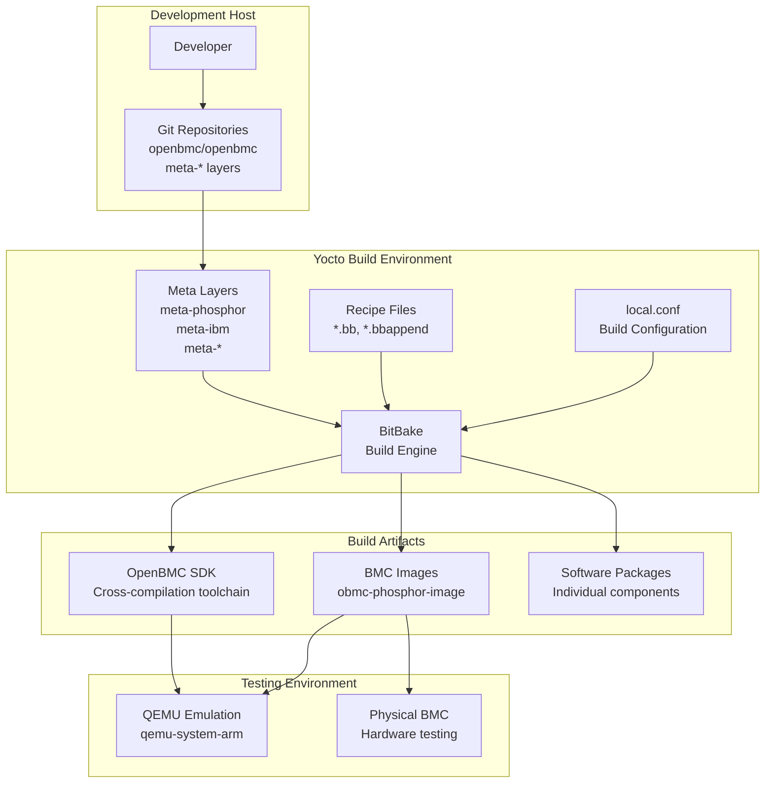
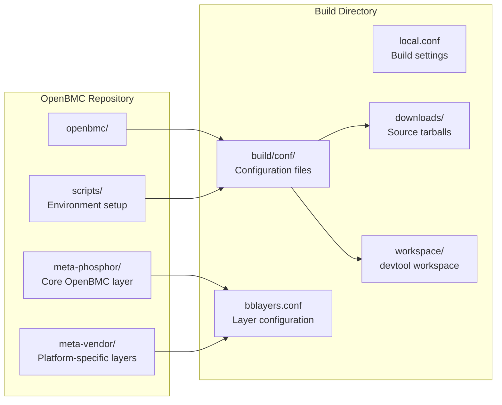
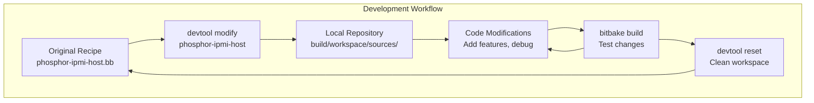
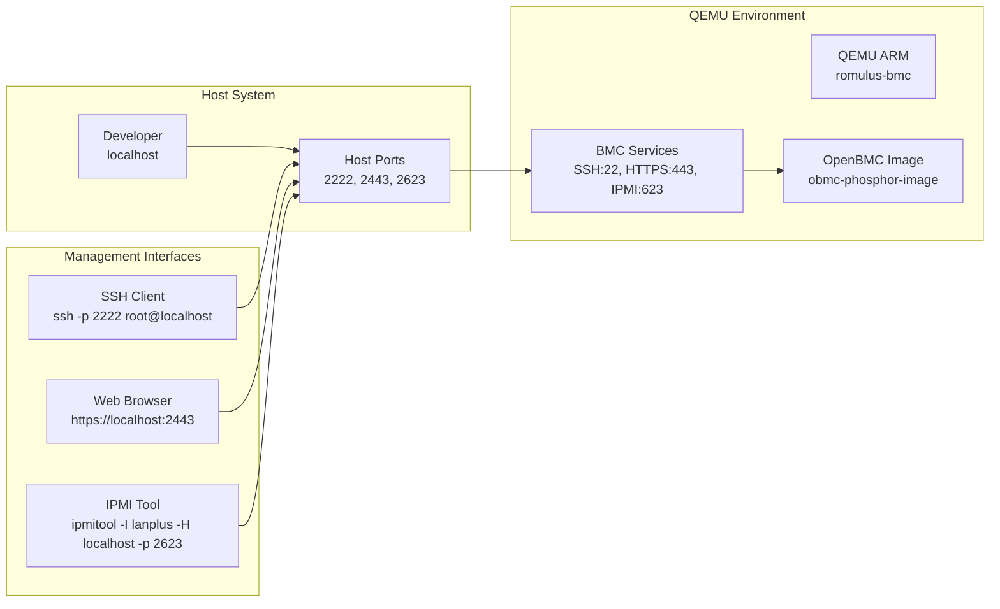

<!-- source: DeepWiki mcp.deepwiki.com · repo NVIDIA/nvbmc-docs · page 2.1 Development Environment Setup · fetched 2026-10-26 -->

# Development Environment Setup

<details>
<summary>Relevant source files</summary>

The following files were used as context for generating this wiki page:

- [cheatsheet.md](cheatsheet.md)
- [designs/management-console/VMI_Certificate_Exchange.md](designs/management-console/VMI_Certificate_Exchange.md)
- [designs/management-console/service-discovery.md](designs/management-console/service-discovery.md)
- [designs/mctp/mctp-kernel.md](designs/mctp/mctp-kernel.md)
- [designs/multihost-ipmi-design.md](designs/multihost-ipmi-design.md)
- [designs/phosphor-audit.md](designs/phosphor-audit.md)
- [development/dev-environment.md](development/dev-environment.md)

</details>


## Purpose and Scope

This document covers the setup of a complete OpenBMC development environment, including the Yocto build system, Software Development Kit (SDK) installation, and essential development tools. This environment enables developers to build, modify, and test OpenBMC components efficiently without requiring physical BMC hardware.

For information about building and testing specific components once the environment is established, see [Building and Testing with QEMU](#2.2). For details about the overall OpenBMC architecture and core features, see [OpenBMC Overview](#1).

## Prerequisites and System Requirements

### Host System Requirements

OpenBMC development requires a Linux-based development environment. The recommended configuration includes:

| Requirement | Minimum | Recommended |
|-------------|---------|-------------|
| Operating System | Ubuntu 18.04 LTS | Latest Ubuntu LTS |
| CPU Cores | 4 | 8+ |
| RAM | 8GB | 16GB+ |
| Storage | 100GB | 200GB+ |
| Network | Internet connectivity for package downloads | High-speed connection |

### Virtualization Support

For developers using Windows or macOS, virtualization through VirtualBox or VMware is supported. The virtual machine should be allocated maximum available resources for optimal build performance.

**Sources:** [development/dev-environment.md:35-62]()

## Yocto Build System Overview

OpenBMC uses the Yocto Project as its underlying build and distribution framework. The build system consists of several interconnected components that work together to produce BMC firmware images.

### Build System Architecture



**Sources:** [development/dev-environment.md:11-18](), [cheatsheet.md:25-61]()

## Environment Setup Process

### Initial Repository Clone and Configuration

The OpenBMC build environment starts with cloning the main repository and setting up the build configuration:

```bash
# Clone the main OpenBMC repository
git clone https://github.com/openbmc/openbmc.git
cd openbmc

# Set up build environment for specific platform
TEMPLATECONF=meta-ibm/meta-palmetto/conf . openbmc-env
```

The `openbmc-env` script initializes the BitBake environment and creates the `build/conf` directory containing configuration files like `local.conf` and `bblayers.conf`.

### Build Configuration Structure



**Sources:** [cheatsheet.md:29-44](), [development/dev-environment.md:209-227]()

## Software Development Kit (SDK) Installation

The OpenBMC SDK provides a complete cross-compilation environment that includes compilers, libraries, and development tools needed to build applications for ARM-based BMC targets.

### SDK Download and Installation

```bash
# Create SDK workspace
mkdir -p ~/sdk
cd ~/sdk

# Download pre-built SDK (example for Romulus platform)
wget https://jenkins.openbmc.org/job/latest-master-sdk/label=docker-builder,target=romulus/lastSuccessfulBuild/artifact/deploy/sdk/oecore-x86_64-arm1176jzs-toolchain-nodistro.0.sh

# Make executable and install
chmod u+x oecore-x86_64-arm1176jzs-toolchain-nodistro.0.sh
mkdir -p ~/sdk/romulus-$(date +%F)
./oecore-x86_64-arm1176jzs-toolchain-nodistro.0.sh
```

### SDK Environment Activation

After installation, each development session requires sourcing the SDK environment:

```bash
# Source SDK environment (path varies based on installation)
. /path/to/sdk/environment-setup-arm1176jzs-openbmc-linux-gnueabi
```

The SDK provides cross-compilation tools including `$CC`, `$CXX`, `$GDB`, and other development utilities configured for the target BMC architecture.

**Sources:** [development/dev-environment.md:79-139](), [cheatsheet.md:62-71]()

### Building SDK from Source

Alternatively, the SDK can be built from source using BitBake:

```bash
# Build SDK using BitBake
bitbake -c populate_sdk obmc-phosphor-image

# Install the generated SDK
./tmp/deploy/sdk/openbmc-phosphor-glibc-x86_64-obmc-phosphor-image-armv5e-toolchain-2.1.sh
```

**Sources:** [cheatsheet.md:62-71]()

## Development Tools and Workflow

### devtool: Development Workflow Management

The `devtool` utility provides a streamlined workflow for modifying OpenBMC components during development. It integrates with the Yocto build system to manage source code modifications and testing.

#### devtool Workflow



#### Common devtool Commands

```bash
# Create local copy of a recipe for modification
devtool modify phosphor-ipmi-host

# Navigate to source directory
cd build/workspace/sources/phosphor-ipmi-host

# Build with local changes
bitbake obmc-phosphor-image

# Reset recipe to ignore local changes
devtool reset phosphor-ipmi-host
```

**Sources:** [cheatsheet.md:258-312]()

### Build Optimization Techniques

#### Shared Downloads Directory

To accelerate builds across multiple workspaces, configure a shared downloads directory:

```bash
# Method 1: Configure in local.conf
echo 'DL_DIR ?= "/path/to/shared/downloads"' >> build/conf/local.conf

# Method 2: Create symbolic link
ln -sf /path/to/existing/downloads build/downloads
```

#### Git Proxy Configuration

For environments with restricted internet access, configure git proxy support:

```bash
# Create proxy wrapper script
cat > ~/bin/git-proxy-wrapper << 'EOF'
#!/bin/sh
/usr/bin/connect -S localhost:9054 "$@"
EOF

# Enable proxy for git operations
export GIT_PROXY_COMMAND=~/bin/git-proxy-wrapper
```

**Sources:** [cheatsheet.md:212-256]()

## QEMU Emulation Environment

QEMU provides hardware emulation capabilities that enable testing OpenBMC images without physical BMC hardware. This significantly accelerates the development and testing cycle.

### QEMU Setup and Configuration

#### Pre-built QEMU and Images

```bash
# Download QEMU binary
wget https://jenkins.openbmc.org/job/latest-qemu-x86/lastSuccessfulBuild/artifact/qemu/build/qemu-system-arm
chmod u+x qemu-system-arm

# Download BMC image (Romulus example)
wget https://jenkins.openbmc.org/job/latest-master/label=docker-builder,target=romulus/lastSuccessfulBuild/artifact/openbmc/build/tmp/deploy/images/romulus/obmc-phosphor-image-romulus.static.mtd
```

#### QEMU Execution with Network Forwarding

```bash
# Start QEMU with port forwarding for management interfaces
./qemu-system-arm -m 256 -M romulus-bmc -nographic \
    -drive file=./obmc-phosphor-image-romulus.static.mtd,format=raw,if=mtd \
    -net nic \
    -net user,hostfwd=:127.0.0.1:2222-:22,hostfwd=:127.0.0.1:2443-:443,hostfwd=udp:127.0.0.1:2623-:623,hostname=qemu
```

This configuration provides access to:
- SSH on port 2222
- HTTPS/Web interface on port 2443  
- IPMI on UDP port 2623

**Sources:** [development/dev-environment.md:141-198](), [cheatsheet.md:99-124]()

### QEMU Network Architecture



### Alternative Yocto QEMU Integration

For more advanced development scenarios, Yocto provides integrated QEMU support:

```bash
# Set up build environment
source setup romulus myBuild/build

# Configure for QEMU x86 testing
echo 'MACHINE ??= "qemux86"' >> conf/local.conf

# Build and run with Yocto's runqemu
MACHINE=qemux86 bitbake obmc-phosphor-image
runqemu myBuild/build/tmp/deploy/images/qemux86/ nographic qemuparams="-m 2048"
```

This approach provides TAP network interface support and better integration with the Yocto build system.

**Sources:** [development/dev-environment.md:199-231]()

## Development Environment Validation

### Build System Verification

After environment setup, verify the build system functionality:

```bash
# Test basic build capability
bitbake obmc-phosphor-image

# Verify SDK functionality
echo 'int main() { return 0; }' > test.c
$CC test.c -o test
file test  # Should show ARM executable
```

### QEMU Boot Verification

Validate QEMU environment by checking OpenBMC system state:

```bash
# Connect to QEMU instance
ssh -p 2222 root@localhost

# Check OpenBMC state services
obmcutil state
# Expected output:
# CurrentBMCState     : xyz.openbmc_project.State.BMC.BMCState.Ready
# CurrentPowerState   : xyz.openbmc_project.State.Chassis.PowerState.Off
# CurrentHostState    : xyz.openbmc_project.State.Host.HostState.Off
```

### Development Workflow Testing

Verify devtool functionality with a simple modification:

```bash
# Test devtool workflow
devtool modify bmcweb
cd build/workspace/sources/bmcweb
# Make simple changes
bitbake bmcweb
devtool reset bmcweb
```

**Sources:** [development/dev-environment.md:180-195]()

---

