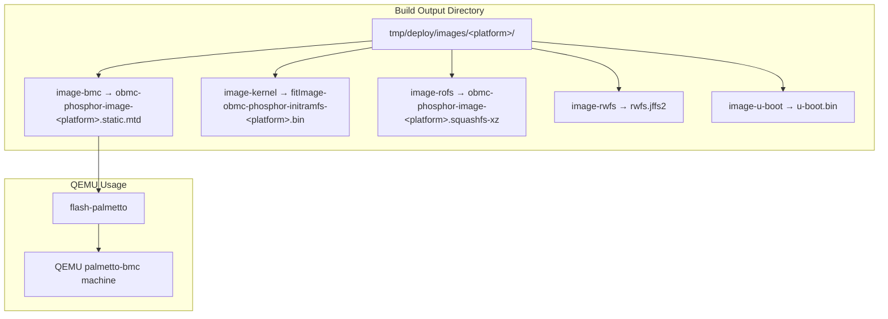
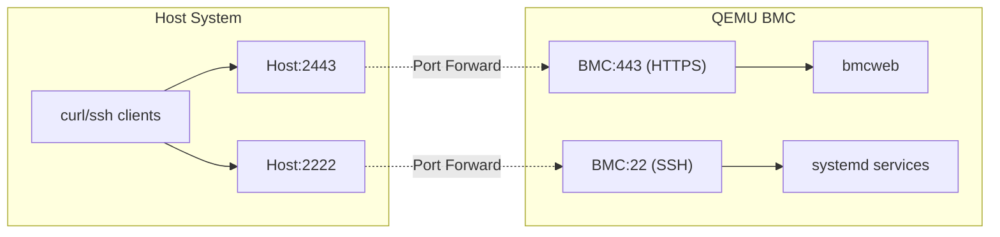
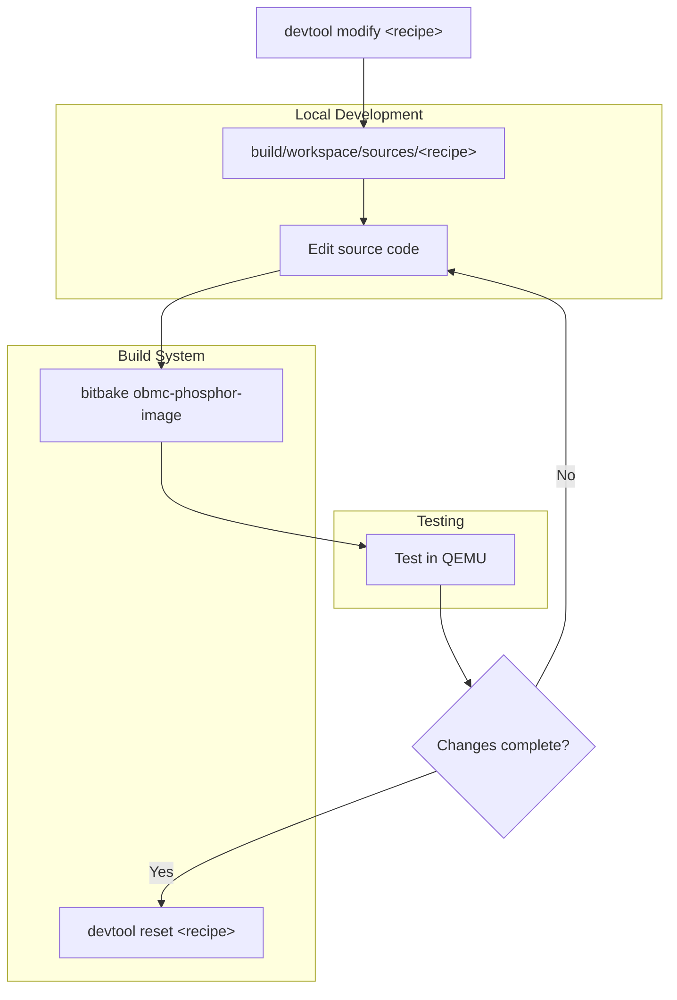
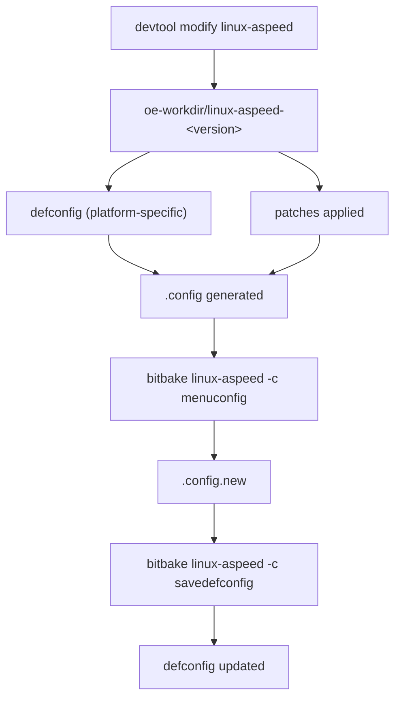
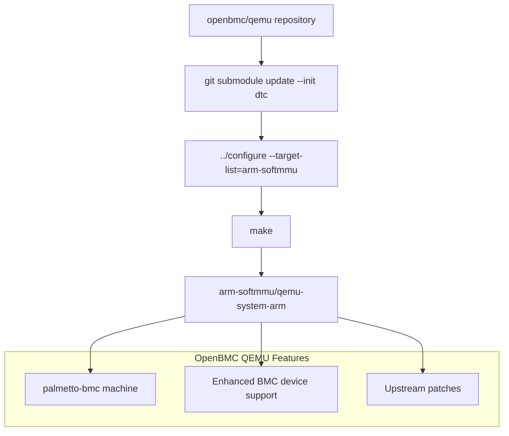

<!-- source: DeepWiki mcp.deepwiki.com · repo NVIDIA/nvbmc-docs · page 2.2 Building and Testing with QEMU · fetched 2026-10-26 -->

# Building and Testing with QEMU

<details>
<summary>Relevant source files</summary>

The following files were used as context for generating this wiki page:

- [Makefile](Makefile)
- [architecture/code-update/code-update-deprecated.md](architecture/code-update/code-update-deprecated.md)
- [architecture/code-update/flash-layout.md](architecture/code-update/flash-layout.md)
- [cheatsheet.md](cheatsheet.md)
- [userguide/userguide.tex](userguide/userguide.tex)

</details>


This document covers building OpenBMC images and using QEMU emulation for development and testing. It provides practical guidance for setting up a development environment that allows rapid iteration without requiring physical BMC hardware.

For information about the overall development environment setup, see [Development Environment Setup](#2.1). For details about core OpenBMC architecture and services, see [Core Architecture](#3).

## Purpose and Scope

QEMU provides hardware emulation that enables OpenBMC development and testing without physical BMC hardware. This approach accelerates development cycles by allowing developers to:

- Build and test OpenBMC images locally
- Iterate quickly on code changes using `devtool`
- Validate functionality through network interfaces
- Debug issues in a controlled environment

## Building OpenBMC Images

### Basic Image Build

OpenBMC uses the Yocto build system with BitBake to create BMC firmware images. The primary target for QEMU testing is `obmc-phosphor-image`.

```bash
# Set up build environment for specific platform
cd openbmc
TEMPLATECONF=meta-ibm/meta-palmetto/conf . openbmc-env
bitbake obmc-phosphor-image
```

### Platform-Specific Builds

Different BMC platforms require specific machine configurations. The build system supports multiple targets:

```bash
# Building for Palmetto (AST2400-based)
TEMPLATECONF=meta-ibm/meta-palmetto/conf . openbmc-env
bitbake obmc-phosphor-image

# Building for Zaius (AST2500-based)  
TEMPLATECONF=meta-ingrasys/meta-zaius/conf . openbmc-env
bitbake obmc-phosphor-image
```

**Build Output Structure**



Sources: [cheatsheet.md:25-45](), [architecture/code-update/code-update-deprecated.md:13-36]()

### Machine Configuration Override

When building systems with multiple machine configurations, specify the target machine explicitly:

```bash
cd openbmc
TEMPLATECONF=meta-<layer>/meta-<system>/conf . openbmc-env
export MACHINE="machineB"
bitbake obmc-phosphor-image
```

Sources: [cheatsheet.md:47-61]()

## QEMU Setup and Configuration

### Standard QEMU Execution

OpenBMC provides QEMU machine definitions that emulate BMC hardware. The `palmetto-bmc` machine type supports core BMC functionality:

```bash
qemu-system-arm -m 256 -M palmetto-bmc -nographic \
  -drive file=<path>/flash-palmetto,format=raw,if=mtd \
  -net nic \
  -net user,hostfwd=:127.0.0.1:2222-:22,hostfwd=:127.0.0.1:2443-:443,hostname=qemu
```

**QEMU Network Access Configuration**



Sources: [cheatsheet.md:99-125]()

### Network Access Methods

**SSH Access:**
```bash
ssh -p 2222 root@localhost
```

**REST API Access:**
```bash
curl -c cjar -b cjar -k -H "Content-Type: application/json" \
  -X POST https://localhost:2443/login \
  -d "{\"data\": [ \"root\", \"0penBmc\" ] }"
```

**Console Access:**
The QEMU console provides direct access to the BMC system. Use `Ctrl-a c` to switch to QEMU monitor and `quit` to exit.

Sources: [cheatsheet.md:114-124]()

### Bridge Network Configuration

For more advanced networking that avoids port forwarding, configure a bridge interface:

```bash
# Install required packages
apt-get install libvirt libvirt-bin bridge-utils uml-utilities qemu-system-common

# Run with bridge network
qemu-system-arm -m 256 -M palmetto-bmc -nographic \
  -drive file=<path>/flash-palmetto,format=raw,if=mtd \
  -net nic,macaddr=C0:FF:EE:00:00:02,model=ftgmac100 \
  -net bridge,id=net0,helper=/usr/lib/qemu-bridge-helper,br=virbr0
```

Sources: [cheatsheet.md:139-151]()

## Development Workflow with devtool

### devtool Overview

The `devtool` utility enables efficient development by creating local working copies of OpenBMC components. This allows modification and testing without rebuilding entire images.

**devtool Development Cycle**



Sources: [cheatsheet.md:258-276]()

### IPMI Development Example

For modifying IPMI functionality using the `phosphor-ipmi-host` component:

```bash
# Create local development copy
devtool modify phosphor-ipmi-host

# Modify code in workspace
cd build/workspace/sources/phosphor-ipmi-host
# Make changes to source files

# Build with changes
bitbake obmc-phosphor-image
# or build specific component
bitbake phosphor-ipmi-host

# Test by copying changed binary to running BMC
scp build/workspace/sources/phosphor-ipmi-host/oe-workdir/package/usr/lib/ipmid-providers/libapphandler.so.0.0.0 \
  root@bmc:/usr/lib/ipmid-providers/
systemctl restart phosphor-ipmi-host.service
```

Sources: [cheatsheet.md:280-312]()

### Kernel Development Workflow

Linux kernel development requires special handling due to patch application and configuration management:

```bash
# Create kernel workspace (creates dev-4.13 branch, applies patches)
devtool modify linux-aspeed

# Build kernel
bitbake linux-aspeed -c build

# Modify kernel configuration
bitbake linux-aspeed -c menuconfig
bitbake linux-aspeed -c savedefconfig
```

**Kernel Configuration Management**



Sources: [cheatsheet.md:314-347]()

## Testing and Validation

### Rapid Kernel Testing

For faster kernel testing cycles, use network loading instead of flashing complete images:

```bash
# Put fitImage on TFTP server
cp build/tmp/deploy/images/romulus/fitImage-obmc-phosphor-initramfs-romulus.bin /tftpboot/fitImage

# In U-Boot console:
setenv ethaddr <mac:addr>
setenv ipaddr 192.168.0.80
setenv serverip 192.168.0.11  
tftp 0x83000000 fitImage
bootm 0x83000000
```

This approach loads the kernel directly into RAM, bypassing flash operations and significantly reducing test iteration time.

Sources: [cheatsheet.md:349-370]()

### Host System Control

Once OpenBMC is running in QEMU, test host management functionality:

```bash
# Login to BMC
curl -c cjar -k -X POST -H "Content-Type: application/json" \
  -d '{"data": [ "root", "0penBmc" ] }' https://${bmc}/login

# Power on host system
curl -c cjar -b cjar -k -H "Content-Type: application/json" -X PUT \
  -d '{"data": "xyz.openbmc_project.State.Host.Transition.On"}' \
  https://${bmc}/xyz/openbmc_project/state/host0/attr/RequestedHostTransition

# Access host console
ssh -p 2200 root@bmc
```

Sources: [cheatsheet.md:158-175]()

### D-Bus Interface Testing

QEMU provides an excellent environment for testing D-Bus interfaces using `busctl`:

```bash
# Example D-Bus command execution
busctl call <path> <interface> <object> <method> <parameters>
```

This enables testing of OpenBMC's core D-Bus communication without physical hardware dependencies.

Sources: [cheatsheet.md:81-98]()

## Building Custom QEMU

If the system QEMU lacks required BMC machine support, build OpenBMC's enhanced QEMU version:

```bash
git clone https://github.com/openbmc/qemu.git
cd qemu
git submodule update --init dtc
mkdir build
cd build
../configure --target-list=arm-softmmu
make
```

The built executable is located at `arm-softmmu/qemu-system-arm`.

**QEMU Build Dependencies**



Sources: [cheatsheet.md:126-137]()

## SDK Development

For cross-compilation development, build the OpenBMC SDK:

```bash
bitbake -c populate_sdk obmc-phosphor-image
./tmp/deploy/sdk/openbmc-phosphor-glibc-x86_64-obmc-phosphor-image-armv5e-toolchain-2.1.sh

# Setup development environment
. /opt/openbmc-phosphor/2.1/environment-setup-armv5e-openbmc-linux-gnueabi
```

The SDK provides cross-compilation tools and debugging capabilities including GDB with debug symbols for troubleshooting BMC applications.

Sources: [cheatsheet.md:62-71](), [cheatsheet.md:177-191]()

---

