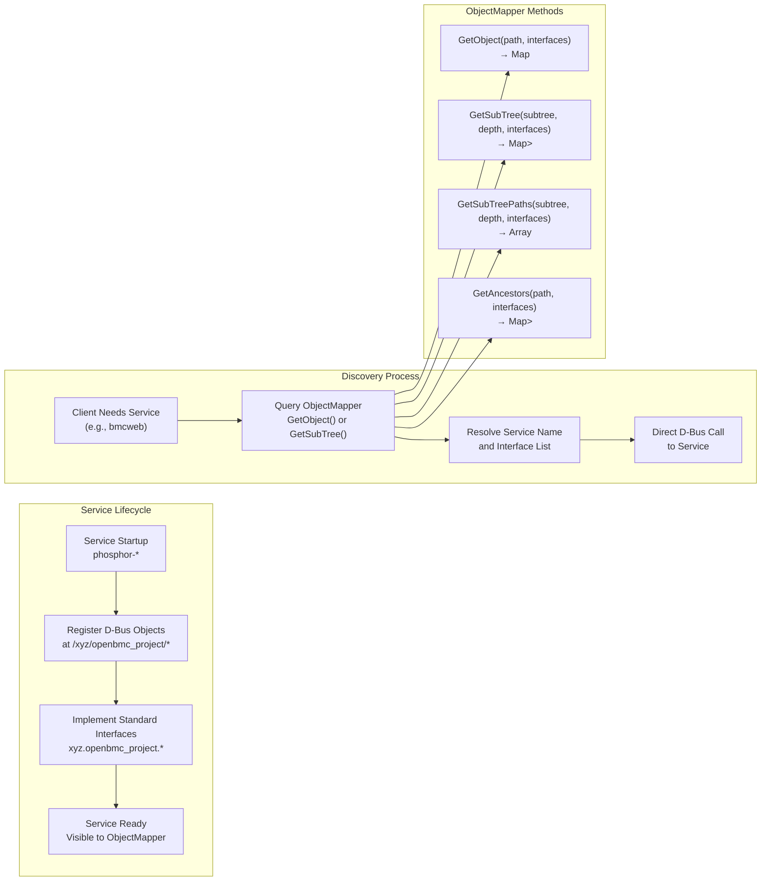
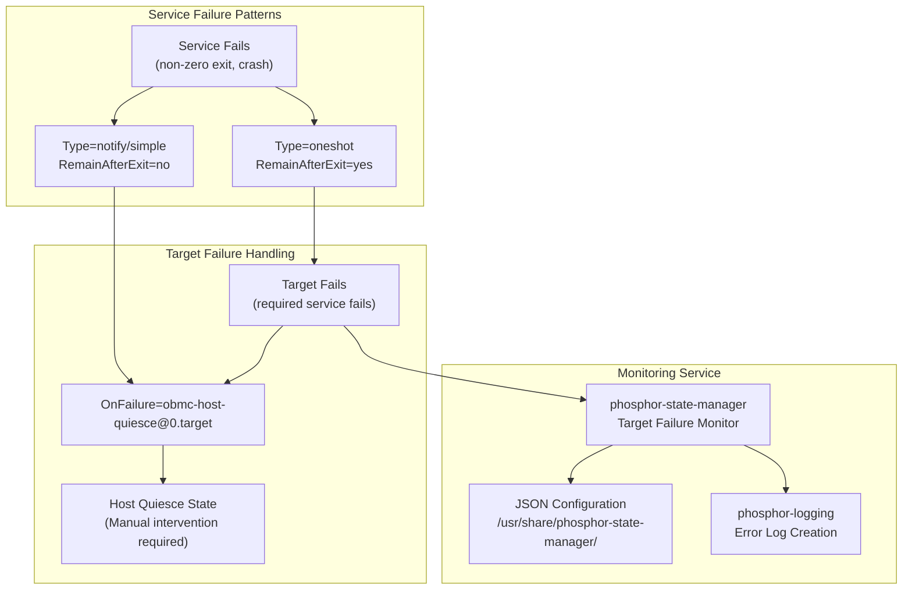
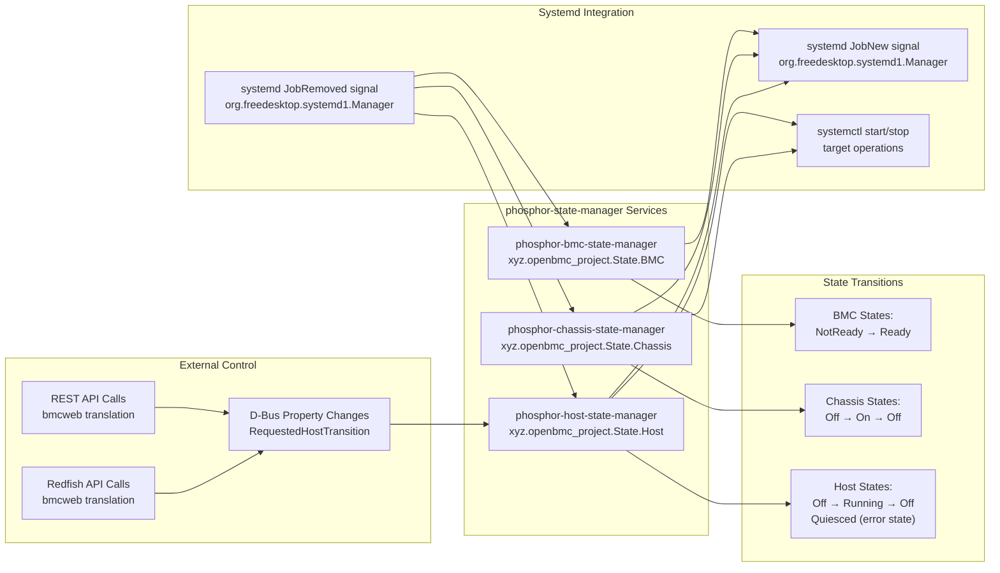

<!-- source: DeepWiki mcp.deepwiki.com · repo NVIDIA/nvbmc-docs · page 3 Core Architecture · fetched 2026-10-26 -->

# Core Architecture

<details>
<summary>Relevant source files</summary>

The following files were used as context for generating this wiki page:

- [architecture/object-mapper.md](architecture/object-mapper.md)
- [architecture/openbmc-systemd.md](architecture/openbmc-systemd.md)
- [designs/target-fail-monitoring.md](designs/target-fail-monitoring.md)
- [yocto-development.md](yocto-development.md)

</details>


This document describes OpenBMC's internal architecture, focusing on the D-Bus communication system, systemd process management, and core service design patterns. It covers how services discover and interact with each other, and how the system coordinates startup, shutdown, and state transitions.

For information about external management interfaces (REST, Redfish, IPMI), see [Management Interfaces](#4). For platform-specific protocols like PLDM and MCTP, see [Platform Protocols](#5). For build system and development environment details, see [Getting Started](#2).

## Architecture Overview

OpenBMC's core architecture is built around three fundamental components: D-Bus for inter-process communication, systemd for process lifecycle management, and the Object Mapper for service discovery. This creates a service-oriented architecture where applications communicate through well-defined D-Bus interfaces rather than direct inter-process communication.

### Core Communication Model

```mermaid
graph TB
    subgraph "External Management Layer"
        bmcweb["bmcweb<br/>(Web/REST/Redfish Server)"]
        SSH["SSH Console Access"]
        IPMI["IPMI Interface"]
    end
    
    subgraph "D-Bus Communication Hub"
        DBus[("D-Bus System Bus<br/>org.freedesktop.DBus")]
        ObjectMapper["xyz.openbmc_project.ObjectMapper<br/>(Service Discovery)"]
    end
    
    subgraph "Core Management Services"
        StateManager["phosphor-state-manager<br/>xyz.openbmc_project.State.*"]
        UserManager["phosphor-user-manager<br/>xyz.openbmc_project.User.Manager"]
        EntityManager["entity-manager<br/>xyz.openbmc_project.EntityManager"]
        InventoryManager["phosphor-inventory-manager<br/>xyz.openbmc_project.Inventory.Manager"]
    end
    
    subgraph "Hardware Interface Services"
        HwmonTempd["phosphor-hwmon<br/>xyz.openbmc_project.Hwmon.*"]
        GPIODaemon["phosphor-gpio-monitor<br/>xyz.openbmc_project.Gpio.*"]
        SensorDaemon["dbus-sensors<br/>xyz.openbmc_project.Sensor.*"]
    end
    
    subgraph "Systemd Process Manager"
        SystemdManager["systemd<br/>org.freedesktop.systemd1.Manager"]
        SystemdTargets["systemd targets<br/>(obmc-*.target)"]
    end
    
    %% External to D-Bus connections
    bmcweb --> DBus
    SSH --> DBus
    IPMI --> DBus
    
    %% D-Bus service discovery
    ObjectMapper --> DBus
    
    %% Core services to D-Bus
    StateManager --> DBus
    UserManager --> DBus
    EntityManager --> DBus
    InventoryManager --> DBus
    
    %% Hardware services to D-Bus
    HwmonTempd --> DBus
    GPIODaemon --> DBus
    SensorDaemon --> DBus
    
    %% Systemd coordination
    SystemdManager --> DBus
    SystemdTargets --> SystemdManager
    StateManager --> SystemdManager
    
    %% Service discovery relationships
    bmcweb --> ObjectMapper
    StateManager --> ObjectMapper
    EntityManager --> ObjectMapper
```



**Sources:** [architecture/openbmc-systemd.md:1-295](), [architecture/object-mapper.md:1-281]()

## D-Bus Communication System

D-Bus serves as the central communication hub for all OpenBMC services. Services register objects at well-defined paths and implement standardized interfaces to expose their functionality. The system uses the `xyz.openbmc_project.*` namespace for all OpenBMC-specific interfaces.

### Service Registration and Discovery



**Sources:** [architecture/object-mapper.md:13-199]()

### Common D-Bus Interface Patterns

| Interface Category | Interface Name | Purpose | Typical Object Path |
|-------------------|----------------|---------|-------------------|
| State Management | `xyz.openbmc_project.State.Host` | Host power state control | `/xyz/openbmc_project/state/host0` |
| State Management | `xyz.openbmc_project.State.Chassis` | Chassis power state control | `/xyz/openbmc_project/state/chassis0` |
| State Management | `xyz.openbmc_project.State.BMC` | BMC ready state tracking | `/xyz/openbmc_project/state/bmc0` |
| Sensor Data | `xyz.openbmc_project.Sensor.Value` | Sensor reading interface | `/xyz/openbmc_project/sensors/temperature/cpu0` |
| Sensor Thresholds | `xyz.openbmc_project.Sensor.Threshold.Warning` | Warning threshold interface | `/xyz/openbmc_project/sensors/temperature/cpu0` |
| Inventory | `xyz.openbmc_project.Inventory.Item` | Hardware inventory item | `/xyz/openbmc_project/inventory/system/chassis/motherboard` |
| User Management | `xyz.openbmc_project.User.Manager` | User account management | `/xyz/openbmc_project/user` |
| Association | `xyz.openbmc_project.Association.Definitions` | Object relationship definitions | Various paths |

**Sources:** [architecture/object-mapper.md:17-52](), [architecture/object-mapper.md:200-280]()

## Systemd Process Management

OpenBMC uses systemd to manage all processes and coordinate system state transitions. The system defines custom targets and services that control which processes are started for different operational states.

### Systemd Target Hierarchy

```mermaid
graph TD
    subgraph "Boot Process"
        DefaultTarget["default.target<br/>(symlink to multi-user.target)"]
        MultiUserTarget["multi-user.target<br/>(BMC basic services)"]
        PhosphorServices["phosphor-* services<br/>(D-Bus services)"]
    end
    
    subgraph "Host Power Management"
        HostStart["obmc-host-start@0.target<br/>(Full host boot)"]
        HostStartMin["obmc-host-startmin@0.target<br/>(Minimal host boot)"]
        ChassisOn["obmc-chassis-poweron@0.target<br/>(Chassis power on)"]
        StartHostService["start_host@0.service"]
        OpPowerStart["op-power-start@0.service"]
        OpWaitPowerOn["op-wait-power-on@0.service"]
    end
    
    subgraph "Host Shutdown"
        HostShutdown["obmc-host-shutdown@0.target<br/>(Soft shutdown)"]
        HostStop["obmc-host-stop@0.target"]
        ChassisOff["obmc-chassis-poweroff@0.target"]
        OpPowerStop["op-power-stop@0.service"]
    end
    
    subgraph "Error Handling"
        HostQuiesce["obmc-host-quiesce@0.target<br/>(Error state)"]
        ChassisEmergencyOff["obmc-chassis-emergency-poweroff@0.target<br/>(Emergency shutdown)"]
        ChassisHardOff["obmc-chassis-hard-poweroff@0.target<br/>(Force power off)"]
    end
    
    %% Boot dependencies
    DefaultTarget --> MultiUserTarget
    MultiUserTarget --> PhosphorServices
    
    %% Host start dependencies
    HostStart --> HostStartMin
    HostStart --> "phosphor-reset-host-reboot-attempts@0.service"
    HostStartMin --> ChassisOn
    HostStartMin --> StartHostService
    ChassisOn --> OpPowerStart
    ChassisOn --> OpWaitPowerOn
    
    %% Shutdown dependencies
    HostShutdown --> HostStop
    HostStop --> ChassisOff
    ChassisOff --> OpPowerStop
    
    %% Error handling
    HostQuiesce -.-> "OnFailure paths"
    ChassisEmergencyOff --> ChassisHardOff
    ChassisEmergencyOff --> HostQuiesce
```

**Sources:** [architecture/openbmc-systemd.md:28-120]()

### Service Dependencies and Failure Handling

OpenBMC defines clear error handling policies for systemd services and targets. The system uses `OnFailure` directives to route failed services to appropriate recovery targets.



**Sources:** [architecture/openbmc-systemd.md:153-220](), [designs/target-fail-monitoring.md:78-138]()

## Core Service Interactions

Core OpenBMC services follow established patterns for state management, event notification, and error handling. Services implement state machine patterns and coordinate through D-Bus signals and method calls.

### State Management Service Design



**Sources:** [architecture/openbmc-systemd.md:122-136]()

### Service Discovery and Object Relationships

The Object Mapper enables loose coupling between services by providing dynamic service discovery. Services can find and interact with other services without hard-coded dependencies.

```mermaid
graph TB
    subgraph "Association Framework"
        AssociationDefs["xyz.openbmc_project.Association.Definitions<br/>Associations property"]
        ForwardAssoc["Forward Association Object<br/>pathA/foo"]
        ReverseAssoc["Reverse Association Object<br/>pathB/bar"]
        EndpointsProperty["endpoints property<br/>Array of object paths"]
    end
    
    subgraph "Example: Error Log to Inventory"
        ErrorLog["/xyz/openbmc_project/logging/entry/3<br/>Error log object"]
        PowerSupply["/xyz/openbmc_project/inventory/system/chassis/motherboard/powersupply0<br/>Inventory item"]
        CalloutAssoc["/xyz/openbmc_project/logging/entry/3/callout<br/>Forward association"]
        FaultAssoc["/xyz/openbmc_project/inventory/system/chassis/motherboard/powersupply0/fault<br/>Reverse association"]
    end
    
    subgraph "Service Discovery Pattern"
        ClientQuery["Client needs service implementing<br/>xyz.openbmc_project.Sensor.Value"]
        MapperQuery["ObjectMapper.GetSubTree(<br/>'/xyz/openbmc_project/sensors',<br/>0,<br/>['xyz.openbmc_project.Sensor.Value'])"]
        ServiceList["Returns: Map of sensor paths<br/>to service names"]
        DirectCall["Client makes direct D-Bus call<br/>to discovered service"]
    end
    
    AssociationDefs --> ForwardAssoc
    AssociationDefs --> ReverseAssoc
    ForwardAssoc --> EndpointsProperty
    ReverseAssoc --> EndpointsProperty
    
    ErrorLog --> CalloutAssoc
    PowerSupply --> FaultAssoc
    CalloutAssoc --> PowerSupply
    FaultAssoc --> ErrorLog
    
    ClientQuery --> MapperQuery
    MapperQuery --> ServiceList
    ServiceList --> DirectCall
```



**Sources:** [architecture/object-mapper.md:200-279](), [architecture/object-mapper.md:54-138]()

This architecture provides a flexible, maintainable system where services can be developed independently while maintaining well-defined interfaces for communication and coordination.

---

