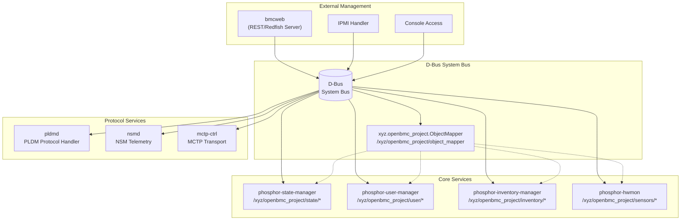
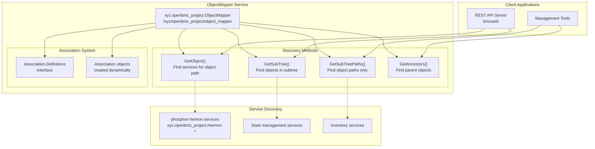
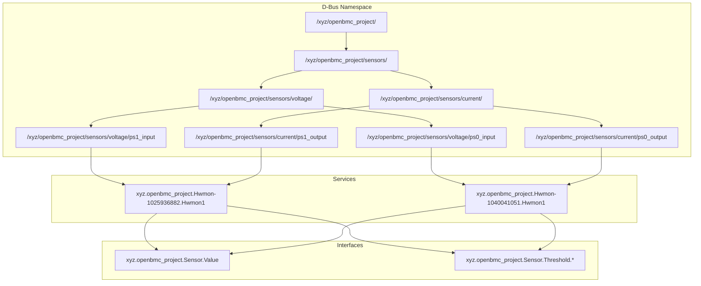
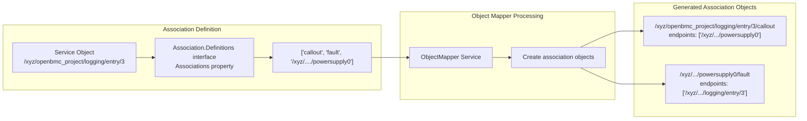

<!-- source: DeepWiki mcp.deepwiki.com · repo NVIDIA/nvbmc-docs · page 3.1 D-Bus and Object Mapper · fetched 2026-10-26 -->

# D-Bus and Object Mapper

<details>
<summary>Relevant source files</summary>

The following files were used as context for generating this wiki page:

- [MAINTAINERS](MAINTAINERS)
- [architecture/object-mapper.md](architecture/object-mapper.md)
- [rest-api.md](rest-api.md)
- [yocto-development.md](yocto-development.md)

</details>


This document covers OpenBMC's central D-Bus communication system and the Object Mapper service that provides discovery and association functionality. Together, these form the backbone of inter-service communication in OpenBMC, enabling external management interfaces to discover and interact with hardware-specific services.

For information about specific management interfaces that use D-Bus, see [REST API](#4.1), [Redfish API](#4.2), and [IPMI Interface](#4.3). For details on hardware abstraction layers, see [Hardware Interfaces and GPIO](#3.4).

## D-Bus Communication Architecture

D-Bus serves as the central communication hub in OpenBMC, connecting external management interfaces with core services and hardware abstraction layers. The system uses a standardized namespace structure under `/xyz/openbmc_project/` for all OpenBMC-specific objects and interfaces.

**D-Bus Communication Flow**


The REST API directly maps to the D-Bus object hierarchy, where each REST endpoint corresponds to a D-Bus object path. External clients can discover services through the Object Mapper and interact with them using standard D-Bus method calls and property access.

Sources: [rest-api.md:6-8](), [architecture/object-mapper.md:1-12]()

## Object Mapper Service

The `xyz.openbmc_project.ObjectMapper` service provides D-Bus discovery and object association functionality. It runs at the well-known path `/xyz/openbmc_project/object_mapper` and implements methods for finding services, objects, and their relationships.

**Object Mapper Core Functions**


The Object Mapper maintains a real-time view of all D-Bus services and their implemented interfaces, enabling dynamic service discovery without requiring static configuration.

Sources: [architecture/object-mapper.md:1-12](), [architecture/object-mapper.md:13-16]()

## Discovery Methods

The Object Mapper provides four primary methods for D-Bus object and service discovery, each optimized for different use cases.

### GetObject Method

The `GetObject` method finds all services that implement a specific object path, returning a map of service names to their interfaces.

```
Input: object path, optional interface filter
Output: Map[service_name] -> Array[interface_names]
```

**Example Usage:**
```
GetObject("/xyz/openbmc_project/sensors/voltage/ps1_input_voltage", [])
Returns: {
  "xyz.openbmc_project.Hwmon-1025936882.Hwmon1": [
    "xyz.openbmc_project.Sensor.Threshold.Critical",
    "xyz.openbmc_project.Sensor.Threshold.Warning", 
    "xyz.openbmc_project.Sensor.Value"
  ]
}
```

### GetSubTree Method

The `GetSubTree` method discovers all objects within a D-Bus subtree that implement specified interfaces, with configurable depth limits.

```
Input: subtree_root, depth, interface_filter
Output: Map[object_path] -> Map[service_name] -> Array[interface_names]  
```

**GetSubTree Discovery Pattern**


### GetSubTreePaths and GetAncestors

The `GetSubTreePaths` method returns only object paths from `GetSubTree`, optimized for cases where service details aren't needed. The `GetAncestors` method finds parent objects that implement specific interfaces.

Sources: [architecture/object-mapper.md:17-52](), [architecture/object-mapper.md:54-108](), [architecture/object-mapper.md:110-137](), [architecture/object-mapper.md:139-198]()

## Association System

The Object Mapper creates dynamic association objects to link related D-Bus objects bidirectionally. Services implement the `xyz.openbmc_project.Association.Definitions` interface and populate the `Associations` property to create these links.

**Association Creation Process**


Association tuples follow the format `[forward_name, reverse_name, target_object_path]`. The Object Mapper creates two association objects: one at the source object with the forward name, and one at the target object with the reverse name. Both implement the `xyz.openbmc_project.Association` interface with an `endpoints` property containing the associated object paths.

**Association Lifecycle Management:**
- Association objects match the lifetime of their associated objects
- When an object is deleted, its association objects are also removed
- If a target object disappears from D-Bus, associations are temporarily removed until it reappears
- Multiple objects can associate with the same target, creating arrays of endpoints

Sources: [architecture/object-mapper.md:200-246](), [architecture/object-mapper.md:248-280]()

## Service Integration Patterns

The D-Bus and Object Mapper system enables several key integration patterns used throughout OpenBMC.

### REST API Integration

The bmcweb service translates REST API calls directly to D-Bus operations, using the Object Mapper for service discovery. The URL structure mirrors the D-Bus object hierarchy exactly.

**REST to D-Bus Mapping:**
- `GET /xyz/openbmc_project/inventory/system` → D-Bus property read
- `PUT /xyz/openbmc_project/state/host0/attr/RequestedHostTransition` → D-Bus property write  
- `POST /xyz/openbmc_project/logging/action/DeleteAll` → D-Bus method call

### Dynamic Service Discovery

Services use Object Mapper methods to find dependencies at runtime rather than using static configuration:

```
# Find all temperature sensors
GetSubTree("/xyz/openbmc_project/sensors/temperature", 0, 
          ["xyz.openbmc_project.Sensor.Value"])

# Find inventory item for a specific component  
GetObject("/xyz/openbmc_project/inventory/system/chassis/motherboard/cpu0", 
         ["xyz.openbmc_project.Inventory.Item"])
```

### Event Correlation Through Associations

Error logs use associations to link with failing components, enabling automated fault isolation:

```
Error Log → "callout" association → Hardware Component
Hardware Component → "fault" association → Error Log
```

This bidirectional linking allows management software to navigate from errors to components and from components to their associated errors.

Sources: [rest-api.md:6-8](), [rest-api.md:25-96](), [architecture/object-mapper.md:248-280]()

---

