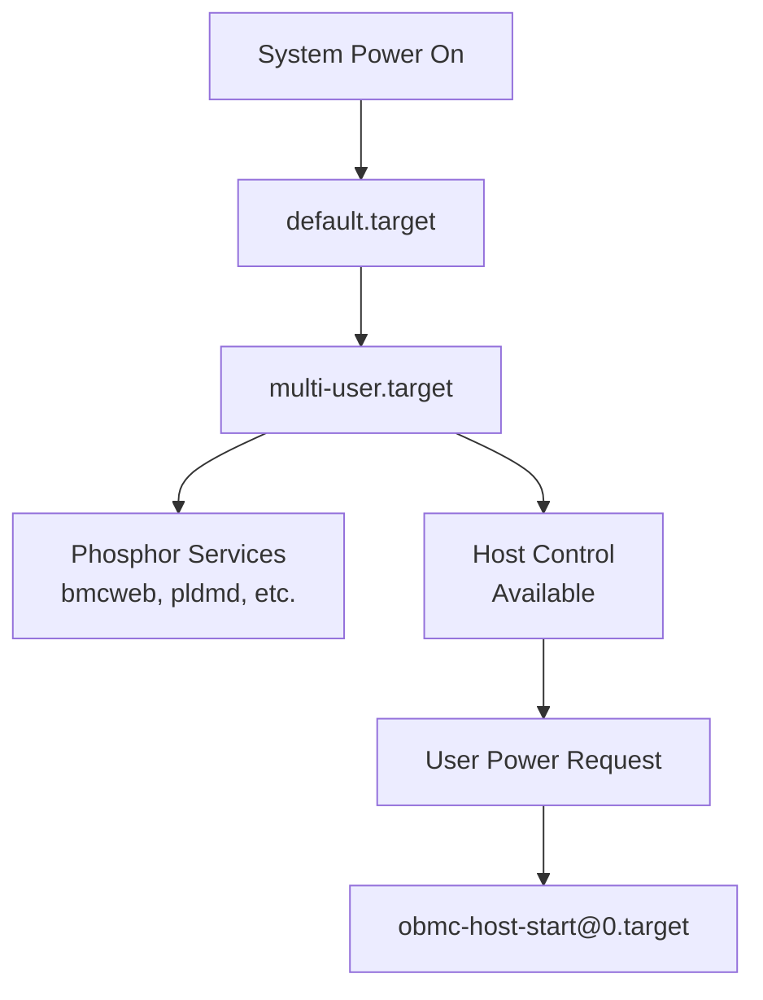
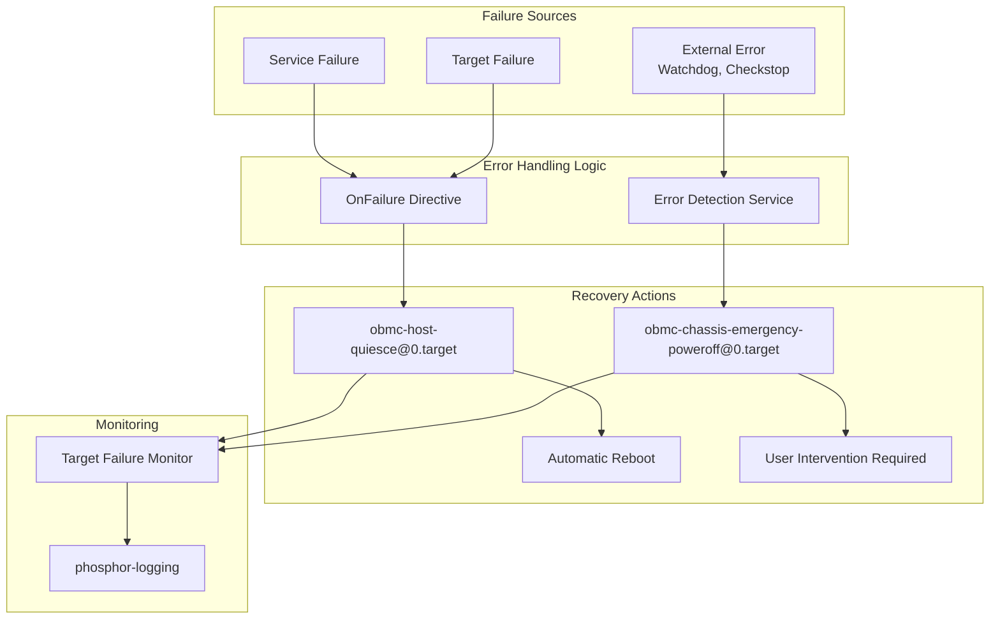
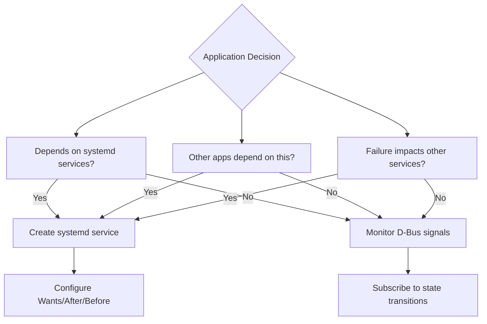
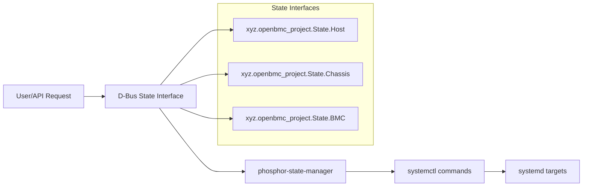
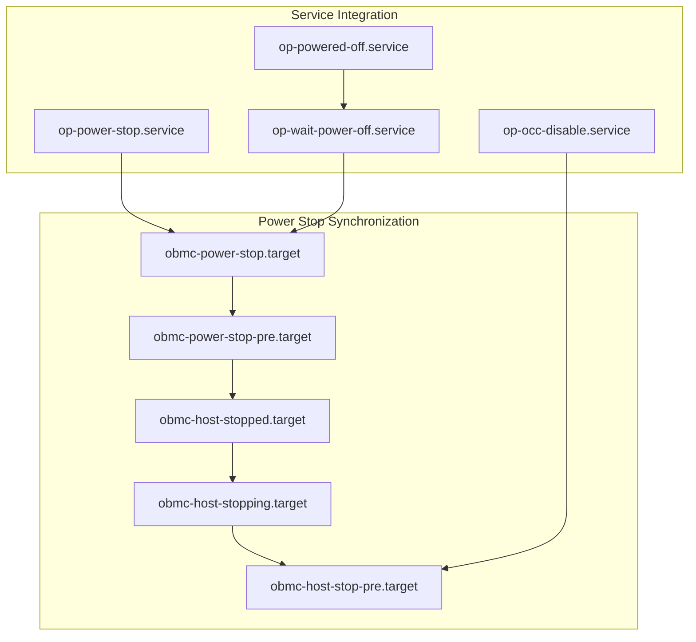

<!-- source: DeepWiki mcp.deepwiki.com · repo NVIDIA/nvbmc-docs · page 3.2 System State Management · fetched 2026-10-26 -->

# System State Management

<details>
<summary>Relevant source files</summary>

The following files were used as context for generating this wiki page:

- [architecture/openbmc-systemd.md](architecture/openbmc-systemd.md)
- [designs/target-fail-monitoring.md](designs/target-fail-monitoring.md)

</details>


This document covers how OpenBMC uses systemd for process management, state transitions, and error handling. It explains the systemd targets and services that control system lifecycle, power management, and failure recovery mechanisms.

For information about D-Bus communication between services, see [D-Bus and Object Mapper](#3.1). For details about user authentication and security, see [User Management and Security](#3.3).

## Systemd Integration Overview

OpenBMC uses systemd as its primary process manager and service orchestrator. All system processes are managed through systemd units, which provide dependency management, failure handling, and coordinated state transitions.

### Core Systemd Concepts

OpenBMC leverages three main systemd unit types:

| Unit Type | Purpose | OpenBMC Usage |
|-----------|---------|---------------|
| **Service** | Define processes to run | Individual daemons like `pldmd`, `bmcweb` |
| **Target** | Synchronization points | Power state transitions, system milestones |
| **Unit** | Base framework | Foundation for all systemd operations |

The systemd units are located in `/lib/systemd/system/`, `/etc/systemd/system/`, and `/run/systemd/system/`.

**Sources:** [architecture/openbmc-systemd.md:1-26]()

## System State Transitions

### Initial System Boot



When OpenBMC first receives power, it starts `default.target`, which links to `multi-user.target`. This target brings up all core OpenBMC services and makes the system ready for host management operations.

**Sources:** [architecture/openbmc-systemd.md:28-34]()

### Host Power Management Targets

```mermaid
graph TD
    subgraph "Power On Sequence"
        HostStart["obmc-host-start@0.target"] --> HostStartMin["obmc-host-startmin@0.target"]
        HostStart --> RebootAttempts["phosphor-reset-host-reboot-attempts@0.service"]
        
        HostStartMin --> ChassisPowerOn["obmc-chassis-poweron@0.target"]
        HostStartMin --> StartHost["start_host@0.service"]
        
        ChassisPowerOn --> PowerStart["op-power-start@0.service"]
        ChassisPowerOn --> WaitPowerOn["op-wait-power-on@0.service"]
    end
    
    subgraph "Power Off Sequence"
        SoftShutdown["obmc-host-shutdown@0.target"] --> ChassisOff["obmc-chassis-poweroff@0.target"]
        HardShutdown["obmc-chassis-hard-poweroff@0.target"]
        
        ChassisOff --> HostStop["obmc-host-stop@0.target"]
        ChassisOff --> PowerStop["op-power-stop@0.service"]
        ChassisOff --> WaitPowerOff["op-wait-power-off@0.service"]
    end
    
    subgraph "Error Handling"
        Quiesce["obmc-host-quiesce@0.target"]
        Emergency["obmc-chassis-emergency-poweroff@0.target"]
        Emergency --> HardShutdown
        Emergency --> Quiesce
    end
    
    subgraph "Reboot"
        Reboot["obmc-host-reboot@0.target"] --> SoftShutdown
        SoftShutdown --> HostStartMin
    end
```

OpenBMC implements distinct targets for different power management operations:

- **`obmc-host-start@.target`**: Full host power-on with all services
- **`obmc-host-startmin@.target`**: Minimal host power-on for reboots
- **`obmc-host-shutdown@.target`**: Graceful host shutdown
- **`obmc-chassis-hard-poweroff@.target`**: Immediate power cut
- **`obmc-host-reboot@.target`**: Complete reboot cycle

**Sources:** [architecture/openbmc-systemd.md:35-101]()

## Error Handling and Recovery

### Failure Detection and Response



OpenBMC implements a comprehensive error handling strategy:

### Service Failure Handling

Services follow specific patterns for failure management:

| Service Type | Failure Behavior | Configuration |
|--------------|------------------|---------------|
| `Type=oneshot` | Target fails if service fails | `OnFailure=obmc-host-quiesce@.target` |
| Long-running | Service restart or failure action | `OnFailure` directive |
| Critical services | `RequiredBy` target dependency | Immediate target failure |

### Target Failure Monitoring

The system implements automated target failure monitoring through a dedicated service that:

1. Monitors systemd JobRemoved signals
2. Detects failure statuses: `timeout`, `failed`, `dependency`
3. Logs structured errors to `phosphor-logging`
4. Triggers appropriate recovery actions

**Sources:** [architecture/openbmc-systemd.md:153-210](), [designs/target-fail-monitoring.md:1-142]()

## Service Lifecycle Management

### Service vs. Monitoring Application Guidelines



OpenBMC provides clear guidelines for when to implement functionality as systemd services versus D-Bus monitoring applications.

### Service Configuration Patterns

**Best Practices:**
- Use `Type=oneshot` with `RemainAfterExit=yes` when possible
- Set `OnFailure=obmc-host-quiesce@.target` for host-related services
- Use `RequiredBy` for critical dependencies, `WantedBy` for optional ones

**Sources:** [architecture/openbmc-systemd.md:137-152](), [architecture/openbmc-systemd.md:211-220]()

## D-Bus State Control Interface

### Abstraction Layer

OpenBMC provides D-Bus interfaces that abstract systemd complexity:



Example host power-on request:
```bash
busctl set-property xyz.openbmc_project.State.Host \
    /xyz/openbmc_project/state/host0 \
    xyz.openbmc_project.State.Host RequestedHostTransition s \
    xyz.openbmc_project.State.Host.Transition.On
```

This D-Bus call triggers the `obmc-host-start@0.target` systemd target execution.

**Sources:** [architecture/openbmc-systemd.md:122-136]()

## Dependency Management

### Target Synchronization

OpenBMC uses synchronization targets to coordinate complex operations:



The dependency structure uses `Wants`, `Requires`, `Before`, and `After` directives to ensure proper sequencing and failure handling.

**Sources:** [architecture/openbmc-systemd.md:221-295]()

---

