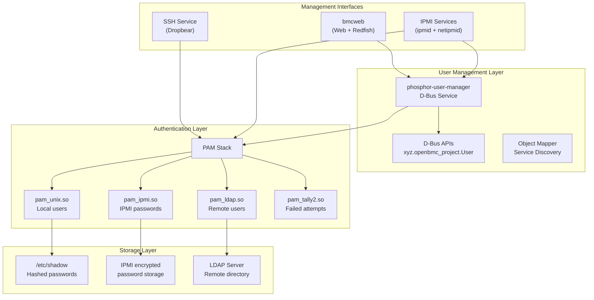
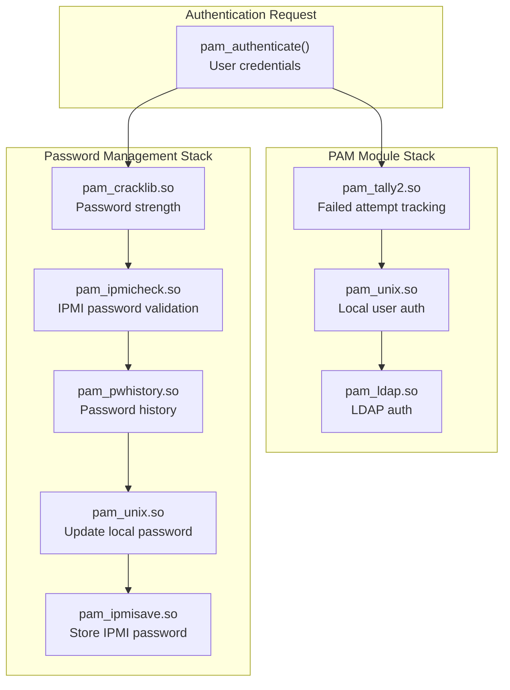
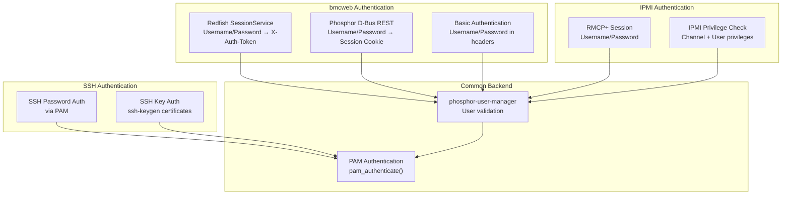
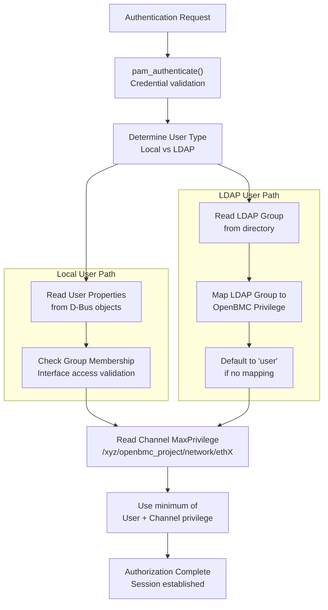
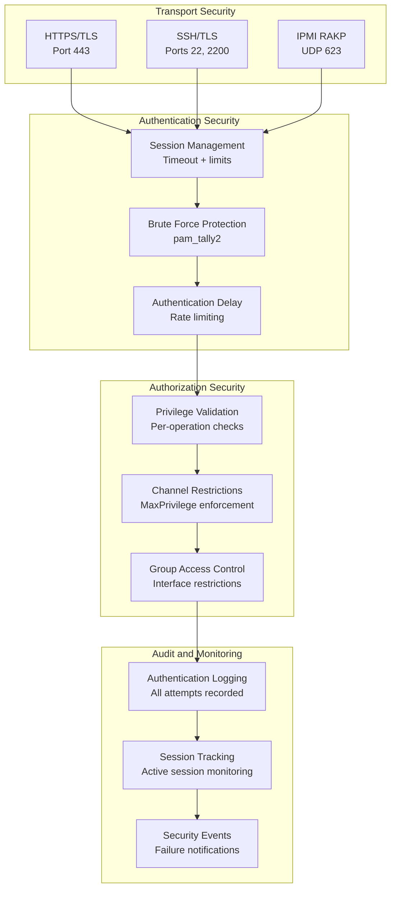
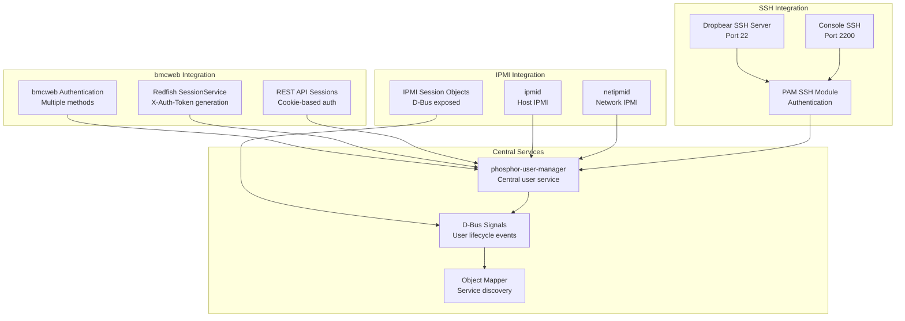

<!-- source: DeepWiki mcp.deepwiki.com · repo NVIDIA/nvbmc-docs · page 3.3 User Management and Security · fetched 2026-10-26 -->

# User Management and Security

Relevant source files

The following files were used as context for generating this wiki page:

- [architecture/ipmi-architecture.md](architecture/ipmi-architecture.md)
- [architecture/user-management.md](architecture/user-management.md)
- [features.md](features.md)
- [security/network-security-considerations.md](security/network-security-considerations.md)

## Purpose and Scope

This document describes OpenBMC's user management and security architecture, including user authentication, authorization, privilege models, and security considerations across all management interfaces. It covers the central `phosphor-user-manager` service, PAM integration, D-Bus APIs for user operations, and security protocols used by OpenBMC services.

For information about network-specific security protocols and transport layer security, see the broader network security considerations. For details about specific management interface implementations, see [REST API](#4.1), [Redfish API](#4.2), and [IPMI Interface](#4.3).

## User Management Architecture

OpenBMC uses a centralized user management approach built around the `phosphor-user-manager` service, which provides D-Bus APIs for user operations and integrates with Linux PAM for authentication.

### Core User Management System

The `phosphor-user-manager` service exposes D-Bus interfaces for user management operations while delegating authentication to the PAM stack. This design separates user management from authentication, allowing different services to use the same user accounts.

Sources: [architecture/user-management.md:67-72](), [architecture/user-management.md:76-114]()

### D-Bus Interface Design

```mermaid
graph TB
    subgraph "D-Bus Object Hierarchy"
        Manager["xyz.openbmc_project.User.Manager<br/>/xyz/openbmc_project/user"]
        UserObjects["User Objects<br/>/xyz/openbmc_project/user/<name>"]
        AccountPolicy["Account Policy<br/>Password requirements"]
    end
    
    subgraph "Manager Interface Methods"
        CreateUser["CreateUser()<br/>Add new user"]
        RenameUser["RenameUser()<br/>Change username"]
        GetUserInfo["GetUserInfo()<br/>Query user details"]
    end
    
    subgraph "User Attributes Interface"
        UserGroups["UserGroups<br/>Group memberships"]
        UserPrivilege["UserPrivilege<br/>Privilege level"]
        UserEnabled["UserEnabled<br/>Account status"]
        UserLocked["UserLockedForFailAttempt<br/>Lockout status"]
    end
    
    subgraph "Signals"
        UserRenamed["UserRenamed<br/>Username changed"]
        InterfacesAdded["InterfacesAdded<br/>User created"]
        InterfacesRemoved["InterfacesRemoved<br/>User deleted"]
    end
    
    Manager --> CreateUser
    Manager --> RenameUser
    Manager --> GetUserInfo
    
    UserObjects --> UserGroups
    UserObjects --> UserPrivilege
    UserObjects --> UserEnabled
    UserObjects --> UserLocked
    
    Manager --> UserRenamed
    Manager --> InterfacesAdded
    Manager --> InterfacesRemoved
```

The D-Bus interface design provides comprehensive user management capabilities while maintaining security by not exposing passwords over D-Bus APIs. Password operations are handled exclusively through PAM.

Sources: [architecture/user-management.md:67-72](), [architecture/user-management.md:122-151]()

## Authentication System

OpenBMC supports multiple authentication methods across different interfaces, all unified through the PAM authentication framework.

### PAM Authentication Stack

The PAM stack handles both authentication and password management. For users in the 'ipmi' group, passwords are stored in both hashed form (via `pam_unix`) and encrypted form (via `pam_ipmisave`) to support IPMI's clear-text password requirements.

Sources: [architecture/user-management.md:326-347](), [architecture/user-management.md:355-390]()

### Service Authentication Methods

Different services use appropriate authentication methods while leveraging the common `phosphor-user-manager` and PAM infrastructure.

Sources: [security/network-security-considerations.md:182-202](), [architecture/user-management.md:322-324]()

## Authorization and Privileges

OpenBMC implements a two-tier authorization model using group roles for interface access and privilege roles for operation permissions.

### Group and Privilege Model

| Group Role | Interface Access | Purpose |
|------------|------------------|---------|
| `ssh` | SSH only | Command-line access |
| `ipmi` | IPMI only | Traditional BMC management |
| `redfish` | Redfish only | Modern REST API access |
| `web` | Web interface only | Browser-based management |

| Privilege Role | Permissions | Description |
|----------------|-------------|-------------|
| `admin` | Full administrative access | All configurations and user management |
| `operator` | Basic operations | Host control, no configuration changes |
| `user` | Read-only access | View system status only |
| `no-access` | No permissions | Disabled or empty privilege |

Sources: [architecture/user-management.md:30-49](), [architecture/user-management.md:51-66]()

### Authorization Flow

The authorization system ensures users can only access appropriate interfaces and perform operations within their privilege level.

Sources: [architecture/user-management.md:392-428](), [architecture/user-management.md:445-463]()

## Security Considerations

OpenBMC implements multiple security layers to protect against various threat vectors while maintaining usability for legitimate administrators.

### Network Security Integration

Security is implemented at multiple layers from transport encryption to application-level access controls.

Sources: [security/network-security-considerations.md:82-102](), [security/network-security-considerations.md:116-120]()

### Security Best Practices

The OpenBMC user management system implements several security best practices:

1. **No Default Passwords**: Systems must force user creation during deployment to comply with regulations like CA Law SB-327
2. **Password Security**: Passwords are never transmitted over D-Bus APIs; all password operations use PAM
3. **Privilege Separation**: User management is separated from authentication to prevent security vulnerabilities
4. **Session Management**: Automatic session timeouts and concurrent session limits prevent resource exhaustion
5. **Audit Trail**: All authentication attempts are logged for monitoring and forensic analysis

Sources: [architecture/user-management.md:8-28](), [security/network-security-considerations.md:123-127](), [architecture/user-management.md:490-528]()

## Integration with OpenBMC Services

The user management system integrates with all major OpenBMC services through standardized interfaces.

### Service Integration Pattern

All services integrate through the common `phosphor-user-manager` service and D-Bus interfaces, ensuring consistent user management across the system.

Sources: [architecture/user-management.md:155-198](), [architecture/ipmi-architecture.md:117-124](), [security/network-security-considerations.md:70-80]()

---

