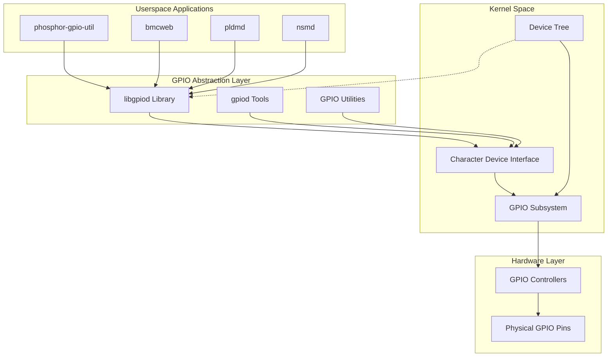
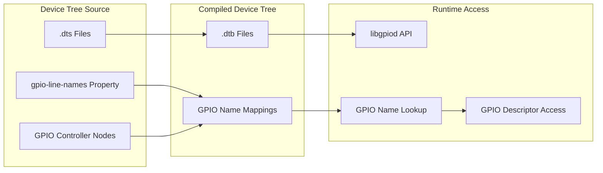
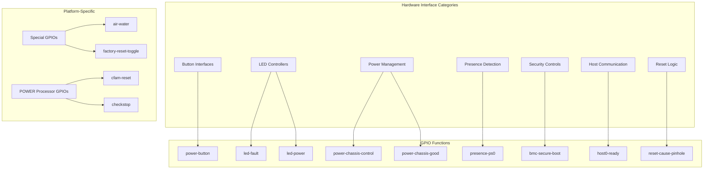
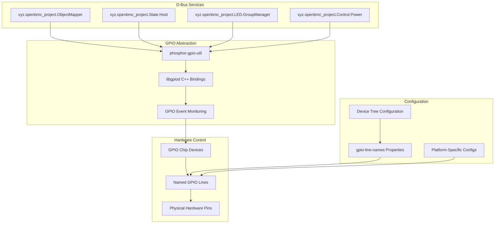

<!-- source: DeepWiki mcp.deepwiki.com · repo NVIDIA/nvbmc-docs · page 3.4 Hardware Interfaces and GPIO · fetched 2026-10-26 -->

# Hardware Interfaces and GPIO

Relevant source files

The following files were used as context for generating this wiki page:

- [designs/device-tree-gpio-naming.md](designs/device-tree-gpio-naming.md)

This document covers OpenBMC's hardware abstraction layer, focusing on GPIO (General Purpose Input/Output) interfaces, device tree integration, and standardized naming conventions. It explains how OpenBMC abstracts hardware components and provides consistent interfaces for hardware control across different platforms.

For information about higher-level management protocols that utilize these hardware interfaces, see [Platform Protocols](#5). For system state management that coordinates hardware control, see [System State Management](#3.2).

## Purpose and Scope

OpenBMC provides a hardware abstraction layer that enables consistent access to GPIO pins, sensors, and other hardware components across diverse BMC platforms. This abstraction layer uses the Linux kernel's character device GPIO interface through `libgpiod`, standardized device tree naming conventions, and D-Bus integration to provide unified hardware control.

## GPIO Subsystem Architecture

OpenBMC has transitioned from the deprecated sysfs GPIO interface to a descriptor-based character device interface using `libgpiod`. This provides better abstraction and more reliable GPIO access patterns.

**GPIO Subsystem Architecture in OpenBMC**

Sources: [designs/device-tree-gpio-naming.md:13-17]()

## Device Tree Integration

OpenBMC uses device tree files to define GPIO configurations and naming. The `gpio-line-names` property in device tree sources provides human-readable names that can be accessed through `libgpiod` APIs.

**Device Tree to GPIO Name Resolution**

Sources: [designs/device-tree-gpio-naming.md:26-28]()

## GPIO Naming Conventions

OpenBMC enforces standardized naming conventions for common GPIO functions to ensure consistency across different hardware platforms. All common GPIOs must follow these naming patterns.

### Button GPIOs
Pattern: `*-button`

| GPIO Name | Purpose | Direction |
|-----------|---------|-----------|
| `power-button` | System power button input | Input |

### Host Ready GPIOs
Pattern: `host*-ready` (active high), `host*-ready-n` (active low)

| GPIO Name | Purpose | Active State |
|-----------|---------|--------------|
| `host0-ready` | Host 0 ready signal | High |
| `host1-ready-n` | Host 1 ready signal | Low |

### LED Control GPIOs
Pattern: `led-*`

| GPIO Name | Purpose |
|-----------|---------|
| `led-fault` | System fault indicator |
| `led-identify` | System identification LED |
| `led-power` | Power status LED |
| `led-sys-boot-status` | System boot status LED |
| `led-attention` | Attention/service LED |
| `led-hdd-fault` | HDD fault indicator |
| `led-rear-fault` | Rear panel fault LED |
| `led-rear-power` | Rear panel power LED |
| `led-rear-id` | Rear panel identification LED |

### Power and Regulator GPIOs
Pattern: `power-*`, `regulator-*`

| GPIO Name | Purpose | Direction |
|-----------|---------|-----------|
| `power-chassis-control` | Chassis power control | Output |
| `power-chassis-good` | Chassis power good status | Input |
| `power-config-full-load` | Full load power configuration | Output |
| `regulator-standby-faulted` | Standby regulator fault status | Input |
| `rtc-battery-voltage-read-enable` | RTC battery voltage read enable | Output |

### Presence Detection GPIOs
Pattern: `presence-*`

| GPIO Name | Purpose |
|-----------|---------|
| `presence-ps0` | Power supply 0 presence |
| `presence-ps1` | Power supply 1 presence |
| `presence-ps<N>` | Power supply N presence |

### Reset Cause GPIOs
Pattern: `reset-cause-*`

| GPIO Name | Purpose |
|-----------|---------|
| `reset-cause-pinhole` | Pinhole reset cause detection |

### Security GPIOs

| GPIO Name | Purpose | Default State |
|-----------|---------|---------------|
| `bmc-secure-boot` | Secure boot configuration | Pulled up (secure) |

Sources: [designs/device-tree-gpio-naming.md:40-48](), [designs/device-tree-gpio-naming.md:50-86](), [designs/device-tree-gpio-naming.md:87-112](), [designs/device-tree-gpio-naming.md:116-120](), [designs/device-tree-gpio-naming.md:121-137](), [designs/device-tree-gpio-naming.md:139-146]()

## Hardware Interface Categories

OpenBMC organizes hardware interfaces into logical categories that map to different system management functions.

**GPIO Organization by Hardware Function**

Sources: [designs/device-tree-gpio-naming.md:50-170]()

## Integration with OpenBMC Services

GPIO interfaces integrate with OpenBMC's D-Bus architecture to provide hardware control capabilities to system management services.

**GPIO Integration with OpenBMC D-Bus Services**

## Hardware Abstraction Benefits

The standardized GPIO naming and hardware abstraction provides several key benefits:

- **Platform Independence**: Applications can use consistent GPIO names across different hardware platforms
- **Maintainability**: Reduced need for platform-specific configuration files
- **Reliability**: Character device interface provides better error handling than deprecated sysfs
- **Discoverability**: Named GPIOs can be discovered programmatically through `libgpiod` APIs
- **Configuration Management**: Device tree integration centralizes hardware configuration

## Requirements and Compliance

All OpenBMC systems must comply with the established GPIO naming conventions. When implementing support for a new platform:

1. Device tree files must use standardized `gpio-line-names` for common functions
2. Platform-specific GPIOs should follow the established patterns when possible
3. New common GPIO functions must be documented and added to the naming standard
4. Hardware abstraction should use `libgpiod` rather than direct sysfs access

Sources: [designs/device-tree-gpio-naming.md:37-39](), [designs/device-tree-gpio-naming.md:181-182]()

---

