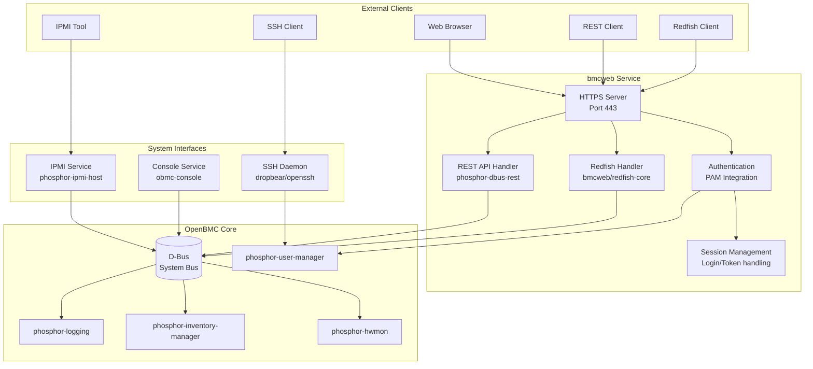
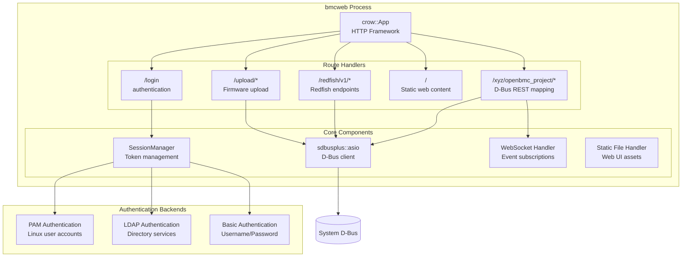
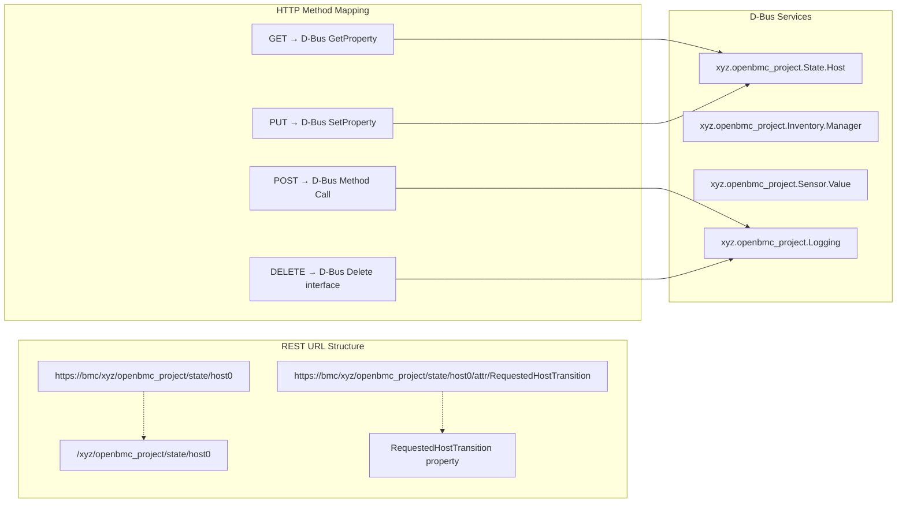
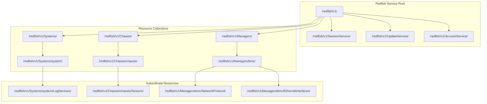
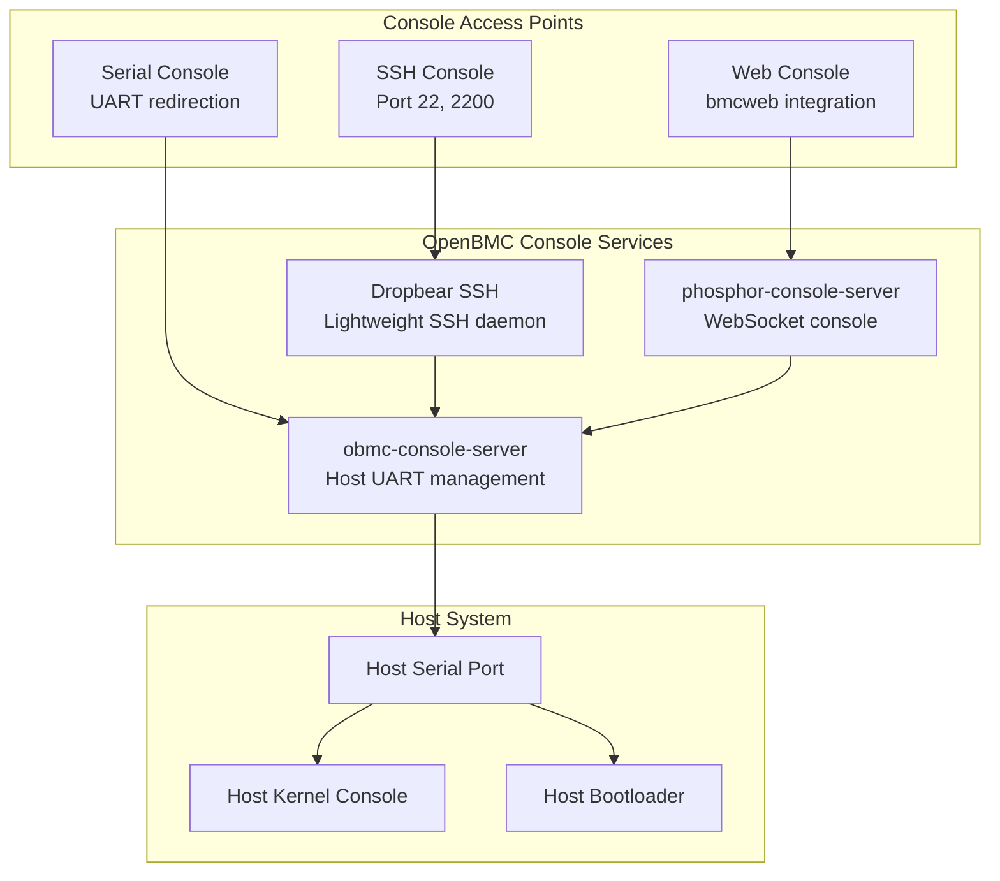

<!-- source: DeepWiki mcp.deepwiki.com · repo NVIDIA/nvbmc-docs · page 4 Management Interfaces · fetched 2026-10-26 -->

# Management Interfaces

<details>
<summary>Relevant source files</summary>

The following files were used as context for generating this wiki page:

- [MAINTAINERS](MAINTAINERS)
- [REDFISH-cheatsheet.md](REDFISH-cheatsheet.md)
- [REST-cheatsheet.md](REST-cheatsheet.md)
- [designs/ci-authorization.md](designs/ci-authorization.md)
- [host-management.md](host-management.md)
- [kernel-development.md](kernel-development.md)
- [rest-api.md](rest-api.md)

</details>


This document describes the external interfaces available for managing OpenBMC systems. These interfaces provide programmatic and interactive access to BMC functionality including host control, sensor monitoring, configuration management, and system administration. For information about internal communication between BMC services, see [Core Architecture](#3). For details about platform-specific protocols like PLDM and MCTP, see [Platform Protocols](#5).

## Overview

OpenBMC provides multiple standardized management interfaces that allow external clients to interact with the BMC firmware. These interfaces are implemented by the `bmcweb` service and provide different levels of functionality and compatibility with existing management tools.

### Management Interface Architecture



**Management Interface Types and Protocols**

| Interface | Protocol | Port | Authentication | Primary Use Case |
|-----------|----------|------|----------------|------------------|
| REST API | HTTP/HTTPS | 443 | Token/Session | Custom applications, scripts |
| Redfish API | HTTP/HTTPS | 443 | Token/Session | Standards-based management |
| Web UI | HTTP/HTTPS | 443 | Session | Interactive management |
| IPMI | UDP | 623 | Username/Password | Legacy tool compatibility |
| SSH Console | TCP | 22, 2200 | Key/Password | Host console access |

Sources: [rest-api.md:1-50](), [REDFISH-cheatsheet.md:1-50](), [host-management.md:1-20]()

## Interface Implementation Details

### bmcweb Service Architecture

The `bmcweb` service serves as the primary HTTP/HTTPS server for OpenBMC, implementing multiple management protocols through a unified web server architecture.



Sources: [rest-api.md:6-8](), [REDFISH-cheatsheet.md:18-42]()

### Authentication and Session Management

OpenBMC supports multiple authentication methods across its management interfaces, with token-based authentication being the recommended approach for programmatic access.

**Authentication Methods by Interface**

| Method | REST API | Redfish | Web UI | SSH | IPMI |
|--------|----------|---------|--------|-----|------|
| Session Token | ✓ | ✓ | ✓ | ✗ | ✗ |
| Basic Auth | ✓ | ✓ | ✗ | ✗ | ✗ |
| Cookie-based | ✓ | ✓ | ✓ | ✗ | ✗ |
| SSH Key | ✗ | ✗ | ✗ | ✓ | ✗ |
| IPMI Auth | ✗ | ✗ | ✗ | ✗ | ✓ |

**Token Authentication Flow**
```bash
# Obtain authentication token
export token=`curl -k -H "Content-Type: application/json" \
  -X POST https://${bmc}/login \
  -d '{"username": "root", "password": "0penBmc"}' | \
  grep token | awk '{print $2;}' | tr -d '"'`

# Use token for subsequent requests  
curl -k -H "X-Auth-Token: $token" https://${bmc}/xyz/openbmc_project/...
```

Sources: [rest-api.md:13-23](), [REST-cheatsheet.md:7-42](), [REDFISH-cheatsheet.md:18-37]()

## D-Bus REST Mapping

The OpenBMC REST API provides direct access to the D-Bus object hierarchy, creating a RESTful interface over the internal communication bus. This mapping allows external clients to interact with BMC services using standard HTTP methods.

### URL Structure and Object Mapping



**REST Operation Examples**

| Operation | HTTP Method | URL Pattern | D-Bus Action |
|-----------|-------------|-------------|--------------|
| List objects | GET | `/xyz/openbmc_project/` | Enumerate children |
| Get properties | GET | `/xyz/openbmc_project/state/host0` | GetAllProperties |
| Get single property | GET | `/xyz/openbmc_project/state/host0/attr/CurrentHostState` | GetProperty |
| Set property | PUT | `/xyz/openbmc_project/state/host0/attr/RequestedHostTransition` | SetProperty |
| Call method | POST | `/xyz/openbmc_project/logging/action/DeleteAll` | Method call |
| Delete object | DELETE | `/xyz/openbmc_project/logging/entry/1` | Delete interface |

Sources: [rest-api.md:25-156](), [host-management.md:4-16]()

### Event Subscription Protocol

OpenBMC provides WebSocket-based event subscriptions that allow clients to receive real-time notifications of D-Bus signal events without polling.

```javascript
// WebSocket event subscription example
var ws = new WebSocket("wss://bmc_ip/subscribe");
var filter = {
    "paths": ["/xyz/openbmc_project/sensors", "/xyz/openbmc_project/logging"],
    "interfaces": ["xyz.openbmc_project.Sensor.Value", "xyz.openbmc_project.Logging.Entry"]
};

ws.onopen = function() {
    ws.send(JSON.stringify(filter));
};

ws.onmessage = function(event) {
    var data = JSON.parse(event.data);
    // Handle InterfacesAdded or PropertiesChanged events
};
```

Sources: [rest-api.md:301-394]()

## Redfish Standards Compliance

The Redfish API implementation in `bmcweb` provides a standards-compliant interface following DMTF Redfish specifications. This enables interoperability with existing data center management tools and provides a consistent API across different BMC vendors.

### Redfish Service Structure



**Redfish to D-Bus Mapping Examples**

| Redfish Resource | D-Bus Object Path | Purpose |
|------------------|-------------------|---------|
| `/redfish/v1/Systems/system` | `/xyz/openbmc_project/state/host0` | Host system state |
| `/redfish/v1/Chassis/chassis` | `/xyz/openbmc_project/inventory/system/chassis` | Chassis inventory |
| `/redfish/v1/Managers/bmc` | `/xyz/openbmc_project/state/bmc0` | BMC state and info |
| `/redfish/v1/Systems/system/LogServices/EventLog` | `/xyz/openbmc_project/logging` | System event logs |
| `/redfish/v1/UpdateService` | `/xyz/openbmc_project/software` | Firmware update |

Sources: [REDFISH-cheatsheet.md:10-186](), [host-management.md:216-248]()

## Console and Out-of-Band Access

OpenBMC provides multiple methods for accessing the host system console and performing out-of-band management operations through SSH and serial console interfaces.

### Console Access Methods



**Console Configuration**

| Service | Configuration File | Purpose |
|---------|-------------------|---------|
| `obmc-console-server` | `/etc/obmc-console/server.conf` | UART console configuration |
| `dropbear` | `/etc/default/dropbear` | SSH daemon settings |
| `phosphor-console-server` | Built-in configuration | WebSocket console bridge |

Sources: [host-management.md:1-16](), [REST-cheatsheet.md:17-53]()

---

