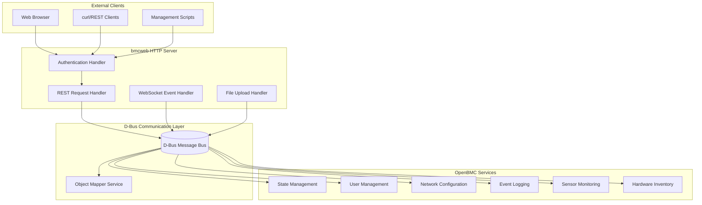
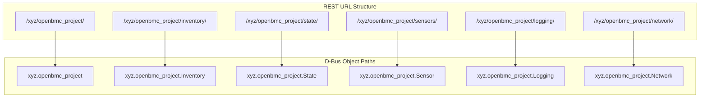
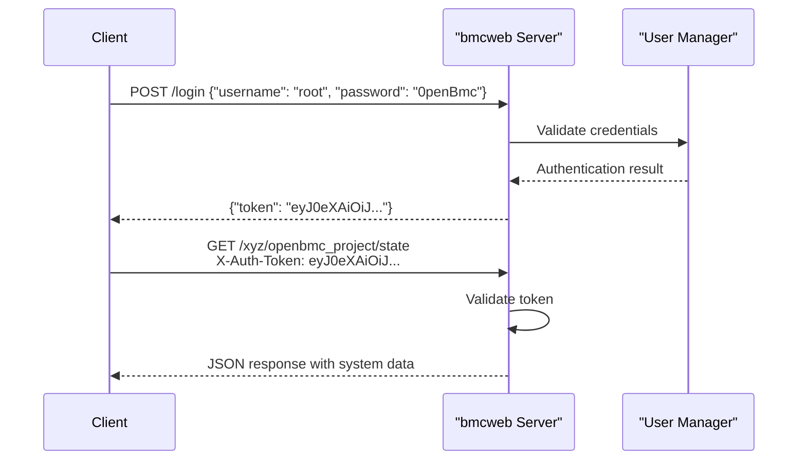
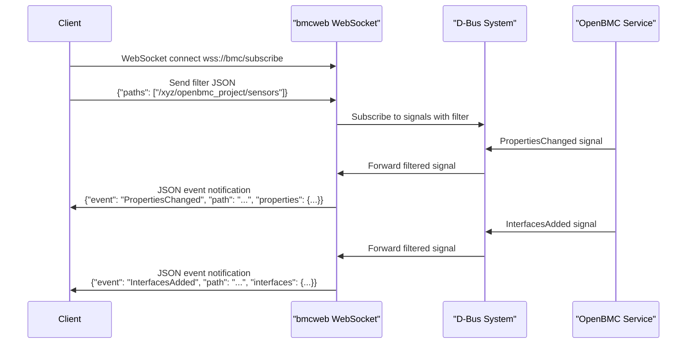
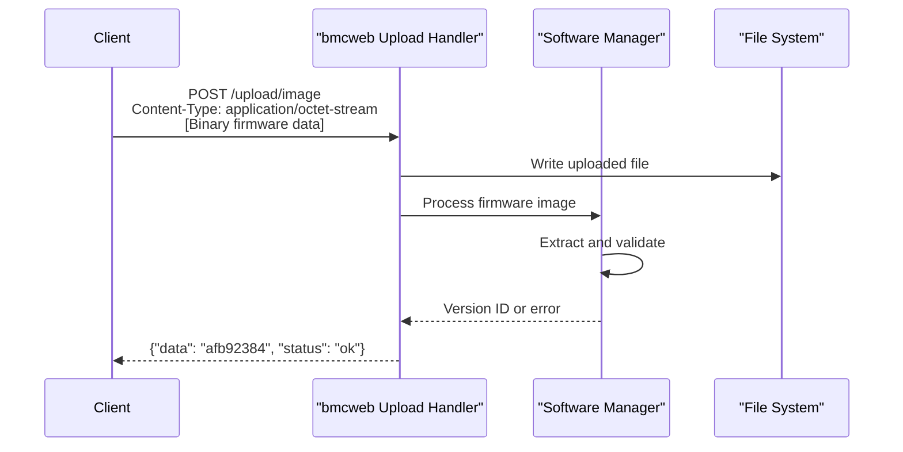

<!-- source: DeepWiki mcp.deepwiki.com · repo NVIDIA/nvbmc-docs · page 4.1 REST API · fetched 2026-10-26 -->

# REST API

<details>
<summary>Relevant source files</summary>

The following files were used as context for generating this wiki page:

- [MAINTAINERS](MAINTAINERS)
- [REDFISH-cheatsheet.md](REDFISH-cheatsheet.md)
- [REST-cheatsheet.md](REST-cheatsheet.md)
- [designs/ci-authorization.md](designs/ci-authorization.md)
- [host-management.md](host-management.md)
- [kernel-development.md](kernel-development.md)
- [rest-api.md](rest-api.md)

</details>


The OpenBMC REST API serves as the primary management interface for OpenBMC systems, providing HTTP-based access to system management functions through a RESTful interface. This API directly maps to the underlying D-Bus object hierarchy, enabling external clients to monitor, configure, and control BMC and host system operations over standard HTTP/HTTPS protocols.

For information about the industry-standard Redfish API implementation, see [Redfish API](#4.2). For traditional IPMI protocol support, see [IPMI Interface](#4.3).

## Architecture Overview

The REST API is implemented by the `bmcweb` service, which acts as an HTTP server that translates REST requests into D-Bus operations. This creates a bridge between external network clients and the internal D-Bus communication system that connects all OpenBMC services.

### REST API System Architecture



**Sources**: [rest-api.md:1-394](), [REST-cheatsheet.md:8-15](), [host-management.md:1-25]()

### URL Structure and D-Bus Mapping

The REST API URL structure directly mirrors the D-Bus object hierarchy, creating a predictable and discoverable interface.



**Sources**: [rest-api.md:6-8](), [rest-api.md:25-96]()

## Authentication

The REST API supports multiple authentication methods to secure access to BMC management functions.

### Authentication Methods

| Method | Description | Use Case |
|--------|-------------|----------|
| Token-based | JWT tokens via `/login` endpoint | Recommended for scripts and applications |
| Cookie-based | Session cookies (legacy) | Supported for backward compatibility |
| Basic Auth | Username/password in URL | Simple clients and testing |

### Token-Based Authentication Flow



**Sources**: [rest-api.md:13-23](), [REST-cheatsheet.md:34-42]()

## HTTP Operations

The REST API implements standard HTTP verbs mapped to specific operations on D-Bus objects and properties.

### HTTP Verb Mapping

| HTTP Verb | Purpose | D-Bus Operation | Example |
|-----------|---------|-----------------|---------|
| `GET` | Query objects/properties | Read D-Bus properties | Get sensor values |
| `PUT` | Update properties | Set D-Bus properties | Change host state |
| `POST` | Call methods | Invoke D-Bus methods | Delete log entries |
| `DELETE` | Remove objects | Call Delete interface | Remove log entries |

### URL Path Conventions

| URL Pattern | Description | Example |
|-------------|-------------|---------|
| `/path/to/object` | Get all properties of object | `/xyz/openbmc_project/state/host0` |
| `/path/to/object/` | List child objects | `/xyz/openbmc_project/inventory/` |
| `/path/to/object/list` | Recursively list all children | `/xyz/openbmc_project/network/list` |
| `/path/to/object/enumerate` | List children with properties | `/xyz/openbmc_project/sensors/enumerate` |
| `/path/to/object/attr/PropertyName` | Access single property | `/xyz/openbmc_project/state/host0/attr/CurrentHostState` |
| `/path/to/object/action/MethodName` | Call D-Bus method | `/xyz/openbmc_project/logging/action/DeleteAll` |

**Sources**: [rest-api.md:25-156](), [rest-api.md:157-233]()

## Event Subscription

The REST API provides real-time event notifications through WebSocket connections, allowing clients to receive immediate updates when system state changes occur.

### WebSocket Event Protocol



### Event Filter Structure

The WebSocket subscription accepts JSON filter objects to control which D-Bus signals are forwarded to the client:

```json
{
  "paths": ["/xyz/openbmc_project/sensors", "/xyz/openbmc_project/logging"],
  "interfaces": ["xyz.openbmc_project.Sensor.Value", "xyz.openbmc_project.Logging.Entry"]
}
```

**Sources**: [rest-api.md:301-394]()

## File Upload Capabilities

The REST API supports uploading firmware images and other files through dedicated upload endpoints.

### Upload Endpoints

| Endpoint | Method | Content-Type | Purpose |
|----------|--------|--------------|---------|
| `/upload/image` | POST | `application/octet-stream` | Upload firmware image (auto-named) |
| `/upload/image/filename` | PUT | `application/octet-stream` | Upload with specific filename |

### Firmware Upload Flow



**Sources**: [rest-api.md:255-299]()

## Common Management Operations

The REST API enables comprehensive system management through standardized HTTP operations on well-defined object paths.

### Host Power Control

Host power operations are performed by modifying the `RequestedHostTransition` property of the host state object:

| Operation | HTTP Method | URL | Request Body |
|-----------|-------------|-----|--------------|
| Power On | PUT | `/xyz/openbmc_project/state/host0/attr/RequestedHostTransition` | `{"data": "xyz.openbmc_project.State.Host.Transition.On"}` |
| Power Off | PUT | `/xyz/openbmc_project/state/host0/attr/RequestedHostTransition` | `{"data": "xyz.openbmc_project.State.Host.Transition.Off"}` |
| Reboot | PUT | `/xyz/openbmc_project/state/host0/attr/RequestedHostTransition` | `{"data": "xyz.openbmc_project.State.Host.Transition.Reboot"}` |

### System Information Access

| Information Type | URL Pattern | Example |
|------------------|-------------|---------|
| Hardware Inventory | `/xyz/openbmc_project/inventory/enumerate` | List all FRUs and components |
| Sensor Readings | `/xyz/openbmc_project/sensors/enumerate` | Get all sensor values |
| Event Logs | `/xyz/openbmc_project/logging/entry/enumerate` | List system event logs |
| Network Configuration | `/xyz/openbmc_project/network/enumerate` | Network interface settings |

**Sources**: [host-management.md:216-248](), [REST-cheatsheet.md:67-90]()

## Error Handling and Response Format

All REST API responses follow a consistent JSON format that includes status information and data payload.

### Standard Response Format

```json
{
  "data": <response_data>,
  "message": "200 OK",
  "status": "ok"
}
```

### Error Response Format

```json
{
  "data": {
    "description": "Error description"
  },
  "message": "400 Bad Request", 
  "status": "error"
}
```

**Sources**: [rest-api.md:36-50](), [rest-api.md:276-296]()

---

