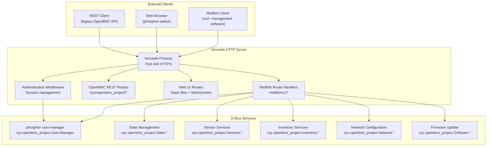
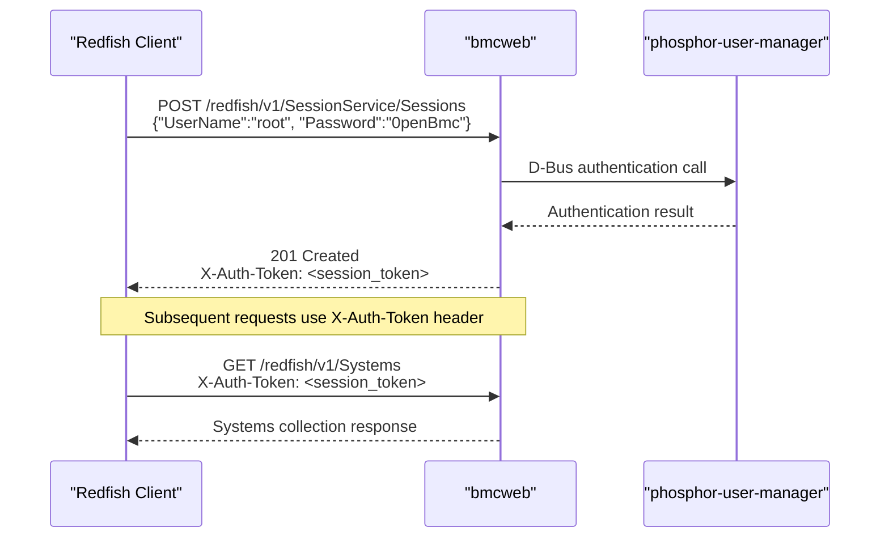
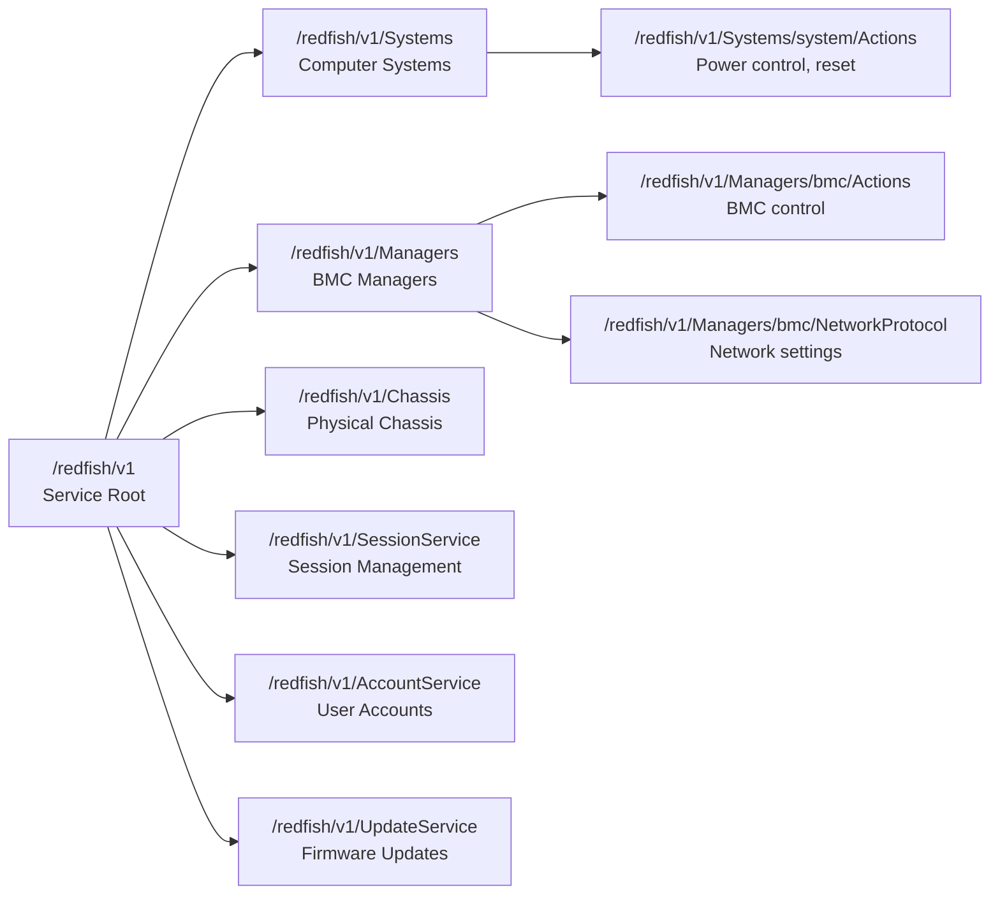
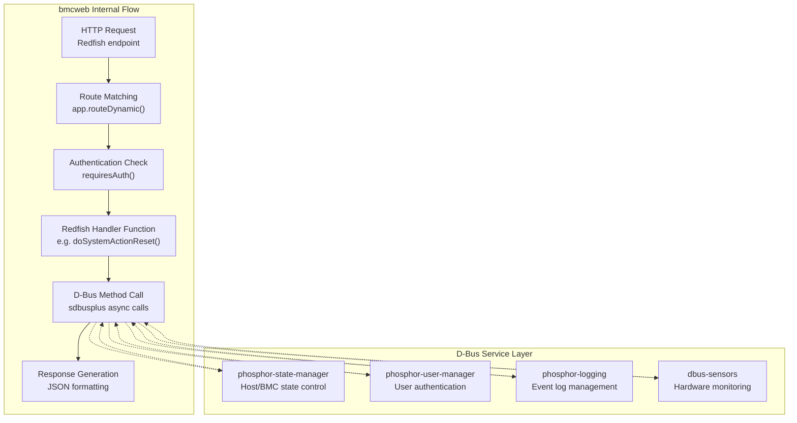
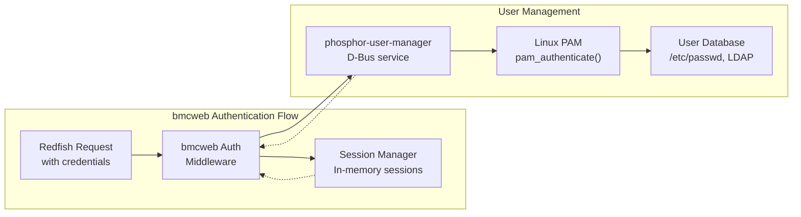

<!-- source: DeepWiki mcp.deepwiki.com · repo NVIDIA/nvbmc-docs · page 4.2 Redfish API · fetched 2026-10-26 -->

# Redfish API

Relevant source files

The following files were used as context for generating this wiki page:

- [REDFISH-cheatsheet.md](REDFISH-cheatsheet.md)
- [REST-cheatsheet.md](REST-cheatsheet.md)
- [architecture/ipmi-architecture.md](architecture/ipmi-architecture.md)
- [architecture/user-management.md](architecture/user-management.md)
- [designs/ci-authorization.md](designs/ci-authorization.md)
- [features.md](features.md)
- [host-management.md](host-management.md)
- [kernel-development.md](kernel-development.md)
- [security/network-security-considerations.md](security/network-security-considerations.md)

## Purpose and Scope

This document covers OpenBMC's implementation of the Redfish API, an industry-standard RESTful interface for out-of-band management of servers and data center hardware. The Redfish API provides a standardized way to manage BMC functions including power control, sensors, inventory, firmware updates, and system configuration.

For information about OpenBMC's custom REST API, see [REST API](#4.1). For IPMI protocol support, see [IPMI Interface](#4.3). For console access methods, see [Console Access](#4.4).

## Architecture Overview

The Redfish API is implemented through the `bmcweb` HTTP server, which serves as OpenBMC's unified web interface. The `bmcweb` service provides multiple APIs through a single HTTPS endpoint on port 443, including Redfish, the legacy OpenBMC REST API, and the phosphor-webui web interface.

Sources: [REDFISH-cheatsheet.md:1-187](), [architecture diagrams from prompt]()

## Authentication Methods

The Redfish API supports multiple authentication mechanisms, all implemented through `bmcweb`:

### Session-Based Authentication

The preferred method uses the Redfish SessionService to create authenticated sessions:

### Basic Authentication

For simple integrations, HTTP Basic Authentication is supported:

| Method | Description | Usage |
|--------|-------------|-------|
| Session Service | Creates X-Auth-Token for subsequent requests | Recommended for applications |
| Basic Auth | Username/password in Authorization header | Deprecated, legacy support |
| Legacy Login | OpenBMC-specific `/login` endpoint | Deprecated, use Session Service |

Sources: [REDFISH-cheatsheet.md:18-37](), [REST-cheatsheet.md:17-42]()

## Key Redfish Endpoints

### Service Root and Discovery

The Redfish service root provides the entry point for API discovery:

### System Management Operations

| Endpoint | HTTP Method | Purpose | D-Bus Mapping |
|----------|-------------|---------|---------------|
| `/redfish/v1/Systems/system/Actions/ComputerSystem.Reset` | POST | Host power control | `xyz.openbmc_project.State.Host` |
| `/redfish/v1/Managers/bmc/Actions/Manager.Reset` | POST | BMC reboot | `xyz.openbmc_project.State.BMC` |
| `/redfish/v1/Systems/system/LogServices/EventLog/Entries` | GET | System event logs | `xyz.openbmc_project.Logging` |
| `/redfish/v1/UpdateService` | POST | Firmware updates | `xyz.openbmc_project.Software` |
| `/redfish/v1/AccountService/Accounts/{user}` | PATCH | User management | `xyz.openbmc_project.User.Manager` |

Sources: [REDFISH-cheatsheet.md:57-146](), [host-management.md:216-248]()

## Request Flow Architecture

Sources: [network-security-considerations.md:150-179](), architecture diagrams from prompt

## Implementation Details

### bmcweb Route Handlers

The Redfish API is implemented through C++ route handlers in the `bmcweb` codebase. Key implementation characteristics:

- **Asynchronous D-Bus calls**: All backend communication uses asynchronous D-Bus calls to prevent blocking
- **JSON response formatting**: Redfish responses follow DMTF JSON schema specifications
- **Error handling**: HTTP status codes and Redfish error responses for proper client integration
- **Security headers**: HTTPS enforcement and security headers for production deployment

### Authentication Integration

Authentication flows through the `phosphor-user-manager` service:

Sources: [user-management.md:67-79](), [network-security-considerations.md:182-201]()

## Differences from Other OpenBMC Interfaces

| Feature | Redfish API | OpenBMC REST API | IPMI |
|---------|-------------|------------------|------|
| **Standard** | DMTF industry standard | OpenBMC-specific | IPMI 2.0 standard |
| **Transport** | HTTPS/JSON | HTTPS/JSON | UDP 623, KCS, IPMB |
| **Authentication** | Session service, Basic Auth | Token-based, cookie | RAKP+, session-based |
| **Discovery** | Self-describing schema | D-Bus object enumeration | Static command set |
| **Endpoints** | `/redfish/v1/*` | `/xyz/openbmc_project/*` | Binary command/response |
| **Use Case** | Standard management tools | OpenBMC development/debug | Legacy system integration |

### Migration Considerations

- **Redfish is preferred** for new integrations due to industry standardization
- **OpenBMC REST API** remains available for backward compatibility and development
- **Both APIs** share the same underlying D-Bus services and authentication system
- **Session tokens** from Redfish SessionService work with OpenBMC REST endpoints

Sources: [REDFISH-cheatsheet.md:34-37](), [REST-cheatsheet.md:7-15](), [features.md:5-8]()

---

