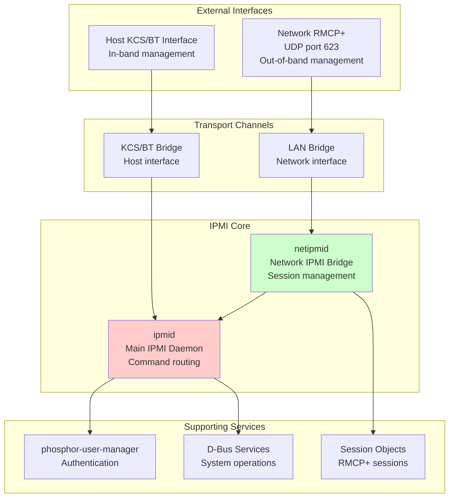
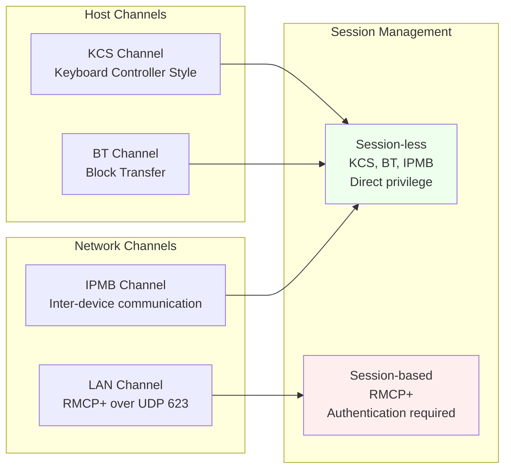
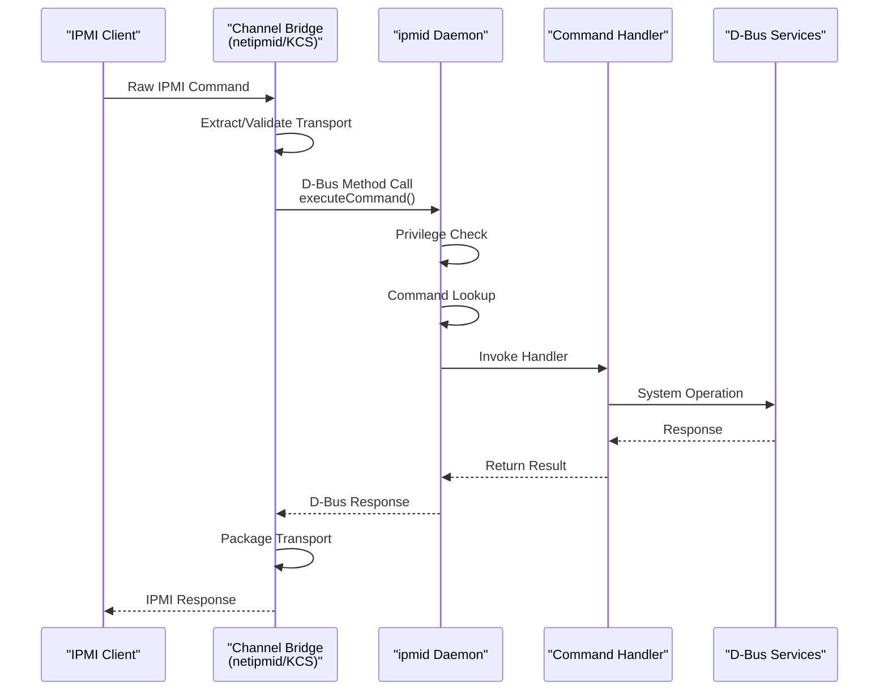
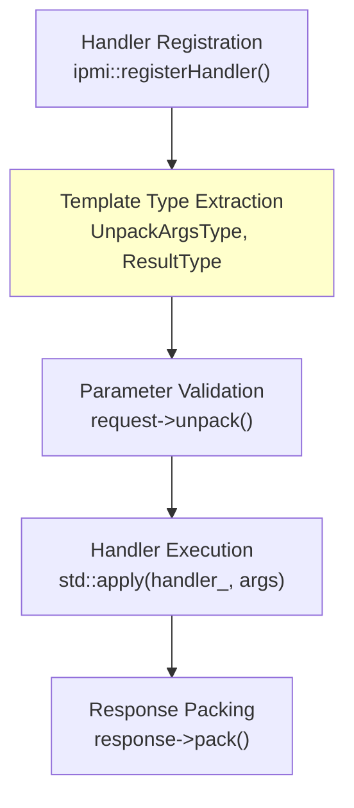

<!-- source: DeepWiki mcp.deepwiki.com · repo NVIDIA/nvbmc-docs · page 4.3 IPMI Interface · fetched 2026-10-26 -->

# IPMI Interface

<details>
<summary>Relevant source files</summary>

The following files were used as context for generating this wiki page:

- [REDFISH-cheatsheet.md](REDFISH-cheatsheet.md)
- [REST-cheatsheet.md](REST-cheatsheet.md)
- [architecture/ipmi-architecture.md](architecture/ipmi-architecture.md)
- [architecture/user-management.md](architecture/user-management.md)
- [designs/ci-authorization.md](designs/ci-authorization.md)
- [features.md](features.md)
- [host-management.md](host-management.md)
- [kernel-development.md](kernel-development.md)
- [security/network-security-considerations.md](security/network-security-considerations.md)

</details>


## Purpose and Scope

The IPMI (Intelligent Platform Management Interface) interface provides a standardized protocol for out-of-band management of OpenBMC systems. This document covers the IPMI implementation in OpenBMC, including its architecture, channel types, authentication mechanisms, and security considerations.

IPMI serves as one of the primary external management interfaces alongside REST APIs and Redfish. For information about other management protocols, see [REST API](#4.1) and [Redfish API](#4.2). For platform-level protocols that work alongside IPMI, see [PLDM Stack](#5.1).

## IPMI Protocol Overview

OpenBMC implements IPMI 2.0 with full DCMI compliance, providing both in-band and out-of-band management capabilities. The IPMI interface supports standard IPMI commands for system management including power control, sensor monitoring, event logging, and user management.

The IPMI implementation is built around commands and channels. Commands are provided by handlers and channels are communication pathways managed by bridge processes. Commands received from external sources are routed through the main IPMI daemon to appropriate command handlers.

Sources: [features.md:12-13](), [architecture/ipmi-architecture.md:1-6]()

## Architecture Components

OpenBMC's IPMI architecture consists of several key components that work together to provide comprehensive IPMI functionality:



**IPMI Architecture Overview**

The architecture separates transport concerns from command processing. Channel bridges handle protocol-specific details while the main daemon focuses on command routing and execution.

Sources: [architecture/ipmi-architecture.md:18-48]()

### Core Components

| Component | Purpose | Key Responsibilities |
|-----------|---------|---------------------|
| `ipmid` | Main IPMI daemon | Command routing, handler management, privilege checking |
| `netipmid` | Network IPMI bridge | RMCP+ session management, SOL commands, network transport |
| `phosphor-user-manager` | User authentication | IPMI user validation, privilege enforcement |

Sources: [architecture/ipmi-architecture.md:117-123](), [security/network-security-considerations.md:254-256]()

## Channel Types

OpenBMC supports multiple IPMI channel types, each with different transport mechanisms and security characteristics:



**IPMI Channel Types and Session Models**

### Host Interface Channels

**KCS/BT Channels** provide in-band management through the host system. These channels are session-less and rely on physical access control for security. Commands received through these channels bypass session authentication but are subject to channel privilege limits.

Sources: [architecture/ipmi-architecture.md:97-101]()

### Network Interface Channels

**RMCP+ LAN Channel** operates on UDP port 623 and provides out-of-band management over the network. This channel requires session establishment with user authentication and supports IPMI 2.0 security features including encrypted sessions.

The network implementation handles:
- RMCP+ session establishment and management
- User authentication through `phosphor-user-manager`
- Serial-over-LAN (SOL) functionality
- Session privilege negotiation

Sources: [security/network-security-considerations.md:244-263](), [architecture/ipmi-architecture.md:117-123]()

## Message Flow and Command Processing

The following diagram illustrates how IPMI commands flow through the system:



**IPMI Command Processing Flow**

The message flow includes several validation and security steps:

1. **Transport Processing**: Channel bridges extract IPMI commands from transport protocols
2. **Privilege Validation**: Commands are checked against user and channel privileges  
3. **Command Routing**: The daemon locates appropriate handlers based on NetFn/Command
4. **Handler Execution**: Typed handlers process commands and interact with system services
5. **Response Packaging**: Results are packaged back into transport-specific responses

Sources: [architecture/ipmi-architecture.md:73-115]()

### Command Handler Registration

Command handlers are registered using a templated system that provides type safety:



**Handler Registration and Execution Pipeline**

Sources: [architecture/ipmi-architecture.md:131-194]()

## Authentication and User Management

IPMI authentication integrates with OpenBMC's centralized user management system through `phosphor-user-manager`. The authentication flow varies by channel type:

### Session-based Authentication (RMCP+)

Network IPMI channels require full session establishment with username/password authentication. The `netipmid` process manages sessions and coordinates with the user management system.

Key features:
- RAKP (Remote Authentication and Key exchange Protocol) support
- Session privilege negotiation
- Encrypted communication support
- Session timeout and cleanup

### Session-less Authentication (KCS/BT)

Host interface channels operate without explicit sessions, relying on physical access control. These channels check only against channel maximum privilege levels.

Sources: [architecture/user-management.md:434-435](), [security/network-security-considerations.md:254-256]()

## Security Considerations

The IPMI interface presents several security considerations that OpenBMC addresses:

### Network Security

- **Port 623 Exposure**: IPMI RMCP+ operates on UDP port 623, requiring careful network configuration
- **Authentication Brute Force**: Automated agents may cause authentication failures; rate limiting recommended
- **Session Management**: Orphaned sessions consume resources; timeouts help prevent resource exhaustion
- **Clear Text Requirements**: IPMI requires clear text passwords for RAKP authentication

### Privilege Management

IPMI privilege levels integrate with OpenBMC's role-based access control:

| IPMI Privilege | OpenBMC Role | Capabilities |
|----------------|-------------|--------------|
| Administrator | admin | Full system configuration access |
| Operator | operator | System control, limited configuration |
| User | user | Read-only access |
| Callback | callback | Minimal access for callbacks |

Sources: [security/network-security-considerations.md:89-101](), [architecture/user-management.md:51-65]()

## Implementation Details

### Key Source Files

The IPMI implementation spans multiple repositories and source files:

- **Main Daemon**: The core IPMI daemon implementation handles command routing and execution
- **Network Bridge**: Handles RMCP+ protocol and session management  
- **Command Providers**: Individual command implementations organized by function
- **Transport Libraries**: Low-level transport protocol handling

### D-Bus Integration

IPMI commands typically result in D-Bus calls to system services. The asynchronous design allows multiple in-flight IPMI commands without blocking:

```cpp
// Example async pattern from architecture
ipmi::RspType<uint8_t> getSystemInfo(ipmi::Context::ptr ctx) {
    auto& bus = getSdBus();
    auto result = bus->yield_method_call(*ctx->yield, ...);
    return ipmi::responseSuccess(result);
}
```

The `yield_context` enables coroutine-based asynchronous operations that appear synchronous in code.

Sources: [architecture/ipmi-architecture.md:235-253]()

### Command Handler Types

OpenBMC supports various parameter types for IPMI handlers:
- Standard integer types (`uint8_t`, `uint16_t`, etc.)
- Bit-precise types (`uint4_t`, `uint6_t`)
- Optional parameters (`std::optional<T>`)
- Variable payloads (`std::vector<uint8_t>`)
- Bitsets (`std::bitset<N>`)

This type system provides compile-time validation of IPMI command parameters and automatic packing/unpacking.

Sources: [architecture/ipmi-architecture.md:265-284]()

---

