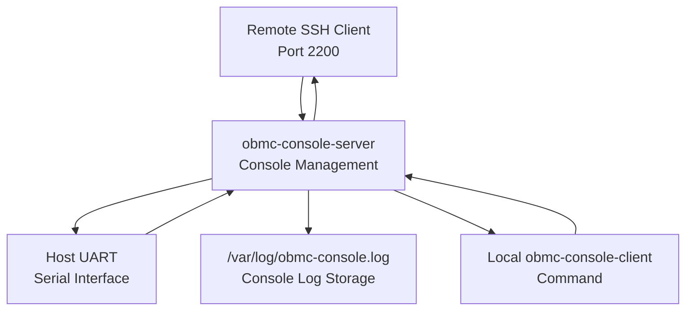
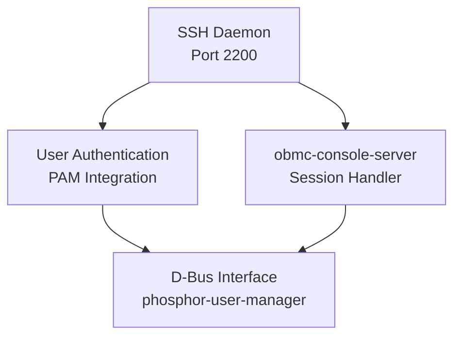
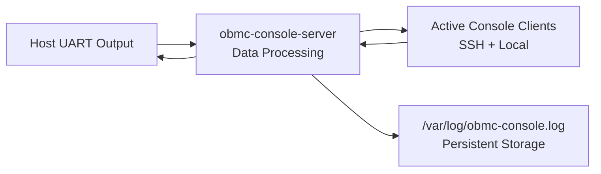

<!-- source: DeepWiki mcp.deepwiki.com · repo NVIDIA/nvbmc-docs · page 4.4 Console Access · fetched 2026-10-26 -->

# Console Access

<details>
<summary>Relevant source files</summary>

The following files were used as context for generating this wiki page:

- [README.md](README.md)
- [console.md](console.md)

</details>


This document describes OpenBMC's host console access capabilities, which provide serial console connectivity to managed host systems. Console access allows administrators to interact directly with host system boot processes, operating systems, and firmware interfaces through the BMC's serial console infrastructure.

For information about other management interfaces, see [REST API](#4.1), [Redfish API](#4.2), and [IPMI Interface](#4.3). For host power and state management operations, see [System State Management](#3.2).

## Console Infrastructure Architecture

OpenBMC provides a shared console infrastructure that allows multiple concurrent connections to a single host UART interface. This design enables multiple administrators to monitor console output simultaneously while ensuring that input from any connection is properly forwarded to the host system.

### Console Access Flow



The console infrastructure consists of a server component that manages the host UART connection and multiplexes access between multiple client connections. All console data is logged for historical analysis and troubleshooting.

Sources: [console.md:1-49]()

## Remote Console Access

Remote console access is provided through SSH connections on a dedicated port. This approach leverages OpenBMC's existing user authentication and authorization infrastructure while providing a standardized interface for console connectivity.

### SSH Console Connection

Remote users connect to the console service using SSH on port 2200:

```bash
ssh -p 2200 [user]@[bmc-hostname]
```

This connection method uses the same authentication credentials as standard SSH sessions to the BMC system. The dedicated port separates console traffic from administrative SSH sessions, preventing conflicts and allowing for different access policies.

### Console Session Management



The SSH console service integrates with OpenBMC's user management system through D-Bus interfaces, ensuring that console access follows the same authorization policies as other management interfaces.

Sources: [console.md:11-18]()

## Local Console Access

When logged into the BMC system directly, administrators can access the host console using the local console client. This provides a direct path to the console service without requiring additional network connections.

### obmc-console-client Usage

The local console client connects directly to the console service:

```bash
obmc-console-client
```

This command establishes a connection to the local console server and provides immediate access to the host console interface.

### Session Termination

Console sessions are terminated using a specific escape sequence:

```
return ~ .
```

For nested SSH sessions (when connecting remotely to the BMC and then using the local client), the escape character must be doubled to properly escape the inner session:

```
return ~ ~ .
```

This escape sequence handling prevents conflicts between the remote SSH session to the BMC and the console client's own SSH-like interface.

Sources: [console.md:20-38]()

## Console Logging and Monitoring

OpenBMC maintains persistent logging of all console activity to support troubleshooting and audit requirements. The logging system automatically manages log file size and rotation to prevent storage exhaustion.

### Log File Management

Console output is logged to `/var/log/obmc-console.log` with automatic size limiting and rotation. The current size limit is set at 16kB, and the log file wraps when this limit is reached.

### Console Data Flow



All data flowing through the console infrastructure is captured and stored, providing a complete record of host system console activity. This logging occurs regardless of whether active console clients are connected.

Sources: [console.md:40-49]()

## Integration with OpenBMC Services

Console access integrates with several core OpenBMC services to provide secure, managed access to host systems. This integration ensures that console access follows the same security and management policies as other BMC interfaces.

The console service participates in the D-Bus communication infrastructure, allowing other OpenBMC services to monitor console status and coordinate host management activities. This integration supports automated responses to console events and provides visibility into host system state through console monitoring.

Sources: [console.md:1-49](), [README.md:41-44]()

---

