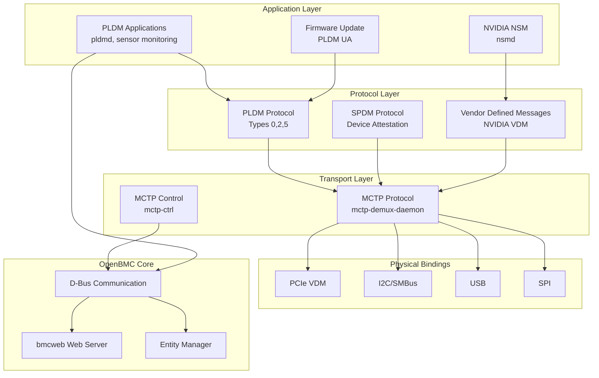
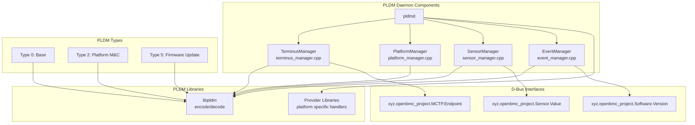
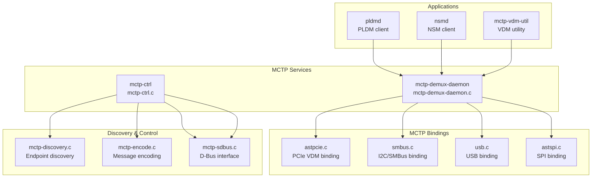
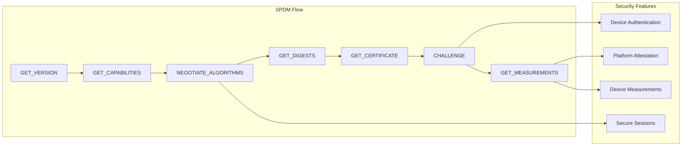
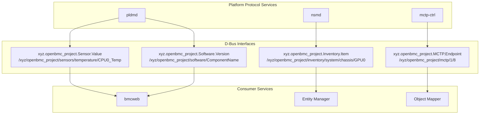

<!-- source: DeepWiki mcp.deepwiki.com · repo NVIDIA/nvbmc-docs · page 5 Platform Protocols · fetched 2026-10-26 -->

# Platform Protocols

<details>
<summary>Relevant source files</summary>

The following files were used as context for generating this wiki page:

- [designs/pldm-stack.md](designs/pldm-stack.md)
- [nvidia/FW-Update/fw_update_platform_guide.md](nvidia/FW-Update/fw_update_platform_guide.md)
- [nvidia/Host-Interfaces/redfish-host-interface.md](nvidia/Host-Interfaces/redfish-host-interface.md)
- [nvidia/MCTP/mctp.md](nvidia/MCTP/mctp.md)
- [nvidia/Telemetry/PLDM T2 Telemetry.md](nvidia/Telemetry/PLDM T2 Telemetry.md)

</details>


Platform Protocols provides advanced communication protocols that enable OpenBMC to manage and interact with various devices in the platform. This document covers the implementation and integration of industry-standard protocols including PLDM (Platform Level Data Model), MCTP (Management Component Transport Protocol), and SPDM (Security Protocol and Data Model).

For information about external management interfaces like REST and Redfish APIs, see [Management Interfaces](#4). For core OpenBMC architecture and D-Bus communication, see [Core Architecture](#3).

## Protocol Stack Overview

Platform Protocols operates as a middleware layer between OpenBMC's core services and hardware devices, providing standardized communication mechanisms for device discovery, monitoring, control, and security.

### Protocol Architecture



Sources: [designs/pldm-stack.md:25-70](), [nvidia/MCTP/mctp.md:48-76]()

## PLDM Implementation

PLDM serves as the primary application-layer protocol for platform management, providing standardized mechanisms for sensor monitoring, firmware updates, and device control.

### PLDM Service Architecture



Sources: [designs/pldm-stack.md:130-180](), [nvidia/Telemetry/PLDM T2 Telemetry.md:240-249]()

### PLDM Request/Response Flow

The PLDM daemon implements both requester and responder functionality, handling device discovery, initialization, and ongoing communication.

| Component | File Location | Responsibility |
|-----------|---------------|----------------|
| Terminus Discovery | [platform-mc/terminus_manager.cpp]() | EID enumeration, TID assignment |
| PDR Repository | [platform-mc/platform_manager.cpp]() | PDR retrieval and parsing |
| Sensor Polling | [platform-mc/sensor_manager.cpp]() | Periodic sensor reading updates |
| Event Handling | [platform-mc/event_manager.cpp]() | Asynchronous event processing |

Sources: [designs/pldm-stack.md:251-354](), [nvidia/Telemetry/PLDM T2 Telemetry.md:251-332]()

## MCTP Transport Layer

MCTP provides the transport foundation for all platform protocols, enabling communication across multiple physical interfaces with a unified addressing scheme.

### MCTP Service Architecture



Sources: [nvidia/MCTP/mctp.md:78-127](), [nvidia/MCTP/mctp.md:130-271]()

### MCTP Endpoint Discovery

MCTP control daemon manages endpoint discovery and EID assignment using either bridged or direct-attached configurations.

| Configuration Type | Description | Supported Bindings |
|-------------------|-------------|-------------------|
| Bridged Network | Endpoints behind FPGA bridge | PCIe VDM, USB |
| Direct Attached | Point-to-point connections | SPI, SMBus |
| Multi-endpoint | Multiple devices on bus | SMBus with JSON config |

Sources: [nvidia/MCTP/mctp.md:111-127](), [nvidia/MCTP/mctp.md:645-709]()

## SPDM Security Protocol

SPDM provides device authentication and secure communication capabilities, enabling trusted platform management.

### SPDM Integration

SPDM operates over MCTP transport to establish secure sessions with devices supporting attestation and measurement protocols.



Sources: [nvidia/FW-Update/fw_update_platform_guide.md:42-48]()

## Protocol Integration with OpenBMC

Platform Protocols integrates with OpenBMC's core architecture through standardized D-Bus interfaces and service interactions.

### D-Bus Interface Mapping



Sources: [designs/pldm-stack.md:383-416](), [nvidia/Telemetry/PLDM T2 Telemetry.md:475-599]()

### Service Dependencies

| Service | Dependencies | Provides |
|---------|-------------|----------|
| `mctp-demux-daemon` | Kernel drivers, udev rules | UNIX socket for MCTP communication |
| `mctp-ctrl` | `mctp-demux-daemon` | D-Bus endpoint discovery interface |
| `pldmd` | `mctp-ctrl`, `mctp-demux-daemon` | Sensor and firmware management D-Bus objects |
| `nsmd` | `mctp-ctrl`, `mctp-demux-daemon` | GPU telemetry and inventory D-Bus objects |

Sources: [nvidia/MCTP/mctp.md:273-388](), [designs/pldm-stack.md:72-115]()

## Platform Enablement

Platform Protocols requires specific configuration for transport bindings, protocol options, and device-specific settings.

### Build Configuration

Key build-time options control protocol feature enablement:

| Component | Configuration Option | Description |
|-----------|---------------------|-------------|
| PLDM | `pldm-type2=enabled` | Enable PLDM Type 2 platform monitoring |
| PLDM | `libpldmresponder=enabled` | Enable PLDM responder for async events |
| MCTP | `enable-usb=enabled` | Enable USB transport binding |
| MCTP | `mctp-batch-tx=enabled` | Enable USB packet batching |

Sources: [nvidia/Telemetry/PLDM T2 Telemetry.md:564-604](), [nvidia/MCTP/mctp.md:403-423]()

### Device Configuration

Platform-specific JSON configuration files define device mappings and protocol parameters:

```json
{
  "PrioritySensorNameSpaces": [
    "/xyz/openbmc_project/sensors/temperature/",
    "/xyz/openbmc_project/sensors/power/",
    "/xyz/openbmc_project/sensors/energy/"
  ]
}
```

Sources: [nvidia/Telemetry/PLDM T2 Telemetry.md:607-623](), [nvidia/FW-Update/fw_update_platform_guide.md:171-377]()

Platform Protocols enables standardized device communication while providing flexibility for platform-specific requirements through modular transport bindings and configurable protocol stacks.

---

