<!-- source: DeepWiki mcp.deepwiki.com · repo NVIDIA/nvbmc-docs · page 5.1 PLDM Stack · fetched 2026-10-26 -->

# PLDM Stack

Relevant source files

The following files were used as context for generating this wiki page:

- [designs/pldm-stack.md](designs/pldm-stack.md)

The PLDM (Platform Level Data Model) stack provides a modern, standards-based communication protocol for platform management in OpenBMC. PLDM overcomes limitations of IPMI by supporting more sensors, providing generic control mechanisms (effecters), and enabling communication over multiple transport protocols including MCTP.

This document covers the PLDM protocol implementation, sensor/effecter management, event handling, and integration with OpenBMC's D-Bus architecture. For MCTP transport layer details, see [MCTP Transport](#5.2). For security protocol implementation, see [SPDM Security Protocol](#5.3).

## Architecture Overview

The PLDM stack consists of several key components working together to provide both requester and responder functionality:

### PLDM Stack Architecture

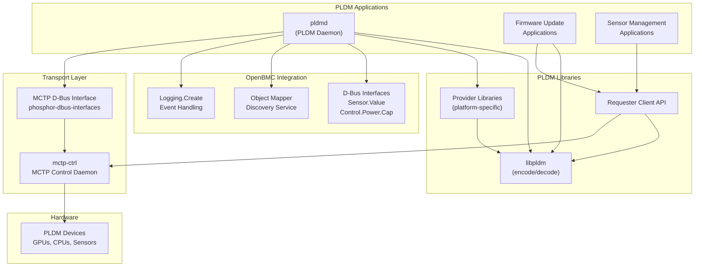

Sources: [designs/pldm-stack.md:115-158]()

### Core Components

#### libpldm Library
The `libpldm` library provides encode/decode functionality for PLDM messages across all PLDM Types. It handles marshalling and unmarshalling of PLDM protocol structures.

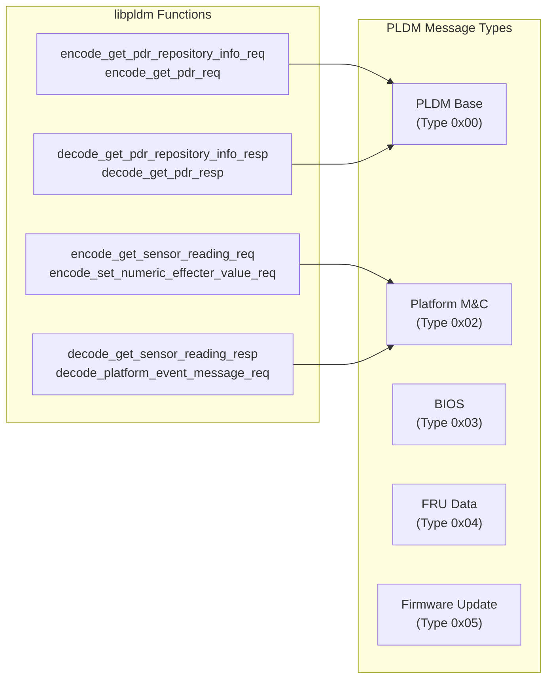

Sources: [designs/pldm-stack.md:130-137]()

#### PLDM Daemon (pldmd)
The `pldmd` daemon serves as both a PLDM requester and responder, managing communication with PLDM devices and exposing sensor/effecter data to OpenBMC via D-Bus.

## Request/Response Model

### Responder Function

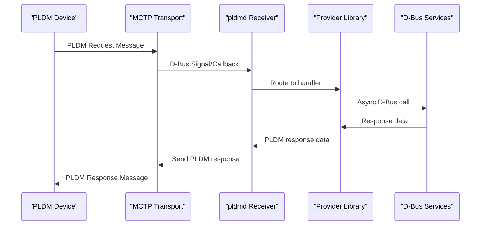

Sources: [designs/pldm-stack.md:164-176]()

### Requester Function

The requester design supports both blocking and non-blocking APIs for PLDM communication:

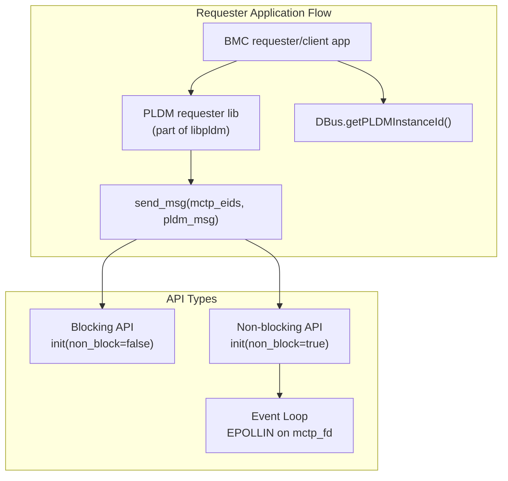

Sources: [designs/pldm-stack.md:196-331]()

## Sensor Management

### Sensor Discovery and Exposure

The PLDM daemon discovers sensors through PDR (Platform Data Record) retrieval and exposes them as D-Bus objects:

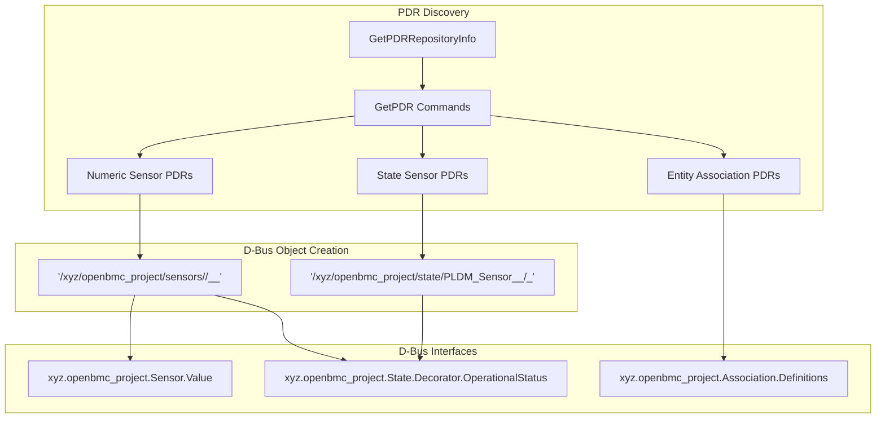

Sources: [designs/pldm-stack.md:356-368](), [designs/pldm-stack.md:370-394](), [designs/pldm-stack.md:495-518]()

### Sensor Monitoring Methods

PLDM supports both polling and asynchronous event-based sensor monitoring:

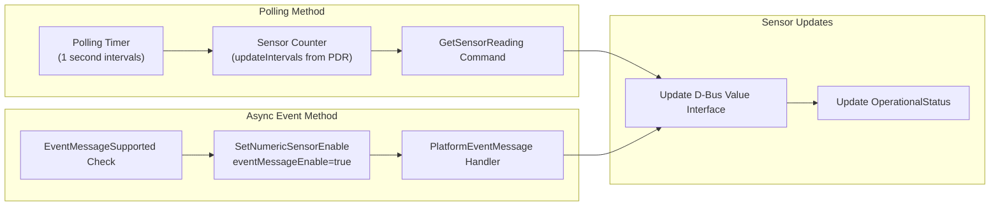

Sources: [designs/pldm-stack.md:525-546]()

## Effecter Management

### Numeric Effecters

Numeric effecters provide control mechanisms, particularly for power management:

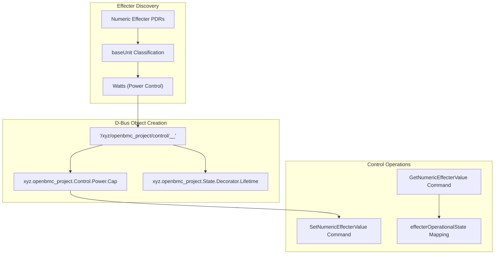

Sources: [designs/pldm-stack.md:547-598]()

### State Effecters

State effecters provide discrete control functionality:

| State Set ID | D-Bus Interface |
|--------------|----------------|
| Remote Debug Enable (33) | `xyz.openbmc_project.Control.Processor.RemoteDebug` |
| Performance (14) | `xyz.openbmc_project.State.ProcessorPerformance` |

Sources: [designs/pldm-stack.md:619-656]()

## Event Handling

### Event Processing Flow

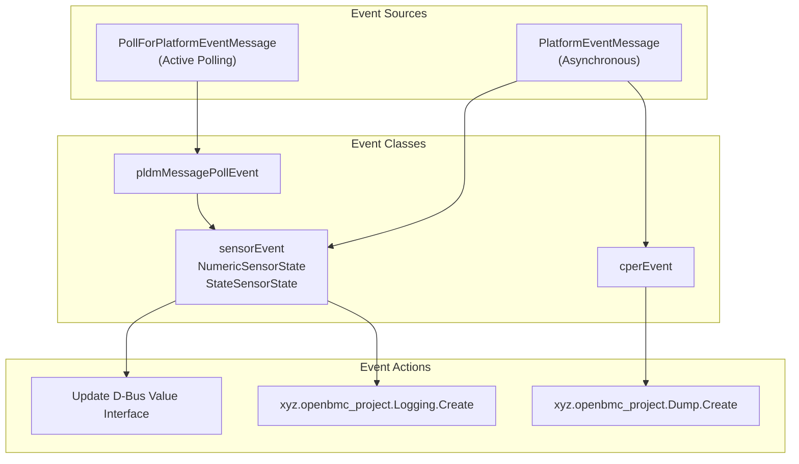

Sources: [designs/pldm-stack.md:658-742]()

### Terminus Initialization

Before handling events, each PLDM terminus must be initialized:

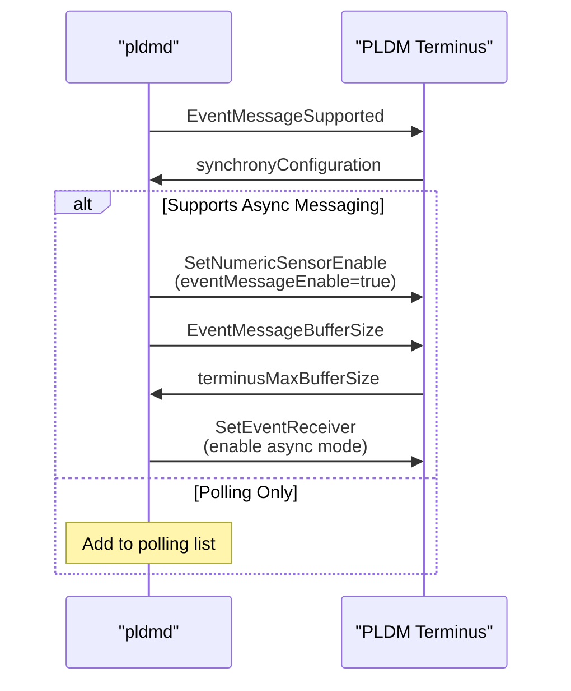

Sources: [designs/pldm-stack.md:664-677]()

## Integration with OpenBMC

### Entity Association and Inventory Mapping

PLDM entities are mapped to OpenBMC inventory objects through Entity Association PDRs:

| PLDM Entity | D-Bus Interface |
|-------------|----------------|
| Overall System (Container ID 0x0000) | `xyz.openbmc_project.Inventory.Item.System` |
| Processor/IO module (Entity ID 81) | `xyz.openbmc_project.Inventory.Item.ProcessorModule` |
| Processor (Entity ID 135) | `xyz.openbmc_project.Inventory.Item.Cpu` |

Sources: [designs/pldm-stack.md:388-413]()

### D-Bus Association Examples

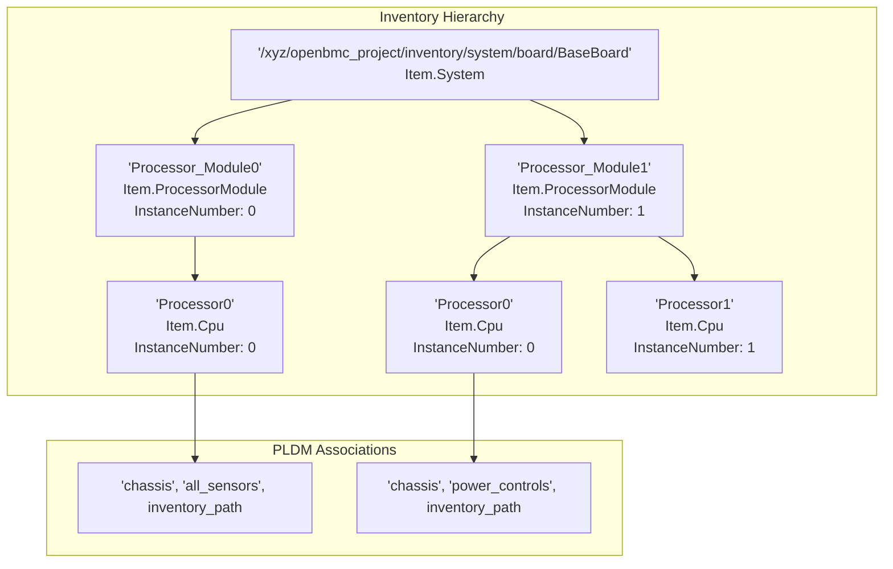

Sources: [designs/pldm-stack.md:418-466]()

## MCTP Integration

The PLDM stack integrates with MCTP through D-Bus interfaces for endpoint discovery and message transport:

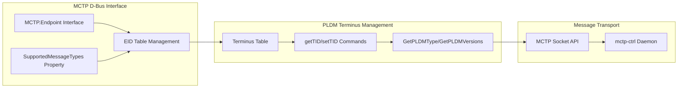

Sources: [designs/pldm-stack.md:332-354]()

---

