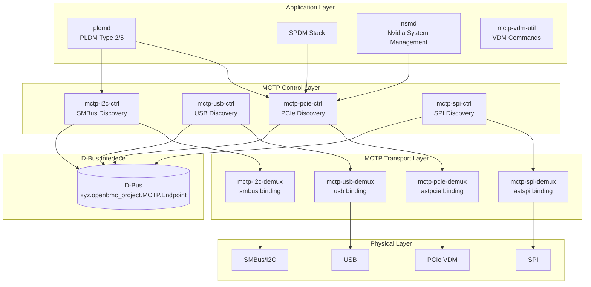
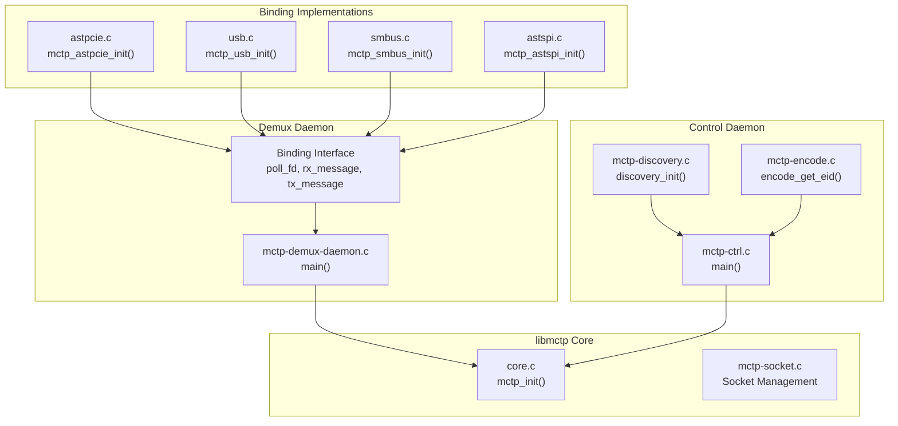
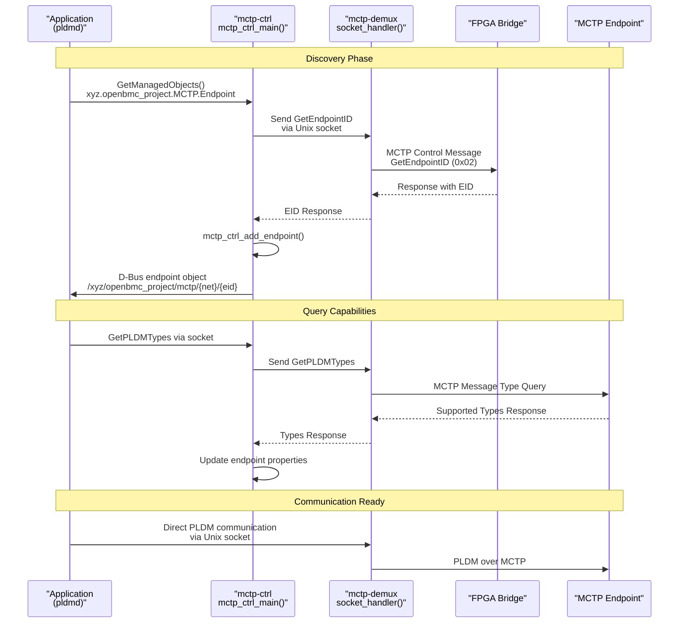

<!-- source: DeepWiki mcp.deepwiki.com · repo NVIDIA/nvbmc-docs · page 5.2 MCTP Transport · fetched 2026-10-26 -->

# MCTP Transport

<details>
<summary>Relevant source files</summary>

The following files were used as context for generating this wiki page:

- [nvidia/FW-Update/fw_update_platform_guide.md](nvidia/FW-Update/fw_update_platform_guide.md)
- [nvidia/Host-Interfaces/redfish-host-interface.md](nvidia/Host-Interfaces/redfish-host-interface.md)
- [nvidia/MCTP/mctp.md](nvidia/MCTP/mctp.md)
- [nvidia/Telemetry/PLDM T2 Telemetry.md](nvidia/Telemetry/PLDM T2 Telemetry.md)

</details>


This document covers the Management Component Transport Protocol (MCTP) implementation in NvBMC, including its architecture, transport bindings, endpoint discovery, and integration with higher-level protocols. MCTP serves as the primary transport layer for device-to-device communication in OpenBMC systems.

For information about PLDM protocols that operate over MCTP, see [PLDM Stack](#5.1). For SPDM security protocols over MCTP, see [SPDM Security Protocol](#5.3).

## Overview

MCTP is the foundational transport protocol for in-band communication between the BMC and managed entities in NvBMC platforms. It enables higher-level application protocols such as PLDM, SPDM, and NVMe-MI to operate over multiple physical transport bindings including PCIe VDM, USB, SMBus, and SPI.

The MCTP implementation follows the upstream OpenBMC userspace design but includes significant NvBMC-specific enhancements for FPGA bridge support, additional transport bindings, and platform-specific discovery protocols.

Sources: [nvidia/MCTP/mctp.md:32-46](), [nvidia/FW-Update/fw_update_platform_guide.md:64-86]()

## System Architecture

### High-Level Architecture



**MCTP Stack Architecture with Code Entities**

The MCTP stack consists of separate demux and control daemon pairs for each physical transport. Applications communicate with MCTP endpoints through UNIX domain sockets exposed by demux daemons, while control daemons handle discovery and expose endpoints via D-Bus.

Sources: [nvidia/MCTP/mctp.md:49-77](), [nvidia/MCTP/mctp.md:261-271]()

### Transport Binding Interface



**MCTP Binding Architecture with Code Files**

Each transport binding implements a standard interface with `poll_fd`, `rx_message`, and `tx_message` functions that the demux daemon uses for event-driven message processing.

Sources: [nvidia/MCTP/mctp.md:99-101](), [nvidia/MCTP/mctp.md:130-271]()

## Transport Bindings

### PCIe VDM Transport

PCIe VDM (Vendor Defined Messages) transport supports FPGA bridge configurations where endpoints are connected downstream to an FPGA that acts as the MCTP bridge.

**Key Implementation Files:**
- `astpcie.c` - PCIe VDM binding implementation
- `astpcie.h` - PCIe binding header definitions
- `mctp-pcie-ctrl` - PCIe control daemon executable
- `mctp-pcie-demux` - PCIe demux daemon executable

**Configuration Parameters:**
- `--bindinfo`: PCIe BDF value (e.g., "00 00 00 00 00 01")
- `--pci_own_eid`: Local EID on PCIe bus
- `--pci_bridge_eid`: EID assigned to FPGA bridge
- `--pci_bridge_pool_start`: Starting EID for bridge pool allocation

Sources: [nvidia/MCTP/mctp.md:515-534](), [nvidia/MCTP/mctp.md:579-596]()

### USB Transport

USB transport also requires an FPGA bridge configuration, supporting batch transmission where multiple MCTP packets can be packed into a single USB packet.

**Key Implementation Files:**
- `usb.c` - USB binding implementation
- `libmctp-usb.h` - USB binding interface
- `mctp-usb-ctrl` - USB control daemon
- `mctp-usb-demux` - USB demux daemon

**Build Configuration:**
- `enable-usb=enabled` - Enables USB binding
- `mctp-batch-tx=enabled` - Enables packet batching

Sources: [nvidia/MCTP/mctp.md:404-422](), [nvidia/MCTP/mctp.md:560-567](), [nvidia/MCTP/mctp.md:599-607]()

### SMBus/I2C Transport

SMBus transport offers the most flexible configuration, supporting both bridged and non-bridged networks through JSON configuration files.

**Key Implementation Files:**
- `smbus.c` - SMBus binding implementation
- `libmctp-smbus.h` - SMBus interface definitions
- `mctp-json.c` - JSON configuration parsing
- `mctp-discovery-i2c.c` - I2C-specific discovery

**JSON Configuration Structure:**
```json
{
  "i2c": {
    "i2c_src_address": 24,
    "src_eid": 11,
    "buses": [
      {
        "bus_number": "i2c16",
        "bus_number_smq": "i2c5", 
        "socket_name": "mctp-i2c5-mux",
        "endpoints": [
          {
            "eid_type": "static",
            "eid": 101,
            "i2c_slave_address": 50
          }
        ]
      }
    ]
  }
}
```

Sources: [nvidia/MCTP/mctp.md:620-746](), [nvidia/MCTP/mctp.md:540-548]()

### SPI Transport

SPI transport supports only a single ERoT endpoint connected directly over the SPI bus.

**Key Implementation Files:**
- `astspi.c` - SPI binding implementation  
- `astspi.h` - SPI binding definitions
- `mctp-spi-ctrl` - SPI control daemon
- `mctp-spi-demux` - SPI demux daemon

**Configuration Parameters:**
- `gpio`: GPIO number for SPI mailbox handshake
- `device`: SPI device number
- `channel`: SPI channel number
- `--uuid`: UUID to assign to SPI ERoT endpoint

Sources: [nvidia/MCTP/mctp.md:549-559](), [nvidia/MCTP/mctp.md:610-618]()

## Endpoint Discovery and Management

### Discovery Flow



**MCTP Discovery and Communication Flow**

The discovery process involves control daemons querying endpoints for their capabilities and exposing them as D-Bus objects that applications can discover and communicate with through demux daemon sockets.

Sources: [nvidia/MCTP/mctp.md:104-127](), [nvidia/Telemetry/PLDM T2 Telemetry.md:252-332]()

### D-Bus Interface

MCTP endpoints are exposed through the `xyz.openbmc_project.MCTP.Endpoint` D-Bus interface at paths like `/xyz/openbmc_project/mctp/{NetworkId}/{EID}`. Additional interfaces include:

- `xyz.openbmc_project.Common.UnixSocket` - Provides socket path for communication
- `xyz.openbmc_project.Inventory.Decorator.I2CDevice` - Exposes I2C bus and address for SMBus endpoints
- `xyz.openbmc_project.Common.UUID` - Provides MCTP UUID for endpoint identification

Sources: [nvidia/Telemetry/PLDM T2 Telemetry.md:89-96](), [nvidia/MCTP/mctp.md:61-67]()

## Platform Enablement

### Build System Integration

MCTP support is included by default in the meta-nvidia layer through the `packagegroup-nvidia-apps.bb` package group. Platform-specific configurations are placed in BitBake meta layers under `meta-nvidia/.../recipes-phosphor/libmctp/`.

**Example Platform Configuration:**
```bitbake
do_install:append:<MACHINE_NAME>() {
    # Disable unused transports
    rm -f ${D}${nonarch_base_libdir}/systemd/system/mctp-spi-ctrl.service
    rm -f ${D}${nonarch_base_libdir}/systemd/system/mctp-spi-demux.service
    
    # Install I2C transport services
    install -m 0644 ${WORKDIR}/systemd/mctp-i2c12-ctrl.service ${D}${nonarch_base_libdir}/systemd/system/
    install -m 0644 ${WORKDIR}/systemd/mctp-i2c12-demux.service ${D}${nonarch_base_libdir}/systemd/system/
}
```

Sources: [nvidia/MCTP/mctp.md:320-401]()

### Systemd Configuration

MCTP services use environment files for configuration parameters. Example environment file at `/usr/share/mctp/mctp`:

```shell
DEMUX_PCIE_BINDING_OPTS=astpcie -e 8
MCTP_PCIE_CTRL_OPTS= -m 1 -t 2 --bindinfo "00 00 00 00 00 01" --pci_own_eid 8 --pci_bridge_eid 12
DEMUX_SPI_BINDING_OPTS=astspi gpio=953  
MCTP_SPI_CTRL_OPTS= -e 0 -i 3 -t 6 -m 1 -u "ad4c836b-c54c-11eb-8529-0242ac130003"
```

Sources: [nvidia/MCTP/mctp.md:424-502]()

### Kernel Dependencies

For SMBus transport, the I2C slave mqueue driver must be enabled:
```makefile
CONFIG_I2C_SLAVE_MQUEUE=y
```

Device tree nodes must specify multi-master capability:
```dts
&i2c5 {
    status = "okay";
    bus-frequency = <400000>;
    multi-master;
};
```

For PCIe transport on AST2600:
```dts
&mctp {
    status = "okay";
};
```

Sources: [nvidia/MCTP/mctp.md:620-642](), [nvidia/MCTP/mctp.md:586-595]()

## Integration with Higher-Level Protocols

MCTP serves as the transport foundation for several critical protocols in NvBMC:

- **PLDM Type 2**: Sensor telemetry and platform monitoring over MCTP
- **PLDM Type 5**: Firmware update operations using MCTP transport
- **SPDM**: Device attestation and secure communication protocols
- **NSM**: NVIDIA System Management telemetry collection
- **VDM**: Vendor-defined messages for platform-specific operations

The modular architecture allows these protocols to operate over any supported MCTP transport binding, providing flexibility for different platform hardware configurations.

Sources: [nvidia/FW-Update/fw_update_platform_guide.md:64-86](), [nvidia/Telemetry/PLDM T2 Telemetry.md:89-96]()

---

