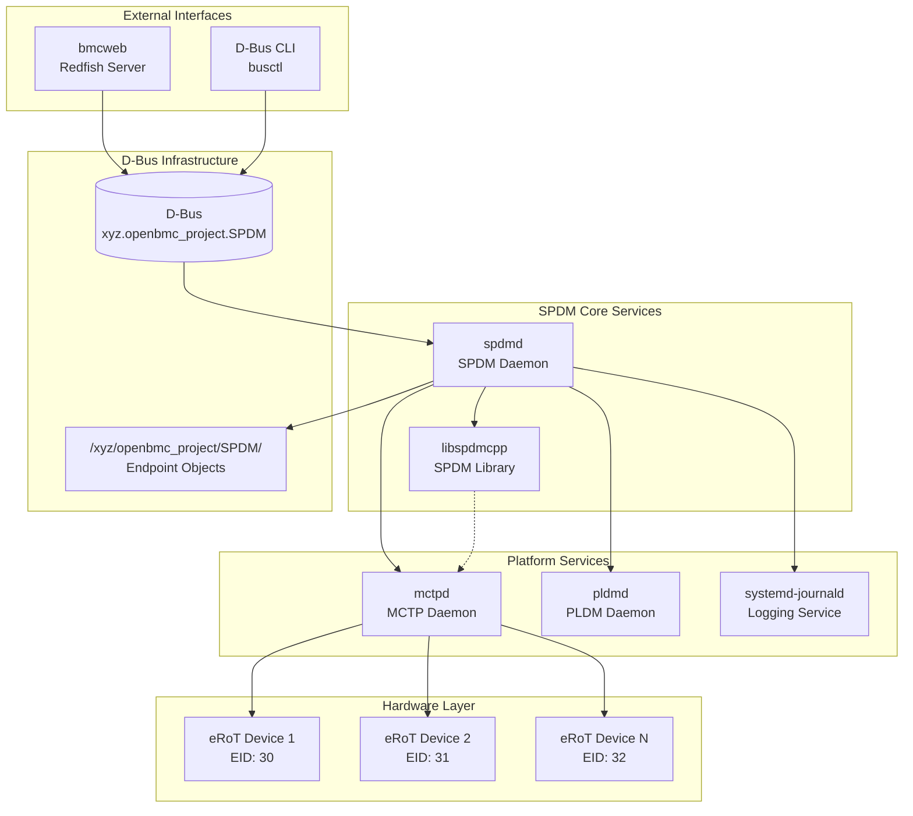
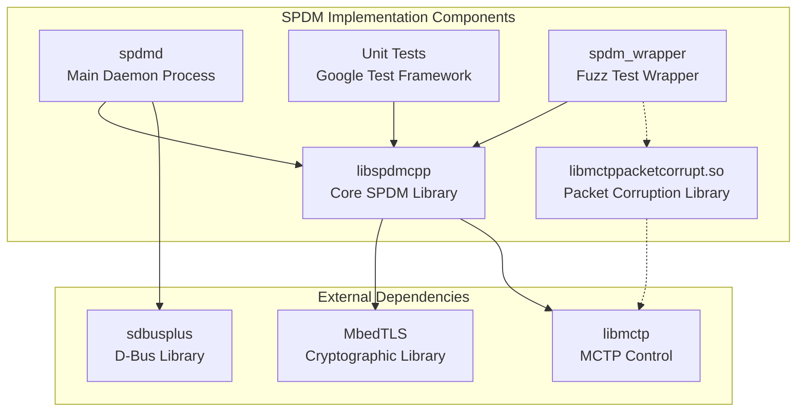

<!-- source: DeepWiki mcp.deepwiki.com · repo NVIDIA/nvbmc-docs · page 5.3 SPDM Security Protocol · fetched 2026-10-26 -->

# SPDM Security Protocol

<details>
<summary>Relevant source files</summary>

The following files were used as context for generating this wiki page:

- [nvidia/Attestation/resources/spdm_services.png](nvidia/Attestation/resources/spdm_services.png)
- [nvidia/Attestation/resources/spdm_services.puml](nvidia/Attestation/resources/spdm_services.puml)
- [nvidia/Attestation/resources/spdm_structure.png](nvidia/Attestation/resources/spdm_structure.png)
- [nvidia/Attestation/resources/spdm_structure.puml](nvidia/Attestation/resources/spdm_structure.puml)
- [nvidia/Attestation/spdmd.md](nvidia/Attestation/spdmd.md)

</details>


This document covers the Security Protocol and Data Model (SPDM) implementation in OpenBMC, which provides device authentication, measurement collection, and secure communication capabilities for platform components. The SPDM implementation enables BMCs to act as requesters to collect cryptographic measurements and certificates from SPDM-capable endpoints over MCTP transport.

For information about the underlying MCTP transport layer, see [MCTP Transport](#5.2). For details about PLDM-based firmware updates that may use SPDM for security, see [Firmware Update Platform](#6.3).

## Architecture Overview

The SPDM implementation consists of multiple integrated components that work together to provide secure device communication and attestation services.

### High-Level System Architecture



**Sources:** [nvidia/Attestation/resources/spdm_services.puml:1-21](), [nvidia/Attestation/spdmd.md:99-107]()

### SPDM Module Structure



**Sources:** [nvidia/Attestation/resources/spdm_structure.puml:1-35](), [nvidia/Attestation/spdmd.md:286-298]()

## Core Components

### SPDM Daemon (`spdmd`)

The `spdmd` daemon serves as the central orchestrator for SPDM operations, implementing the SPDM requester role and managing communication with SPDM responder devices.

| Component | Description |
|-----------|-------------|
| **Process Model** | Single-threaded daemon with event-driven architecture |
| **Discovery** | MCTP endpoint discovery and PLDM inventory integration |
| **D-Bus Handler** | Manages D-Bus object creation and property updates |
| **SPDM State Machine** | Implements SPDM protocol state transitions |

#### Key Responsibilities

- **Endpoint Discovery**: Discovers SPDM-capable devices through MCTP and PLDM services
- **Certificate Management**: Retrieves and validates X.509 certificate chains from responders  
- **Measurement Collection**: Collects cryptographic measurements and signed attestations
- **D-Bus API**: Exposes SPDM data through structured D-Bus object interfaces
- **Error Handling**: Manages timeouts, retries, and communication error scenarios

**Sources:** [nvidia/Attestation/spdmd.md:334-345](), [nvidia/Attestation/spdmd.md:114-123]()

### SPDM Library (`libspdmcpp`)

The `libspdmcpp` library provides the core SPDM protocol implementation as a reusable C++ library.

| Feature | Implementation |
|---------|----------------|
| **Language** | C++ with thread-safe design using `std::mutex` |
| **Crypto Backend** | MbedTLS for SHA-2, RSA-SSA/ECDSA, FFDHE/ECDHE, AES_GCM |
| **Transport** | SPDM over MCTP binding (DSP0275) |
| **Security** | Secured messages support (DSP0277) |

#### Supported SPDM Messages

The library implements the following SPDM v1.1 message types:

- `GET_CAPABILITIES` / `CAPABILITIES`
- `NEGOTIATE_ALGORITHMS` / `ALGORITHMS` 
- `GET_DIGEST` / `DIGEST`
- `GET_CERTIFICATE` / `CERTIFICATE`
- `CHALLENGE` / `CHALLENGE_AUTH`
- `GET_MEASUREMENTS` / `MEASUREMENTS`

**Sources:** [nvidia/Attestation/spdmd.md:311-320](), [nvidia/Attestation/spdmd.md:82-88]()

## D-Bus API Integration

### Object Tree Structure

SPDM endpoints are exposed through a hierarchical D-Bus object tree:

```
/xyz/openbmc_project/SPDM/
├── /xyz/openbmc_project/SPDM/HGX_ERoT_BMC_0
├── /xyz/openbmc_project/SPDM/HGX_ERoT_FPGA_0  
└── /xyz/openbmc_project/SPDM/HGX_ERoT_NVSwitch_0
```

Each endpoint object implements the `xyz.openbmc_project.SPDM.Responder` interface with properties for certificates, measurements, and status information.

**Sources:** [nvidia/Attestation/spdmd.md:142-155]()

### D-Bus Interface Properties

| Property | Type | Description |
|----------|------|-------------|
| `Capabilities` | `uint32` | Responder capabilities per DSP0274 flags |
| `Certificate` | `string` | ASN.1 PEM-encoded X.509 certificate chain |
| `HashingAlgorithm` | `string` | Negotiated hashing algorithm |
| `Measurements` | `array[struct]` | Firmware/software measurement data |
| `MeasurementsHash` | `string` | Hash of nonce and measurement blocks |
| `MeasurementsSignature` | `string` | Cryptographic signature of measurements hash |
| `SigningAlgorithm` | `string` | Negotiated signing algorithm |
| `Status` | `string` | Communication status (Success/Error states) |
| `Version` | `string` | SPDM protocol version |

### Refresh Method

The `Refresh` method triggers fresh measurement collection with parameters:

| Parameter | Type | Description |
|-----------|------|-------------|  
| `slot` | `byte` | Certificate slot number (default: 0) |
| `nonce` | `array[byte]` | Random nonce up to 32 bytes |
| `MeasurementIndices` | `array[byte]` | Measurement block indices (0-254, or 255 for all) |
| `sessionId` | `uint32` | Optional session ID for secure communication |

**Sources:** [nvidia/Attestation/spdmd.md:164-192]()

## Platform Integration

### MCTP Transport Integration

SPDM messages are transported over MCTP using the binding specification DSP0275. The daemon integrates with `mctpd` for:

- **Endpoint Discovery**: Querying MCTP endpoints with message type 5 (SPDM)
- **Transport Selection**: Prioritizing PCIe > SPI > I2C for multi-interface devices  
- **Message Exchange**: Sending/receiving SPDM payloads over MCTP

### PLDM Inventory Integration

The daemon uses PLDM inventory data to:

- **Device Identification**: Match MCTP UUIDs with inventory objects
- **Component Mapping**: Associate SPDM measurements with protected components
- **Interface Discovery**: Query `Item.ComponentIntegrity` interface implementations

**Sources:** [nvidia/Attestation/spdmd.md:115-119](), [nvidia/Attestation/spdmd.md:268-285]()

## Configuration and Deployment

### Command Line Options

| Option | Description |
|--------|-------------|
| `--version`, `-v` | Display version and compilation date |
| `--verbose [0-7]` | Set debug level (0=Emergency, 7=Debug) |
| `--cached_measurements` | Enable automatic measurement collection on discovery |
| `--cached_measurements_delay` | Initial communication delay in seconds (default: 60) |

### Meson Build Configuration

| Option | Default | Description |
|--------|---------|-------------|
| `systemd` | enabled | Create systemd service unit |
| `discovery_only_from_mctp_control` | disabled | MCTP-only discovery (no PLDM inventory) |
| `fetch_serialnumber_from_responder` | enabled | Fetch serial number from measurements |
| `emu` | disabled | Build SPDM responder emulator |

### Configuration File

Optional configuration file `/etc/spdmd_conf.json` for defining non-Redfish endpoints:

```json
{
    "endpoints": [
        {
            "eid": 30,
            "name": "satmc", 
            "enabled": false,
            "description": "Satellite Management Controller"
        }
    ]
}
```

**Sources:** [nvidia/Attestation/spdmd.md:346-376](), [nvidia/Attestation/spdmd.md:377-412]()

## Error Handling and Status Management

### Status States

| Status | Description | Recovery |
|--------|-------------|----------|
| `Success` | Communication successful, data ready | N/A |
| `Initializing` | Initial state after system restart | Automatic progression |
| `GettingCertificates` | Certificate retrieval in progress | Wait or timeout |
| `GettingMeasurements` | Measurement collection in progress | Wait or timeout |
| `Error_ConnectionTimeout` | No response within timeout window | Automatic retry |
| `Error_Responder` | Invalid response from responder | Manual refresh required |
| `Error_CertificateValidation` | Certificate validation failed | Manual refresh required |
| `Error_AuthenticationFailed` | Authentication process failed | Manual refresh required |

### Timeout Configuration

| Parameter | Value | Description |
|-----------|-------|-------------|
| **T1** | RTT + ST1 | Timeout for non-cryptographic requests |
| **T2** | Variable | Timeout for cryptographic operations |
| **ST1** | 100ms | Maximum responder processing time |
| **Current T1** | 3.1s | Current eRoT implementation |
| **Current T2** | 68s | Current eRoT implementation |

**Sources:** [nvidia/Attestation/spdmd.md:414-435](), [nvidia/Attestation/spdmd.md:75-78]()

## Testing Infrastructure

### Unit Testing

The implementation includes comprehensive unit tests using Google Test framework:

- **Coverage**: 88% line coverage, 96.5% function coverage
- **Scope**: All `libspdmcpp` API functions have dedicated tests
- **Framework**: Google Test with thread-safe test execution

### Fuzz Testing

AFL++ framework integration for robustness testing:

- **Wrapper**: `spdm_wrapper` application for standalone/fuzzer operation
- **Input Generation**: Grammar-based and response dictionary scenarios  
- **Packet Corruption**: `libmctppacketcorrupt.so` for error simulation
- **State Testing**: Fuzzing of SPDM state machine transitions

### Stress Testing

Integration with `openbmc-test-automation` repository:

- **Robot Framework**: Automated long-duration testing
- **Load Generation**: Cyclical measurement requests to bmcweb
- **System Integration**: Full system stress testing including SPDM operations

**Sources:** [nvidia/Attestation/spdmd.md:545-550](), [nvidia/Attestation/spdmd.md:548-586](), [nvidia/Attestation/spdmd.md:640-659]()

---

