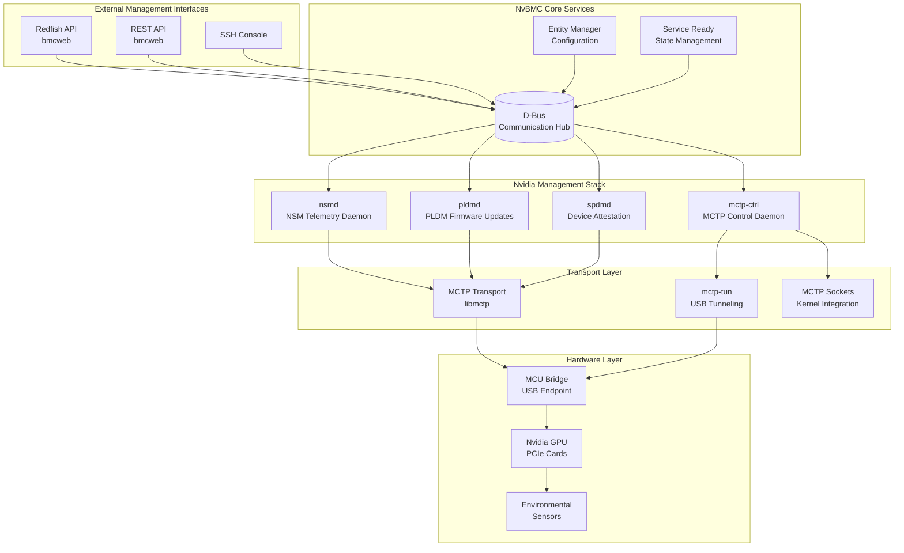
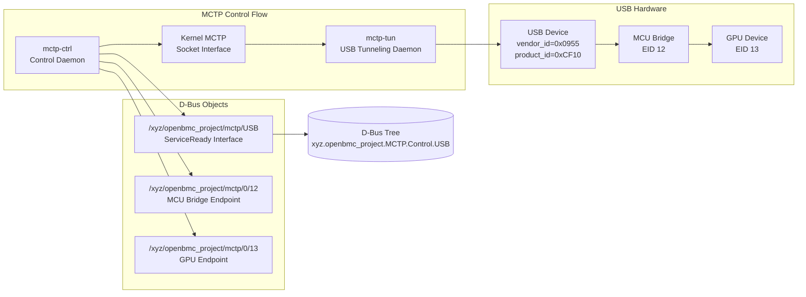
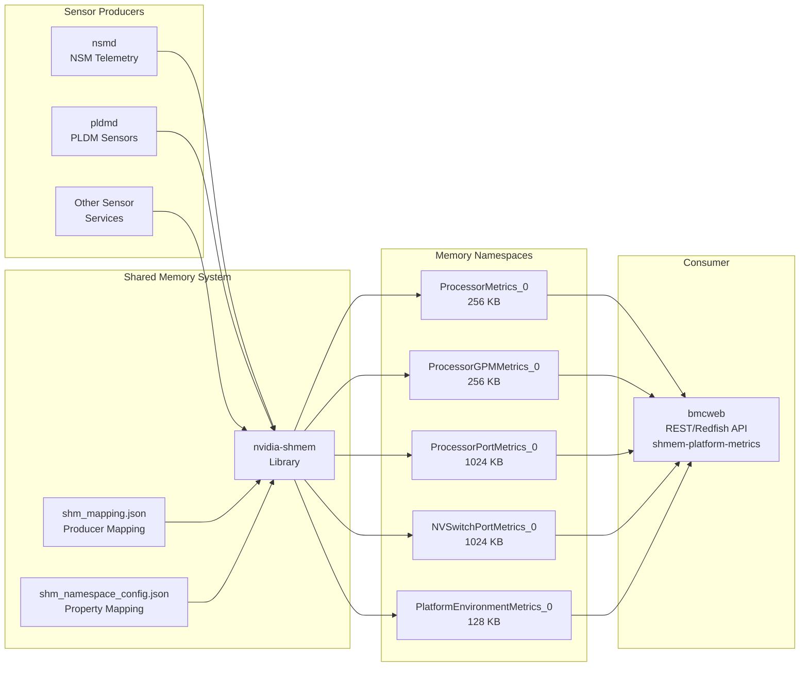

<!-- source: DeepWiki mcp.deepwiki.com · repo NVIDIA/nvbmc-docs · page 6 Nvidia OpenBMC (NvBMC) · fetched 2026-10-26 -->

# Nvidia OpenBMC (NvBMC)

Relevant source files

The following files were used as context for generating this wiki page:

- [nvidia/Platforms/gpu-pcie-card-mgmt.md](nvidia/Platforms/gpu-pcie-card-mgmt.md)

## Purpose and Scope

NvBMC (Nvidia OpenBMC) is Nvidia's specialized implementation of the OpenBMC firmware stack designed for out-of-band management of Nvidia GPU and accelerator systems. This document covers the architecture, core services, and platform integration of NvBMC for managing Nvidia GPU PCIe cards and related hardware.

NvBMC extends the standard OpenBMC framework with Nvidia-specific management protocols and services while maintaining compatibility with industry-standard interfaces. For general OpenBMC architecture information, see [Core Architecture](#3). For platform-agnostic protocol details, see [Platform Protocols](#5).

## Architecture Overview

NvBMC implements a layered architecture that extends OpenBMC's D-Bus-centric design with Nvidia-specific management services. The system provides out-of-band management capabilities for GPU hardware through multiple transport protocols and industry-standard APIs.

**NvBMC System Architecture**

The architecture demonstrates how NvBMC integrates Nvidia-specific services with standard OpenBMC components. The `nsmd`, `pldmd`, and `spdmd` services provide GPU-specific management capabilities while communicating through standard D-Bus interfaces and MCTP transport protocols.

**Sources**: [nvidia/Platforms/gpu-pcie-card-mgmt.md:1-25]()

## Core Management Features

NvBMC provides comprehensive out-of-band management for Nvidia GPU systems through multiple protocols and transport mechanisms:

| Feature | Protocol | Transport | NvBMC Service | Purpose |
|---------|----------|-----------|---------------|---------|
| Enumeration | MCTP | USB | `libmctp`, `mctp-ctrl` | GPU discovery and endpoint management |
| Telemetry | NSM over MCTP | USB | `nsmd` | Sensor data and metrics collection |
| Firmware Update | PLDM Type 5 over MCTP | USB | `pldmd` | Secure firmware management |
| Attestation | SPDM over MCTP | USB | `spdmd` | Hardware security verification |
| Firmware Recovery | OCP Recovery | I2C | `pldmd` | Emergency recovery procedures |
| Management API | Redfish | HTTP/HTTPS | `bmcweb` | Standard management interface |

**Sources**: [nvidia/Platforms/gpu-pcie-card-mgmt.md:10-18]()

## MCTP Enumeration and Discovery

The MCTP (Management Component Transport Protocol) layer provides the foundation for GPU discovery and communication. NvBMC implements USB-based MCTP transport with kernel socket integration for efficient packet routing.

**MCTP Discovery and Endpoint Management**

Each discovered MCTP endpoint exposes standardized D-Bus interfaces including `xyz.openbmc_project.MCTP.Endpoint`, `xyz.openbmc_project.Common.UUID`, and `xyz.openbmc_project.Object.Enable` for integration with other OpenBMC services.

**Sources**: [nvidia/Platforms/gpu-pcie-card-mgmt.md:29-241]()

## NSM Telemetry System

The NSM (Nvidia System Management) daemon (`nsmd`) provides comprehensive telemetry collection and sensor management for Nvidia GPU devices. It integrates with Entity Manager for configuration and exposes sensor data through standard OpenBMC D-Bus interfaces.

```mermaid
graph TB
    subgraph "NSM Configuration"
        EntityManager["Entity Manager<br/>JSON Configuration"]
        StaticInventory["Static Inventory<br/>hgxb_static_inventory.json"]
        DynamicInventory["Dynamic Inventory<br/>hgxb_gpu_chassis.json"]
        InstanceMapping["Instance Mapping<br/>hgxb_instance_mapping.json"]
    end
    
    subgraph "NSM Service"
        NSMd["nsmd<br/>System Management Daemon"]
        ServiceReady["/xyz/openbmc_project/NSM<br/>ServiceReady Interface"]
        FruDevice["/xyz/openbmc_project/FruDevice/{EID}<br/>Device Information"]
    end
    
    subgraph "Sensor Objects"
        TempSensors["/xyz/openbmc_project/sensors/temperature<br/>GPU Temperature Sensors"]
        PowerSensors["/xyz/openbmc_project/sensors/power<br/>GPU Power Sensors"]
        VoltageSensors["/xyz/openbmc_project/sensors/voltage<br/>GPU Voltage Sensors"]
        EnergySensors["/xyz/openbmc_project/sensors/energy<br/>GPU Energy Counters"]
    end
    
    subgraph "Inventory Objects"
        Chassis["/xyz/openbmc_project/inventory/system/chassis<br/>GPU Chassis Objects"]
        Processors["/xyz/openbmc_project/inventory/system/processors<br/>GPU Processor Objects"]
        Memory["/xyz/openbmc_project/inventory/system/memory<br/>GPU Memory Objects"]
    end
    
    EntityManager --> NSMd
    StaticInventory --> EntityManager
    DynamicInventory --> EntityManager
    InstanceMapping --> EntityManager
    
    NSMd --> ServiceReady
    NSMd --> FruDevice
    NSMd --> TempSensors
    NSMd --> PowerSensors
    NSMd --> VoltageSensors
    NSMd --> EnergySensors
    NSMd --> Chassis
    NSMd --> Processors
    NSMd --> Memory
```

**NSM Telemetry Architecture**

The NSM daemon creates extensive D-Bus object hierarchies for each GPU, including sensors, inventory items, and control objects. The system supports both static inventory (always present) and dynamic inventory (created when devices are enumerated).

**Sources**: [nvidia/Platforms/gpu-pcie-card-mgmt.md:281-1661]()

## Entity Manager Integration

NvBMC extensively uses Entity Manager for configuration management, supporting both static and dynamic inventory creation based on JSON configuration files:

### Static vs Dynamic Inventory

**Static Inventory**: Objects always present on D-Bus regardless of device communication status. Uses UUID format `"DEVICE_TYPE=X:INSTANCE_ID=Y"` with probe rule `"Probe": "TRUE"`.

**Dynamic Inventory**: Objects created only when devices are enumerated on MCTP network. Uses probe rule `"xyz.openbmc_project.FruDevice({'DEVICE_TYPE': X})"` with UUID `"$UUID"`.

### Configuration Objects

| Configuration Type | Purpose | Example Objects |
|-------------------|---------|-----------------|
| `NSM_Chassis` | GPU chassis representation | Physical GPU modules |
| `NSM_Processor` | GPU processor objects | Computing units |
| `NSM_Memory` | GPU memory objects | HBM memory modules |
| `NSM_Temp` | Temperature sensors | Thermal monitoring |
| `NSM_Power` | Power sensors | Power consumption tracking |
| `NSM_PCIeDevice` | PCIe device representation | PCIe interface objects |

**Sources**: [nvidia/Platforms/gpu-pcie-card-mgmt.md:402-477](), [nvidia/Platforms/gpu-pcie-card-mgmt.md:658-1474]()

## Shared Memory Integration

NvBMC integrates with the `nvidia-shmem` library to provide high-performance sensor data caching for improved REST API response times. This system acts as a sensor repository cache for `bmcweb` to reduce MRD (Metrics Request Data) processing latency.

**Shared Memory Sensor Caching Architecture**

The shared memory system partitions sensor data into namespaces with pre-allocated memory regions. Each namespace is updated by specific producer services and consumed by `bmcweb` for rapid API response generation.

**Sources**: [nvidia/Platforms/gpu-pcie-card-mgmt.md:1664-1863]()

## Service Dependencies and Lifecycle

NvBMC services follow a specific startup sequence and dependency chain to ensure proper system initialization:

| Service | Dependencies | D-Bus Interface | Purpose |
|---------|-------------|-----------------|---------|
| `mctp-usb-tun.service` | USB hardware | N/A | USB MCTP transport |
| `mctp-usb-ctrl.service` | `mctp-usb-tun.service` | `xyz.openbmc_project.MCTP.Control.USB` | MCTP endpoint discovery |
| `nsmd.service` | MCTP control, Entity Manager | `xyz.openbmc_project.State.ServiceReady` | NSM telemetry collection |
| `pldmd.service` | MCTP control | PLDM interfaces | Firmware management |
| `spdmd.service` | MCTP control | SPDM interfaces | Device attestation |

Each service implements the `xyz.openbmc_project.State.ServiceReady` interface with appropriate `ServiceType` values (`MCTP`, `NSM`, etc.) and state transitions from `Starting` to `Enabled` upon successful initialization.

**Sources**: [nvidia/Platforms/gpu-pcie-card-mgmt.md:121-157](), [nvidia/Platforms/gpu-pcie-card-mgmt.md:1534-1560]()

## Platform Enablement Process

Integrating NvBMC into a platform requires specific BitBake recipe modifications, configuration files, and systemd service setup:

1. **MCTP Transport Setup**: Configure `libmctp` with USB transport and kernel MCTP socket support
2. **NSM Service Integration**: Add `nsmd` recipe with Entity Manager JSON configurations  
3. **Shared Memory Configuration**: Set up `nvidia-shmem` with platform-specific namespace mappings
4. **BMCWeb Integration**: Enable shared memory platform metrics in `bmcweb` build configuration

The process involves creating platform-specific JSON configuration files, systemd service files, and BitBake recipe extensions to enable the full NvBMC management stack.

**Sources**: [nvidia/Platforms/gpu-pcie-card-mgmt.md:25-28](), [nvidia/Platforms/gpu-pcie-card-mgmt.md:285-399](), [nvidia/Platforms/gpu-pcie-card-mgmt.md:1688-1723]()

---

