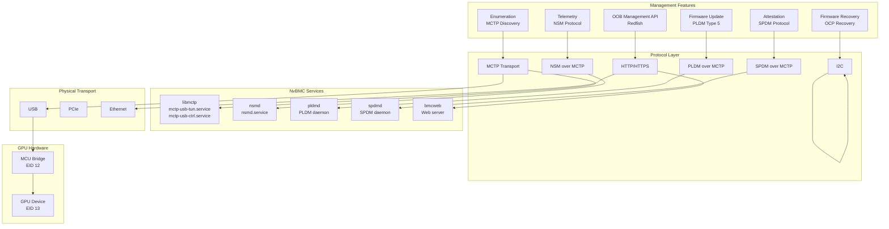
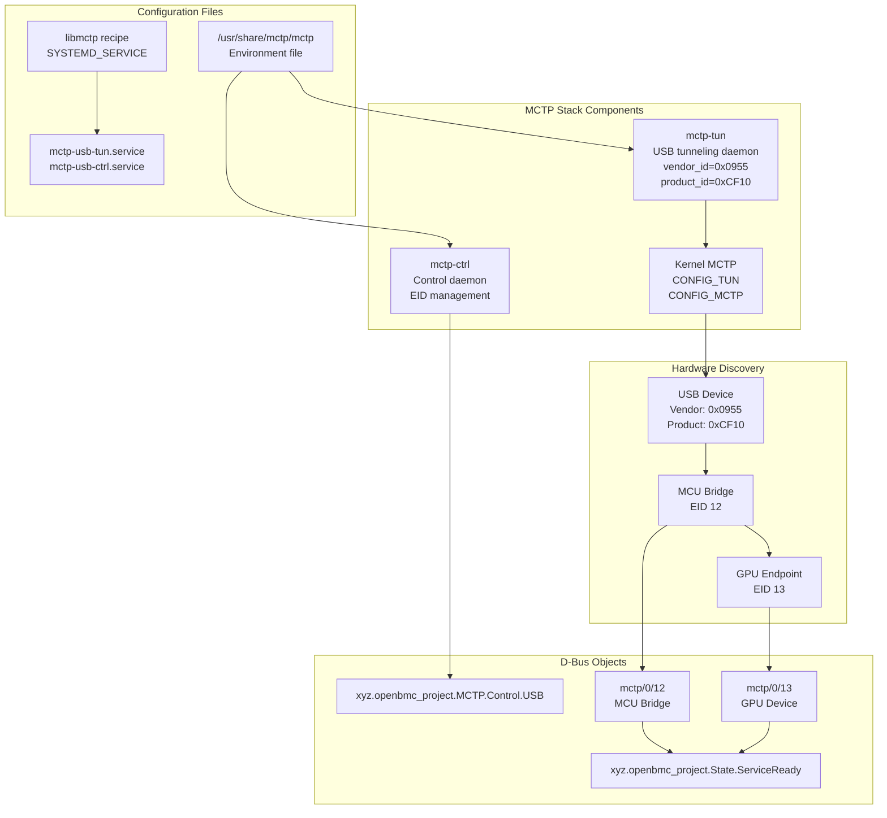
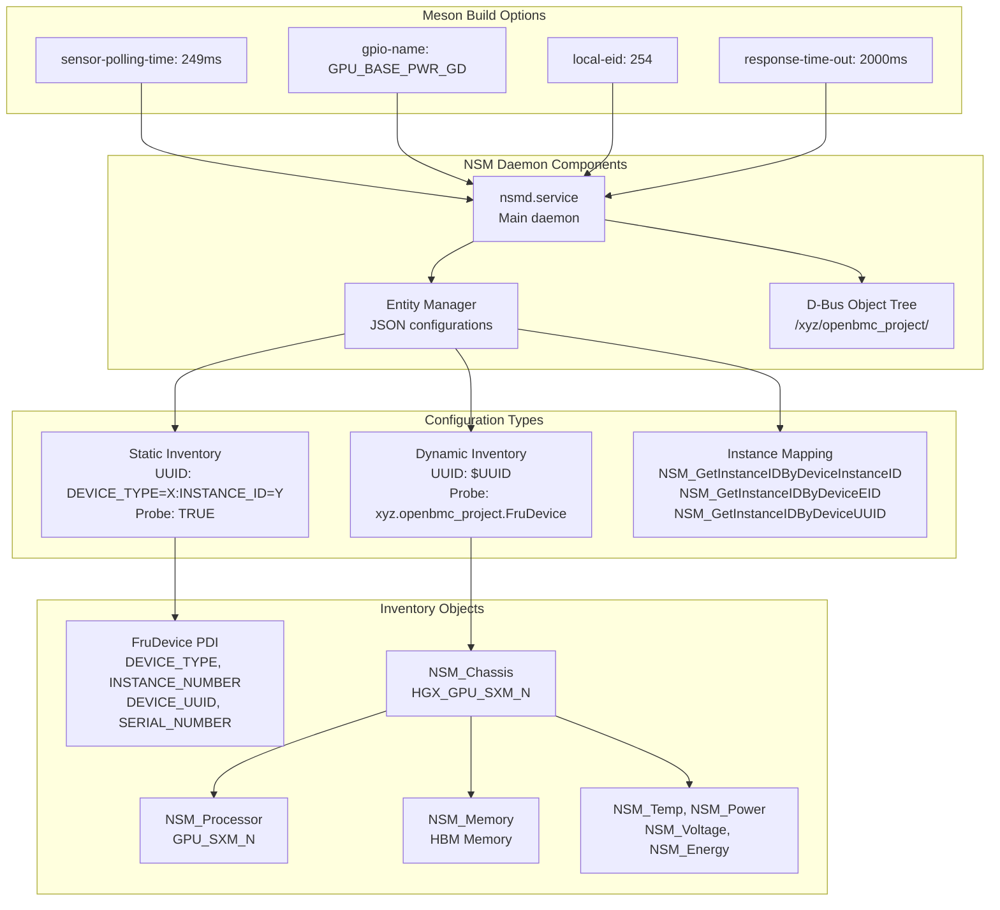
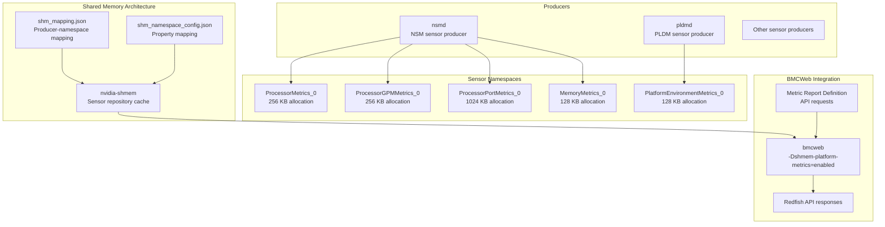

<!-- source: DeepWiki mcp.deepwiki.com · repo NVIDIA/nvbmc-docs · page 6.1 GPU PCIe Card Management · fetched 2026-10-26 -->

# GPU PCIe Card Management

<details>
<summary>Relevant source files</summary>

The following files were used as context for generating this wiki page:

- [nvidia/Platforms/gpu-pcie-card-mgmt.md](nvidia/Platforms/gpu-pcie-card-mgmt.md)

</details>


## Purpose and Scope

This document describes the out-of-band (OOB) management of Nvidia GPU PCIe cards through the NvBMC (Nvidia OpenBMC) stack. It covers the protocols, services, and configuration required to enable enumeration, telemetry collection, firmware updates, and attestation for GPU devices connected via PCIe.

For information about the NSM telemetry protocol specifically, see [NSM Telemetry System](#6.2). For firmware update procedures, see [Firmware Update Platform](#6.3). For device attestation, see [Device Attestation](#6.4).

## Management Architecture Overview

NvBMC provides comprehensive OOB management capabilities for GPU PCIe cards through multiple protocols and transport mechanisms:



**GPU Management Protocol Stack**

| Feature | Protocol | Transport | NvBMC Service Repository |
|---------|----------|-----------|--------------------------|
| Enumeration | MCTP | USB | [libmctp](https://github.com/NVIDIA/libmctp) |
| Telemetry | NSM over MCTP | USB | [nsmd](https://github.com/NVIDIA/nsmd) |
| Firmware Update | PLDM Type 5 over MCTP | USB | [pldm](https://github.com/NVIDIA/pldm) |
| Attestation | SPDM over MCTP | USB | [spdm](https://github.com/NVIDIA/spdm) |
| Firmware Recovery | OCP Recovery | I2C | [pldm](https://github.com/NVIDIA/pldm) |
| OOB Management API | Redfish | HTTP | [bmcweb](https://github.com/NVIDIA/bmcweb) |

Sources: [nvidia/Platforms/gpu-pcie-card-mgmt.md:10-17]()

## Enumeration Process

GPU enumeration uses MCTP (Management Component Transport Protocol) over USB to discover and establish communication with GPU devices. The process involves configuring the MCTP tunneling daemon and control daemon.



**MCTP Enumeration Flow**

### BitBake Recipe Configuration

The MCTP enumeration requires a BitBake recipe that enables USB transport and in-kernel MCTP support:

Key configuration parameters from [nvidia/Platforms/gpu-pcie-card-mgmt.md:39-82]():
- `EXTRA_OEMESON += " -Denable-usb=enabled -Dmctp-in-kernel-enable=enabled -Denable-mctp-tun=enabled "`
- SystemD services: `mctp-usb-tun.service` and `mctp-usb-ctrl.service`
- Dependencies: `json-c`, `i2c-tools`, `libusb1`

### Runtime Configuration

The MCTP stack requires kernel configuration and routing setup from [nvidia/Platforms/gpu-pcie-card-mgmt.md:90-113]():

```bash
# Kernel requirements
CONFIG_TUN=y
CONFIG_MCTP=y

# MCTP routing setup
mctp addr add 8 dev tun0      # Local EID 8
mctp route add 12 via tun0    # MCU bridge EID 12
mctp route add 13 via tun0    # GPU EID 13
mctp link set tun0 up
```

### D-Bus Interface Implementation

Each discovered MCTP endpoint creates D-Bus objects implementing these interfaces from [nvidia/Platforms/gpu-pcie-card-mgmt.md:215-241]():

| Interface | Properties | Purpose |
|-----------|------------|---------|
| `xyz.openbmc_project.Common.UUID` | `UUID` | MCTP endpoint identification |
| `xyz.openbmc_project.MCTP.Binding` | `BindingType` | Transport binding type |
| `xyz.openbmc_project.MCTP.Endpoint` | `EID`, `MediumType`, `NetworkId`, `SupportedMessageTypes` | Endpoint capabilities |
| `xyz.openbmc_project.Object.Enable` | `Enabled` | Endpoint state management |

Sources: [nvidia/Platforms/gpu-pcie-card-mgmt.md:29-278]()

## Telemetry System

The NSM (Nvidia System Management) daemon provides comprehensive telemetry collection from GPU devices through the MCTP transport. NSM supports both static and dynamic inventory management.



**NSM Telemetry Architecture**

### Static vs Dynamic Inventory

NSM supports two inventory management approaches from [nvidia/Platforms/gpu-pcie-card-mgmt.md:403-413]():

**Static Inventory**: Objects are always populated regardless of device communication status
- UUID format: `"DEVICE_TYPE=X:INSTANCE_ID=Y"` (e.g., `"STATIC:0:3"`)
- Probe condition: `"TRUE"` (not dependent on EID enumeration)

**Dynamic Inventory**: Objects created only when devices are discovered
- UUID format: `"$UUID"` (uses runtime UUID)
- Probe condition: `"xyz.openbmc_project.FruDevice({'DEVICE_TYPE': X})"`

### NSM Build Configuration

Key meson build options from [nvidia/Platforms/gpu-pcie-card-mgmt.md:332-351]():

| Option | Default | Description |
|--------|---------|-------------|
| `sensor-polling-time` | 249ms | Sensor polling interval |
| `gpio-name` | `GPU_BASE_PWR_GD` | GPIO for NSM operations |
| `local-eid` | 254 | Default local EID |
| `response-time-out` | 2000ms | NSM response timeout |
| `shmem` | enabled | Shared memory IPC support |

### Entity Manager Configuration

The telemetry system requires Entity Manager JSON configurations for inventory creation. Example GPU chassis configuration from [nvidia/Platforms/gpu-pcie-card-mgmt.md:750-1475]():

```json
{
  "Name": "HGX_GPU_SXM_$INSTANCE_NUMBER + 1",
  "Type": "chassis",
  "Probe": "xyz.openbmc_project.NsmDevice({'DEVICE_TYPE': 0})",
  "Parent_Chassis": "/xyz/openbmc_project/inventory/system/chassis/HGX_Chassis_0",
  "Exposes": [
    {
      "Name": "HGX_GPU_SXM_$INSTANCE_NUMBER + 1",
      "Type": "NSM_Chassis",
      "UUID": "$UUID",
      "DeviceType": "$DEVICE_TYPE"
    }
  ]
}
```

Sources: [nvidia/Platforms/gpu-pcie-card-mgmt.md:280-1661]()

## D-Bus Interface Structure

The NSM system creates a comprehensive D-Bus object tree representing GPU inventory and sensors. The structure follows OpenBMC conventions with Nvidia-specific extensions.

```mermaid
graph TD
    subgraph "Service Objects"
        NSMService["xyz.openbmc_project.NSM<br/>/xyz/openbmc_project/NSM<br/>ServiceReady interface"]
        FruDevices["FruDevice Objects<br/>/xyz/openbmc_project/FruDevice/EID"]
    end
    
    subgraph "Inventory Hierarchy"
        Chassis["Chassis Objects<br/>/xyz/openbmc_project/inventory/system/chassis/<br/>HGX_GPU_SXM_N"]
        Processors["Processor Objects<br/>/xyz/openbmc_project/inventory/system/processors/<br/>GPU_SXM_N"]
        Memory["Memory Objects<br/>/xyz/openbmc_project/inventory/system/memory/<br/>GPU_SXM_N_DRAM_0"]
        PCIeDevices["PCIe Device Objects<br/>/xyz/openbmc_project/inventory/system/chassis/<br/>HGX_GPU_SXM_N/PCIeDevices/GPU_SXM_N"]
    end
    
    subgraph "Sensor Objects"
        TempSensors["Temperature Sensors<br/>/xyz/openbmc_project/sensors/temperature/<br/>HGX_GPU_SXM_N_TEMP_0"]
        PowerSensors["Power Sensors<br/>/xyz/openbmc_project/sensors/power/<br/>HGX_GPU_SXM_N_Power_0"]
        VoltageSensors["Voltage Sensors<br/>/xyz/openbmc_project/sensors/voltage/<br/>HGX_GPU_SXM_N_Voltage_0"]
        EnergySensors["Energy Sensors<br/>/xyz/openbmc_project/sensors/energy/<br/>HGX_GPU_SXM_N_Energy_0"]
    end
    
    subgraph "Control Objects"
        PowerLimit["Power Limit Controls<br/>NSM_PowerLimit"]
        ClockLimit["Clock Limit Controls<br/>NSM_ControlClockLimit_0"]
        MIGMode["MIG Mode Controls<br/>NSM_MIG"]
        ECCMode["ECC Mode Controls<br/>NSM_ECC"]
    end
    
    %% Service relationships
    NSMService --> FruDevices
    
    %% Inventory hierarchy
    Chassis --> Processors
    Chassis --> Memory
    Chassis --> PCIeDevices
    
    %% Sensor associations
    Processors --> TempSensors
    Processors --> PowerSensors
    Processors --> VoltageSensors
    Processors --> EnergySensors
    
    %% Control associations
    Processors --> PowerLimit
    Processors --> ClockLimit
    Processors --> MIGMode
    Processors --> ECCMode
```



**NSM D-Bus Object Tree Structure**

### FruDevice Properties

Each GPU creates a FruDevice object with mandatory properties from [nvidia/Platforms/gpu-pcie-card-mgmt.md:1521-1531]():

| Property | Type | NSM Command | Purpose |
|----------|------|-------------|---------|
| `DEVICE_TYPE` | byte | Query Device Identification (0x09) | Inventory type determination |
| `INSTANCE_NUMBER` | byte | Query Device Identification (0x09) | Instance identification |
| `SERIAL_NUMBER` | string | Get Inventory Information (0x11) | Device debugability |
| `UUID` | string | MCTP Control Daemon | Unique device identification |
| `DEVICE_UUID` | string | Query Device Identification (0x09) | Hardware UUID |

### Service Ready Interface

The NSM service implements `xyz.openbmc_project.State.ServiceReady` from [nvidia/Platforms/gpu-pcie-card-mgmt.md:1534-1540]():
- `ServiceType`: `"xyz.openbmc_project.State.ServiceReady.ServiceTypes.NSM"`
- `State`: Transitions from `"Starting"` to `"Enabled"` when all sensors are initialized

### Comprehensive Inventory Example

A complete D-Bus tree for a single GPU system from [nvidia/Platforms/gpu-pcie-card-mgmt.md:1564-1660]() includes:
- Chassis objects with assemblies and PCIe devices
- Processor objects with ports (NVLink_0-17, PCIe_0)
- Memory objects (HBM with ECC support)
- Sensor objects (temperature, power, voltage, energy)
- Control objects (power limits, clock limits, MIG/ECC modes)
- Error injection and performance monitoring objects

Sources: [nvidia/Platforms/gpu-pcie-card-mgmt.md:1478-1661]()

## Shared Memory Integration

The NSM system integrates with the `nvidia-shmem` library to provide high-performance sensor data caching for bmcweb, significantly reducing processing time for Metric Report Definition (MRD) requests.



**Shared Memory Sensor Caching Architecture**

### Configuration Requirements

The shared memory integration requires platform-specific configuration from [nvidia/Platforms/gpu-pcie-card-mgmt.md:1688-1723]():

**BMCWeb Recipe Changes**:
```bitbake
EXTRA_OEMESON:append = " -Dshmem-platform-metrics=enabled "
DEPENDS:append = " nvidia-shmem"
```

**Platform Configuration**:
```bitbake
EXTRA_OEMESON:append = " -Dplatform-system-id=HGX_Baseboard_0"
EXTRA_OEMESON:append = " -Dplatform-device-prefix=HGX_"
```

### Namespace Memory Allocation

Memory allocation sizes are calculated based on HGX platform usage from [nvidia/Platforms/gpu-pcie-card-mgmt.md:1807-1816]():

| Namespace | Used Size (KB) | Allocated Size |
|-----------|----------------|----------------|
| `MemoryMetrics_0` | 46.13 | 128 KB |
| `ProcessorMetrics_0` | 103.27 | 256 KB |
| `ProcessorGPMMetrics_0` | 138.02 | 256 KB |
| `ProcessorPortMetrics_0` | 829.73 | 1024 KB |
| `PlatformEnvironmentMetrics_0` | 55.92 | 128 KB |

### Mapping Configuration

The `shm_mapping.json` file defines producer assignments from [nvidia/Platforms/gpu-pcie-card-mgmt.md:1821-1829]():

```json
{
    "Namespaces": {
        "ProcessorMetrics": {
            "Producers": ["nsmd"],
            "SizeInBytes": 262144
        }
    }
}
```

Sources: [nvidia/Platforms/gpu-pcie-card-mgmt.md:1662-1864]()

## Integration with Other Subsystems

GPU PCIe card management integrates with other NvBMC subsystems for comprehensive device lifecycle management.

For SPDM attestation and PLDM Type 5 firmware update enablement, refer to the referenced documentation:
- SPDM: [Device Attestation](#6.4)
- PLDM Type 5: [Firmware Update Platform](#6.3)

The integration points include:
- MCTP transport shared across PLDM, SPDM, and NSM protocols
- D-Bus object associations between inventory and firmware objects
- Shared memory metrics for unified telemetry reporting
- Entity Manager configuration coordination across all subsystems

Sources: [nvidia/Platforms/gpu-pcie-card-mgmt.md:1866-1868]()

---

