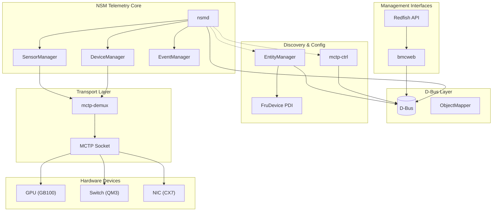
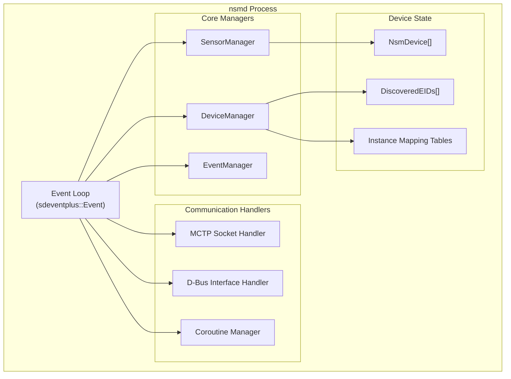
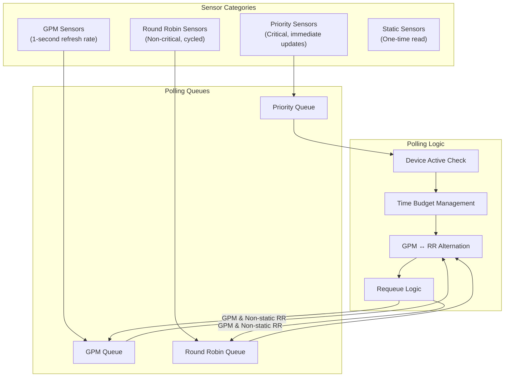
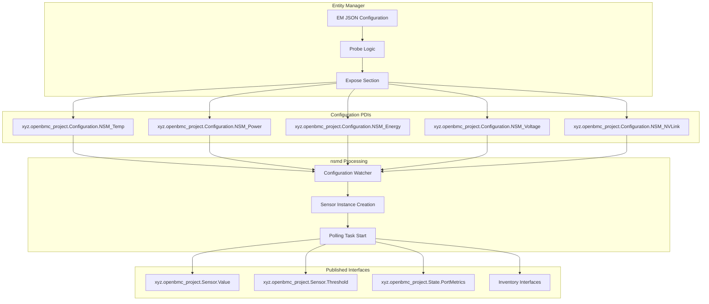
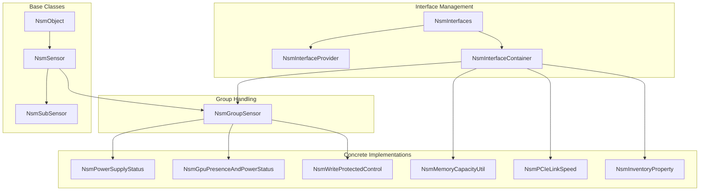
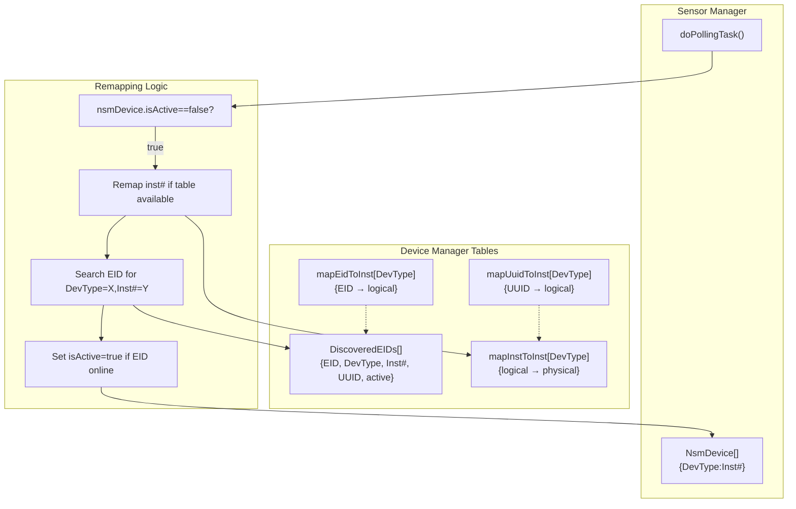
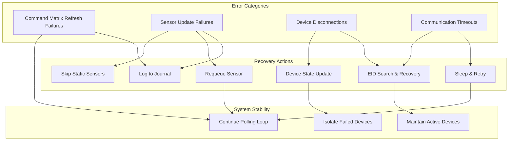

<!-- source: DeepWiki mcp.deepwiki.com · repo NVIDIA/nvbmc-docs · page 6.2 NSM Telemetry System · fetched 2026-10-26 -->

# NSM Telemetry System

<details>
<summary>Relevant source files</summary>

The following files were used as context for generating this wiki page:

- [designs/oem/Nvidia/nsm_event_sequence_diagram.png](designs/oem/Nvidia/nsm_event_sequence_diagram.png)
- [designs/oem/Nvidia/nsm_mock_responder_running_sequence_dia.png](designs/oem/Nvidia/nsm_mock_responder_running_sequence_dia.png)
- [designs/oem/Nvidia/nsm_mockup_device_sequence_diagram.png](designs/oem/Nvidia/nsm_mockup_device_sequence_diagram.png)
- [designs/oem/Nvidia/nsm_sensor_class_hierarchy.png](designs/oem/Nvidia/nsm_sensor_class_hierarchy.png)
- [designs/oem/Nvidia/nsmd.md](designs/oem/Nvidia/nsmd.md)
- [nvidia/NSM/nsmd.md](nvidia/NSM/nsmd.md)

</details>


The NSM (Nvidia System Management) Telemetry System provides comprehensive telemetry collection and sensor management for Nvidia GPU devices, switches, and network adapters through the `nsmd` daemon. This system enables out-of-band management capabilities by gathering device telemetry data via MCTP transport and exposing it through D-Bus interfaces for consumption by management services like `bmcweb`.

For information about PLDM-based sensor management, see [PLDM Stack](#5.1). For MCTP transport details, see [MCTP Transport](#5.2). For GPU device management specifics, see [GPU PCIe Card Management](#6.1).

## Architecture Overview

The NSM Telemetry System operates as a central hub for device telemetry collection, bridging MCTP-based NSM protocols with OpenBMC's D-Bus infrastructure.



**NSM Telemetry System Architecture**

Sources: [nvidia/NSM/nsmd.md:163-199](), [designs/oem/Nvidia/nsmd.md:56-57]()

## Core Components

### nsmd Service

The `nsmd` daemon serves as the primary telemetry collection service, implementing an event-driven architecture using `sdeventplus::Event` for managing multiple concurrent operations.



**nsmd Service Internal Architecture**

The event loop manages six key responsibilities as defined in [nvidia/NSM/nsmd.md:200-239]():

1. **MCTP Socket Communication** - Handles incoming VDM (0x7e) messages
2. **D-Bus Interface Management** - Monitors interface additions and property operations  
3. **Coroutine Management** - Manages sensor polling coroutines and scheduling
4. **Event Type Handlers** - Processes NSM event types 0, 1, and 3
5. **Resource Management** - Controls socket descriptors and instance IDs
6. **DBus Property Operations** - Handles get/set operations and notifications

Sources: [nvidia/NSM/nsmd.md:22-24](), [nvidia/NSM/nsmd.md:200-259]()

### Device Discovery

Device discovery operates through MCTP endpoint enumeration and NSM capability validation.

```mermaid
graph TD
    subgraph "Discovery Process"
        start[("nsmd startup")]
        getendpoints["ObjectMapper.GetSubTree<br/>/xyz/openbmc_project/mctp"]
        checkvdm["Check SupportedMessageTypes<br/>for 0x7E (VDM-PCI)"]
        queryvendor["Get Vendor Defined Message Support<br/>Command 0x6"]
        checkvendor["Verify NVIDIA VID (0x10DE)"]
        querysupport["NSM GetSupportedMessageTypes<br/>(msgType=0x0, cmd=0x01)"]
        querycmds["GetSupportedCommandCodes<br/>(msgType=0x0, cmd=0x02)"]
        validatemandatory["Validate mandatory commands:<br/>QueryDeviceIdentification,<br/>GetInventoryInformation"]
        addeid["Add EID/UUID to NSM endpoint list"]
        createfru["Create FruDevice PDI"]
    end
    
    start --> getendpoints
    getendpoints --> checkvdm
    checkvdm -->|0x7E found| queryvendor
    checkvdm -->|No 0x7E| getendpoints
    queryvendor --> checkvendor
    checkvendor -->|NVIDIA VID found| querysupport
    checkvendor -->|Wrong VID| getendpoints
    querysupport --> querycmds
    querycmds --> validatemandatory
    validatemandatory -->|Commands available| addeid
    validatemandatory -->|Missing commands| getendpoints
    addeid --> createfru
```



**NSM Endpoint Discovery Flow**

The discovery process creates `FruDevice` PDIs at `/xyz/openbmc_project/FruDevice/{DeviceType}_{InstanceNumber}` with mandatory properties:

| Property | Type | NSM Command Source |
|----------|------|-------------------|
| `DEVICE_TYPE` | byte | Type 0 Query Device Identification (0x09) |
| `INSTANCE_NUMBER` | byte | Type 0 Query Device Identification (0x09) |
| `UUID` | string | MCTP Control Daemon |
| `BOARD_PART_NUMBER` | string | Type 3 Get Inventory Information (0x11) |
| `SERIAL_NUMBER` | string | Type 3 Get Inventory Information (0x11) |

Sources: [nvidia/NSM/nsmd.md:489-508](), [designs/oem/Nvidia/nsmd.md:218-248]()

### Sensor Management

The sensor management system implements a multi-tiered polling architecture with priority-based scheduling and device state tracking.



**Sensor Polling Architecture**

The polling system uses coroutines for concurrent sensor updates with the following characteristics:

- **Priority Sensors**: Updated regardless of time budget constraints
- **GPM Sensors**: Always requeued after processing, 1-second target refresh
- **Round Robin Sensors**: Only requeued if non-static, processed in rotation
- **Time Management**: Tracks elapsed time and implements sleep intervals between cycles

Sources: [nvidia/NSM/nsmd.md:261-297](), [nvidia/NSM/nsmd.md:298-341]()

## D-Bus Integration

The NSM system publishes telemetry data through standardized D-Bus interfaces, integrating with OpenBMC's object-oriented management model.



**D-Bus Configuration and Interface Flow**

Common configuration properties across NSM sensor PDIs include:

| Property | Type | Description |
|----------|------|-------------|
| `Name` | string | Sensor identifier name |
| `UUID` | string | Device UUID for EID lookup |
| `SensorId` | uint64_t | NSM command sensor ID field |
| `Priority` | bool | Priority queue assignment flag |
| `Association` | string[] | D-Bus object path relationships |
| `Aggregated` | bool | Supports aggregate command variants |

Sources: [designs/oem/Nvidia/nsmd.md:352-385](), [nvidia/NSM/nsmd.md:477-484]()

## Sensor Class Hierarchy

The NSM sensor implementation uses a hierarchical class design to handle different sensor types and data propagation patterns.



**NSM Sensor Class Hierarchy**

Key virtual methods in the `NsmSensor` base class:

- `genRequestMsg(eid_t eid, uint8_t instanceId)` - Generates NSM command requests
- `handleResponseMsg(const nsm_msg* responseMsg, size_t responseLen)` - Processes NSM responses  
- `update(SensorManager& manager, eid_t eid)` - Coroutine-based sensor update logic
- `equals(const NsmSensor& other)` - Sensor deduplication comparison

The design supports two main patterns:
- **`NsmInterfaceContainer`**: Single sensor data propagated to multiple D-Bus interfaces
- **`NsmGroupSensor`**: Multiple `NsmSubSensor` instances processing shared response data differently

Sources: [nvidia/NSM/nsmd.md:342-461](), [nvidia/NSM/nsmd.md:462-475]()

## Instance Number Remapping

The system handles dynamic device instance mapping to provide stable sensor identifiers across device topology changes.



**Instance Number Remapping System**

Example remapping table for GPU devices:
```
mapInstToInst[GPU]:
4 -> 0, 5 -> 1, 6 -> 2, 7 -> 3
0 -> 4, 1 -> 5, 2 -> 6, 3 -> 7
```

This allows logical instance numbers (0-3) to map to physical device instances (4-7) that may change across system reconfigurations.

Sources: [nvidia/NSM/nsmd.md:130-161]()

## Error Handling and Recovery

The NSM system implements comprehensive error handling to maintain telemetry availability despite device failures or communication issues.



**Error Handling and Recovery Flow**

Key error handling principles:
- **Non-blocking**: Failed sensors don't stop polling of other sensors
- **Device isolation**: Failed devices don't impact functional endpoints  
- **Automatic recovery**: Continuous EID search attempts for disconnected devices
- **Static sensor optimization**: Failed static sensors are not requeued
- **Graceful degradation**: System maintains partial functionality during failures

Sources: [nvidia/NSM/nsmd.md:289-296]()

## Performance Characteristics

The NSM system is designed to meet stringent telemetry freshness requirements for real-time monitoring applications.

**Target Performance Metrics**:
- **Sensor freshness**: ≤500ms from NSM endpoint to D-Bus
- **Redfish response time**: ≤1 second total
- **MCTP round-trip time**: ~3.5ms per NSM command
- **Concurrent polling**: Multiple device instances in parallel coroutines

**Estimated sensor capacity** (250ms polling period):
- Max sensors per loop: 250ms ÷ 3.5ms = ~71 sensors
- Priority sensors: Updated regardless of time budget
- Non-priority sensors: Round-robin scheduling within time constraints

Sources: [designs/oem/Nvidia/nsmd.md:134-180]()

---

