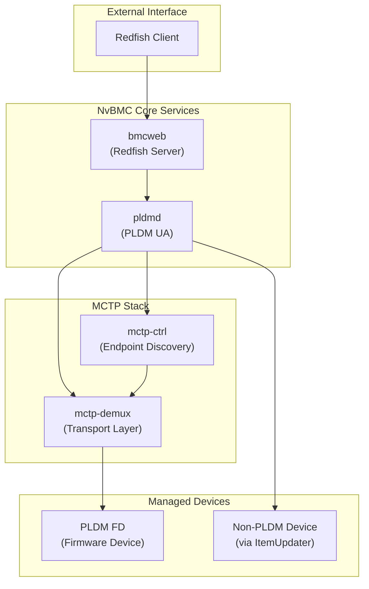
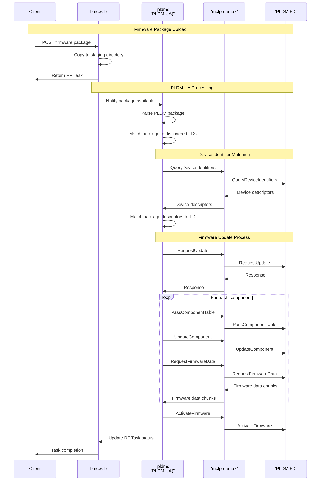
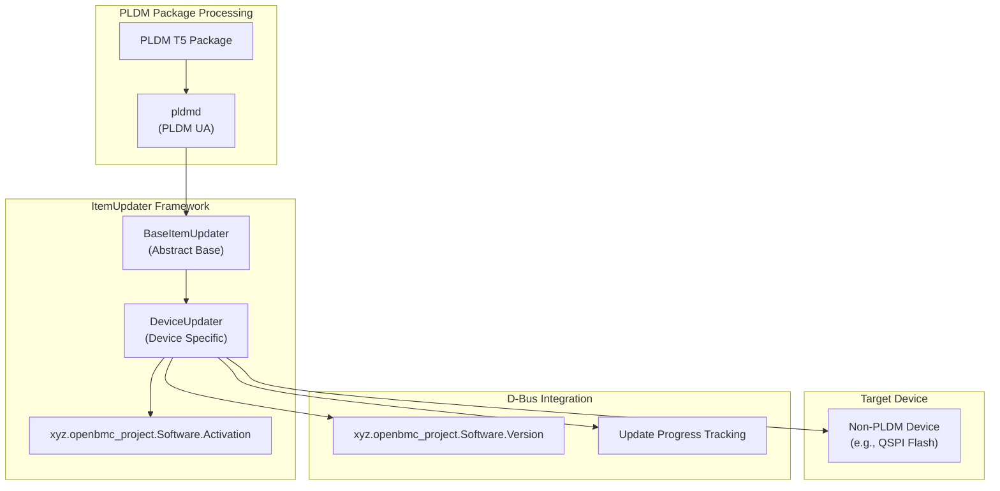

<!-- source: DeepWiki mcp.deepwiki.com · repo NVIDIA/nvbmc-docs · page 6.3 Firmware Update Platform · fetched 2026-10-26 -->

# Firmware Update Platform

Relevant source files

The following files were used as context for generating this wiki page:

- [nvidia/FW-Update/fw_update_platform_guide.md](nvidia/FW-Update/fw_update_platform_guide.md)
- [nvidia/Host-Interfaces/redfish-host-interface.md](nvidia/Host-Interfaces/redfish-host-interface.md)
- [nvidia/MCTP/mctp.md](nvidia/MCTP/mctp.md)
- [nvidia/Telemetry/PLDM T2 Telemetry.md](nvidia/Telemetry/PLDM T2 Telemetry.md)

## Purpose and Scope

The Firmware Update Platform provides a PLDM-based firmware update system for Nvidia devices in OpenBMC. This system enables firmware updates for both PLDM-capable and non-PLDM devices through standardized Redfish APIs, using PLDM Type 5 (T5) firmware update protocols as the underlying transport mechanism.

This document covers the PLDM-based firmware update infrastructure. For general PLDM protocol implementation details, see [PLDM Stack](#5.1). For device attestation and security verification, see [Device Attestation](#6.4).

Sources: [nvidia/FW-Update/fw_update_platform_guide.md:1-49]()

## Architecture Overview

The firmware update platform consists of four primary components that work together to provide end-to-end firmware update capabilities:

**High-Level Architecture Components**

### bmcweb
The Redfish server that implements firmware update APIs including Multipart HTTP Push Update and Unstructured HTTP Push Update. It handles firmware package staging and initiates update processes through D-Bus interfaces.

### MCTP Control Daemon
Publishes discovered MCTP endpoints on D-Bus and manages endpoint lifecycle. Provides the `xyz.openbmc_project.MCTP.Endpoint` interface for application discovery of MCTP-capable devices.

### MCTP Demux Daemon  
Abstracts MCTP transport communication for upper layer protocols. Routes PLDM messages between the PLDM daemon and MCTP endpoints via Unix sockets.

### PLDM Daemon
Acts as the PLDM Update Agent (UA) implementing DSP0267 PLDM T5 specification. Processes firmware packages, matches them with discovered devices, and orchestrates firmware updates for both PLDM and non-PLDM devices.

Sources: [nvidia/FW-Update/fw_update_platform_guide.md:51-86]()

## PLDM T5 Firmware Update Flow

The PLDM-based firmware update process follows a standardized sequence for PLDM T5 capable devices:

**PLDM FW Update Path Selection**

The PLDM UA automatically selects the optimal communication path for firmware updates. In MCTP networks with multiple physical mediums, the UA prioritizes faster transport methods (PCIe over I2C) for efficient firmware delivery.

Sources: [nvidia/FW-Update/fw_update_platform_guide.md:89-98](), [nvidia/FW-Update/fw_update_platform_guide.md:153-168]()

## Non-PLDM Device Support

For devices that don't support PLDM T5, the platform provides an ItemUpdater framework that allows non-PLDM devices to be updated using PLDM packaging:

**ItemUpdater Implementation Process**

1. **Service Configuration**: Add DeviceUpdater service and ItemUpdater service definitions
2. **UUID Assignment**: Configure unique UUID for device updater in firmware bundle
3. **Component ID Selection**: Choose unique component ID for firmware image identification  
4. **Custom Implementation**: Inherit from `BaseItemUpdater` class and implement device-specific update mechanism
5. **Integration**: Add service to invoke device-specific update mechanism

The ItemUpdater framework enables non-PLDM devices to benefit from PLDM T5 packaging standards while implementing custom update logic for device-specific requirements.

Sources: [nvidia/FW-Update/fw_update_platform_guide.md:99-102](), [nvidia/FW-Update/fw_update_platform_guide.md:527-538]()

## Platform Configuration

### Build-Time Configuration

The platform supports extensive build-time configuration for both bmcweb and pldmd components:

**bmcweb Configuration Options**

| Configuration | Description |
|---------------|-------------|
| `update-service-task-timeout` | RF task timeout for firmware update progress tracking |
| `update-service-image-location` | Staging directory for firmware package processing |
| `update-service-stage-location` | Persistent storage location for staged packages |
| `http-body-limit` | Maximum HTTP request body size |
| `firmware-image-limit` | Maximum firmware package size in megabytes |

**pldmd Configuration Options**

| Configuration | Description |
|---------------|-------------|
| `number-of-request-retries` | PLDM request retry count |
| `maximum-transfer-size` | Maximum payload size for RequestFirmwareData |
| `firmware-image-limit` | Firmware image size limit |
| `non-pldm` | Enable non-PLDM device update capability |
| `oem-nvidia` | Enable NVIDIA vendor-specific response codes |
| `pldm-package-verification` | Enable package signature verification |

Sources: [nvidia/FW-Update/fw_update_platform_guide.md:105-140]()

### PLDM Firmware Packaging

Firmware packages use the PLDM T5 standard (DSP0267_1.0.0) format, containing device descriptors, component information, and firmware images. The platform includes package validation with integrity checking and signature verification capabilities.

**Package Structure Components**:
- Package header with device identifier records
- Component parameter table with firmware component metadata  
- Firmware component images with version information
- Optional signature and integrity verification data

Package creation utilizes the upstream tool at [pldm/tools/fw-update/pldm_fwup_pkg_creator.py]() with platform-specific metadata configuration files.

Sources: [nvidia/FW-Update/fw_update_platform_guide.md:141-151]()

### Runtime Configuration

**fw_update_config.json**: Configures PLDM UA behavior for firmware inventory, device inventory, message registries, and target filtering. This JSON file enables creation of D-Bus objects representing firmware components and devices.

**fw_mctp_mapping.json**: Maps firmware inventory D-Bus paths to MCTP endpoint IDs for commit image operations. Used by bmcweb to translate Redfish CommitImageAction operations to appropriate MCTP VDM commands.

Sources: [nvidia/FW-Update/fw_update_platform_guide.md:170-411]()

## Platform Enablement

### Prerequisites

Platform enablement requires coordination with FPGA teams to determine:
- Number of MCTP networks and endpoint ID assignments
- Management controller endpoint ID configuration
- Bridge endpoint ID and downstream endpoint pool allocation
- MCTP UUID assignments for ERoT endpoints (specified in FPGA IAS documents)

### Enablement Steps

1. **Configure Build-Time Options**: Set appropriate pldmd and bmcweb configuration parameters for platform requirements
2. **Define PLDM Descriptors**: Create device descriptors and component information for platform devices
3. **Configure fw_update_config.json**: Set up firmware inventory, device inventory, and component mappings
4. **Configure fw_mctp_mapping.json**: Map firmware inventory paths to MCTP endpoints for commit operations  
5. **Build PLDM Packages**: Create platform-specific firmware packages using pldm_fwup_pkg_creator.py with defined descriptors

### PLDM Device Enablement

For new PLDM T5 devices:
1. Add device inventory configuration in fw_update_config.json
2. Add firmware inventory for components (EC_FW, AP_FW, etc.)
3. Configure message registry entries for update status reporting
4. Enable target filtering for selective firmware application
5. Add fw_mctp_mapping.json entries for commit image support

### Non-PLDM Device Enablement  

For non-PLDM devices using ItemUpdater framework:
1. Add device type and updater configuration
2. Create ItemUpdater and DeviceUpdater service definitions
3. Configure device-specific UUID and component ID
4. Implement custom updater inheriting from BaseItemUpdater
5. Add device-specific update mechanism service

Sources: [nvidia/FW-Update/fw_update_platform_guide.md:413-538]()

## Firmware Recovery Support

The platform provides comprehensive firmware recovery capabilities with device dependency ordering. Recovery prioritizes critical infrastructure components (FPGA, HMC) before downstream devices to ensure communication pathways remain available.

**HGX-H100 Recovery Sequence**:
1. FPGA ERoT recovery via BMC over I2C (prerequisite for MCTP bridge functionality)
2. FPGA recovery via BMC over I2C (enables downstream communication)  
3. Downstream ERoT recovery for HMC, GPU, NVSwitch, PEXSwitch via BMC over I2C
4. HMC recovery via BMC over I2C (enables PLDM T5 updates)
5. Downstream device recovery via PLDM T5 from HMC
6. Retimer recovery via PLDM T5 from HMC (non-PLDM device using T5 packaging)

This hierarchical recovery approach ensures that critical communication infrastructure is restored before attempting recovery of dependent devices.

Sources: [nvidia/FW-Update/fw_update_platform_guide.md:540-565]()

---

