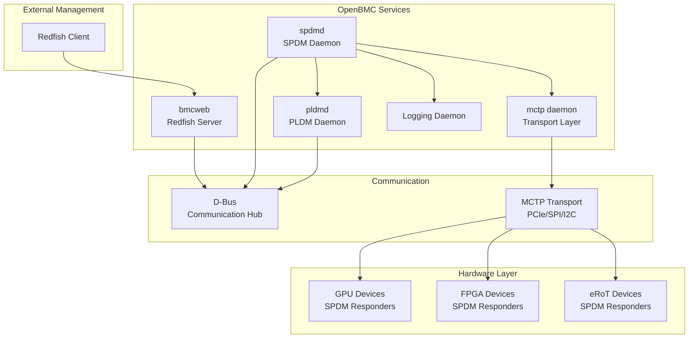
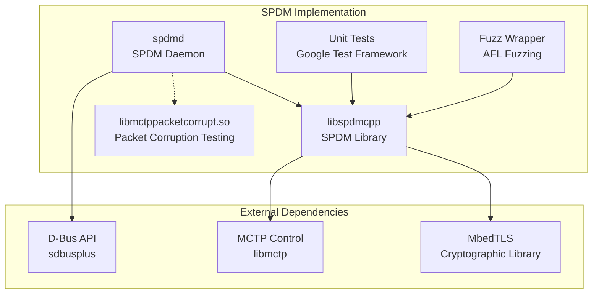
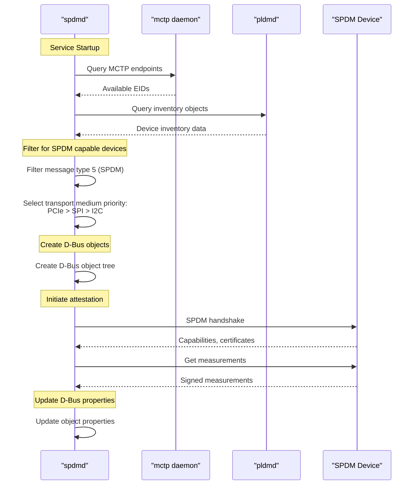
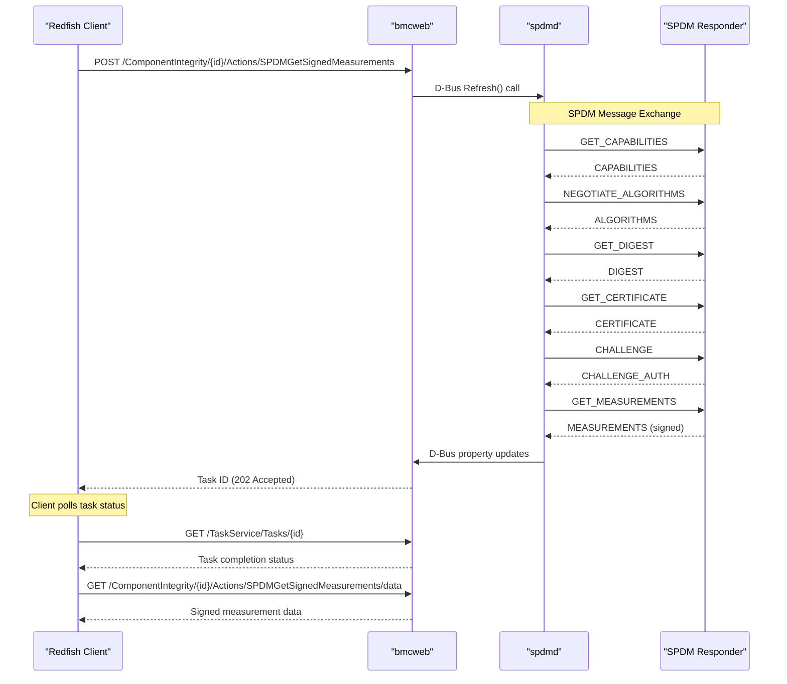

<!-- source: DeepWiki mcp.deepwiki.com · repo NVIDIA/nvbmc-docs · page 6.4 Device Attestation · fetched 2026-10-26 -->

# Device Attestation

<details>
<summary>Relevant source files</summary>

The following files were used as context for generating this wiki page:

- [nvidia/Attestation/resources/spdm_services.png](nvidia/Attestation/resources/spdm_services.png)
- [nvidia/Attestation/resources/spdm_services.puml](nvidia/Attestation/resources/spdm_services.puml)
- [nvidia/Attestation/resources/spdm_structure.png](nvidia/Attestation/resources/spdm_structure.png)
- [nvidia/Attestation/resources/spdm_structure.puml](nvidia/Attestation/resources/spdm_structure.puml)
- [nvidia/Attestation/spdmd.md](nvidia/Attestation/spdmd.md)

</details>


This document covers the SPDM-based device attestation system implemented in Nvidia OpenBMC (NvBMC) for hardware security verification. The system enables secure measurement collection and cryptographic verification of Nvidia devices including GPUs, FPGAs, and other components through the Security Protocol and Data Model (SPDM) standard.

For general information about the SPDM protocol implementation, see [SPDM Security Protocol](#5.3). For GPU-specific management capabilities, see [GPU PCIe Card Management](#6.1).

## Overview

The device attestation system provides cryptographic verification of hardware integrity through standardized SPDM protocols. The BMC acts as an SPDM Requester, collecting measurements and certificates from SPDM-capable devices (Responders) to verify their authenticity and firmware integrity.

Key capabilities include:
- Device authentication via X.509 certificate chains
- Firmware measurement collection and verification
- Cryptographic signature validation
- Support for SPDM versions 1.0 and 1.1
- Integration with Redfish API for external management access

Sources: [nvidia/Attestation/spdmd.md:13-30]()

## Architecture Overview

The SPDM attestation system integrates with multiple OpenBMC services to provide comprehensive device security verification:



The `spdmd` daemon serves as the central orchestrator, managing SPDM communication flows and exposing device attestation data through D-Bus interfaces. External Redfish clients access attestation data through `bmcweb`, which translates REST API calls into D-Bus method invocations.

Sources: [nvidia/Attestation/spdmd.md:99-107](), [nvidia/Attestation/resources/spdm_services.puml:1-21]()

## SPDM Daemon Structure

The SPDM implementation is modularized into several components for testability and reusability:



The modular design enables comprehensive testing through unit tests (88% line coverage, 96.5% function coverage) and fuzz testing using the AFL framework. The `libmctppacketcorrupt.so` library simulates network errors for robustness testing.

Sources: [nvidia/Attestation/spdmd.md:286-298](), [nvidia/Attestation/spdmd.md:546-616](), [nvidia/Attestation/resources/spdm_structure.puml:1-35]()

## D-Bus Interface

The SPDM daemon exposes device attestation data through a hierarchical D-Bus object tree, with each SPDM endpoint represented as a distinct object:

### Object Tree Structure

```
/xyz/openbmc_project/SPDM/
├── <Device_ID_1>/
├── <Device_ID_2>/
└── <Device_ID_N>/
```

Device IDs follow the pattern `HGX_ERoT_<Component>_<Index>` (e.g., `HGX_ERoT_BMC_0`, `HGX_ERoT_FPGA_0`).

### Key D-Bus Interfaces

| Interface | Description |
|-----------|-------------|
| `xyz.openbmc_project.SPDM.Responder` | Primary SPDM device interface |
| `xyz.openbmc_project.Association.Definitions` | Device associations and inventory links |

### Critical Properties

| Property | Type | Description |
|----------|------|-------------|
| `Certificate` | String | ASN.1 PEM-encoded X.509 certificate chains |
| `Measurements` | Array | Firmware/software measurement data |
| `MeasurementsSignature` | String | Cryptographic signature of measurements |
| `Status` | String | Current attestation status |
| `Version` | String | SPDM protocol version |
| `HashingAlgorithm` | String | Negotiated hashing algorithm |
| `SigningAlgorithm` | String | Negotiated signing algorithm |

### Refresh Method

The `Refresh` method triggers fresh attestation data collection:

```
busctl call xyz.openbmc_project.SPDM \
  /xyz/openbmc_project/SPDM/HGX_ERoT_BMC_0 \
  xyz.openbmc_project.SPDM.Responder \
  Refresh yayayu <slot> <nonce> <measurement_indices> <session_id>
```

Sources: [nvidia/Attestation/spdmd.md:135-194](), [nvidia/Attestation/spdmd.md:202-265]()

## Endpoint Discovery Process

The SPDM daemon automatically discovers attestation-capable devices through integration with MCTP and PLDM services:



The discovery process prioritizes transport mediums by speed (PCIe first, then SPI, then I2C) when devices are accessible through multiple interfaces. Only devices supporting SPDM message type 5 are included in the attestation system.

Sources: [nvidia/Attestation/spdmd.md:111-123]()

## Attestation Workflow

The attestation process follows a structured SPDM message exchange sequence:



The workflow supports both synchronous and asynchronous operation modes, with task-based tracking for long-running attestation operations.

Sources: [nvidia/Attestation/spdmd.md:125-134](), [nvidia/Attestation/spdmd.md:437-506]()

## Configuration and Error Handling

### Configuration Options

The `spdmd` daemon supports multiple configuration mechanisms:

**Command Line Parameters:**
- `--verbose [0-7]`: Debug logging levels (Emergency to Debug)
- `--cached_measurements`: Enable automatic measurement collection
- `--cached_measurements_delay`: Initial communication delay (default: 60s)

**Meson Build Configuration:**
- `systemd`: Enable systemd service creation
- `discovery_only_from_mctp_control`: MCTP-only discovery mode
- `fetch_serialnumber_from_responder`: Extract serial numbers from devices

**Configuration File (`/etc/spdmd_conf.json`):**
```json
{
    "endpoints": [
        {
            "eid": 30,
            "name": "satmc",
            "enabled": false,
            "description": "Satellite Management Controller"
        }
    ]
}
```

### Status Codes

The system provides detailed status reporting through the `Status` property:

| Status | Description |
|--------|-------------|
| `Success` | Attestation completed successfully |
| `Initializing` | Initial communication phase |
| `GettingCertificates` | Certificate retrieval in progress |
| `GettingMeasurements` | Measurement collection in progress |
| `Error_ConnectionTimeout` | Device communication timeout |
| `Error_Responder` | Invalid response from device |
| `Error_CertificateValidation` | Certificate validation failure |
| `Error_AuthenticationFailed` | Device authentication failure |

Error conditions trigger automatic retry mechanisms with configurable timeout intervals (T1: 3.1s for non-crypto operations, T2: 68s for cryptographic operations).

Sources: [nvidia/Attestation/spdmd.md:346-409](), [nvidia/Attestation/spdmd.md:414-435]()

---

