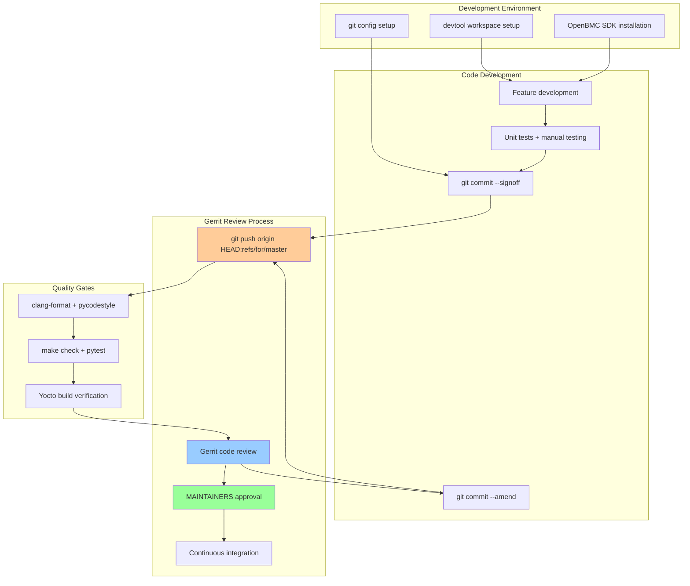
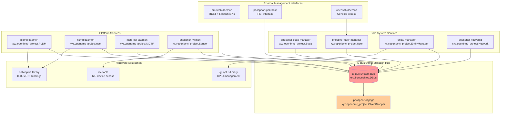
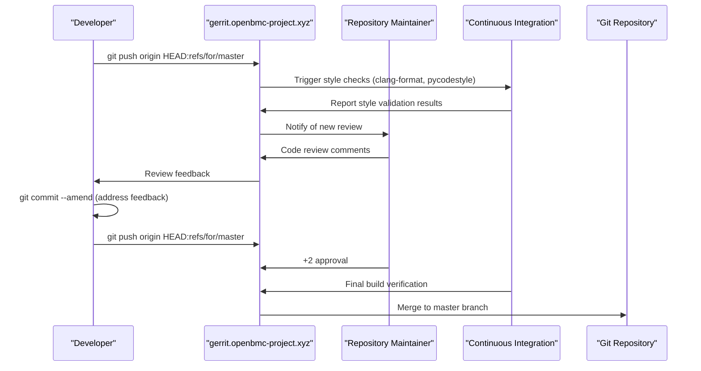

<!-- source: DeepWiki mcp.deepwiki.com · repo NVIDIA/nvbmc-docs · page 7 Development Guidelines · fetched 2026-10-26 -->

# Development Guidelines

<details>
<summary>Relevant source files</summary>

The following files were used as context for generating this wiki page:

- [CONTRIBUTING.md](CONTRIBUTING.md)
- [development/gerrit-setup.md](development/gerrit-setup.md)
- [maintainer-workflow.md](maintainer-workflow.md)

</details>


## Purpose and Scope

This document provides comprehensive development guidelines for contributing to the OpenBMC project, covering workflow processes, quality standards, and best practices. OpenBMC follows a modular D-Bus-based architecture with rigorous code review processes to maintain high code quality and system reliability.

For detailed information about the contribution process including CLA requirements and patch submission, see [Contributing Process](#7.1). For specific coding standards and style enforcement, see [Code Style and Standards](#7.2). For architectural best practices and common pitfalls, see [Design Patterns and Anti-patterns](#7.3).

## Development Workflow Overview

OpenBMC development follows a structured workflow centered around Gerrit code review and Yocto build systems. All contributions must go through formal review processes before integration.

### Development Lifecycle Flow



**Sources:** [CONTRIBUTING.md:160-356](), [development/gerrit-setup.md:74-88]()

### OpenBMC Modular Architecture



**Sources:** [CONTRIBUTING.md:26-38](), [CONTRIBUTING.md:368-381]()

## Core Development Principles

### Modular Design Philosophy

OpenBMC follows a strict modular design where each daemon has limited responsibilities and communicates through D-Bus interfaces. This design principle ensures maintainability and allows for independent development of components.

| Principle | Implementation | Example |
|-----------|----------------|---------|
| Single Responsibility | Each daemon handles one functional area | `phosphor-state-manager` only manages host state |
| D-Bus Communication | All inter-process communication via D-Bus | `bmcweb` calls D-Bus methods to control hardware |
| Standard Interfaces | Reusable D-Bus interfaces in `phosphor-dbus-interfaces` | `xyz.openbmc_project.Sensor.Value` interface |
| Hardware Abstraction | Hardware-specific code isolated in dedicated services | `phosphor-hwmon` abstracts sensor hardware |

**Sources:** [CONTRIBUTING.md:26-38](), [CONTRIBUTING.md:371-381]()

### Code Quality Standards

All contributions must meet strict quality standards enforced through automated tools and manual review processes:

- **Style Enforcement**: `clang-format` for C++, `pycodestyle` for Python, Google style for JavaScript
- **Testing Requirements**: Unit tests with coverage for new functionality
- **Documentation**: Comprehensive commit messages with testing descriptions
- **License Compliance**: All contributors must sign CLAs before code acceptance

**Sources:** [CONTRIBUTING.md:73-144](), [CONTRIBUTING.md:242-261](), [maintainer-workflow.md:1-27]()

## Code Review Process

### Gerrit-Based Review Workflow

OpenBMC uses Gerrit for all code reviews, requiring maintainer approval before merging changes. The process ensures code quality through multiple review stages.



**Sources:** [CONTRIBUTING.md:273-356](), [development/gerrit-setup.md:74-88]()

### Review Requirements

| Review Stage | Requirements | Tools/Process |
|--------------|-------------|---------------|
| Style Check | Code formatting compliance | `clang-format`, `pycodestyle`, automated CI |
| Unit Testing | Test coverage for new code | `make check`, `pytest` frameworks |
| Functional Review | Logic and design validation | Manual review by subject matter experts |
| Maintainer Approval | Final quality gate | `MAINTAINERS` file defines required reviewers |
| Integration Test | Full system validation | QEMU-based testing, hardware validation |

**Sources:** [CONTRIBUTING.md:242-261](), [maintainer-workflow.md:28-42]()

## Quality Assurance

### Testing Requirements

Every commit must include appropriate testing with clear documentation of how the change was validated:

```
Tested: I ran unit tests with "make check" (added 2 new tests) and manually
tested on Witherspoon that Foo daemon no longer crashes at boot.
```

**Sources:** [CONTRIBUTING.md:242-261]()

### Commit Organization

Commits should be atomic and logically organized:

- **Too large**: "convert foo to new API; also fix CVE 1234 in bar"
- **Too small**: "move abc.h to top of include list" and "move xyz.h to bottom of include list"  
- **Just right**: "convert foo to new API" and "convert foo from tab to space"

**Sources:** [CONTRIBUTING.md:167-189]()

### D-Bus Interface Best Practices

When developing D-Bus interfaces, follow these guidelines:

- Design reusable interfaces defined in `phosphor-dbus-interfaces` repository
- Use appropriate type signatures with simplest types possible
- Avoid passing numbers as ASCII strings
- Follow established naming conventions for service and interface names

**Sources:** [CONTRIBUTING.md:368-381]()

## Getting Started

### Prerequisites

1. **CLA Execution**: Sign Individual or Corporate Contributor License Agreement
2. **Development Environment**: Yocto build system and OpenBMC SDK setup
3. **Gerrit Account**: Configure SSH keys and Gerrit access
4. **Repository Access**: Clone appropriate OpenBMC repositories

### Initial Contribution Steps

1. Set up development environment with `devtool` workspace
2. Configure Git identity and commit message hooks
3. Identify "bitesize" issues for initial contributions
4. Follow coding style guidelines for your target language
5. Submit changes through Gerrit review process

For detailed setup instructions, see [Getting Started](#2) and [Contributing Process](#7.1).

**Sources:** [CONTRIBUTING.md:40-72](), [development/gerrit-setup.md:11-97]()

---

