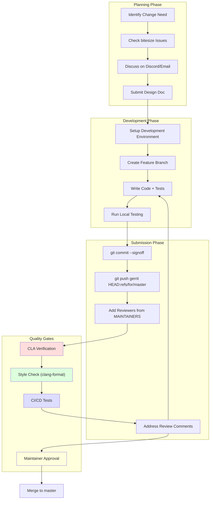
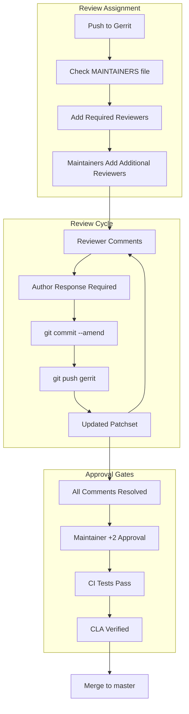

<!-- source: DeepWiki mcp.deepwiki.com · repo NVIDIA/nvbmc-docs · page 7.1 Contributing Process · fetched 2026-10-26 -->

# Contributing Process

<details>
<summary>Relevant source files</summary>

The following files were used as context for generating this wiki page:

- [CONTRIBUTING.md](CONTRIBUTING.md)
- [development/gerrit-setup.md](development/gerrit-setup.md)
- [maintainer-workflow.md](maintainer-workflow.md)

</details>


## Purpose and Scope

This document covers the complete process for contributing code, documentation, and designs to the OpenBMC project. It includes legal requirements, development workflows, submission procedures, and quality gates that all contributors must follow.

For specific coding standards and style requirements, see [Code Style and Standards](#7.2). For architectural guidance and best practices, see [Design Patterns and Anti-patterns](#7.3).

## Contributor License Agreement

Before any code contributions can be accepted, contributors must execute an OpenBMC Contributor License Agreement (CLA). This is a one-time requirement that covers all future contributions to OpenBMC repositories.

### CLA Types

| Agreement Type | When to Use | Form Link |
|---|---|---|
| Individual CLA (ICLA) | Personal contributions or freelance work | [Individual CLA Form](https://drive.google.com/file/d/1k3fc7JPgzKdItEfyIoLxMCVbPUhTwooY) |
| Corporate CLA (CCLA) | When contributing as part of employment | [Corporate CLA Form](https://drive.google.com/file/d/1d-2M8ng_Dl2j1odsvZ8o1QHAdHB-pNSH) |

Corporate CLAs allow multiple employees to contribute under a single agreement by adding them to Schedule A. After signing, send the CLA to `manager@lfprojects.org`.

**Sources:** [CONTRIBUTING.md:43-53](), [maintainer-workflow.md:2-17]()

## Getting Started as a New Contributor

### Finding Suitable Issues

New contributors should start with issues tagged as `bitesize` - these are fixes or enhancements that don't require extensive OpenBMC knowledge:

```
https://github.com/issues?utf8=%E2%9C%93&q=is%3Aopen+is%3Aissue+user%3Aopenbmc+label%3Abitesize
```

### Code Review Practice

Contributing through code reviews is an excellent way to learn the codebase. Access the Gerrit review system and filter by repository:

```
status:open project:openbmc/bmcweb
```

**Sources:** [CONTRIBUTING.md:55-71]()

## Contribution Workflow

The following diagram shows the complete contribution process from initial planning through final merge:

### Overall Contribution Process



**Sources:** [CONTRIBUTING.md:146-355]()

## Gerrit Workflow Setup

### Initial Configuration

The OpenBMC project uses Gerrit for code review. Initial setup requires GitHub credentials and SSH key configuration:

```mermaid
flowchart LR
    subgraph "Account Setup"
        A["GitHub Account"] --> B["gerrit.openbmc-project.xyz"]
        B --> C["Import SSH Keys"]
        C --> D["Register Email"]
        D --> E["Set Full Name"]
    end
    
    subgraph "SSH Configuration"
        F["~/.ssh/config"]
        G["Host openbmc.gerrit"]
        H["Hostname gerrit.openbmc-project.xyz"]
        I["Port 29418"]
        J["User github_username"]
    end
    
    subgraph "Repository Setup"
        K["git remote add gerrit"]
        L["ssh://openbmc.gerrit/openbmc/repo"]
        M["git config remote.gerrit.push"]
        N["HEAD:refs/for/master"]
    end
    
    E --> F
    F --> G
    G --> H
    H --> I
    I --> J
    J --> K
    K --> L
    L --> M
    M --> N
```



### Commit Hooks Installation

Gerrit requires `Change-Id` headers in commit messages for tracking reviews:

```bash
gitdir=$(git rev-parse --git-dir)
scp -p -P 29418 openbmc.gerrit:hooks/commit-msg ${gitdir}/hooks
```

**Sources:** [development/gerrit-setup.md:22-70](), [CONTRIBUTING.md:314-325]()

## Code Organization and Commit Structure

### Atomic Commit Guidelines

OpenBMC enforces strict commit organization to maintain code quality and reviewability:

| Commit Size | Example | Acceptable |
|---|---|---|
| Too Large | "convert foo to new API; also fix CVE 1234 in bar" | ❌ |
| Too Small | "move abc.h to top of include list" + "move xyz.h to bottom" | ❌ |
| Just Right | "convert foo to new API" + "convert foo from tab to space" | ✅ |

### Commit Message Format

```
component: concise summary of change (≤50 chars)

Comprehensive explanation of why this change is needed.
Include context about the problem being solved.

Tested: Description of testing performed, including
both automated tests and manual verification.

Signed-off-by: Full Name <email@domain.com>
Change-Id: I1234567890abcdef...
```

**Sources:** [CONTRIBUTING.md:167-241]()

## Review Process and Quality Gates

### Review Assignment Process



### Maintainer Responsibilities

Repository maintainers verify multiple aspects before approval:

- **CLA Verification**: Check contributor status in [CLA repository](https://drive.google.com/drive/folders/1Ooi0RdTcaOWF1DWFJUAJDdN7tRKde7Nl)
- **Code Quality**: Ensure adherence to project standards
- **Testing**: Verify adequate test coverage and validation
- **License Compliance**: Ensure no dependencies on non-public resources

**Sources:** [CONTRIBUTING.md:336-355](), [maintainer-workflow.md:6-26]()

## Testing Requirements

### Test Integration Standards

Every commit must include appropriate testing based on the change type:

| Change Type | Required Testing |
|---|---|
| Bug Fix | Unit test demonstrating the fix |
| New Feature | Unit tests for positive and negative cases |
| Refactoring | Existing tests must continue to pass |
| Configuration | Manual testing on target hardware |

### Test Documentation Format

```
Tested: I ran unit tests with "make check" (added 2 new tests) and manually
tested on Witherspoon that Foo daemon no longer crashes at boot.
```

**Sources:** [CONTRIBUTING.md:242-260]()

## Best Practices for D-Bus Integration

Given OpenBMC's D-Bus-centric architecture, contributions involving D-Bus interfaces must follow specific guidelines:

- **Interface Reusability**: New D-Bus interfaces should be designed for reuse across components
- **Type Signatures**: Use simplest appropriate types, avoid ASCII strings for numeric data
- **Interface Definitions**: Add new interfaces to `phosphor-dbus-interfaces` repository
- **Documentation**: Follow D-Bus API design guidelines

**Sources:** [CONTRIBUTING.md:368-380]()

## Review Pace and Community Expectations

Contributors should understand that OpenBMC operates with distributed, often volunteer reviewers across multiple timezones. Reasonable expectations include:

- **Response Time**: Allow approximately one week before following up on reviews
- **Review Quality**: Expect thorough, sometimes detailed feedback focused on long-term maintainability
- **Iteration**: Be prepared for multiple review cycles to achieve project standards

The maintainer community prioritizes code quality and long-term maintainability over rapid integration, reflecting the critical nature of BMC firmware in production systems.

**Sources:** [CONTRIBUTING.md:409-433]()

---

