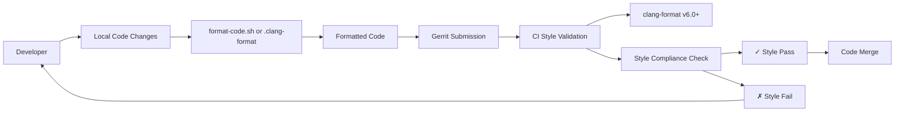
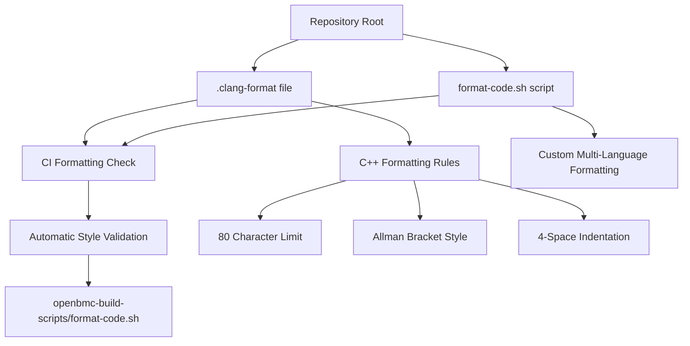

<!-- source: DeepWiki mcp.deepwiki.com · repo NVIDIA/nvbmc-docs · page 7.2 Code Style and Standards · fetched 2026-10-26 -->

# Code Style and Standards

<details>
<summary>Relevant source files</summary>

The following files were used as context for generating this wiki page:

- [cpp-style-and-conventions.md](cpp-style-and-conventions.md)
- [style/cpp/.clang-format](style/cpp/.clang-format)
- [style/javascript/.clang-format](style/javascript/.clang-format)

</details>


This document defines the coding style standards, formatting conventions, and tooling requirements for OpenBMC C++ and JavaScript code. It covers the project's adoption of modern C++ practices, automated style enforcement, and specific guidelines for library usage.

For information about the code review and contribution process, see [Contributing Process](#7.1). For architectural patterns and design best practices, see [Design Patterns and Anti-patterns](#7.3).

## Philosophy and Principles

OpenBMC follows a philosophy centered on three core principles that guide all coding decisions, as established in the project's foundational approach to C++ development.

### Code Clarity and Conciseness

The codebase prioritizes reviewer and maintainer comprehension over writer convenience. Solutions avoid clever tricks that obscure meaning, favoring expressive but concise representations of problems. When clarity conflicts with brevity, clarity takes precedence.

### Modern C++ Practices

All code must compile with C++20 compiler settings, with migration to C++23 planned as compiler support matures. The project follows the C++ Core Guidelines established by Bjarne Stroustrup and Herb Sutter, representing the "smaller, simpler, safer language" within C++.

### Performance Constraints

OpenBMC targets embedded processors with 32-64MB flash and limited processing power comparable to 2016-era smart watches. Performance evaluation prioritizes code size, CPU utilization, and memory usage in that order. Solutions must demonstrate appropriate algorithmic complexity for their problem domain.

**Style Enforcement Pipeline**


Sources: [cpp-style-and-conventions.md:137-154]()

## C++ Core Guidelines Adoption

OpenBMC follows the ISO C++ Core Guidelines with specific exceptions tailored to embedded system constraints and project conventions.

### Adopted Guidelines

The project implements the complete C++ Core Guidelines from the official repository, with the last reviewed revision being `53bc78f`. This includes resource management, type safety, performance recommendations, and modern C++ idioms.

### Documented Exceptions

Two specific guideline violations are explicitly permitted:
- **NL.10 Avoid CamelCase**: OpenBMC uses camelCase and UpperCamelCase naming conventions
- **NL.17 Use K&R-derived layout**: OpenBMC uses Allman-style bracket placement

### Guideline Support Library

The project does not utilize the Guideline Support Library (GSL), making any GSL-specific recommendations within the Core Guidelines optional for OpenBMC implementations.

Sources: [cpp-style-and-conventions.md:70-89]()

## Code Formatting Standards

### Clang-Format Configuration

OpenBMC repositories use automated code formatting through `clang-format` version 6.0 or greater. The CI infrastructure automatically validates formatting when a `.clang-format` file exists in the repository root.

**Clang-Format Integration Process**


The standard configuration enforces:
- 80-character line limits
- Allman-style brace wrapping after all control structures
- 4-space indentation with no tabs
- Specific header inclusion ordering and grouping

### Key Formatting Rules

**Bracket Style**: Allman-style brackets appear on their own line at the same indentation level as the creating statement. Even single-line conditionals require brackets.

**Indentation Hierarchy**:
- Namespace content: Same level as namespace declaration
- Class/struct content: Indented from class declaration  
- Function/conditional/loop content: Indented from parent scope
- Switch case statements: Indented within switch block
- Labels: One level less than current indentation

**Whitespace Standards**:
- C++-style declarator layout: `T& bar, const S* baz`
- Whitespace after conditionals: `if (...)`, `while (...)`, `for (...)`
- Binary operator spacing: `(a - 1) / b, c - 2`
- No whitespace around unary operators or inside parentheses
- Line continuation after operators rather than before

Sources: [cpp-style-and-conventions.md:133-150](), [style/cpp/.clang-format:40-45](), [style/cpp/.clang-format:22-38]()

## Naming Conventions

OpenBMC follows a consistent naming scheme across all code entities, with specific patterns for different language constructs.

**Naming Convention Hierarchy**

```mermaid
graph TD
    CodeEntities["Code Entities"] --> Types["Types"]
    CodeEntities --> Variables["Variables"] 
    CodeEntities --> Functions["Functions"]
    CodeEntities --> Constants["Constants"]
    CodeEntities --> Files["Files"]
    CodeEntities --> Namespaces["Namespaces"]
    
    Types --> UpperCamelCase1["UpperCamelCase"]
    UpperCamelCase1 --> Structs["struct SensorData"]
    UpperCamelCase1 --> Classes["class DeviceManager"]
    UpperCamelCase1 --> Enums["enum PowerState"]
    UpperCamelCase1 --> Templates["template<T> class Handler"]
    
    Variables --> lowerCamelCase1["lowerCamelCase"]
    lowerCamelCase1 --> Members["sensorValue, deviceCount"]
    lowerCamelCase1 --> Locals["tempReading, isValid"]
    
    Functions --> lowerCamelCase2["lowerCamelCase"]
    lowerCamelCase2 --> Methods["getValue(), processData()"]
    lowerCamelCase2 --> LibraryException["lower_snake_case for STL compatibility"]
    
    Constants --> lowerCamelCase3["lowerCamelCase"]
    lowerCamelCase3 --> EnumMembers["powerOn, thermalShutdown"]
    lowerCamelCase3 --> ConstValues["maxRetries, defaultTimeout"]
    
    Files --> lower_snake_case1["lower_snake_case"]
    lower_snake_case1 --> CppFiles["sensor_manager.cpp"]
    lower_snake_case1 --> Headers["device_control.hpp"]
    
    Namespaces --> lower_snake_case2["lower_snake_case"]
    lower_snake_case2 --> TopLevel["phosphor_logging"]
    lower_snake_case2 --> Internal["details, internal"]
```


### Type Naming

All user-defined types use `UpperCamelCase`: structs, classes, enums, and template parameters. Type aliases prefer `using` over `typedef`. Single-word aliases within classes may be lowercase (`using type = T`) while multi-word aliases remain UpperCamelCase (`using ArrayOfT = std::array<T, N>`).

### Variable and Function Naming

Variables and functions use `lowerCamelCase` with no underscores, including class members. Library APIs may use `lower_snake_case` for STL compatibility, but application APIs must use `lowerCamelCase`.

### File and Namespace Organization

C++ source files use `lower_snake_case.cpp`, headers use `lower_snake_case.hpp`. Namespaces follow `lower_snake_case` with top-level namespaces based on repository names. Private namespaces use `details` or `internal` conventions.

### Acronym Handling

Acronyms maintain consistent case throughout their usage: `SomeBMCType someBMCVariable = bmcFunction()` rather than mixed-case variations.

Sources: [cpp-style-and-conventions.md:274-360]()

## Header Organization and File Structure

OpenBMC enforces strict header inclusion ordering and file naming conventions to maintain consistency and build reliability.

### Header Inclusion Order

**For Header Files**:
1. Local headers (`"daemon_sys.hpp"`)
2. C libraries (`<cstdio>`, `<unistd.h>`)
3. C++ libraries including OpenBMC libraries (`<vector>`, `<phosphor-logging/log.hpp>`)

**For Source Files**:
1. Corresponding header (`source.hpp`)
2. Local headers
3. C libraries  
4. C++ libraries

All groups maintain alphabetical sorting within their categories.

### Header Guard Standards

OpenBMC prefers `#pragma once` over traditional `#ifndef`-style header guards for simplicity and compiler optimization.

**File Organization Structure**
```mermaid
graph TD
    SourceFile["source_file.cpp"] --> CorrespondingHeader["source_file.hpp"]
    SourceFile --> LocalHeaders["Local Headers"]
    SourceFile --> CLibraries["C Libraries"]
    SourceFile --> CppLibraries["C++ Libraries"]
    
    HeaderFile["header_file.hpp"] --> PragmaOnce["#pragma once"]
    HeaderFile --> LocalHeadersH["Local Headers"]
    HeaderFile --> CLibrariesH["C Libraries"] 
    HeaderFile --> CppLibrariesH["C++ Libraries"]
    
    LocalHeaders --> ProjectHeaders['"project_header.hpp"']
    CLibraries --> CStandard["<cstdio>, <unistd.h>"]
    CppLibraries --> StdLibrary["<vector>, <memory>"]
    CppLibraries --> OpenBmcLibs["<phosphor-logging/log.hpp>"]
    
    PragmaOnce --> GuardStyle["Preferred over #ifndef"]
    
    AlphabeticalSort["Alphabetical Sorting"] --> LocalHeaders
    AlphabeticalSort --> CLibraries
    AlphabeticalSort --> CppLibraries
    AlphabeticalSort --> LocalHeadersH
    AlphabeticalSort --> CLibrariesH
    AlphabeticalSort --> CppLibrariesH
```

Sources: [cpp-style-and-conventions.md:288-305](), [cpp-style-and-conventions.md:361-363](), [style/cpp/.clang-format:59-76]()

## Library-Specific Guidelines

### Boost Library Usage

Boost usage requires adherence to specific constraints designed for embedded system optimization:

1. **Header-only libraries only**: Prevents unused function inclusion and reduces flash overhead
2. **Minimal header inclusion**: Include lowest-level headers (`#include <boost/container/flat_map.hpp>` not `#include <boost/container.hpp>`)
3. **Standard library preference**: Use `std` equivalents when available (`std::chrono` over `boost::chrono`)
4. **Compliance with core tenets**: Must not conflict with clarity, modern practices, or performance requirements

### iostream Restrictions

The project prohibits iostream usage for logging due to code size overhead from individual function calls per appended value. Printf-style operations are preferred for logging scenarios.

iostream utilities like `sstream` remain acceptable when they produce clearer, similarly-sized code compared to alternatives.

### Type Selection Standards

- Use `size_t` or `ssize_t` for sizes, counts, and similar quantities
- Use explicitly sized types (`uint8_t`, `int16_t`, `uint32_t`, `int64_t`) only for hardware interaction
- Prefer `size_t` or `int` for non-hardware contexts unless strong rationale exists for sized types

Sources: [cpp-style-and-conventions.md:95-125](), [cpp-style-and-conventions.md:443-451]()

## JavaScript Style Standards

JavaScript code follows Google's JavaScript style guide with an 80-character column limit, enforced through a separate clang-format configuration.

The JavaScript configuration uses Google's base style with minimal customization, focusing primarily on line length consistency with C++ code standards.

Sources: [style/javascript/.clang-format:1-6]()

## Enforcement and Continuous Integration

### Automated Style Validation

The OpenBMC CI infrastructure automatically validates code formatting for all repositories containing style configuration files. When `.clang-format` exists in the repository root, the CI system runs formatting validation as part of the build process.

### Custom Formatting Scripts

Repositories requiring different formatting rules for multiple languages can implement `format-code.sh` scripts. These scripts execute during CI and validate that no files are modified after running, ensuring consistent formatting across all code changes.

### Build Script Integration

The centralized formatting validation uses `openbmc-build-scripts/scripts/format-code.sh` to ensure consistent formatting checks across all OpenBMC repositories, providing a unified style enforcement mechanism.

Sources: [cpp-style-and-conventions.md:137-154]()

---

