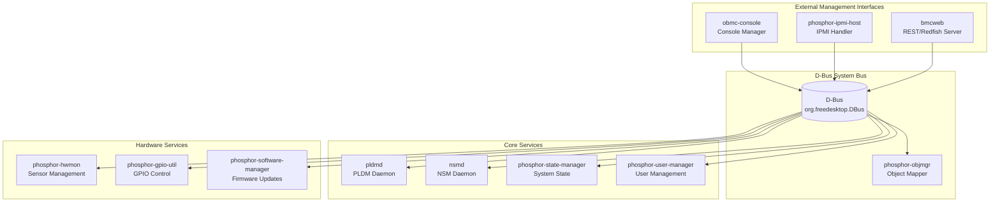
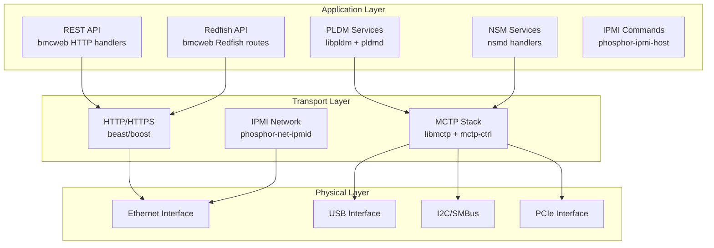
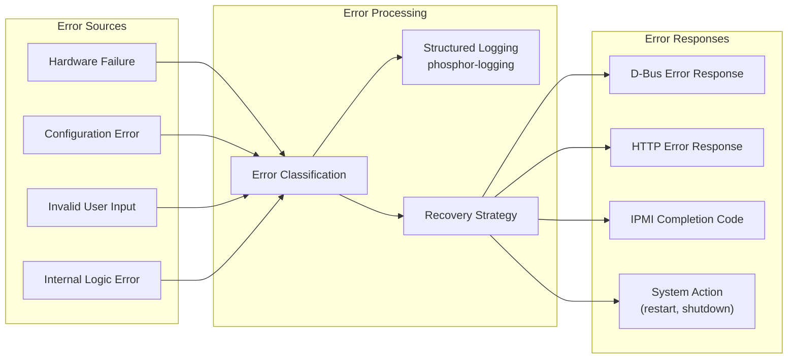
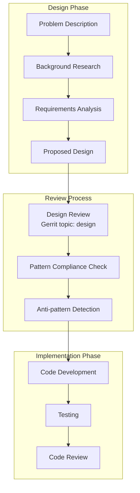

<!-- source: DeepWiki mcp.deepwiki.com · repo NVIDIA/nvbmc-docs · page 7.3 Design Patterns and Anti-patterns · fetched 2026-10-26 -->

# Design Patterns and Anti-patterns

<details>
<summary>Relevant source files</summary>

The following files were used as context for generating this wiki page:

- [anti-patterns.md](anti-patterns.md)
- [designs/design-template.md](designs/design-template.md)
- [designs/voltage-regulator-configuration.md](designs/voltage-regulator-configuration.md)
- [release/release-notes.md](release/release-notes.md)
- [release/release-process.md](release/release-process.md)

</details>


## Purpose and Scope

This document catalogues established design patterns (recommended practices) and anti-patterns (practices to avoid) within the OpenBMC codebase. It serves as a reference for code reviewers and contributors to maintain consistency and quality across the project.

For information about the contribution process and code style standards, see [Contributing Process](#7.1) and [Code Style and Standards](#7.2). For architectural overview of core systems, see [Core Architecture](#3).

## Design Patterns (Recommended Practices)

### D-Bus Central Communication Hub Pattern

OpenBMC uses D-Bus as the primary inter-process communication mechanism, with all major services registering objects and interfaces on the system bus.



**Key Benefits:**
- Service isolation and modularity
- Language-agnostic communication
- Introspection and discovery capabilities
- Standardized error handling

**Implementation Example:**
Services register objects at well-defined paths like `/xyz/openbmc_project/state/host0` and implement standard interfaces such as `xyz.openbmc_project.State.Host`.

Sources: [anti-patterns.md:1-377](), system architecture diagrams

### Protocol Layering Pattern

OpenBMC implements a clean separation between application protocols, transport layers, and physical interfaces.



**Key Benefits:**
- Protocol independence
- Transport flexibility
- Easier testing and simulation
- Clean abstraction boundaries

Sources: [anti-patterns.md:1-377](), system architecture diagrams

### Configuration-Driven Service Pattern

Services use external configuration files (JSON, YAML) rather than hard-coded logic for platform-specific behavior.

| Service | Configuration File | Location | Purpose |
|---------|-------------------|----------|---------|
| `phosphor-regulators` | JSON config | `/usr/share/phosphor-regulators/` | Voltage regulator settings |
| `entity-manager` | JSON config | `/usr/share/entity-manager/` | Hardware inventory |
| `phosphor-hwmon` | Device tree | `/sys/firmware/devicetree/` | Sensor configuration |

**Key Benefits:**
- Platform portability
- Runtime configuration updates
- Easier testing with mock configurations
- Separation of policy from implementation

Sources: [designs/voltage-regulator-configuration.md:106-126](), [anti-patterns.md:1-377]()

### Standardized Error Handling Pattern

OpenBMC services implement consistent error handling using structured exceptions and logging.



**Implementation Guidelines:**
- Use specific exception types from `sdbusplus` for D-Bus errors
- Log errors with appropriate severity levels
- Include diagnostic information for developers
- Provide user-friendly messages for external interfaces

Sources: [anti-patterns.md:248-341]()

### Build System Integration Pattern

OpenBMC uses Yocto/BitBake with standardized recipes and integration patterns.

**Recipe Structure:**
```
SUMMARY = "Service description"
LICENSE = "Apache-2.0"
LIC_FILES_CHKSUM = "file://LICENSE;md5=..."

SRC_URI = "git://github.com/openbmc/service-name"
SRCREV = "${AUTOREV}"

inherit meson pkgconfig
inherit obmc-phosphor-systemd

DEPENDS += "sdbusplus phosphor-logging"
SYSTEMD_SERVICE_${PN} = "service-name.service"
```

Sources: [anti-patterns.md:102-132]()

## Anti-patterns (Practices to Avoid)

### Custom ArgumentParser Object Anti-pattern

**Problem:** Creating custom command-line argument parsing code instead of using established libraries.

**Identification:**
- Custom `ArgumentParser` classes with `[]` operators
- Reinventing command-line parsing logic
- Duplicate argument parsing code across repositories

**Resolution:** Use the CLI11 library for modern C++ argument parsing with built-in validation.

Sources: [anti-patterns.md:45-70]()

### Explicit Shared Library Dependencies Anti-pattern

**Problem:** Manually listing shared library packages in BitBake `RDEPENDS`.

**Identification:**
```bitbake
RDEPENDS_${PN} = "libsystemd"
```

**Resolution:** Remove explicit shared library dependencies and let BitBake automatically detect them.

Sources: [anti-patterns.md:102-132]()

### Environment Path in Systemd Services Anti-pattern

**Problem:** Using `/usr/bin/env` in systemd service `ExecStart` directives.

**Identification:**
```ini
[Service]
ExecStart=/usr/bin/env some-application
```

**Resolution:** Use fully qualified paths in systemd service files:
```ini
[Service]
ExecStart=/usr/bin/some-application
```

Sources: [anti-patterns.md:133-189]()

### Incorrect Executable Placement Anti-pattern

**Problem:** Installing OpenBMC applications in `/usr/sbin` instead of appropriate locations.

| Application Type | Correct Location | Purpose |
|------------------|------------------|---------|
| Daemons (systemd-managed) | `/usr/libexec/<package>/` | Internal use only |
| User utilities | `/usr/bin/` | CLI tools in PATH |
| System administration | `/usr/sbin/` | OS-level admin tools |

Sources: [anti-patterns.md:190-247]()

### Exception Suppression Anti-pattern

**Problem:** Catching exceptions and continuing processing without proper error handling.

**Bad Example:**
```cpp
try {
    // D-Bus operations
} catch (InternalFailure& e) {
    phosphor::logging::commit<InternalFailure>();
    // Continue processing - WRONG!
}
```

**Resolution:**
- Only catch specific exceptions you can handle
- Allow unexpected exceptions to propagate
- Include diagnostic information in error logs
- Consider service restart for unrecoverable errors

Sources: [anti-patterns.md:248-341]()

### Non-standard Debug Options Anti-pattern

**Problem:** Using inconsistent command-line options and logging mechanisms for debug output.

**Problematic Variations:**
- `0xff`, `--vv`, `-vv`, `-v`, `--verbose`
- Using `std::cout`, `printf`, `fprintf` instead of structured logging

**Resolution:**
- Use standard `-v,--verbose` option
- Use journald debug levels consistently
- Implement structured logging with `phosphor-logging`

Sources: [anti-patterns.md:342-377]()

## Implementation Guidelines

### Code Review Checklist

When reviewing code, check for these common anti-patterns:

1. **Command Line Parsing:** Verify use of CLI11 instead of custom parsers
2. **BitBake Dependencies:** Check that `RDEPENDS` doesn't list shared libraries
3. **Systemd Services:** Ensure fully qualified paths without `/usr/bin/env`
4. **Executable Location:** Verify daemons go in `/usr/libexec/`, utilities in `/usr/bin/`
5. **Error Handling:** Check for appropriate exception handling and logging
6. **Debug Options:** Verify standard `-v,--verbose` and journald usage

### Design Process Integration



Follow the design template structure for new features requiring architectural changes.

Sources: [designs/design-template.md:1-88](), [anti-patterns.md:1-377]()