# Page: OpenBMC Overview

# OpenBMC Overview

<details>
<summary>Relevant source files</summary>

The following files were used as context for generating this wiki page:

- [README.md](README.md)
- [architecture/ipmi-architecture.md](architecture/ipmi-architecture.md)
- [architecture/user-management.md](architecture/user-management.md)
- [console.md](console.md)
- [features.md](features.md)
- [security/network-security-considerations.md](security/network-security-considerations.md)

</details>


## Purpose and Scope

This document provides an introduction to OpenBMC, its purpose as a Linux-based BMC (Baseboard Management Controller) firmware stack, and its high-level architecture. It covers the fundamental components, communication patterns, and development ecosystem that make up OpenBMC.

For specific implementation details on individual subsystems, see [Core Architecture](#3), [Management Interfaces](#4), and [Platform Protocols](#5). For Nvidia-specific implementations, see [Nvidia OpenBMC (NvBMC)](#6).

## What is OpenBMC

OpenBMC is an open-source firmware stack for Baseboard Management Controllers (BMCs) developed under the Linux Foundation. It provides a customizable, standards-based platform for out-of-band management of server systems.

Key characteristics of OpenBMC include:

- **Linux-based**: Built on standard Linux kernel with systemd process management
- **D-Bus Architecture**: Uses D-Bus as the central communication bus between services
- **Standards Compliance**: Implements industry standards like Redfish, IPMI 2.0, and PLDM
- **Yocto Build System**: Uses Yocto Project for cross-compilation and image generation
- **Modular Design**: Component-based architecture allowing customization per platform

OpenBMC serves as the management processor firmware that enables remote monitoring, control, and maintenance of server hardware independently of the host operating system.

**Sources:** [README.md:1-53](), [features.md:1-33]()

## Core Architecture Overview

OpenBMC follows a service-oriented architecture where individual daemons communicate through D-Bus interfaces. The system is built on standard Linux components with systemd managing service lifecycle.

### System Architecture Diagram

```mermaid
graph TB
    subgraph "External Management Interfaces"
        WebUI["bmcweb<br/>Web Interface"]
        REST["REST API<br/>phosphor-rest-server"]
        Redfish["Redfish API<br/>bmcweb/redfish"]
        SSH["SSH Console<br/>dropbear"]
        IPMI["IPMI Interface<br/>phosphor-net-ipmid"]
    end
    
    subgraph "Core Communication Layer"
        DBus["D-Bus System Bus<br/>dbus-broker"]
        ObjectMapper["Object Mapper<br/>phosphor-objmgr"]
    end
    
    subgraph "System Services"
        UserManager["User Management<br/>phosphor-user-manager"]
        StateManager["State Management<br/>phosphor-state-manager"]
        NetworkManager["Network Management<br/>phosphor-networkd"]
        Logging["Event Logging<br/>phosphor-logging"]
    end
    
    subgraph "Hardware Abstraction"
        SensorManager["Sensor Management<br/>phosphor-hwmon"]
        EntityManager["Entity Manager<br/>entity-manager"]
        GPIOManager["GPIO Control<br/>phosphor-gpio-util"]
        FanControl["Fan Control<br/>phosphor-fan-presence"]
    end
    
    subgraph "Platform Protocols"
        PLDMDaemon["PLDM Stack<br/>pldmd + libpldm"]
        MCTPDaemon["MCTP Transport<br/>mctp-ctrl"]
        NSMDaemon["NSM Daemon<br/>nsmd"]
    end
    
    subgraph "Linux Foundation"
        SystemD["systemd<br/>Process Manager"]
        Kernel["Linux Kernel<br/>Device Drivers"]
        PAM["PAM Authentication<br/>pam_unix + pam_ipmi"]
    end
    
    %% External to D-Bus connections
    WebUI --> DBus
    REST --> DBus
    Redfish --> DBus
    SSH --> PAM
    IPMI --> DBus
    
    %% D-Bus service connections
    DBus --> ObjectMapper
    DBus --> UserManager
    DBus --> StateManager
    DBus --> NetworkManager
    DBus --> Logging
    
    %% Hardware abstraction connections
    DBus --> SensorManager
    DBus --> EntityManager
    DBus --> GPIOManager
    DBus --> FanControl
    
    %% Protocol stack connections
    PLDMDaemon --> DBus
    PLDMDaemon --> MCTPDaemon
    NSMDaemon --> DBus
    NSMDaemon --> MCTPDaemon
    
    %% Foundation layer connections
    SystemD --> DBus
    SystemD --> UserManager
    SystemD --> StateManager
    UserManager --> PAM
    SensorManager --> Kernel
    EntityManager --> Kernel
    
    style DBus fill:#ffeeee
    style SystemD fill:#eeffee
    style WebUI fill:#eeeeff
```

**Sources:** [README.md:18-53](), [features.md:5-33](), [architecture/user-management.md:67-152]()

## Management Protocol Stack

OpenBMC implements multiple management protocols to provide comprehensive system management capabilities. Each protocol serves specific use cases and operates over different transport layers.

### Protocol Implementation Diagram

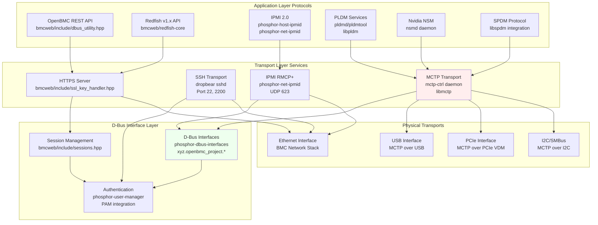

**Sources:** [features.md:5-33](), [security/network-security-considerations.md:129-264](), [architecture/ipmi-architecture.md:1-48]()

## Development Environment

OpenBMC uses the Yocto Project build system to create cross-compiled firmware images. The development workflow integrates multiple tools for source management, building, and testing.

### Key Development Components:

| Component | Purpose | Implementation |
|-----------|---------|----------------|
| **Yocto/BitBake** | Cross-compilation framework | `meta-openbmc` recipes and layers |
| **devtool** | Source modification workflow | Yocto development tool |
| **QEMU** | Hardware emulation | `qemu-system-arm` for BMC simulation |
| **Gerrit** | Code review system | `gerrit.openbmc-project.xyz` |
| **SDK** | Development toolkit | Cross-compilation toolchain |

The build system produces several artifacts:
- **BMC Images**: Complete firmware images (`obmc-phosphor-image`)
- **SDK**: Cross-compilation environment for application development  
- **Individual Packages**: Modular components for custom builds

**Sources:** [README.md:18-33](), [features.md:28-30]()

## Key System Features

OpenBMC provides comprehensive BMC functionality through its modular architecture:

### Core Management Capabilities

- **Remote System Control**: Power management, reset control, and system state monitoring
- **Hardware Monitoring**: Temperature, voltage, fan speed, and environmental sensors
- **Event Logging**: System event capture, storage, and retrieval through `phosphor-logging`
- **User Authentication**: Multi-protocol user management via `phosphor-user-manager` and PAM
- **Network Services**: HTTPS, SSH, IPMI, and service discovery protocols

### Standards Implementation

- **IPMI 2.0**: Full compliance with DCMI extensions via `phosphor-host-ipmid` and `phosphor-net-ipmid`
- **Redfish API**: Industry-standard REST API through `bmcweb/redfish-core`
- **PLDM**: Platform Level Data Model for modern device communication
- **SPDM**: Security Protocol and Data Model for device attestation

### Hardware Abstraction

- **Entity Management**: Dynamic hardware discovery through `entity-manager`
- **Sensor Framework**: Standardized sensor data collection via `phosphor-hwmon`
- **GPIO Control**: Hardware control interfaces through `phosphor-gpio-util`
- **Storage Management**: Flash memory and persistent storage handling

**Sources:** [features.md:1-73](), [console.md:1-49](), [architecture/user-management.md:30-66]()

## Communication Architecture

All OpenBMC services communicate through D-Bus interfaces defined in the `phosphor-dbus-interfaces` repository. This creates a uniform API layer that enables loose coupling between components and supports both local and remote management operations.

The `phosphor-objmgr` service provides object discovery and enumeration, allowing services to dynamically find and interact with hardware components and other system services. This architecture supports hot-plug events, dynamic configuration changes, and modular system composition.

**Sources:** [features.md:9-11](), [architecture/user-management.md:67-73]()

---

# Page: Project Structure and Documentation

# Project Structure and Documentation

<details>
<summary>Relevant source files</summary>

The following files were used as context for generating this wiki page:

- [MAINTAINERS](MAINTAINERS)
- [README.md](README.md)
- [console.md](console.md)
- [rest-api.md](rest-api.md)

</details>


This document describes how the OpenBMC documentation is organized, the maintainer structure for code review, and the contribution processes that govern project development. This covers the documentation infrastructure and governance processes that support the technical systems described throughout the rest of this wiki.

For information about the actual development workflow and building OpenBMC, see [Getting Started](#2). For code style and contribution guidelines, see [Development Guidelines](#7).

## Documentation Organization

The OpenBMC project maintains documentation across multiple repositories, with the main documentation repository serving as the central hub for project-wide information. The documentation is structured to serve different audiences: developers implementing OpenBMC services, system administrators deploying OpenBMC, and users consuming OpenBMC management interfaces.

### Documentation Repository Structure

```mermaid
graph TB
    subgraph "docs Repository Root"
        README["README.md<br/>Project overview"]
        CONTRIBUTING["CONTRIBUTING.md<br/>Contribution guidelines"]
        MAINTAINERS["MAINTAINERS<br/>Review assignments"]
        features["features.md<br/>Feature catalog"]
    end
    
    subgraph "Development Documentation"
        cheatsheet["cheatsheet.md<br/>Development tasks"]
        development["development/<br/>Tutorial directory"]
        kernel["kernel-development.md<br/>Kernel tasks"]
    end
    
    subgraph "Usage Documentation"
        rest_api["rest-api.md<br/>REST interface"]
        console_doc["console.md<br/>Host console"]
        host_mgmt["host-management.md<br/>Host operations"]
        redfish_cheat["REDFISH-cheatsheet.md<br/>Redfish commands"]
        rest_cheat["REST-cheatsheet.md<br/>REST commands"]
    end
    
    subgraph "Architecture Documentation"
        arch_dir["architecture/<br/>System design"]
        code_update["architecture/code-update<br/>Firmware updates"]
    end
    
    README --> development
    README --> rest_api
    README --> console_doc
    README --> host_mgmt
    README --> arch_dir
    CONTRIBUTING --> MAINTAINERS
    features --> arch_dir
```

**Sources:** [README.md:1-53](), [MAINTAINERS:1-57]()

### Documentation Types and Purposes

The documentation follows a clear categorization based on user intent and technical depth:

| Documentation Type | Purpose | Example Files | Target Audience |
|-------------------|---------|---------------|-----------------|
| **Development** | Code implementation guidance | `cheatsheet.md`, `development/`, `kernel-development.md` | OpenBMC developers |
| **Usage** | Operating OpenBMC systems | `rest-api.md`, `console.md`, `host-management.md` | System administrators |
| **Architecture** | System design and internals | `architecture/code-update` | Platform implementers |
| **Reference** | Quick command lookups | `REDFISH-cheatsheet.md`, `REST-cheatsheet.md` | All technical users |

The documentation architecture mirrors the layered approach of OpenBMC itself, with usage documentation mapping to external management interfaces, development documentation covering D-Bus services and internal APIs, and architecture documentation explaining the underlying system design.

**Sources:** [README.md:18-53]()

## Maintainer and Review System

OpenBMC uses a distributed maintainer model defined by `MAINTAINERS` files in each repository. This system ensures appropriate technical review and maintains code quality across the project's many components.

### MAINTAINERS File Structure

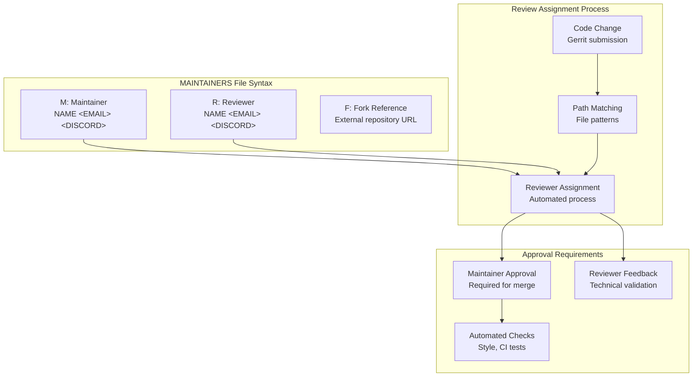

**Sources:** [MAINTAINERS:20-48]()

The `MAINTAINERS` file uses a structured format where each entry specifies role types and contact information:

- **M:** entries define maintainers who have approval authority for changes
- **R:** entries define reviewers who provide technical feedback but cannot approve changes  
- **F:** entries reference external repositories that have been forked

The current docs repository maintainers are:

| Role | Name | Email | Discord |
|------|------|-------|---------|
| Maintainer | Brad Bishop | `bradleyb@fuzziesquirrel.com` | `radsquirrel!` |
| Maintainer | Patrick Williams | `patrick@stwcx.xyz` | `stwcx!` |
| Reviewer | Adriana Kobylak | `anoo@us.ibm.com` | `anoo!` |
| Reviewer | Andrew Jeffery | `andrew@aj.id.au` | `arj!` |
| Reviewer | Gunnar Mills | `gmills@linux.vnet.ibm.com` | `GunnarM!` |

**Sources:** [MAINTAINERS:52-57]()

### Review Assignment Algorithm

The maintainer system operates through automated tooling that parses the `MAINTAINERS` file structure:

1. **Path Matching**: Changes are analyzed to determine which repository paths are modified
2. **Section Lookup**: The most specific `MAINTAINERS` section matching the changed paths is identified
3. **Reviewer Assignment**: All `R:` and `M:` entries from matching sections are added as reviewers
4. **Approval Enforcement**: At least one `M:` entry must approve before the change can merge

This system ensures that domain experts review changes while distributing the review workload across maintainers and reviewers.

**Sources:** [MAINTAINERS:8-18](), [MAINTAINERS:46-47]()

## Project Communication Infrastructure

OpenBMC maintains multiple communication channels that support both synchronous and asynchronous collaboration:

### Primary Communication Channels

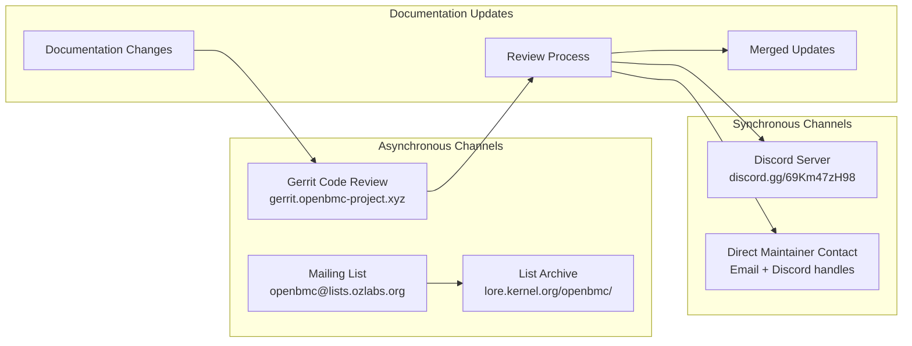

**Sources:** [README.md:12-16]()

The communication infrastructure supports the documentation lifecycle:

- **Mailing List**: Technical discussions and announcements reach all project participants
- **Discord**: Real-time communication for quick questions and collaborative work sessions  
- **Gerrit**: All documentation changes go through the same code review process as source code
- **Archive**: Searchable history of all technical discussions for reference

## Documentation Standards and Patterns

OpenBMC documentation follows consistent patterns that make information easy to find and use across different technical domains.

### Technical Documentation Structure

Most technical documentation follows this pattern:

1. **Purpose Statement**: Clear scope definition with links to related documentation
2. **Quick Start**: Minimal example or command sequence  
3. **Detailed Examples**: Comprehensive usage scenarios with code snippets
4. **Reference Material**: Complete API listings, command tables, or parameter descriptions

For example, `rest-api.md` demonstrates this pattern:

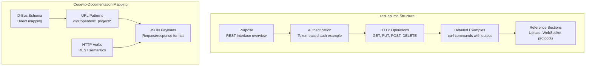

**Sources:** [rest-api.md:1-11](), [rest-api.md:25-98]()

### Cross-Reference Patterns

Documentation maintains consistency through standardized cross-referencing:

- **Internal Links**: References to other wiki sections use numeric page IDs: `[Title](#page.id)`
- **Code References**: File paths and line numbers use bracketed syntax: `[path/file:start-end]()`  
- **Command Examples**: Consistent shell prompt and variable naming (`${bmc}`, `$token`)
- **API Examples**: Standardized JSON formatting and curl command structure

This systematic approach ensures that users can navigate between different documentation areas and understand how components interact across the entire OpenBMC system.

**Sources:** [rest-api.md:19-23](), [console.md:14-18](), [console.md:25-27]()

---

# Page: Core Features and Capabilities

# Core Features and Capabilities

<details>
<summary>Relevant source files</summary>

The following files were used as context for generating this wiki page:

- [architecture/ipmi-architecture.md](architecture/ipmi-architecture.md)
- [architecture/user-management.md](architecture/user-management.md)
- [features.md](features.md)
- [security/network-security-considerations.md](security/network-security-considerations.md)

</details>


This document provides an overview of OpenBMC's management capabilities, supported interfaces, and key features. It covers the functionality available to system administrators and integrators for managing BMC-enabled systems.

For detailed architectural information about internal components, see [Core Architecture](#3). For specific implementation details of management interfaces, see [Management Interfaces](#4).

## Management Capabilities Overview

OpenBMC provides comprehensive out-of-band management capabilities for server systems through multiple standardized and proprietary interfaces. The system supports both local and remote management scenarios with robust security and authentication mechanisms.

### Core Management Functions

| Feature Category | Capabilities | Key Components |
|------------------|-------------|----------------|
| **System Control** | Host power management, reset control, watchdog | `phosphor-state-manager`, `phosphor-watchdog` |
| **Hardware Monitoring** | Environmental sensors, inventory tracking, LED control | `phosphor-hwmon`, `entity-manager`, `phosphor-led-manager` |
| **User Management** | Local/LDAP authentication, role-based access control | `phosphor-user-manager`, PAM integration |
| **Firmware Management** | BMC and host firmware updates, version management | Code update infrastructure, PLDM update agents |
| **Console Access** | Host serial console, virtual media, KVM | `obmc-console`, `bmcweb` WebSocket services |
| **Network Services** | DHCP/static IP, certificate management, secure protocols | `systemd-networkd`, `phosphor-certificate-manager` |

Sources: [features.md:1-73](), [security/network-security-considerations.md:1-264]()

## Network Interfaces and Protocol Stack

OpenBMC exposes management functionality through multiple network protocols and interfaces, each serving different use cases and client types.

### Network Service Architecture

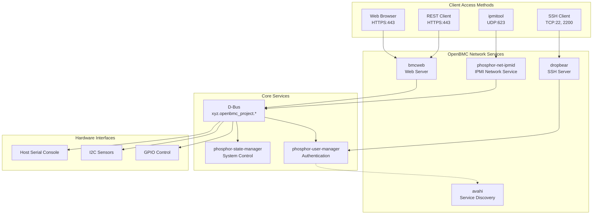

Sources: [security/network-security-considerations.md:129-264](), [features.md:5-28]()

### Protocol Support Matrix

| Protocol | Port | Service | Authentication | Primary Use Case |
|----------|------|---------|----------------|------------------|
| **HTTPS** | 443 | `bmcweb` | Session tokens, Basic Auth | REST APIs, Web UI, Redfish |
| **SSH** | 22 | `dropbear` | PAM, SSH keys | Shell access, SCP |
| **SSH Console** | 2200 | `dropbear` | PAM, SSH keys | Host serial console |
| **IPMI** | 623/UDP | `phosphor-net-ipmid` | RMCP+, Session-based | Traditional IPMI management |
| **mDNS** | 5355/UDP | `avahi-daemon` | None | Service discovery |

Sources: [security/network-security-considerations.md:131-264]()

## Hardware Management Features

OpenBMC provides comprehensive hardware monitoring and control capabilities through a modular sensor and inventory management system.

### Hardware Management Architecture

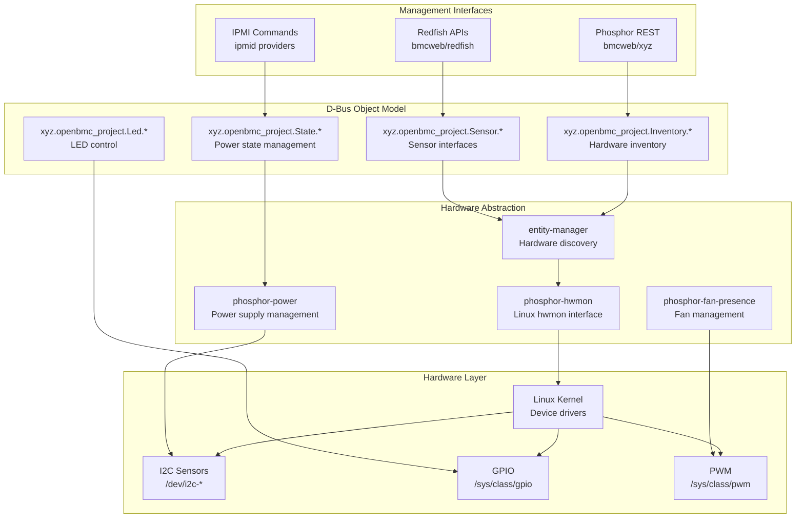

Sources: [features.md:15-25](), [architecture/user-management.md:1-528]()

### Sensor and Monitoring Capabilities

| Feature | Implementation | D-Bus Interface | Configuration |
|---------|----------------|-----------------|---------------|
| **Temperature Sensors** | `phosphor-hwmon` | `xyz.openbmc_project.Sensor.Value` | Device tree, entity-manager |
| **Voltage Sensors** | `phosphor-hwmon` | `xyz.openbmc_project.Sensor.Value` | Linux hwmon drivers |
| **Fan Control** | `phosphor-fan-presence` | `xyz.openbmc_project.Sensor.Value` | YAML configuration |
| **Power Supplies** | `phosphor-power` | `xyz.openbmc_project.Sensor.Value` | PMBus/I2C communication |
| **Inventory Tracking** | `entity-manager` | `xyz.openbmc_project.Inventory.Item` | JSON configuration |
| **LED Management** | `phosphor-led-manager` | `xyz.openbmc_project.Led.Group` | LED group definitions |

Sources: [features.md:15-25]()

## Security and User Management

OpenBMC implements a comprehensive security model with centralized user management, role-based access control, and secure communication protocols.

### User Management and Authentication Flow

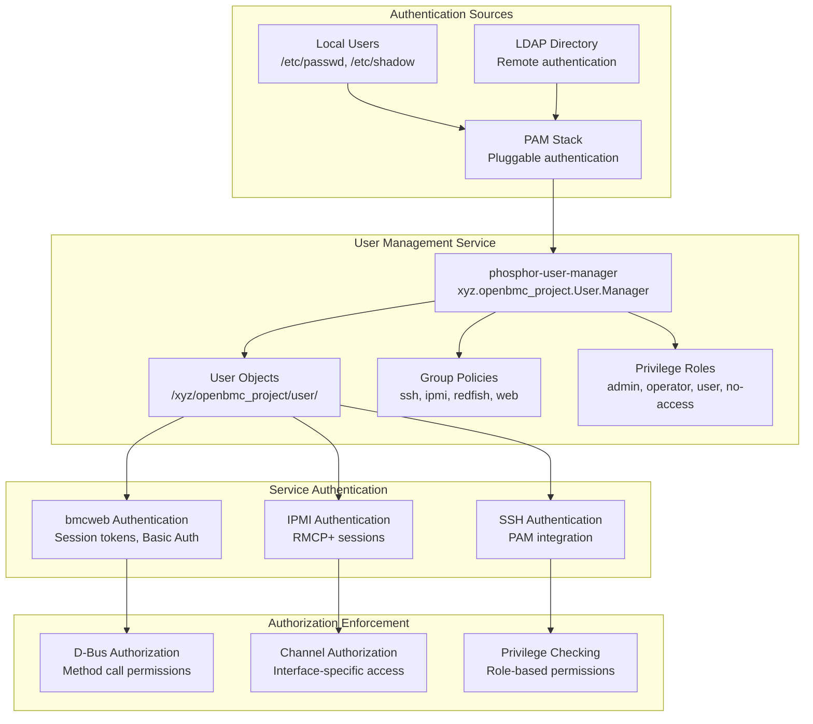

Sources: [architecture/user-management.md:67-528](), [security/network-security-considerations.md:70-128]()

### Security Features

| Security Domain | Implementation | Key Components |
|----------------|----------------|----------------|
| **Transport Security** | TLS 1.2+, SSH protocols | OpenSSL, Dropbear SSH |
| **Authentication** | PAM, LDAP, local users | `phosphor-user-manager`, PAM modules |
| **Authorization** | Role-based access control | Group membership, privilege levels |
| **Session Management** | Token-based sessions, timeouts | `bmcweb` session handling |
| **Certificate Management** | X.509 certificates, CA support | `phosphor-certificate-manager` |
| **Audit Logging** | Authentication events, system changes | `phosphor-logging`, rsyslog |

Sources: [architecture/user-management.md:30-66](), [security/network-security-considerations.md:82-121]()

## Development and Testing Features

OpenBMC provides comprehensive development infrastructure supporting both embedded development and testing workflows.

### Development Infrastructure

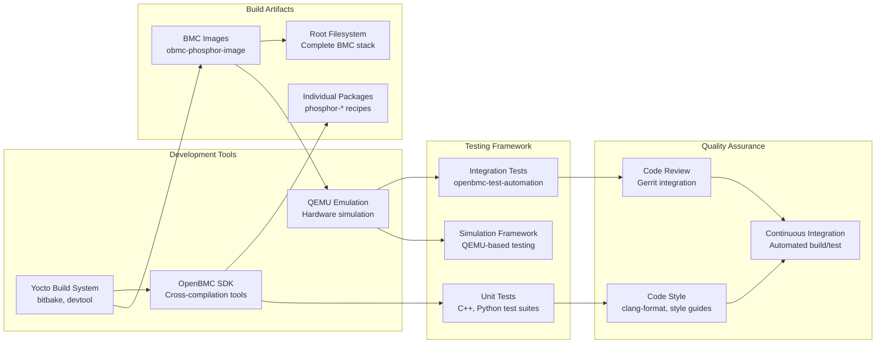

Sources: [features.md:28-31]()

### Key Development Features

| Feature | Purpose | Implementation |
|---------|---------|----------------|
| **QEMU Simulation** | Hardware-independent testing | Full BMC stack emulation |
| **devtool Workflow** | Source code modification | Yocto development tool |
| **Automated Testing** | Continuous integration | `openbmc-test-automation` framework |
| **Cross-compilation** | ARM target development | OpenBMC SDK toolchain |
| **Style Enforcement** | Code quality | `clang-format`, automated checks |
| **Package Management** | Modular development | BitBake recipe system |

Sources: [features.md:28-31]()

## Integration Points and Extensibility

OpenBMC's modular architecture enables customization and extension for specific platform requirements through well-defined interfaces and configuration mechanisms.

### Platform Customization Points

| Customization Area | Mechanism | Configuration Method |
|-------------------|-----------|---------------------|
| **Hardware Detection** | Entity Manager | JSON configuration files |
| **Sensor Mapping** | Device tree, hwmon | Kernel device tree, hwmon bindings |
| **GPIO Configuration** | Device tree | Platform-specific device tree |
| **Fan Control** | YAML configuration | Fan presence and control definitions |
| **Power Control** | D-Bus services | Custom power control implementations |
| **LED Patterns** | LED group definitions | YAML LED group configurations |
| **IPMI Extensions** | Provider libraries | Custom IPMI command handlers |
| **Redfish Extensions** | bmcweb schemas | Additional Redfish resource definitions |

This extensibility allows OpenBMC to support diverse hardware platforms while maintaining a consistent management interface across different system types.

Sources: [features.md:1-73](), [architecture/ipmi-architecture.md:95-318]()

---

# Page: Getting Started

# Getting Started

<details>
<summary>Relevant source files</summary>

The following files were used as context for generating this wiki page:

- [cheatsheet.md](cheatsheet.md)
- [designs/management-console/VMI_Certificate_Exchange.md](designs/management-console/VMI_Certificate_Exchange.md)
- [designs/management-console/service-discovery.md](designs/management-console/service-discovery.md)
- [designs/mctp/mctp-kernel.md](designs/mctp/mctp-kernel.md)
- [designs/multihost-ipmi-design.md](designs/multihost-ipmi-design.md)
- [designs/phosphor-audit.md](designs/phosphor-audit.md)
- [development/dev-environment.md](development/dev-environment.md)

</details>


## Purpose and Scope

This page provides an introduction to OpenBMC development, covering the essential concepts, tools, and workflow needed to begin developing and testing OpenBMC firmware. It focuses on setting up a development environment and understanding the core build and testing processes.

For detailed environment setup instructions, see [Development Environment Setup](#2.1). For comprehensive building and QEMU testing procedures, see [Building and Testing with QEMU](#2.2). For information about OpenBMC's overall architecture and features, see [OpenBMC Overview](#1).

## OpenBMC Development Overview

OpenBMC is a Linux-based BMC (Baseboard Management Controller) firmware stack built using the Yocto Project framework. Development involves building custom firmware images, developing applications that communicate via D-Bus, and testing using both hardware platforms and QEMU emulation.

The development process centers around three key activities:
- **Building**: Using Yocto/BitBake to create OpenBMC images
- **Developing**: Using the SDK for cross-compilation and `devtool` for iterative development
- **Testing**: Using QEMU emulation for rapid testing and validation

**Development Architecture Overview**

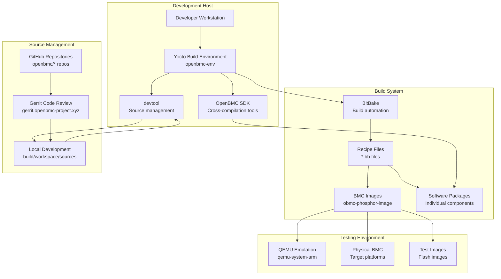

Sources: [cheatsheet.md:1-376](), [development/dev-environment.md:1-233]()

## Quick Start Workflow

The typical OpenBMC development workflow follows these essential steps:

**1. Environment Preparation**
```bash
# Set up build environment
cd openbmc
TEMPLATECONF=meta-ibm/meta-palmetto/conf . openbmc-env
```

**2. Initial Build**
```bash
# Build complete OpenBMC image
bitbake obmc-phosphor-image
```

**3. SDK Generation and Installation**
```bash
# Build SDK for cross-compilation
bitbake -c populate_sdk obmc-phosphor-image

# Install SDK
./tmp/deploy/sdk/openbmc-phosphor-glibc-x86_64-obmc-phosphor-image-armv5e-toolchain-2.1.sh
```

**4. Development with devtool**
```bash
# Modify existing component
devtool modify phosphor-ipmi-host
cd build/workspace/sources/phosphor-ipmi-host
# Make changes...

# Build with changes
bitbake obmc-phosphor-image
```

**5. QEMU Testing**
```bash
# Download QEMU
wget https://jenkins.openbmc.org/job/latest-qemu-x86/lastSuccessfulBuild/artifact/qemu/build/qemu-system-arm

# Run OpenBMC in emulation
./qemu-system-arm -m 256 -M palmetto-bmc -nographic \
    -drive file=./flash-palmetto,format=raw,if=mtd \
    -net nic \
    -net user,hostfwd=:127.0.0.1:2222-:22,hostfwd=:127.0.0.1:2443-:443,hostname=qemu
```

Sources: [cheatsheet.md:25-123](), [development/dev-environment.md:92-197]()

**Development Tools and Key Commands**

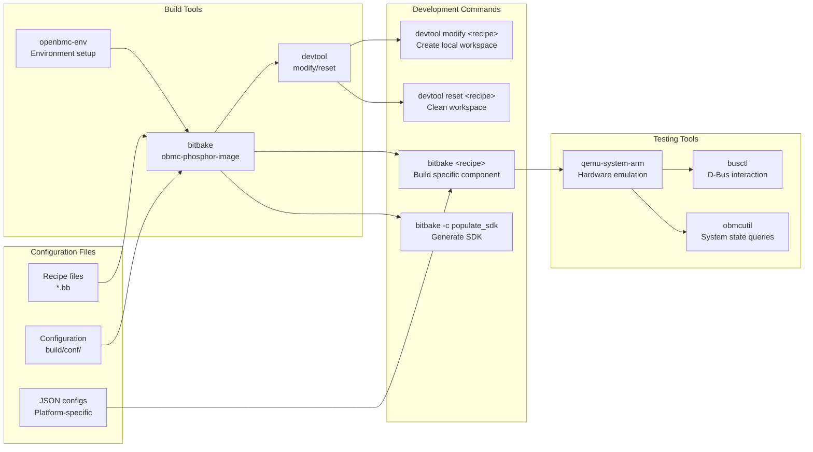

Sources: [cheatsheet.md:258-275](), [cheatsheet.md:83-98]()

## Platform-Specific Building

OpenBMC supports multiple hardware platforms through machine configurations. Each platform has its own template configuration:

| Platform | Template Configuration | Machine Target |
|----------|----------------------|----------------|
| Palmetto | `meta-ibm/meta-palmetto/conf` | `palmetto` |
| Zaius | `meta-ingrasys/meta-zaius/conf` | `zaius` |
| Romulus | Default CI platform | `romulus` |

**Platform Build Example:**
```bash
# Building for specific platform
cd openbmc
TEMPLATECONF=meta-ibm/meta-palmetto/conf . openbmc-env
export MACHINE="palmetto"
bitbake obmc-phosphor-image
```

**Build Configuration Override:**
```bash
# Using different machine in existing build
export MACHINE="machineB"
bitbake obmc-phosphor-image
```

Sources: [cheatsheet.md:25-61](), [development/dev-environment.md:32-33]()

## Essential Development Utilities

**D-Bus Interaction with busctl**
```bash
# Execute D-Bus methods directly
busctl call <path> <interface> <object> <method> <parameters>

# Example: Power control
busctl call xyz.openbmc_project.State.Host \
    xyz.openbmc_project.State.Host.Transition \
    RequestedHostTransition s "xyz.openbmc_project.State.Host.Transition.On"
```

**System State Monitoring**
```bash
# Check OpenBMC state
obmcutil state
# Output:
# CurrentBMCState     : xyz.openbmc_project.State.BMC.BMCState.Ready
# CurrentPowerState   : xyz.openbmc_project.State.Chassis.PowerState.Off  
# CurrentHostState    : xyz.openbmc_project.State.Host.HostState.Off
```

**Development Performance Optimization**
- **Shared Downloads**: Configure `DL_DIR` in `build/conf/local.conf` to share downloaded sources across builds
- **Git Proxy**: Use `GIT_PROXY_COMMAND` for faster repository access in restricted networks
- **Incremental Builds**: Use `devtool modify` for iterative development without full rebuilds

Sources: [cheatsheet.md:83-98](), [cheatsheet.md:211-256](), [development/dev-environment.md:184-195]()

## Next Steps

Once you understand these basic concepts and have experimented with the quick start workflow:

1. **Set up your development environment** following the detailed instructions in [Development Environment Setup](#2.1)

2. **Learn the complete build and testing process** including QEMU setup and advanced devtool usage in [Building and Testing with QEMU](#2.2)

3. **Explore the core architecture** to understand D-Bus communication, state management, and hardware interfaces in [Core Architecture](#3)

4. **Study management interfaces** for REST API, Redfish, and IPMI development in [Management Interfaces](#4)

The OpenBMC development ecosystem provides powerful tools for firmware development, but mastering the Yocto build system and D-Bus architecture is essential for effective development.

Sources: [cheatsheet.md:1-376](), [development/dev-environment.md:1-233]()

---

# Page: Development Environment Setup

# Development Environment Setup

<details>
<summary>Relevant source files</summary>

The following files were used as context for generating this wiki page:

- [cheatsheet.md](cheatsheet.md)
- [designs/management-console/VMI_Certificate_Exchange.md](designs/management-console/VMI_Certificate_Exchange.md)
- [designs/management-console/service-discovery.md](designs/management-console/service-discovery.md)
- [designs/mctp/mctp-kernel.md](designs/mctp/mctp-kernel.md)
- [designs/multihost-ipmi-design.md](designs/multihost-ipmi-design.md)
- [designs/phosphor-audit.md](designs/phosphor-audit.md)
- [development/dev-environment.md](development/dev-environment.md)

</details>


## Purpose and Scope

This document covers the setup of a complete OpenBMC development environment, including the Yocto build system, Software Development Kit (SDK) installation, and essential development tools. This environment enables developers to build, modify, and test OpenBMC components efficiently without requiring physical BMC hardware.

For information about building and testing specific components once the environment is established, see [Building and Testing with QEMU](#2.2). For details about the overall OpenBMC architecture and core features, see [OpenBMC Overview](#1).

## Prerequisites and System Requirements

### Host System Requirements

OpenBMC development requires a Linux-based development environment. The recommended configuration includes:

| Requirement | Minimum | Recommended |
|-------------|---------|-------------|
| Operating System | Ubuntu 18.04 LTS | Latest Ubuntu LTS |
| CPU Cores | 4 | 8+ |
| RAM | 8GB | 16GB+ |
| Storage | 100GB | 200GB+ |
| Network | Internet connectivity for package downloads | High-speed connection |

### Virtualization Support

For developers using Windows or macOS, virtualization through VirtualBox or VMware is supported. The virtual machine should be allocated maximum available resources for optimal build performance.

**Sources:** [development/dev-environment.md:35-62]()

## Yocto Build System Overview

OpenBMC uses the Yocto Project as its underlying build and distribution framework. The build system consists of several interconnected components that work together to produce BMC firmware images.

### Build System Architecture

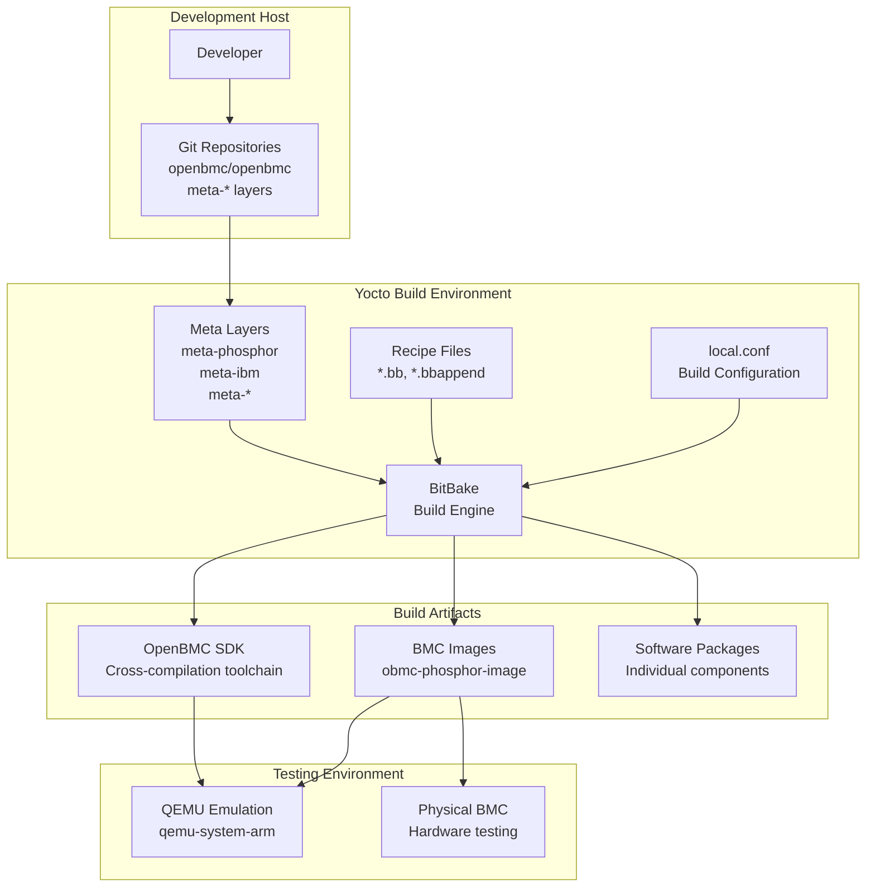

**Sources:** [development/dev-environment.md:11-18](), [cheatsheet.md:25-61]()

## Environment Setup Process

### Initial Repository Clone and Configuration

The OpenBMC build environment starts with cloning the main repository and setting up the build configuration:

```bash
# Clone the main OpenBMC repository
git clone https://github.com/openbmc/openbmc.git
cd openbmc

# Set up build environment for specific platform
TEMPLATECONF=meta-ibm/meta-palmetto/conf . openbmc-env
```

The `openbmc-env` script initializes the BitBake environment and creates the `build/conf` directory containing configuration files like `local.conf` and `bblayers.conf`.

### Build Configuration Structure

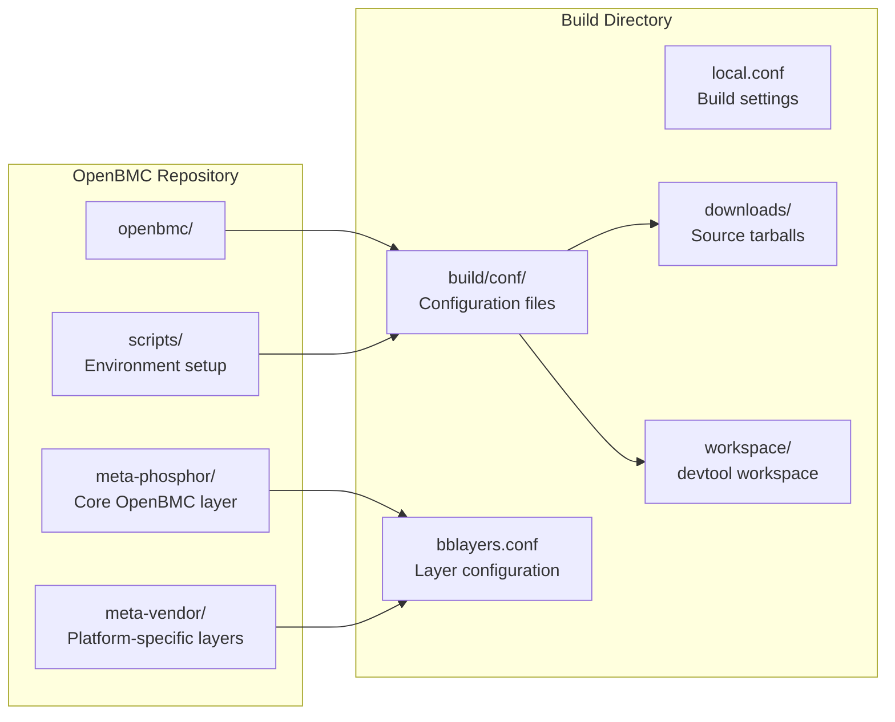

**Sources:** [cheatsheet.md:29-44](), [development/dev-environment.md:209-227]()

## Software Development Kit (SDK) Installation

The OpenBMC SDK provides a complete cross-compilation environment that includes compilers, libraries, and development tools needed to build applications for ARM-based BMC targets.

### SDK Download and Installation

```bash
# Create SDK workspace
mkdir -p ~/sdk
cd ~/sdk

# Download pre-built SDK (example for Romulus platform)
wget https://jenkins.openbmc.org/job/latest-master-sdk/label=docker-builder,target=romulus/lastSuccessfulBuild/artifact/deploy/sdk/oecore-x86_64-arm1176jzs-toolchain-nodistro.0.sh

# Make executable and install
chmod u+x oecore-x86_64-arm1176jzs-toolchain-nodistro.0.sh
mkdir -p ~/sdk/romulus-$(date +%F)
./oecore-x86_64-arm1176jzs-toolchain-nodistro.0.sh
```

### SDK Environment Activation

After installation, each development session requires sourcing the SDK environment:

```bash
# Source SDK environment (path varies based on installation)
. /path/to/sdk/environment-setup-arm1176jzs-openbmc-linux-gnueabi
```

The SDK provides cross-compilation tools including `$CC`, `$CXX`, `$GDB`, and other development utilities configured for the target BMC architecture.

**Sources:** [development/dev-environment.md:79-139](), [cheatsheet.md:62-71]()

### Building SDK from Source

Alternatively, the SDK can be built from source using BitBake:

```bash
# Build SDK using BitBake
bitbake -c populate_sdk obmc-phosphor-image

# Install the generated SDK
./tmp/deploy/sdk/openbmc-phosphor-glibc-x86_64-obmc-phosphor-image-armv5e-toolchain-2.1.sh
```

**Sources:** [cheatsheet.md:62-71]()

## Development Tools and Workflow

### devtool: Development Workflow Management

The `devtool` utility provides a streamlined workflow for modifying OpenBMC components during development. It integrates with the Yocto build system to manage source code modifications and testing.

#### devtool Workflow

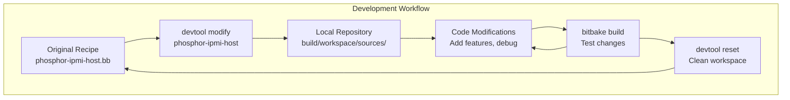

#### Common devtool Commands

```bash
# Create local copy of a recipe for modification
devtool modify phosphor-ipmi-host

# Navigate to source directory
cd build/workspace/sources/phosphor-ipmi-host

# Build with local changes
bitbake obmc-phosphor-image

# Reset recipe to ignore local changes
devtool reset phosphor-ipmi-host
```

**Sources:** [cheatsheet.md:258-312]()

### Build Optimization Techniques

#### Shared Downloads Directory

To accelerate builds across multiple workspaces, configure a shared downloads directory:

```bash
# Method 1: Configure in local.conf
echo 'DL_DIR ?= "/path/to/shared/downloads"' >> build/conf/local.conf

# Method 2: Create symbolic link
ln -sf /path/to/existing/downloads build/downloads
```

#### Git Proxy Configuration

For environments with restricted internet access, configure git proxy support:

```bash
# Create proxy wrapper script
cat > ~/bin/git-proxy-wrapper << 'EOF'
#!/bin/sh
/usr/bin/connect -S localhost:9054 "$@"
EOF

# Enable proxy for git operations
export GIT_PROXY_COMMAND=~/bin/git-proxy-wrapper
```

**Sources:** [cheatsheet.md:212-256]()

## QEMU Emulation Environment

QEMU provides hardware emulation capabilities that enable testing OpenBMC images without physical BMC hardware. This significantly accelerates the development and testing cycle.

### QEMU Setup and Configuration

#### Pre-built QEMU and Images

```bash
# Download QEMU binary
wget https://jenkins.openbmc.org/job/latest-qemu-x86/lastSuccessfulBuild/artifact/qemu/build/qemu-system-arm
chmod u+x qemu-system-arm

# Download BMC image (Romulus example)
wget https://jenkins.openbmc.org/job/latest-master/label=docker-builder,target=romulus/lastSuccessfulBuild/artifact/openbmc/build/tmp/deploy/images/romulus/obmc-phosphor-image-romulus.static.mtd
```

#### QEMU Execution with Network Forwarding

```bash
# Start QEMU with port forwarding for management interfaces
./qemu-system-arm -m 256 -M romulus-bmc -nographic \
    -drive file=./obmc-phosphor-image-romulus.static.mtd,format=raw,if=mtd \
    -net nic \
    -net user,hostfwd=:127.0.0.1:2222-:22,hostfwd=:127.0.0.1:2443-:443,hostfwd=udp:127.0.0.1:2623-:623,hostname=qemu
```

This configuration provides access to:
- SSH on port 2222
- HTTPS/Web interface on port 2443  
- IPMI on UDP port 2623

**Sources:** [development/dev-environment.md:141-198](), [cheatsheet.md:99-124]()

### QEMU Network Architecture

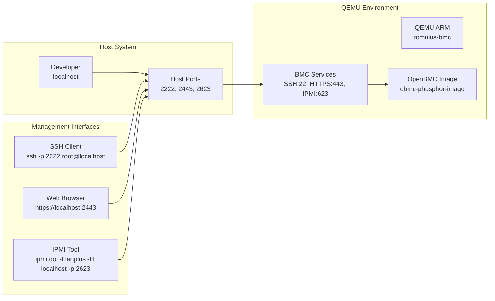

### Alternative Yocto QEMU Integration

For more advanced development scenarios, Yocto provides integrated QEMU support:

```bash
# Set up build environment
source setup romulus myBuild/build

# Configure for QEMU x86 testing
echo 'MACHINE ??= "qemux86"' >> conf/local.conf

# Build and run with Yocto's runqemu
MACHINE=qemux86 bitbake obmc-phosphor-image
runqemu myBuild/build/tmp/deploy/images/qemux86/ nographic qemuparams="-m 2048"
```

This approach provides TAP network interface support and better integration with the Yocto build system.

**Sources:** [development/dev-environment.md:199-231]()

## Development Environment Validation

### Build System Verification

After environment setup, verify the build system functionality:

```bash
# Test basic build capability
bitbake obmc-phosphor-image

# Verify SDK functionality
echo 'int main() { return 0; }' > test.c
$CC test.c -o test
file test  # Should show ARM executable
```

### QEMU Boot Verification

Validate QEMU environment by checking OpenBMC system state:

```bash
# Connect to QEMU instance
ssh -p 2222 root@localhost

# Check OpenBMC state services
obmcutil state
# Expected output:
# CurrentBMCState     : xyz.openbmc_project.State.BMC.BMCState.Ready
# CurrentPowerState   : xyz.openbmc_project.State.Chassis.PowerState.Off
# CurrentHostState    : xyz.openbmc_project.State.Host.HostState.Off
```

### Development Workflow Testing

Verify devtool functionality with a simple modification:

```bash
# Test devtool workflow
devtool modify bmcweb
cd build/workspace/sources/bmcweb
# Make simple changes
bitbake bmcweb
devtool reset bmcweb
```

**Sources:** [development/dev-environment.md:180-195]()

---

# Page: Building and Testing with QEMU

# Building and Testing with QEMU

<details>
<summary>Relevant source files</summary>

The following files were used as context for generating this wiki page:

- [Makefile](Makefile)
- [architecture/code-update/code-update-deprecated.md](architecture/code-update/code-update-deprecated.md)
- [architecture/code-update/flash-layout.md](architecture/code-update/flash-layout.md)
- [cheatsheet.md](cheatsheet.md)
- [userguide/userguide.tex](userguide/userguide.tex)

</details>


This document covers building OpenBMC images and using QEMU emulation for development and testing. It provides practical guidance for setting up a development environment that allows rapid iteration without requiring physical BMC hardware.

For information about the overall development environment setup, see [Development Environment Setup](#2.1). For details about core OpenBMC architecture and services, see [Core Architecture](#3).

## Purpose and Scope

QEMU provides hardware emulation that enables OpenBMC development and testing without physical BMC hardware. This approach accelerates development cycles by allowing developers to:

- Build and test OpenBMC images locally
- Iterate quickly on code changes using `devtool`
- Validate functionality through network interfaces
- Debug issues in a controlled environment

## Building OpenBMC Images

### Basic Image Build

OpenBMC uses the Yocto build system with BitBake to create BMC firmware images. The primary target for QEMU testing is `obmc-phosphor-image`.

```bash
# Set up build environment for specific platform
cd openbmc
TEMPLATECONF=meta-ibm/meta-palmetto/conf . openbmc-env
bitbake obmc-phosphor-image
```

### Platform-Specific Builds

Different BMC platforms require specific machine configurations. The build system supports multiple targets:

```bash
# Building for Palmetto (AST2400-based)
TEMPLATECONF=meta-ibm/meta-palmetto/conf . openbmc-env
bitbake obmc-phosphor-image

# Building for Zaius (AST2500-based)  
TEMPLATECONF=meta-ingrasys/meta-zaius/conf . openbmc-env
bitbake obmc-phosphor-image
```

**Build Output Structure**

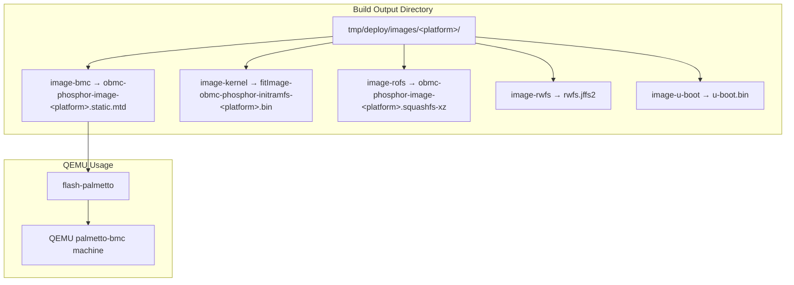

Sources: [cheatsheet.md:25-45](), [architecture/code-update/code-update-deprecated.md:13-36]()

### Machine Configuration Override

When building systems with multiple machine configurations, specify the target machine explicitly:

```bash
cd openbmc
TEMPLATECONF=meta-<layer>/meta-<system>/conf . openbmc-env
export MACHINE="machineB"
bitbake obmc-phosphor-image
```

Sources: [cheatsheet.md:47-61]()

## QEMU Setup and Configuration

### Standard QEMU Execution

OpenBMC provides QEMU machine definitions that emulate BMC hardware. The `palmetto-bmc` machine type supports core BMC functionality:

```bash
qemu-system-arm -m 256 -M palmetto-bmc -nographic \
  -drive file=<path>/flash-palmetto,format=raw,if=mtd \
  -net nic \
  -net user,hostfwd=:127.0.0.1:2222-:22,hostfwd=:127.0.0.1:2443-:443,hostname=qemu
```

**QEMU Network Access Configuration**

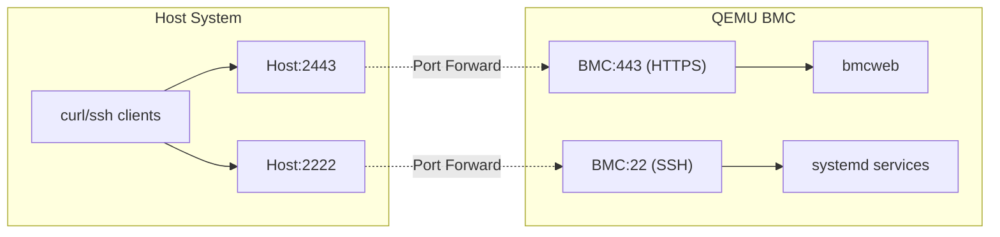

Sources: [cheatsheet.md:99-125]()

### Network Access Methods

**SSH Access:**
```bash
ssh -p 2222 root@localhost
```

**REST API Access:**
```bash
curl -c cjar -b cjar -k -H "Content-Type: application/json" \
  -X POST https://localhost:2443/login \
  -d "{\"data\": [ \"root\", \"0penBmc\" ] }"
```

**Console Access:**
The QEMU console provides direct access to the BMC system. Use `Ctrl-a c` to switch to QEMU monitor and `quit` to exit.

Sources: [cheatsheet.md:114-124]()

### Bridge Network Configuration

For more advanced networking that avoids port forwarding, configure a bridge interface:

```bash
# Install required packages
apt-get install libvirt libvirt-bin bridge-utils uml-utilities qemu-system-common

# Run with bridge network
qemu-system-arm -m 256 -M palmetto-bmc -nographic \
  -drive file=<path>/flash-palmetto,format=raw,if=mtd \
  -net nic,macaddr=C0:FF:EE:00:00:02,model=ftgmac100 \
  -net bridge,id=net0,helper=/usr/lib/qemu-bridge-helper,br=virbr0
```

Sources: [cheatsheet.md:139-151]()

## Development Workflow with devtool

### devtool Overview

The `devtool` utility enables efficient development by creating local working copies of OpenBMC components. This allows modification and testing without rebuilding entire images.

**devtool Development Cycle**

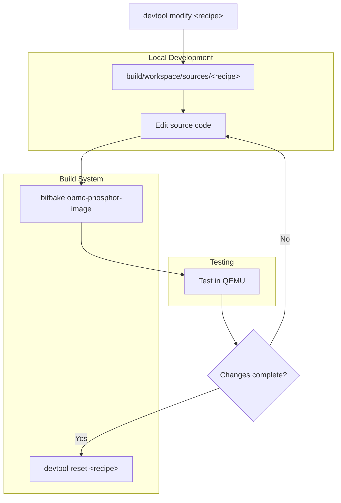

Sources: [cheatsheet.md:258-276]()

### IPMI Development Example

For modifying IPMI functionality using the `phosphor-ipmi-host` component:

```bash
# Create local development copy
devtool modify phosphor-ipmi-host

# Modify code in workspace
cd build/workspace/sources/phosphor-ipmi-host
# Make changes to source files

# Build with changes
bitbake obmc-phosphor-image
# or build specific component
bitbake phosphor-ipmi-host

# Test by copying changed binary to running BMC
scp build/workspace/sources/phosphor-ipmi-host/oe-workdir/package/usr/lib/ipmid-providers/libapphandler.so.0.0.0 \
  root@bmc:/usr/lib/ipmid-providers/
systemctl restart phosphor-ipmi-host.service
```

Sources: [cheatsheet.md:280-312]()

### Kernel Development Workflow

Linux kernel development requires special handling due to patch application and configuration management:

```bash
# Create kernel workspace (creates dev-4.13 branch, applies patches)
devtool modify linux-aspeed

# Build kernel
bitbake linux-aspeed -c build

# Modify kernel configuration
bitbake linux-aspeed -c menuconfig
bitbake linux-aspeed -c savedefconfig
```

**Kernel Configuration Management**

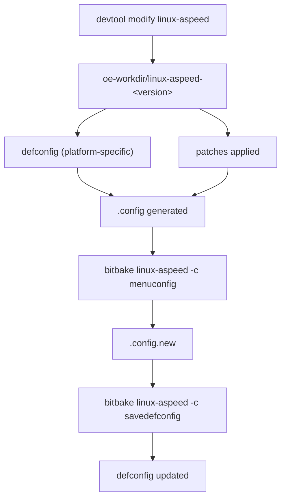

Sources: [cheatsheet.md:314-347]()

## Testing and Validation

### Rapid Kernel Testing

For faster kernel testing cycles, use network loading instead of flashing complete images:

```bash
# Put fitImage on TFTP server
cp build/tmp/deploy/images/romulus/fitImage-obmc-phosphor-initramfs-romulus.bin /tftpboot/fitImage

# In U-Boot console:
setenv ethaddr <mac:addr>
setenv ipaddr 192.168.0.80
setenv serverip 192.168.0.11  
tftp 0x83000000 fitImage
bootm 0x83000000
```

This approach loads the kernel directly into RAM, bypassing flash operations and significantly reducing test iteration time.

Sources: [cheatsheet.md:349-370]()

### Host System Control

Once OpenBMC is running in QEMU, test host management functionality:

```bash
# Login to BMC
curl -c cjar -k -X POST -H "Content-Type: application/json" \
  -d '{"data": [ "root", "0penBmc" ] }' https://${bmc}/login

# Power on host system
curl -c cjar -b cjar -k -H "Content-Type: application/json" -X PUT \
  -d '{"data": "xyz.openbmc_project.State.Host.Transition.On"}' \
  https://${bmc}/xyz/openbmc_project/state/host0/attr/RequestedHostTransition

# Access host console
ssh -p 2200 root@bmc
```

Sources: [cheatsheet.md:158-175]()

### D-Bus Interface Testing

QEMU provides an excellent environment for testing D-Bus interfaces using `busctl`:

```bash
# Example D-Bus command execution
busctl call <path> <interface> <object> <method> <parameters>
```

This enables testing of OpenBMC's core D-Bus communication without physical hardware dependencies.

Sources: [cheatsheet.md:81-98]()

## Building Custom QEMU

If the system QEMU lacks required BMC machine support, build OpenBMC's enhanced QEMU version:

```bash
git clone https://github.com/openbmc/qemu.git
cd qemu
git submodule update --init dtc
mkdir build
cd build
../configure --target-list=arm-softmmu
make
```

The built executable is located at `arm-softmmu/qemu-system-arm`.

**QEMU Build Dependencies**

```mermaid
graph TD
    A["openbmc/qemu repository"] --> B["git submodule update --init dtc"]
    B --> C["../configure --target-list=arm-softmmu"]
    C --> D["make"]
    D --> E["arm-softmmu/qemu-system-arm"]
    
    subgraph "OpenBMC QEMU Features"
        F["palmetto-bmc machine"]
        G["Enhanced BMC device support"]
        H["Upstream patches"]
    end
    
    E --> F
    E --> G
    E --> H
```

Sources: [cheatsheet.md:126-137]()

## SDK Development

For cross-compilation development, build the OpenBMC SDK:

```bash
bitbake -c populate_sdk obmc-phosphor-image
./tmp/deploy/sdk/openbmc-phosphor-glibc-x86_64-obmc-phosphor-image-armv5e-toolchain-2.1.sh

# Setup development environment
. /opt/openbmc-phosphor/2.1/environment-setup-armv5e-openbmc-linux-gnueabi
```

The SDK provides cross-compilation tools and debugging capabilities including GDB with debug symbols for troubleshooting BMC applications.

Sources: [cheatsheet.md:62-71](), [cheatsheet.md:177-191]()

---

# Page: Core Architecture

# Core Architecture

<details>
<summary>Relevant source files</summary>

The following files were used as context for generating this wiki page:

- [architecture/object-mapper.md](architecture/object-mapper.md)
- [architecture/openbmc-systemd.md](architecture/openbmc-systemd.md)
- [designs/target-fail-monitoring.md](designs/target-fail-monitoring.md)
- [yocto-development.md](yocto-development.md)

</details>


This document describes OpenBMC's internal architecture, focusing on the D-Bus communication system, systemd process management, and core service design patterns. It covers how services discover and interact with each other, and how the system coordinates startup, shutdown, and state transitions.

For information about external management interfaces (REST, Redfish, IPMI), see [Management Interfaces](#4). For platform-specific protocols like PLDM and MCTP, see [Platform Protocols](#5). For build system and development environment details, see [Getting Started](#2).

## Architecture Overview

OpenBMC's core architecture is built around three fundamental components: D-Bus for inter-process communication, systemd for process lifecycle management, and the Object Mapper for service discovery. This creates a service-oriented architecture where applications communicate through well-defined D-Bus interfaces rather than direct inter-process communication.

### Core Communication Model

```mermaid
graph TB
    subgraph "External Management Layer"
        bmcweb["bmcweb<br/>(Web/REST/Redfish Server)"]
        SSH["SSH Console Access"]
        IPMI["IPMI Interface"]
    end
    
    subgraph "D-Bus Communication Hub"
        DBus[("D-Bus System Bus<br/>org.freedesktop.DBus")]
        ObjectMapper["xyz.openbmc_project.ObjectMapper<br/>(Service Discovery)"]
    end
    
    subgraph "Core Management Services"
        StateManager["phosphor-state-manager<br/>xyz.openbmc_project.State.*"]
        UserManager["phosphor-user-manager<br/>xyz.openbmc_project.User.Manager"]
        EntityManager["entity-manager<br/>xyz.openbmc_project.EntityManager"]
        InventoryManager["phosphor-inventory-manager<br/>xyz.openbmc_project.Inventory.Manager"]
    end
    
    subgraph "Hardware Interface Services"
        HwmonTempd["phosphor-hwmon<br/>xyz.openbmc_project.Hwmon.*"]
        GPIODaemon["phosphor-gpio-monitor<br/>xyz.openbmc_project.Gpio.*"]
        SensorDaemon["dbus-sensors<br/>xyz.openbmc_project.Sensor.*"]
    end
    
    subgraph "Systemd Process Manager"
        SystemdManager["systemd<br/>org.freedesktop.systemd1.Manager"]
        SystemdTargets["systemd targets<br/>(obmc-*.target)"]
    end
    
    %% External to D-Bus connections
    bmcweb --> DBus
    SSH --> DBus
    IPMI --> DBus
    
    %% D-Bus service discovery
    ObjectMapper --> DBus
    
    %% Core services to D-Bus
    StateManager --> DBus
    UserManager --> DBus
    EntityManager --> DBus
    InventoryManager --> DBus
    
    %% Hardware services to D-Bus
    HwmonTempd --> DBus
    GPIODaemon --> DBus
    SensorDaemon --> DBus
    
    %% Systemd coordination
    SystemdManager --> DBus
    SystemdTargets --> SystemdManager
    StateManager --> SystemdManager
    
    %% Service discovery relationships
    bmcweb --> ObjectMapper
    StateManager --> ObjectMapper
    EntityManager --> ObjectMapper
```

**Sources:** [architecture/openbmc-systemd.md:1-295](), [architecture/object-mapper.md:1-281]()

## D-Bus Communication System

D-Bus serves as the central communication hub for all OpenBMC services. Services register objects at well-defined paths and implement standardized interfaces to expose their functionality. The system uses the `xyz.openbmc_project.*` namespace for all OpenBMC-specific interfaces.

### Service Registration and Discovery

```mermaid
graph LR
    subgraph "Service Lifecycle"
        ServiceStart["Service Startup<br/>phosphor-*"]
        RegisterObjects["Register D-Bus Objects<br/>at /xyz/openbmc_project/*"]
        ImplementInterfaces["Implement Standard Interfaces<br/>xyz.openbmc_project.*"]
        ServiceReady["Service Ready<br/>Visible to ObjectMapper"]
    end
    
    subgraph "Discovery Process"
        ClientNeed["Client Needs Service<br/>(e.g., bmcweb)"]
        QueryMapper["Query ObjectMapper<br/>GetObject() or GetSubTree()"]
        ResolveService["Resolve Service Name<br/>and Interface List"]
        DirectCall["Direct D-Bus Call<br/>to Service"]
    end
    
    subgraph "ObjectMapper Methods"
        GetObject["GetObject(path, interfaces)<br/>→ Map<service, interfaces>"]
        GetSubTree["GetSubTree(subtree, depth, interfaces)<br/>→ Map<path, Map<service, interfaces>>"]
        GetSubTreePaths["GetSubTreePaths(subtree, depth, interfaces)<br/>→ Array<path>"]
        GetAncestors["GetAncestors(path, interfaces)<br/>→ Map<path, Map<service, interfaces>>"]
    end
    
    ServiceStart --> RegisterObjects
    RegisterObjects --> ImplementInterfaces
    ImplementInterfaces --> ServiceReady
    
    ClientNeed --> QueryMapper
    QueryMapper --> ResolveService
    ResolveService --> DirectCall
    
    QueryMapper --> GetObject
    QueryMapper --> GetSubTree
    QueryMapper --> GetSubTreePaths
    QueryMapper --> GetAncestors
```

**Sources:** [architecture/object-mapper.md:13-199]()

### Common D-Bus Interface Patterns

| Interface Category | Interface Name | Purpose | Typical Object Path |
|-------------------|----------------|---------|-------------------|
| State Management | `xyz.openbmc_project.State.Host` | Host power state control | `/xyz/openbmc_project/state/host0` |
| State Management | `xyz.openbmc_project.State.Chassis` | Chassis power state control | `/xyz/openbmc_project/state/chassis0` |
| State Management | `xyz.openbmc_project.State.BMC` | BMC ready state tracking | `/xyz/openbmc_project/state/bmc0` |
| Sensor Data | `xyz.openbmc_project.Sensor.Value` | Sensor reading interface | `/xyz/openbmc_project/sensors/temperature/cpu0` |
| Sensor Thresholds | `xyz.openbmc_project.Sensor.Threshold.Warning` | Warning threshold interface | `/xyz/openbmc_project/sensors/temperature/cpu0` |
| Inventory | `xyz.openbmc_project.Inventory.Item` | Hardware inventory item | `/xyz/openbmc_project/inventory/system/chassis/motherboard` |
| User Management | `xyz.openbmc_project.User.Manager` | User account management | `/xyz/openbmc_project/user` |
| Association | `xyz.openbmc_project.Association.Definitions` | Object relationship definitions | Various paths |

**Sources:** [architecture/object-mapper.md:17-52](), [architecture/object-mapper.md:200-280]()

## Systemd Process Management

OpenBMC uses systemd to manage all processes and coordinate system state transitions. The system defines custom targets and services that control which processes are started for different operational states.

### Systemd Target Hierarchy

```mermaid
graph TD
    subgraph "Boot Process"
        DefaultTarget["default.target<br/>(symlink to multi-user.target)"]
        MultiUserTarget["multi-user.target<br/>(BMC basic services)"]
        PhosphorServices["phosphor-* services<br/>(D-Bus services)"]
    end
    
    subgraph "Host Power Management"
        HostStart["obmc-host-start@0.target<br/>(Full host boot)"]
        HostStartMin["obmc-host-startmin@0.target<br/>(Minimal host boot)"]
        ChassisOn["obmc-chassis-poweron@0.target<br/>(Chassis power on)"]
        StartHostService["start_host@0.service"]
        OpPowerStart["op-power-start@0.service"]
        OpWaitPowerOn["op-wait-power-on@0.service"]
    end
    
    subgraph "Host Shutdown"
        HostShutdown["obmc-host-shutdown@0.target<br/>(Soft shutdown)"]
        HostStop["obmc-host-stop@0.target"]
        ChassisOff["obmc-chassis-poweroff@0.target"]
        OpPowerStop["op-power-stop@0.service"]
    end
    
    subgraph "Error Handling"
        HostQuiesce["obmc-host-quiesce@0.target<br/>(Error state)"]
        ChassisEmergencyOff["obmc-chassis-emergency-poweroff@0.target<br/>(Emergency shutdown)"]
        ChassisHardOff["obmc-chassis-hard-poweroff@0.target<br/>(Force power off)"]
    end
    
    %% Boot dependencies
    DefaultTarget --> MultiUserTarget
    MultiUserTarget --> PhosphorServices
    
    %% Host start dependencies
    HostStart --> HostStartMin
    HostStart --> "phosphor-reset-host-reboot-attempts@0.service"
    HostStartMin --> ChassisOn
    HostStartMin --> StartHostService
    ChassisOn --> OpPowerStart
    ChassisOn --> OpWaitPowerOn
    
    %% Shutdown dependencies
    HostShutdown --> HostStop
    HostStop --> ChassisOff
    ChassisOff --> OpPowerStop
    
    %% Error handling
    HostQuiesce -.-> "OnFailure paths"
    ChassisEmergencyOff --> ChassisHardOff
    ChassisEmergencyOff --> HostQuiesce
```

**Sources:** [architecture/openbmc-systemd.md:28-120]()

### Service Dependencies and Failure Handling

OpenBMC defines clear error handling policies for systemd services and targets. The system uses `OnFailure` directives to route failed services to appropriate recovery targets.

```mermaid
graph TB
    subgraph "Service Failure Patterns"
        ServiceFails["Service Fails<br/>(non-zero exit, crash)"]
        OneshotService["Type=oneshot<br/>RemainAfterExit=yes"]
        LongRunningService["Type=notify/simple<br/>RemainAfterExit=no"]
    end
    
    subgraph "Target Failure Handling"
        TargetFails["Target Fails<br/>(required service fails)"]
        OnFailureTarget["OnFailure=obmc-host-quiesce@0.target"]
        QuiesceState["Host Quiesce State<br/>(Manual intervention required)"]
    end
    
    subgraph "Monitoring Service"
        TargetMonitor["phosphor-state-manager<br/>Target Failure Monitor"]
        JsonConfig["JSON Configuration<br/>/usr/share/phosphor-state-manager/"]
        LogError["phosphor-logging<br/>Error Log Creation"]
    end
    
    ServiceFails --> OneshotService
    ServiceFails --> LongRunningService
    OneshotService --> TargetFails
    LongRunningService --> OnFailureTarget
    TargetFails --> OnFailureTarget
    OnFailureTarget --> QuiesceState
    
    TargetMonitor --> JsonConfig
    TargetMonitor --> LogError
    TargetFails --> TargetMonitor
```

**Sources:** [architecture/openbmc-systemd.md:153-220](), [designs/target-fail-monitoring.md:78-138]()

## Core Service Interactions

Core OpenBMC services follow established patterns for state management, event notification, and error handling. Services implement state machine patterns and coordinate through D-Bus signals and method calls.

### State Management Service Design

```mermaid
graph LR
    subgraph "phosphor-state-manager Services"
        BmcStateManager["phosphor-bmc-state-manager<br/>xyz.openbmc_project.State.BMC"]
        ChassisStateManager["phosphor-chassis-state-manager<br/>xyz.openbmc_project.State.Chassis"] 
        HostStateManager["phosphor-host-state-manager<br/>xyz.openbmc_project.State.Host"]
    end
    
    subgraph "State Transitions"
        BmcStates["BMC States:<br/>NotReady → Ready"]
        ChassisStates["Chassis States:<br/>Off → On → Off"]
        HostStates["Host States:<br/>Off → Running → Off<br/>Quiesced (error state)"]
    end
    
    subgraph "Systemd Integration"
        SystemdJobNew["systemd JobNew signal<br/>org.freedesktop.systemd1.Manager"]
        SystemdJobRemoved["systemd JobRemoved signal<br/>org.freedesktop.systemd1.Manager"]
        SystemdTargetControl["systemctl start/stop<br/>target operations"]
    end
    
    subgraph "External Control"
        DbusPropertySet["D-Bus Property Changes<br/>RequestedHostTransition"]
        RestApiCalls["REST API Calls<br/>bmcweb translation"]
        RedfishCalls["Redfish API Calls<br/>bmcweb translation"]
    end
    
    BmcStateManager --> BmcStates
    ChassisStateManager --> ChassisStates  
    HostStateManager --> HostStates
    
    BmcStateManager --> SystemdJobNew
    ChassisStateManager --> SystemdJobNew
    HostStateManager --> SystemdJobNew
    
    SystemdJobRemoved --> BmcStateManager
    SystemdJobRemoved --> ChassisStateManager
    SystemdJobRemoved --> HostStateManager
    
    HostStateManager --> SystemdTargetControl
    ChassisStateManager --> SystemdTargetControl
    
    DbusPropertySet --> HostStateManager
    RestApiCalls --> DbusPropertySet
    RedfishCalls --> DbusPropertySet
```

**Sources:** [architecture/openbmc-systemd.md:122-136]()

### Service Discovery and Object Relationships

The Object Mapper enables loose coupling between services by providing dynamic service discovery. Services can find and interact with other services without hard-coded dependencies.

```mermaid
graph TB
    subgraph "Association Framework"
        AssociationDefs["xyz.openbmc_project.Association.Definitions<br/>Associations property"]
        ForwardAssoc["Forward Association Object<br/>pathA/foo"]
        ReverseAssoc["Reverse Association Object<br/>pathB/bar"]
        EndpointsProperty["endpoints property<br/>Array of object paths"]
    end
    
    subgraph "Example: Error Log to Inventory"
        ErrorLog["/xyz/openbmc_project/logging/entry/3<br/>Error log object"]
        PowerSupply["/xyz/openbmc_project/inventory/system/chassis/motherboard/powersupply0<br/>Inventory item"]
        CalloutAssoc["/xyz/openbmc_project/logging/entry/3/callout<br/>Forward association"]
        FaultAssoc["/xyz/openbmc_project/inventory/system/chassis/motherboard/powersupply0/fault<br/>Reverse association"]
    end
    
    subgraph "Service Discovery Pattern"
        ClientQuery["Client needs service implementing<br/>xyz.openbmc_project.Sensor.Value"]
        MapperQuery["ObjectMapper.GetSubTree(<br/>'/xyz/openbmc_project/sensors',<br/>0,<br/>['xyz.openbmc_project.Sensor.Value'])"]
        ServiceList["Returns: Map of sensor paths<br/>to service names"]
        DirectCall["Client makes direct D-Bus call<br/>to discovered service"]
    end
    
    AssociationDefs --> ForwardAssoc
    AssociationDefs --> ReverseAssoc
    ForwardAssoc --> EndpointsProperty
    ReverseAssoc --> EndpointsProperty
    
    ErrorLog --> CalloutAssoc
    PowerSupply --> FaultAssoc
    CalloutAssoc --> PowerSupply
    FaultAssoc --> ErrorLog
    
    ClientQuery --> MapperQuery
    MapperQuery --> ServiceList
    ServiceList --> DirectCall
```

**Sources:** [architecture/object-mapper.md:200-279](), [architecture/object-mapper.md:54-138]()

This architecture provides a flexible, maintainable system where services can be developed independently while maintaining well-defined interfaces for communication and coordination.

---

# Page: D-Bus and Object Mapper

# D-Bus and Object Mapper

<details>
<summary>Relevant source files</summary>

The following files were used as context for generating this wiki page:

- [MAINTAINERS](MAINTAINERS)
- [architecture/object-mapper.md](architecture/object-mapper.md)
- [rest-api.md](rest-api.md)
- [yocto-development.md](yocto-development.md)

</details>


This document covers OpenBMC's central D-Bus communication system and the Object Mapper service that provides discovery and association functionality. Together, these form the backbone of inter-service communication in OpenBMC, enabling external management interfaces to discover and interact with hardware-specific services.

For information about specific management interfaces that use D-Bus, see [REST API](#4.1), [Redfish API](#4.2), and [IPMI Interface](#4.3). For details on hardware abstraction layers, see [Hardware Interfaces and GPIO](#3.4).

## D-Bus Communication Architecture

D-Bus serves as the central communication hub in OpenBMC, connecting external management interfaces with core services and hardware abstraction layers. The system uses a standardized namespace structure under `/xyz/openbmc_project/` for all OpenBMC-specific objects and interfaces.

**D-Bus Communication Flow**
```mermaid
graph TB
    subgraph "External Management"
        bmcweb["bmcweb<br/>(REST/Redfish Server)"]
        ipmi["IPMI Handler"]
        console["Console Access"]
    end
    
    subgraph "D-Bus System Bus"
        dbus[("D-Bus<br/>System Bus")]
        objectmapper["xyz.openbmc_project.ObjectMapper<br/>/xyz/openbmc_project/object_mapper"]
    end
    
    subgraph "Core Services"
        statemgr["phosphor-state-manager<br/>/xyz/openbmc_project/state/*"]
        usermgr["phosphor-user-manager<br/>/xyz/openbmc_project/user/*"]
        inventory["phosphor-inventory-manager<br/>/xyz/openbmc_project/inventory/*"]
        sensors["phosphor-hwmon<br/>/xyz/openbmc_project/sensors/*"]
    end
    
    subgraph "Protocol Services"
        pldmd["pldmd<br/>PLDM Protocol Handler"]
        nsmd["nsmd<br/>NSM Telemetry"]
        mctpd["mctp-ctrl<br/>MCTP Transport"]
    end
    
    bmcweb --> dbus
    ipmi --> dbus
    console --> dbus
    
    dbus --> objectmapper
    dbus --> statemgr
    dbus --> usermgr
    dbus --> inventory
    dbus --> sensors
    dbus --> pldmd
    dbus --> nsmd
    dbus --> mctpd
    
    objectmapper -.-> statemgr
    objectmapper -.-> usermgr
    objectmapper -.-> inventory
    objectmapper -.-> sensors
```

The REST API directly maps to the D-Bus object hierarchy, where each REST endpoint corresponds to a D-Bus object path. External clients can discover services through the Object Mapper and interact with them using standard D-Bus method calls and property access.

Sources: [rest-api.md:6-8](), [architecture/object-mapper.md:1-12]()

## Object Mapper Service

The `xyz.openbmc_project.ObjectMapper` service provides D-Bus discovery and object association functionality. It runs at the well-known path `/xyz/openbmc_project/object_mapper` and implements methods for finding services, objects, and their relationships.

**Object Mapper Core Functions**
```mermaid
graph TD
    subgraph "ObjectMapper Service"
        service["xyz.openbmc_project.ObjectMapper<br/>/xyz/openbmc_project/object_mapper"]
        
        subgraph "Discovery Methods"
            getobject["GetObject()<br/>Find services for object path"]
            getsubtree["GetSubTree()<br/>Find objects in subtree"]
            getsubtreepaths["GetSubTreePaths()<br/>Find object paths only"]
            getancestors["GetAncestors()<br/>Find parent objects"]
        end
        
        subgraph "Association System"
            associations["Association.Definitions<br/>interface"]
            assocobjects["Association objects<br/>created dynamically"]
        end
    end
    
    subgraph "Client Applications"
        restapi["REST API Server<br/>bmcweb"]
        management["Management Tools"]
    end
    
    subgraph "Service Discovery"
        hwmon["phosphor-hwmon services<br/>xyz.openbmc_project.Hwmon-*"]
        statesvcs["State management services"]
        invsvcs["Inventory services"]
    end
    
    service --> getobject
    service --> getsubtree
    service --> getsubtreepaths
    service --> getancestors
    service --> associations
    service --> assocobjects
    
    restapi --> getobject
    restapi --> getsubtree
    management --> getsubtreepaths
    management --> getancestors
    
    getobject -.-> hwmon
    getsubtree -.-> statesvcs
    getsubtreepaths -.-> invsvcs
```

The Object Mapper maintains a real-time view of all D-Bus services and their implemented interfaces, enabling dynamic service discovery without requiring static configuration.

Sources: [architecture/object-mapper.md:1-12](), [architecture/object-mapper.md:13-16]()

## Discovery Methods

The Object Mapper provides four primary methods for D-Bus object and service discovery, each optimized for different use cases.

### GetObject Method

The `GetObject` method finds all services that implement a specific object path, returning a map of service names to their interfaces.

```
Input: object path, optional interface filter
Output: Map[service_name] -> Array[interface_names]
```

**Example Usage:**
```
GetObject("/xyz/openbmc_project/sensors/voltage/ps1_input_voltage", [])
Returns: {
  "xyz.openbmc_project.Hwmon-1025936882.Hwmon1": [
    "xyz.openbmc_project.Sensor.Threshold.Critical",
    "xyz.openbmc_project.Sensor.Threshold.Warning", 
    "xyz.openbmc_project.Sensor.Value"
  ]
}
```

### GetSubTree Method

The `GetSubTree` method discovers all objects within a D-Bus subtree that implement specified interfaces, with configurable depth limits.

```
Input: subtree_root, depth, interface_filter
Output: Map[object_path] -> Map[service_name] -> Array[interface_names]  
```

**GetSubTree Discovery Pattern**
```mermaid
graph TD
    subgraph "D-Bus Namespace"
        root["/xyz/openbmc_project/"]
        sensors["/xyz/openbmc_project/sensors/"]
        voltage["/xyz/openbmc_project/sensors/voltage/"]
        current["/xyz/openbmc_project/sensors/current/"]
        ps0_v["/xyz/openbmc_project/sensors/voltage/ps0_input"]
        ps1_v["/xyz/openbmc_project/sensors/voltage/ps1_input"]
        ps0_c["/xyz/openbmc_project/sensors/current/ps0_output"]
        ps1_c["/xyz/openbmc_project/sensors/current/ps1_output"]
    end
    
    subgraph "Services"
        hwmon1["xyz.openbmc_project.Hwmon-1025936882.Hwmon1"]
        hwmon2["xyz.openbmc_project.Hwmon-1040041051.Hwmon1"]
    end
    
    subgraph "Interfaces"
        sensorvalue["xyz.openbmc_project.Sensor.Value"]
        threshold["xyz.openbmc_project.Sensor.Threshold.*"]
    end
    
    root --> sensors
    sensors --> voltage
    sensors --> current
    voltage --> ps0_v
    voltage --> ps1_v
    current --> ps0_c
    current --> ps1_c
    
    ps0_v --> hwmon2
    ps1_v --> hwmon1
    ps0_c --> hwmon2
    ps1_c --> hwmon1
    
    hwmon1 --> sensorvalue
    hwmon1 --> threshold
    hwmon2 --> sensorvalue
    hwmon2 --> threshold
```

### GetSubTreePaths and GetAncestors

The `GetSubTreePaths` method returns only object paths from `GetSubTree`, optimized for cases where service details aren't needed. The `GetAncestors` method finds parent objects that implement specific interfaces.

Sources: [architecture/object-mapper.md:17-52](), [architecture/object-mapper.md:54-108](), [architecture/object-mapper.md:110-137](), [architecture/object-mapper.md:139-198]()

## Association System

The Object Mapper creates dynamic association objects to link related D-Bus objects bidirectionally. Services implement the `xyz.openbmc_project.Association.Definitions` interface and populate the `Associations` property to create these links.

**Association Creation Process**
```mermaid
graph LR
    subgraph "Association Definition"
        service["Service Object<br/>/xyz/openbmc_project/logging/entry/3"]
        definition["Association.Definitions interface<br/>Associations property"]
        tuple["['callout', 'fault', '/xyz/..../powersupply0']"]
    end
    
    subgraph "Object Mapper Processing"
        mapper["ObjectMapper Service"]
        creation["Create association objects"]
    end
    
    subgraph "Generated Association Objects"
        forward["/xyz/openbmc_project/logging/entry/3/callout<br/>endpoints: ['/xyz/.../powersupply0']"]
        reverse["/xyz/.../powersupply0/fault<br/>endpoints: ['/xyz/.../logging/entry/3']"]
    end
    
    service --> definition
    definition --> tuple
    tuple --> mapper
    mapper --> creation
    creation --> forward
    creation --> reverse
```

Association tuples follow the format `[forward_name, reverse_name, target_object_path]`. The Object Mapper creates two association objects: one at the source object with the forward name, and one at the target object with the reverse name. Both implement the `xyz.openbmc_project.Association` interface with an `endpoints` property containing the associated object paths.

**Association Lifecycle Management:**
- Association objects match the lifetime of their associated objects
- When an object is deleted, its association objects are also removed
- If a target object disappears from D-Bus, associations are temporarily removed until it reappears
- Multiple objects can associate with the same target, creating arrays of endpoints

Sources: [architecture/object-mapper.md:200-246](), [architecture/object-mapper.md:248-280]()

## Service Integration Patterns

The D-Bus and Object Mapper system enables several key integration patterns used throughout OpenBMC.

### REST API Integration

The bmcweb service translates REST API calls directly to D-Bus operations, using the Object Mapper for service discovery. The URL structure mirrors the D-Bus object hierarchy exactly.

**REST to D-Bus Mapping:**
- `GET /xyz/openbmc_project/inventory/system` → D-Bus property read
- `PUT /xyz/openbmc_project/state/host0/attr/RequestedHostTransition` → D-Bus property write  
- `POST /xyz/openbmc_project/logging/action/DeleteAll` → D-Bus method call

### Dynamic Service Discovery

Services use Object Mapper methods to find dependencies at runtime rather than using static configuration:

```
# Find all temperature sensors
GetSubTree("/xyz/openbmc_project/sensors/temperature", 0, 
          ["xyz.openbmc_project.Sensor.Value"])

# Find inventory item for a specific component  
GetObject("/xyz/openbmc_project/inventory/system/chassis/motherboard/cpu0", 
         ["xyz.openbmc_project.Inventory.Item"])
```

### Event Correlation Through Associations

Error logs use associations to link with failing components, enabling automated fault isolation:

```
Error Log → "callout" association → Hardware Component
Hardware Component → "fault" association → Error Log
```

This bidirectional linking allows management software to navigate from errors to components and from components to their associated errors.

Sources: [rest-api.md:6-8](), [rest-api.md:25-96](), [architecture/object-mapper.md:248-280]()

---

# Page: System State Management

# System State Management

<details>
<summary>Relevant source files</summary>

The following files were used as context for generating this wiki page:

- [architecture/openbmc-systemd.md](architecture/openbmc-systemd.md)
- [designs/target-fail-monitoring.md](designs/target-fail-monitoring.md)

</details>


This document covers how OpenBMC uses systemd for process management, state transitions, and error handling. It explains the systemd targets and services that control system lifecycle, power management, and failure recovery mechanisms.

For information about D-Bus communication between services, see [D-Bus and Object Mapper](#3.1). For details about user authentication and security, see [User Management and Security](#3.3).

## Systemd Integration Overview

OpenBMC uses systemd as its primary process manager and service orchestrator. All system processes are managed through systemd units, which provide dependency management, failure handling, and coordinated state transitions.

### Core Systemd Concepts

OpenBMC leverages three main systemd unit types:

| Unit Type | Purpose | OpenBMC Usage |
|-----------|---------|---------------|
| **Service** | Define processes to run | Individual daemons like `pldmd`, `bmcweb` |
| **Target** | Synchronization points | Power state transitions, system milestones |
| **Unit** | Base framework | Foundation for all systemd operations |

The systemd units are located in `/lib/systemd/system/`, `/etc/systemd/system/`, and `/run/systemd/system/`.

**Sources:** [architecture/openbmc-systemd.md:1-26]()

## System State Transitions

### Initial System Boot

```mermaid
graph TD
    PowerOn["System Power On"] --> DefaultTarget["default.target"]
    DefaultTarget --> MultiUser["multi-user.target"]
    MultiUser --> PhosphorServices["Phosphor Services<br/>bmcweb, pldmd, etc."]
    
    MultiUser --> HostControl["Host Control<br/>Available"]
    HostControl --> UserRequest["User Power Request"]
    UserRequest --> HostStart["obmc-host-start@0.target"]
```

When OpenBMC first receives power, it starts `default.target`, which links to `multi-user.target`. This target brings up all core OpenBMC services and makes the system ready for host management operations.

**Sources:** [architecture/openbmc-systemd.md:28-34]()

### Host Power Management Targets

```mermaid
graph TD
    subgraph "Power On Sequence"
        HostStart["obmc-host-start@0.target"] --> HostStartMin["obmc-host-startmin@0.target"]
        HostStart --> RebootAttempts["phosphor-reset-host-reboot-attempts@0.service"]
        
        HostStartMin --> ChassisPowerOn["obmc-chassis-poweron@0.target"]
        HostStartMin --> StartHost["start_host@0.service"]
        
        ChassisPowerOn --> PowerStart["op-power-start@0.service"]
        ChassisPowerOn --> WaitPowerOn["op-wait-power-on@0.service"]
    end
    
    subgraph "Power Off Sequence"
        SoftShutdown["obmc-host-shutdown@0.target"] --> ChassisOff["obmc-chassis-poweroff@0.target"]
        HardShutdown["obmc-chassis-hard-poweroff@0.target"]
        
        ChassisOff --> HostStop["obmc-host-stop@0.target"]
        ChassisOff --> PowerStop["op-power-stop@0.service"]
        ChassisOff --> WaitPowerOff["op-wait-power-off@0.service"]
    end
    
    subgraph "Error Handling"
        Quiesce["obmc-host-quiesce@0.target"]
        Emergency["obmc-chassis-emergency-poweroff@0.target"]
        Emergency --> HardShutdown
        Emergency --> Quiesce
    end
    
    subgraph "Reboot"
        Reboot["obmc-host-reboot@0.target"] --> SoftShutdown
        SoftShutdown --> HostStartMin
    end
```

OpenBMC implements distinct targets for different power management operations:

- **`obmc-host-start@.target`**: Full host power-on with all services
- **`obmc-host-startmin@.target`**: Minimal host power-on for reboots
- **`obmc-host-shutdown@.target`**: Graceful host shutdown
- **`obmc-chassis-hard-poweroff@.target`**: Immediate power cut
- **`obmc-host-reboot@.target`**: Complete reboot cycle

**Sources:** [architecture/openbmc-systemd.md:35-101]()

## Error Handling and Recovery

### Failure Detection and Response

```mermaid
graph TD
    subgraph "Failure Sources"
        ServiceFail["Service Failure"]
        TargetFail["Target Failure"]
        ExternalError["External Error<br/>Watchdog, Checkstop"]
    end
    
    subgraph "Error Handling Logic"
        OnFailure["OnFailure Directive"]
        ErrorDetection["Error Detection Service"]
        
        ServiceFail --> OnFailure
        TargetFail --> OnFailure
        ExternalError --> ErrorDetection
    end
    
    subgraph "Recovery Actions"
        Quiesce["obmc-host-quiesce@0.target"]
        Emergency["obmc-chassis-emergency-poweroff@0.target"]
        AutoReboot["Automatic Reboot"]
        UserIntervention["User Intervention Required"]
        
        OnFailure --> Quiesce
        ErrorDetection --> Emergency
        Quiesce --> AutoReboot
        Emergency --> UserIntervention
    end
    
    subgraph "Monitoring"
        TargetMonitor["Target Failure Monitor"]
        PhosphorLogging["phosphor-logging"]
        
        Quiesce --> TargetMonitor
        Emergency --> TargetMonitor
        TargetMonitor --> PhosphorLogging
    end
```

OpenBMC implements a comprehensive error handling strategy:

### Service Failure Handling

Services follow specific patterns for failure management:

| Service Type | Failure Behavior | Configuration |
|--------------|------------------|---------------|
| `Type=oneshot` | Target fails if service fails | `OnFailure=obmc-host-quiesce@.target` |
| Long-running | Service restart or failure action | `OnFailure` directive |
| Critical services | `RequiredBy` target dependency | Immediate target failure |

### Target Failure Monitoring

The system implements automated target failure monitoring through a dedicated service that:

1. Monitors systemd JobRemoved signals
2. Detects failure statuses: `timeout`, `failed`, `dependency`
3. Logs structured errors to `phosphor-logging`
4. Triggers appropriate recovery actions

**Sources:** [architecture/openbmc-systemd.md:153-210](), [designs/target-fail-monitoring.md:1-142]()

## Service Lifecycle Management

### Service vs. Monitoring Application Guidelines

```mermaid
graph TD
    Decision{"Application Decision"}
    Decision --> SystemdDeps["Depends on systemd services?"]
    Decision --> OthersDependOn["Other apps depend on this?"]
    Decision --> FailureImpact["Failure impacts other services?"]
    
    SystemdDeps -->|Yes| CreateService["Create systemd service"]
    OthersDependOn -->|Yes| CreateService
    FailureImpact -->|Yes| CreateService
    
    SystemdDeps -->|No| MonitorDBus["Monitor D-Bus signals"]
    OthersDependOn -->|No| MonitorDBus
    FailureImpact -->|No| MonitorDBus
    
    CreateService --> ServiceConfig["Configure Wants/After/Before"]
    MonitorDBus --> DBusSignals["Subscribe to state transitions"]
```

OpenBMC provides clear guidelines for when to implement functionality as systemd services versus D-Bus monitoring applications.

### Service Configuration Patterns

**Best Practices:**
- Use `Type=oneshot` with `RemainAfterExit=yes` when possible
- Set `OnFailure=obmc-host-quiesce@.target` for host-related services
- Use `RequiredBy` for critical dependencies, `WantedBy` for optional ones

**Sources:** [architecture/openbmc-systemd.md:137-152](), [architecture/openbmc-systemd.md:211-220]()

## D-Bus State Control Interface

### Abstraction Layer

OpenBMC provides D-Bus interfaces that abstract systemd complexity:

```mermaid
graph LR
    UserRequest["User/API Request"] --> DBusInterface["D-Bus State Interface"]
    DBusInterface --> StateManager["phosphor-state-manager"]
    StateManager --> SystemdControl["systemctl commands"]
    SystemdControl --> SystemdTargets["systemd targets"]
    
    subgraph "State Interfaces"
        HostState["xyz.openbmc_project.State.Host"]
        ChassisState["xyz.openbmc_project.State.Chassis"]
        BMCState["xyz.openbmc_project.State.BMC"]
    end
    
    DBusInterface --> HostState
    DBusInterface --> ChassisState
    DBusInterface --> BMCState
```

Example host power-on request:
```bash
busctl set-property xyz.openbmc_project.State.Host \
    /xyz/openbmc_project/state/host0 \
    xyz.openbmc_project.State.Host RequestedHostTransition s \
    xyz.openbmc_project.State.Host.Transition.On
```

This D-Bus call triggers the `obmc-host-start@0.target` systemd target execution.

**Sources:** [architecture/openbmc-systemd.md:122-136]()

## Dependency Management

### Target Synchronization

OpenBMC uses synchronization targets to coordinate complex operations:

```mermaid
graph TD
    subgraph "Power Stop Synchronization"
        PowerStop["obmc-power-stop.target"]
        PowerStopPre["obmc-power-stop-pre.target"]
        HostStopped["obmc-host-stopped.target"]
        HostStopping["obmc-host-stopping.target"]
        HostStopPre["obmc-host-stop-pre.target"]
        
        PowerStop --> PowerStopPre
        PowerStopPre --> HostStopped
        HostStopped --> HostStopping
        HostStopping --> HostStopPre
    end
    
    subgraph "Service Integration"
        OCCDisable["op-occ-disable.service"]
        PowerStopService["op-power-stop.service"]
        WaitPowerOff["op-wait-power-off.service"]
        PoweredOff["op-powered-off.service"]
        
        OCCDisable --> HostStopPre
        PowerStopService --> PowerStop
        WaitPowerOff --> PowerStop
        PoweredOff --> WaitPowerOff
    end
```

The dependency structure uses `Wants`, `Requires`, `Before`, and `After` directives to ensure proper sequencing and failure handling.

**Sources:** [architecture/openbmc-systemd.md:221-295]()

---

# Page: User Management and Security

# User Management and Security

<details>
<summary>Relevant source files</summary>

The following files were used as context for generating this wiki page:

- [architecture/ipmi-architecture.md](architecture/ipmi-architecture.md)
- [architecture/user-management.md](architecture/user-management.md)
- [features.md](features.md)
- [security/network-security-considerations.md](security/network-security-considerations.md)

</details>


## Purpose and Scope

This document describes OpenBMC's user management and security architecture, including user authentication, authorization, privilege models, and security considerations across all management interfaces. It covers the central `phosphor-user-manager` service, PAM integration, D-Bus APIs for user operations, and security protocols used by OpenBMC services.

For information about network-specific security protocols and transport layer security, see the broader network security considerations. For details about specific management interface implementations, see [REST API](#4.1), [Redfish API](#4.2), and [IPMI Interface](#4.3).

## User Management Architecture

OpenBMC uses a centralized user management approach built around the `phosphor-user-manager` service, which provides D-Bus APIs for user operations and integrates with Linux PAM for authentication.

### Core User Management System

```mermaid
graph TB
    subgraph "Management Interfaces"
        WebUI["bmcweb<br/>(Web + Redfish)"]
        SSH["SSH Service<br/>(Dropbear)"]
        IPMI["IPMI Services<br/>(ipmid + netipmid)"]
    end
    
    subgraph "User Management Layer"
        UserManager["phosphor-user-manager<br/>D-Bus Service"]
        DBusAPI["D-Bus APIs<br/>xyz.openbmc_project.User"]
        ObjectMapper["Object Mapper<br/>Service Discovery"]
    end
    
    subgraph "Authentication Layer"
        PAM["PAM Stack"]
        pam_unix["pam_unix.so<br/>Local users"]
        pam_ldap["pam_ldap.so<br/>Remote users"]
        pam_ipmi["pam_ipmi.so<br/>IPMI passwords"]
        pam_tally2["pam_tally2.so<br/>Failed attempts"]
    end
    
    subgraph "Storage Layer"
        shadow["/etc/shadow<br/>Hashed passwords"]
        ipmi_storage["IPMI encrypted<br/>password storage"]
        ldap_server["LDAP Server<br/>Remote directory"]
    end
    
    WebUI --> UserManager
    SSH --> PAM
    IPMI --> UserManager
    IPMI --> PAM
    
    UserManager --> DBusAPI
    UserManager --> PAM
    
    PAM --> pam_unix
    PAM --> pam_ldap
    PAM --> pam_ipmi
    PAM --> pam_tally2
    
    pam_unix --> shadow
    pam_ipmi --> ipmi_storage
    pam_ldap --> ldap_server
```

The `phosphor-user-manager` service exposes D-Bus interfaces for user management operations while delegating authentication to the PAM stack. This design separates user management from authentication, allowing different services to use the same user accounts.

Sources: [architecture/user-management.md:67-72](), [architecture/user-management.md:76-114]()

### D-Bus Interface Design

```mermaid
graph TB
    subgraph "D-Bus Object Hierarchy"
        Manager["xyz.openbmc_project.User.Manager<br/>/xyz/openbmc_project/user"]
        UserObjects["User Objects<br/>/xyz/openbmc_project/user/<name>"]
        AccountPolicy["Account Policy<br/>Password requirements"]
    end
    
    subgraph "Manager Interface Methods"
        CreateUser["CreateUser()<br/>Add new user"]
        RenameUser["RenameUser()<br/>Change username"]
        GetUserInfo["GetUserInfo()<br/>Query user details"]
    end
    
    subgraph "User Attributes Interface"
        UserGroups["UserGroups<br/>Group memberships"]
        UserPrivilege["UserPrivilege<br/>Privilege level"]
        UserEnabled["UserEnabled<br/>Account status"]
        UserLocked["UserLockedForFailAttempt<br/>Lockout status"]
    end
    
    subgraph "Signals"
        UserRenamed["UserRenamed<br/>Username changed"]
        InterfacesAdded["InterfacesAdded<br/>User created"]
        InterfacesRemoved["InterfacesRemoved<br/>User deleted"]
    end
    
    Manager --> CreateUser
    Manager --> RenameUser
    Manager --> GetUserInfo
    
    UserObjects --> UserGroups
    UserObjects --> UserPrivilege
    UserObjects --> UserEnabled
    UserObjects --> UserLocked
    
    Manager --> UserRenamed
    Manager --> InterfacesAdded
    Manager --> InterfacesRemoved
```

The D-Bus interface design provides comprehensive user management capabilities while maintaining security by not exposing passwords over D-Bus APIs. Password operations are handled exclusively through PAM.

Sources: [architecture/user-management.md:67-72](), [architecture/user-management.md:122-151]()

## Authentication System

OpenBMC supports multiple authentication methods across different interfaces, all unified through the PAM authentication framework.

### PAM Authentication Stack

```mermaid
graph TB
    subgraph "Authentication Request"
        AuthReq["pam_authenticate()<br/>User credentials"]
    end
    
    subgraph "PAM Module Stack"
        pam_tally2["pam_tally2.so<br/>Failed attempt tracking"]
        pam_unix["pam_unix.so<br/>Local user auth"]
        pam_ldap["pam_ldap.so<br/>LDAP auth"]
    end
    
    subgraph "Password Management Stack"
        pam_cracklib["pam_cracklib.so<br/>Password strength"]
        pam_ipmicheck["pam_ipmicheck.so<br/>IPMI password validation"]
        pam_pwhistory["pam_pwhistory.so<br/>Password history"]
        pam_unix_pwd["pam_unix.so<br/>Update local password"]
        pam_ipmisave["pam_ipmisave.so<br/>Store IPMI password"]
    end
    
    AuthReq --> pam_tally2
    pam_tally2 --> pam_unix
    pam_unix --> pam_ldap
    
    AuthReq --> pam_cracklib
    pam_cracklib --> pam_ipmicheck
    pam_ipmicheck --> pam_pwhistory
    pam_pwhistory --> pam_unix_pwd
    pam_unix_pwd --> pam_ipmisave
```

The PAM stack handles both authentication and password management. For users in the 'ipmi' group, passwords are stored in both hashed form (via `pam_unix`) and encrypted form (via `pam_ipmisave`) to support IPMI's clear-text password requirements.

Sources: [architecture/user-management.md:326-347](), [architecture/user-management.md:355-390]()

### Service Authentication Methods

```mermaid
graph TB
    subgraph "bmcweb Authentication"
        RedSession["Redfish SessionService<br/>Username/Password → X-Auth-Token"]
        PhosSession["Phosphor D-Bus REST<br/>Username/Password → Session Cookie"]
        BasicAuth["Basic Authentication<br/>Username/Password in headers"]
    end
    
    subgraph "SSH Authentication"
        SSHPass["SSH Password Auth<br/>via PAM"]
        SSHKey["SSH Key Auth<br/>ssh-keygen certificates"]
    end
    
    subgraph "IPMI Authentication"
        RCMP["RMCP+ Session<br/>Username/Password"]
        IPMIPriv["IPMI Privilege Check<br/>Channel + User privileges"]
    end
    
    subgraph "Common Backend"
        phosphor_user_manager["phosphor-user-manager<br/>User validation"]
        PAMAuth["PAM Authentication<br/>pam_authenticate()"]
    end
    
    RedSession --> phosphor_user_manager
    PhosSession --> phosphor_user_manager
    BasicAuth --> phosphor_user_manager
    
    SSHPass --> PAMAuth
    SSHKey --> PAMAuth
    
    RCMP --> phosphor_user_manager
    IPMIPriv --> phosphor_user_manager
    
    phosphor_user_manager --> PAMAuth
```

Different services use appropriate authentication methods while leveraging the common `phosphor-user-manager` and PAM infrastructure.

Sources: [security/network-security-considerations.md:182-202](), [architecture/user-management.md:322-324]()

## Authorization and Privileges

OpenBMC implements a two-tier authorization model using group roles for interface access and privilege roles for operation permissions.

### Group and Privilege Model

| Group Role | Interface Access | Purpose |
|------------|------------------|---------|
| `ssh` | SSH only | Command-line access |
| `ipmi` | IPMI only | Traditional BMC management |
| `redfish` | Redfish only | Modern REST API access |
| `web` | Web interface only | Browser-based management |

| Privilege Role | Permissions | Description |
|----------------|-------------|-------------|
| `admin` | Full administrative access | All configurations and user management |
| `operator` | Basic operations | Host control, no configuration changes |
| `user` | Read-only access | View system status only |
| `no-access` | No permissions | Disabled or empty privilege |

Sources: [architecture/user-management.md:30-49](), [architecture/user-management.md:51-66]()

### Authorization Flow

```mermaid
graph TB
    AuthRequest["Authentication Request"]
    PAMCheck["pam_authenticate()<br/>Credential validation"]
    UserType["Determine User Type<br/>Local vs LDAP"]
    
    subgraph "Local User Path"
        LocalPriv["Read User Properties<br/>from D-Bus objects"]
        LocalGroup["Check Group Membership<br/>Interface access validation"]
    end
    
    subgraph "LDAP User Path"
        LDAPGroup["Read LDAP Group<br/>from directory"]
        GroupMapping["Map LDAP Group to<br/>OpenBMC Privilege"]
        DefaultPriv["Default to 'user'<br/>if no mapping"]
    end
    
    ChannelCheck["Read Channel MaxPrivilege<br/>/xyz/openbmc_project/network/ethX"]
    FinalPriv["Use minimum of<br/>User + Channel privilege"]
    AuthComplete["Authorization Complete<br/>Session established"]
    
    AuthRequest --> PAMCheck
    PAMCheck --> UserType
    
    UserType --> LocalPriv
    UserType --> LDAPGroup
    
    LocalPriv --> LocalGroup
    LDAPGroup --> GroupMapping
    GroupMapping --> DefaultPriv
    
    LocalGroup --> ChannelCheck
    DefaultPriv --> ChannelCheck
    
    ChannelCheck --> FinalPriv
    FinalPriv --> AuthComplete
```

The authorization system ensures users can only access appropriate interfaces and perform operations within their privilege level.

Sources: [architecture/user-management.md:392-428](), [architecture/user-management.md:445-463]()

## Security Considerations

OpenBMC implements multiple security layers to protect against various threat vectors while maintaining usability for legitimate administrators.

### Network Security Integration

```mermaid
graph TB
    subgraph "Transport Security"
        HTTPS["HTTPS/TLS<br/>Port 443"]
        SSH_TLS["SSH/TLS<br/>Ports 22, 2200"]
        IPMI_RAKP["IPMI RAKP<br/>UDP 623"]
    end
    
    subgraph "Authentication Security"
        SessionMgmt["Session Management<br/>Timeout + limits"]
        BruteForce["Brute Force Protection<br/>pam_tally2"]
        FailureDelay["Authentication Delay<br/>Rate limiting"]
    end
    
    subgraph "Authorization Security"
        PrivilegeCheck["Privilege Validation<br/>Per-operation checks"]
        ChannelLimit["Channel Restrictions<br/>MaxPrivilege enforcement"]
        GroupValidation["Group Access Control<br/>Interface restrictions"]
    end
    
    subgraph "Audit and Monitoring"
        AuthLogging["Authentication Logging<br/>All attempts recorded"]
        SessionTracking["Session Tracking<br/>Active session monitoring"]
        SecurityEvents["Security Events<br/>Failure notifications"]
    end
    
    HTTPS --> SessionMgmt
    SSH_TLS --> SessionMgmt
    IPMI_RAKP --> SessionMgmt
    
    SessionMgmt --> BruteForce
    BruteForce --> FailureDelay
    
    FailureDelay --> PrivilegeCheck
    PrivilegeCheck --> ChannelLimit
    ChannelLimit --> GroupValidation
    
    GroupValidation --> AuthLogging
    AuthLogging --> SessionTracking
    SessionTracking --> SecurityEvents
```

Security is implemented at multiple layers from transport encryption to application-level access controls.

Sources: [security/network-security-considerations.md:82-102](), [security/network-security-considerations.md:116-120]()

### Security Best Practices

The OpenBMC user management system implements several security best practices:

1. **No Default Passwords**: Systems must force user creation during deployment to comply with regulations like CA Law SB-327
2. **Password Security**: Passwords are never transmitted over D-Bus APIs; all password operations use PAM
3. **Privilege Separation**: User management is separated from authentication to prevent security vulnerabilities
4. **Session Management**: Automatic session timeouts and concurrent session limits prevent resource exhaustion
5. **Audit Trail**: All authentication attempts are logged for monitoring and forensic analysis

Sources: [architecture/user-management.md:8-28](), [security/network-security-considerations.md:123-127](), [architecture/user-management.md:490-528]()

## Integration with OpenBMC Services

The user management system integrates with all major OpenBMC services through standardized interfaces.

### Service Integration Pattern

```mermaid
graph TB
    subgraph "bmcweb Integration"
        bmcweb_auth["bmcweb Authentication<br/>Multiple methods"]
        redfish_sessions["Redfish SessionService<br/>X-Auth-Token generation"]
        rest_sessions["REST API Sessions<br/>Cookie-based auth"]
    end
    
    subgraph "IPMI Integration" 
        ipmid["ipmid<br/>Host IPMI"]
        netipmid["netipmid<br/>Network IPMI"]
        ipmi_sessions["IPMI Session Objects<br/>D-Bus exposed"]
    end
    
    subgraph "SSH Integration"
        dropbear["Dropbear SSH Server<br/>Port 22"]
        console_ssh["Console SSH<br/>Port 2200"]
        pam_ssh["PAM SSH Module<br/>Authentication"]
    end
    
    subgraph "Central Services"
        phosphor_user_manager["phosphor-user-manager<br/>Central user service"]
        dbus_signals["D-Bus Signals<br/>User lifecycle events"]
        object_mapper["Object Mapper<br/>Service discovery"]
    end
    
    bmcweb_auth --> phosphor_user_manager
    redfish_sessions --> phosphor_user_manager
    rest_sessions --> phosphor_user_manager
    
    ipmid --> phosphor_user_manager
    netipmid --> phosphor_user_manager
    ipmi_sessions --> dbus_signals
    
    dropbear --> pam_ssh
    console_ssh --> pam_ssh
    pam_ssh --> phosphor_user_manager
    
    phosphor_user_manager --> dbus_signals
    dbus_signals --> object_mapper
```

All services integrate through the common `phosphor-user-manager` service and D-Bus interfaces, ensuring consistent user management across the system.

Sources: [architecture/user-management.md:155-198](), [architecture/ipmi-architecture.md:117-124](), [security/network-security-considerations.md:70-80]()

---

# Page: Hardware Interfaces and GPIO

# Hardware Interfaces and GPIO

<details>
<summary>Relevant source files</summary>

The following files were used as context for generating this wiki page:

- [designs/device-tree-gpio-naming.md](designs/device-tree-gpio-naming.md)

</details>


This document covers OpenBMC's hardware abstraction layer, focusing on GPIO (General Purpose Input/Output) interfaces, device tree integration, and standardized naming conventions. It explains how OpenBMC abstracts hardware components and provides consistent interfaces for hardware control across different platforms.

For information about higher-level management protocols that utilize these hardware interfaces, see [Platform Protocols](#5). For system state management that coordinates hardware control, see [System State Management](#3.2).

## Purpose and Scope

OpenBMC provides a hardware abstraction layer that enables consistent access to GPIO pins, sensors, and other hardware components across diverse BMC platforms. This abstraction layer uses the Linux kernel's character device GPIO interface through `libgpiod`, standardized device tree naming conventions, and D-Bus integration to provide unified hardware control.

## GPIO Subsystem Architecture

OpenBMC has transitioned from the deprecated sysfs GPIO interface to a descriptor-based character device interface using `libgpiod`. This provides better abstraction and more reliable GPIO access patterns.

```mermaid
graph TD
    subgraph "Userspace Applications"
        phosphor-gpio["phosphor-gpio-util"]
        bmcweb["bmcweb"]
        pldmd["pldmd"]
        nsmd["nsmd"]
    end
    
    subgraph "GPIO Abstraction Layer"
        libgpiod["libgpiod Library"]
        gpiod_tools["gpiod Tools"]
        gpio_utils["GPIO Utilities"]
    end
    
    subgraph "Kernel Space"
        char_device["Character Device Interface"]
        gpio_subsystem["GPIO Subsystem"]
        device_tree["Device Tree"]
    end
    
    subgraph "Hardware Layer"
        gpio_controllers["GPIO Controllers"]
        pins["Physical GPIO Pins"]
    end
    
    phosphor-gpio --> libgpiod
    bmcweb --> libgpiod
    pldmd --> libgpiod
    nsmd --> libgpiod
    
    libgpiod --> char_device
    gpiod_tools --> char_device
    gpio_utils --> char_device
    
    char_device --> gpio_subsystem
    device_tree --> gpio_subsystem
    
    gpio_subsystem --> gpio_controllers
    gpio_controllers --> pins
    
    device_tree -.-> libgpiod
```

**GPIO Subsystem Architecture in OpenBMC**

Sources: [designs/device-tree-gpio-naming.md:13-17]()

## Device Tree Integration

OpenBMC uses device tree files to define GPIO configurations and naming. The `gpio-line-names` property in device tree sources provides human-readable names that can be accessed through `libgpiod` APIs.

```mermaid
graph LR
    subgraph "Device Tree Source"
        dts_files[".dts Files"]
        gpio_line_names["gpio-line-names Property"]
        gpio_controllers_dt["GPIO Controller Nodes"]
    end
    
    subgraph "Compiled Device Tree"
        dtb_files[".dtb Files"]
        gpio_mappings["GPIO Name Mappings"]
    end
    
    subgraph "Runtime Access"
        libgpiod_api["libgpiod API"]
        name_lookup["GPIO Name Lookup"]
        descriptor_access["GPIO Descriptor Access"]
    end
    
    dts_files --> dtb_files
    gpio_line_names --> gpio_mappings
    gpio_controllers_dt --> gpio_mappings
    
    dtb_files --> libgpiod_api
    gpio_mappings --> name_lookup
    name_lookup --> descriptor_access
```

**Device Tree to GPIO Name Resolution**

Sources: [designs/device-tree-gpio-naming.md:26-28]()

## GPIO Naming Conventions

OpenBMC enforces standardized naming conventions for common GPIO functions to ensure consistency across different hardware platforms. All common GPIOs must follow these naming patterns.

### Button GPIOs
Pattern: `*-button`

| GPIO Name | Purpose | Direction |
|-----------|---------|-----------|
| `power-button` | System power button input | Input |

### Host Ready GPIOs
Pattern: `host*-ready` (active high), `host*-ready-n` (active low)

| GPIO Name | Purpose | Active State |
|-----------|---------|--------------|
| `host0-ready` | Host 0 ready signal | High |
| `host1-ready-n` | Host 1 ready signal | Low |

### LED Control GPIOs
Pattern: `led-*`

| GPIO Name | Purpose |
|-----------|---------|
| `led-fault` | System fault indicator |
| `led-identify` | System identification LED |
| `led-power` | Power status LED |
| `led-sys-boot-status` | System boot status LED |
| `led-attention` | Attention/service LED |
| `led-hdd-fault` | HDD fault indicator |
| `led-rear-fault` | Rear panel fault LED |
| `led-rear-power` | Rear panel power LED |
| `led-rear-id` | Rear panel identification LED |

### Power and Regulator GPIOs
Pattern: `power-*`, `regulator-*`

| GPIO Name | Purpose | Direction |
|-----------|---------|-----------|
| `power-chassis-control` | Chassis power control | Output |
| `power-chassis-good` | Chassis power good status | Input |
| `power-config-full-load` | Full load power configuration | Output |
| `regulator-standby-faulted` | Standby regulator fault status | Input |
| `rtc-battery-voltage-read-enable` | RTC battery voltage read enable | Output |

### Presence Detection GPIOs
Pattern: `presence-*`

| GPIO Name | Purpose |
|-----------|---------|
| `presence-ps0` | Power supply 0 presence |
| `presence-ps1` | Power supply 1 presence |
| `presence-ps<N>` | Power supply N presence |

### Reset Cause GPIOs
Pattern: `reset-cause-*`

| GPIO Name | Purpose |
|-----------|---------|
| `reset-cause-pinhole` | Pinhole reset cause detection |

### Security GPIOs

| GPIO Name | Purpose | Default State |
|-----------|---------|---------------|
| `bmc-secure-boot` | Secure boot configuration | Pulled up (secure) |

Sources: [designs/device-tree-gpio-naming.md:40-48](), [designs/device-tree-gpio-naming.md:50-86](), [designs/device-tree-gpio-naming.md:87-112](), [designs/device-tree-gpio-naming.md:116-120](), [designs/device-tree-gpio-naming.md:121-137](), [designs/device-tree-gpio-naming.md:139-146]()

## Hardware Interface Categories

OpenBMC organizes hardware interfaces into logical categories that map to different system management functions.

```mermaid
graph TB
    subgraph "Hardware Interface Categories"
        buttons["Button Interfaces"]
        leds["LED Controllers"]
        power_mgmt["Power Management"]
        presence["Presence Detection"]
        security["Security Controls"]
        host_comm["Host Communication"]
        reset_logic["Reset Logic"]
    end
    
    subgraph "GPIO Functions"
        power_button["power-button"]
        led_fault["led-fault"]
        led_power["led-power"]
        power_chassis_control["power-chassis-control"]
        power_chassis_good["power-chassis-good"]
        presence_ps0["presence-ps0"]
        bmc_secure_boot["bmc-secure-boot"]
        host0_ready["host0-ready"]
        reset_cause_pinhole["reset-cause-pinhole"]
    end
    
    subgraph "Platform-Specific"
        special_gpios["Special GPIOs"]
        air_water["air-water"]
        factory_reset_toggle["factory-reset-toggle"]
        power_specific["POWER Processor GPIOs"]
        cfam_reset["cfam-reset"]
        checkstop["checkstop"]
    end
    
    buttons --> power_button
    leds --> led_fault
    leds --> led_power
    power_mgmt --> power_chassis_control
    power_mgmt --> power_chassis_good
    presence --> presence_ps0
    security --> bmc_secure_boot
    host_comm --> host0_ready
    reset_logic --> reset_cause_pinhole
    
    special_gpios --> air_water
    special_gpios --> factory_reset_toggle
    power_specific --> cfam_reset
    power_specific --> checkstop
```

**GPIO Organization by Hardware Function**

Sources: [designs/device-tree-gpio-naming.md:50-170]()

## Integration with OpenBMC Services

GPIO interfaces integrate with OpenBMC's D-Bus architecture to provide hardware control capabilities to system management services.

```mermaid
graph TD
    subgraph "D-Bus Services"
        object_mapper["xyz.openbmc_project.ObjectMapper"]
        state_manager["xyz.openbmc_project.State.Host"]
        led_manager["xyz.openbmc_project.LED.GroupManager"]
        power_manager["xyz.openbmc_project.Control.Power"]
    end
    
    subgraph "GPIO Abstraction"
        phosphor_gpio["phosphor-gpio-util"]
        libgpiod_cpp["libgpiod C++ Bindings"]
        gpio_monitor["GPIO Event Monitoring"]
    end
    
    subgraph "Hardware Control"
        gpio_chips["GPIO Chip Devices"]
        gpio_lines["Named GPIO Lines"]
        hardware_pins["Physical Hardware Pins"]
    end
    
    subgraph "Configuration"
        device_tree_config["Device Tree Configuration"]
        gpio_line_names_prop["gpio-line-names Properties"]
        platform_configs["Platform-Specific Configs"]
    end
    
    object_mapper --> phosphor_gpio
    state_manager --> phosphor_gpio
    led_manager --> phosphor_gpio
    power_manager --> phosphor_gpio
    
    phosphor_gpio --> libgpiod_cpp
    libgpiod_cpp --> gpio_monitor
    
    gpio_monitor --> gpio_chips
    gpio_chips --> gpio_lines
    gpio_lines --> hardware_pins
    
    device_tree_config --> gpio_line_names_prop
    gpio_line_names_prop --> gpio_lines
    platform_configs --> gpio_lines
```

**GPIO Integration with OpenBMC D-Bus Services**

## Hardware Abstraction Benefits

The standardized GPIO naming and hardware abstraction provides several key benefits:

- **Platform Independence**: Applications can use consistent GPIO names across different hardware platforms
- **Maintainability**: Reduced need for platform-specific configuration files
- **Reliability**: Character device interface provides better error handling than deprecated sysfs
- **Discoverability**: Named GPIOs can be discovered programmatically through `libgpiod` APIs
- **Configuration Management**: Device tree integration centralizes hardware configuration

## Requirements and Compliance

All OpenBMC systems must comply with the established GPIO naming conventions. When implementing support for a new platform:

1. Device tree files must use standardized `gpio-line-names` for common functions
2. Platform-specific GPIOs should follow the established patterns when possible
3. New common GPIO functions must be documented and added to the naming standard
4. Hardware abstraction should use `libgpiod` rather than direct sysfs access

Sources: [designs/device-tree-gpio-naming.md:37-39](), [designs/device-tree-gpio-naming.md:181-182]()

---

# Page: Management Interfaces

# Management Interfaces

<details>
<summary>Relevant source files</summary>

The following files were used as context for generating this wiki page:

- [MAINTAINERS](MAINTAINERS)
- [REDFISH-cheatsheet.md](REDFISH-cheatsheet.md)
- [REST-cheatsheet.md](REST-cheatsheet.md)
- [designs/ci-authorization.md](designs/ci-authorization.md)
- [host-management.md](host-management.md)
- [kernel-development.md](kernel-development.md)
- [rest-api.md](rest-api.md)

</details>


This document describes the external interfaces available for managing OpenBMC systems. These interfaces provide programmatic and interactive access to BMC functionality including host control, sensor monitoring, configuration management, and system administration. For information about internal communication between BMC services, see [Core Architecture](#3). For details about platform-specific protocols like PLDM and MCTP, see [Platform Protocols](#5).

## Overview

OpenBMC provides multiple standardized management interfaces that allow external clients to interact with the BMC firmware. These interfaces are implemented by the `bmcweb` service and provide different levels of functionality and compatibility with existing management tools.

### Management Interface Architecture

```mermaid
graph TB
    subgraph "External Clients"
        WebBrowser["Web Browser"]
        RESTClient["REST Client"]
        RedfishClient["Redfish Client"] 
        IPMITool["IPMI Tool"]
        SSHClient["SSH Client"]
    end
    
    subgraph "bmcweb Service"
        HTTPSServer["HTTPS Server<br/>Port 443"]
        RESTHandler["REST API Handler<br/>phosphor-dbus-rest"]
        RedfishHandler["Redfish Handler<br/>bmcweb/redfish-core"]
        AuthManager["Authentication<br/>PAM Integration"]
        SessionManager["Session Management<br/>Login/Token handling"]
    end
    
    subgraph "OpenBMC Core"
        DBus[("D-Bus<br/>System Bus")]
        phosphor_user_manager["phosphor-user-manager"]
        phosphor_logging["phosphor-logging"] 
        phosphor_inventory["phosphor-inventory-manager"]
        phosphor_sensors["phosphor-hwmon"]
    end
    
    subgraph "System Interfaces"
        SSHDaemon["SSH Daemon<br/>dropbear/openssh"]
        IPMIService["IPMI Service<br/>phosphor-ipmi-host"]
        ConsoleService["Console Service<br/>obmc-console"]
    end
    
    %% Client connections
    WebBrowser --> HTTPSServer
    RESTClient --> HTTPSServer  
    RedfishClient --> HTTPSServer
    SSHClient --> SSHDaemon
    IPMITool --> IPMIService
    
    %% bmcweb internal routing
    HTTPSServer --> RESTHandler
    HTTPSServer --> RedfishHandler
    HTTPSServer --> AuthManager
    AuthManager --> SessionManager
    
    %% D-Bus connections
    RESTHandler --> DBus
    RedfishHandler --> DBus
    AuthManager --> phosphor_user_manager
    
    %% Core services
    DBus --> phosphor_logging
    DBus --> phosphor_inventory  
    DBus --> phosphor_sensors
    
    %% System service connections
    SSHDaemon --> phosphor_user_manager
    IPMIService --> DBus
    ConsoleService --> DBus
```

**Management Interface Types and Protocols**

| Interface | Protocol | Port | Authentication | Primary Use Case |
|-----------|----------|------|----------------|------------------|
| REST API | HTTP/HTTPS | 443 | Token/Session | Custom applications, scripts |
| Redfish API | HTTP/HTTPS | 443 | Token/Session | Standards-based management |
| Web UI | HTTP/HTTPS | 443 | Session | Interactive management |
| IPMI | UDP | 623 | Username/Password | Legacy tool compatibility |
| SSH Console | TCP | 22, 2200 | Key/Password | Host console access |

Sources: [rest-api.md:1-50](), [REDFISH-cheatsheet.md:1-50](), [host-management.md:1-20]()

## Interface Implementation Details

### bmcweb Service Architecture

The `bmcweb` service serves as the primary HTTP/HTTPS server for OpenBMC, implementing multiple management protocols through a unified web server architecture.

```mermaid
graph TD
    subgraph "bmcweb Process"
        CrowApp["crow::App<br/>HTTP Framework"]
        
        subgraph "Route Handlers"
            LoginRoute["/login<br/>authentication"]
            RESTRoutes["/xyz/openbmc_project/*<br/>D-Bus REST mapping"] 
            RedfishRoutes["/redfish/v1/*<br/>Redfish endpoints"]
            WebUIRoutes["/<br/>Static web content"]
            UploadRoute["/upload/*<br/>Firmware upload"]
        end
        
        subgraph "Core Components"
            SessionMgr["SessionManager<br/>Token management"]
            DBusClient["sdbusplus::asio<br/>D-Bus client"]
            WebSockets["WebSocket Handler<br/>Event subscriptions"]
            FileHandler["Static File Handler<br/>Web UI assets"]
        end
    end
    
    subgraph "Authentication Backends"
        PAMAuth["PAM Authentication<br/>Linux user accounts"]
        LDAPAuth["LDAP Authentication<br/>Directory services"]
        BasicAuth["Basic Authentication<br/>Username/Password"]
    end
    
    %% Internal connections
    CrowApp --> LoginRoute
    CrowApp --> RESTRoutes
    CrowApp --> RedfishRoutes  
    CrowApp --> WebUIRoutes
    CrowApp --> UploadRoute
    
    LoginRoute --> SessionMgr
    RESTRoutes --> DBusClient
    RedfishRoutes --> DBusClient
    UploadRoute --> DBusClient
    RESTRoutes --> WebSockets
    
    SessionMgr --> PAMAuth
    SessionMgr --> LDAPAuth  
    SessionMgr --> BasicAuth
    
    %% External connections  
    DBusClient --> SystemBus[("System D-Bus")]
```

Sources: [rest-api.md:6-8](), [REDFISH-cheatsheet.md:18-42]()

### Authentication and Session Management

OpenBMC supports multiple authentication methods across its management interfaces, with token-based authentication being the recommended approach for programmatic access.

**Authentication Methods by Interface**

| Method | REST API | Redfish | Web UI | SSH | IPMI |
|--------|----------|---------|--------|-----|------|
| Session Token | ✓ | ✓ | ✓ | ✗ | ✗ |
| Basic Auth | ✓ | ✓ | ✗ | ✗ | ✗ |
| Cookie-based | ✓ | ✓ | ✓ | ✗ | ✗ |
| SSH Key | ✗ | ✗ | ✗ | ✓ | ✗ |
| IPMI Auth | ✗ | ✗ | ✗ | ✗ | ✓ |

**Token Authentication Flow**
```bash
# Obtain authentication token
export token=`curl -k -H "Content-Type: application/json" \
  -X POST https://${bmc}/login \
  -d '{"username": "root", "password": "0penBmc"}' | \
  grep token | awk '{print $2;}' | tr -d '"'`

# Use token for subsequent requests  
curl -k -H "X-Auth-Token: $token" https://${bmc}/xyz/openbmc_project/...
```

Sources: [rest-api.md:13-23](), [REST-cheatsheet.md:7-42](), [REDFISH-cheatsheet.md:18-37]()

## D-Bus REST Mapping

The OpenBMC REST API provides direct access to the D-Bus object hierarchy, creating a RESTful interface over the internal communication bus. This mapping allows external clients to interact with BMC services using standard HTTP methods.

### URL Structure and Object Mapping

```mermaid
graph LR
    subgraph "REST URL Structure"
        RESTPath["https://bmc/xyz/openbmc_project/state/host0"]
        DBusPath["/xyz/openbmc_project/state/host0"]
        AttrPath["https://bmc/xyz/openbmc_project/state/host0/attr/RequestedHostTransition"]
        DBusProperty["RequestedHostTransition property"]
    end
    
    subgraph "HTTP Method Mapping"
        GETMethod["GET → D-Bus GetProperty"]
        PUTMethod["PUT → D-Bus SetProperty"] 
        POSTMethod["POST → D-Bus Method Call"]
        DELETEMethod["DELETE → D-Bus Delete interface"]
    end
    
    subgraph "D-Bus Services"
        StateManager["xyz.openbmc_project.State.Host"]
        InventoryManager["xyz.openbmc_project.Inventory.Manager"]
        SensorManager["xyz.openbmc_project.Sensor.Value"]
        LoggingService["xyz.openbmc_project.Logging"]
    end
    
    RESTPath -.-> DBusPath
    AttrPath -.-> DBusProperty
    
    GETMethod --> StateManager
    PUTMethod --> StateManager
    POSTMethod --> LoggingService
    DELETEMethod --> LoggingService
```

**REST Operation Examples**

| Operation | HTTP Method | URL Pattern | D-Bus Action |
|-----------|-------------|-------------|--------------|
| List objects | GET | `/xyz/openbmc_project/` | Enumerate children |
| Get properties | GET | `/xyz/openbmc_project/state/host0` | GetAllProperties |
| Get single property | GET | `/xyz/openbmc_project/state/host0/attr/CurrentHostState` | GetProperty |
| Set property | PUT | `/xyz/openbmc_project/state/host0/attr/RequestedHostTransition` | SetProperty |
| Call method | POST | `/xyz/openbmc_project/logging/action/DeleteAll` | Method call |
| Delete object | DELETE | `/xyz/openbmc_project/logging/entry/1` | Delete interface |

Sources: [rest-api.md:25-156](), [host-management.md:4-16]()

### Event Subscription Protocol

OpenBMC provides WebSocket-based event subscriptions that allow clients to receive real-time notifications of D-Bus signal events without polling.

```javascript
// WebSocket event subscription example
var ws = new WebSocket("wss://bmc_ip/subscribe");
var filter = {
    "paths": ["/xyz/openbmc_project/sensors", "/xyz/openbmc_project/logging"],
    "interfaces": ["xyz.openbmc_project.Sensor.Value", "xyz.openbmc_project.Logging.Entry"]
};

ws.onopen = function() {
    ws.send(JSON.stringify(filter));
};

ws.onmessage = function(event) {
    var data = JSON.parse(event.data);
    // Handle InterfacesAdded or PropertiesChanged events
};
```

Sources: [rest-api.md:301-394]()

## Redfish Standards Compliance

The Redfish API implementation in `bmcweb` provides a standards-compliant interface following DMTF Redfish specifications. This enables interoperability with existing data center management tools and provides a consistent API across different BMC vendors.

### Redfish Service Structure

```mermaid
graph TD
    subgraph "Redfish Service Root"
        ServiceRoot["/redfish/v1/"]
        SessionService["/redfish/v1/SessionService/"]
        UpdateService["/redfish/v1/UpdateService/"]
        AccountService["/redfish/v1/AccountService/"]
    end
    
    subgraph "Resource Collections"
        Systems["/redfish/v1/Systems/"]
        Chassis["/redfish/v1/Chassis/"]
        Managers["/redfish/v1/Managers/"]
        
        SystemInstance["/redfish/v1/Systems/system/"]
        ChassisInstance["/redfish/v1/Chassis/chassis/"]
        ManagerInstance["/redfish/v1/Managers/bmc/"]
    end
    
    subgraph "Subordinate Resources"
        LogServices["/redfish/v1/Systems/system/LogServices/"]
        Sensors["/redfish/v1/Chassis/chassis/Sensors/"]
        NetworkProtocol["/redfish/v1/Managers/bmc/NetworkProtocol/"]
        EthernetInterfaces["/redfish/v1/Managers/bmc/EthernetInterfaces/"]
    end
    
    ServiceRoot --> Systems
    ServiceRoot --> Chassis
    ServiceRoot --> Managers
    ServiceRoot --> SessionService
    ServiceRoot --> UpdateService
    ServiceRoot --> AccountService
    
    Systems --> SystemInstance
    Chassis --> ChassisInstance  
    Managers --> ManagerInstance
    
    SystemInstance --> LogServices
    ChassisInstance --> Sensors
    ManagerInstance --> NetworkProtocol
    ManagerInstance --> EthernetInterfaces
```

**Redfish to D-Bus Mapping Examples**

| Redfish Resource | D-Bus Object Path | Purpose |
|------------------|-------------------|---------|
| `/redfish/v1/Systems/system` | `/xyz/openbmc_project/state/host0` | Host system state |
| `/redfish/v1/Chassis/chassis` | `/xyz/openbmc_project/inventory/system/chassis` | Chassis inventory |
| `/redfish/v1/Managers/bmc` | `/xyz/openbmc_project/state/bmc0` | BMC state and info |
| `/redfish/v1/Systems/system/LogServices/EventLog` | `/xyz/openbmc_project/logging` | System event logs |
| `/redfish/v1/UpdateService` | `/xyz/openbmc_project/software` | Firmware update |

Sources: [REDFISH-cheatsheet.md:10-186](), [host-management.md:216-248]()

## Console and Out-of-Band Access

OpenBMC provides multiple methods for accessing the host system console and performing out-of-band management operations through SSH and serial console interfaces.

### Console Access Methods

```mermaid
graph TB
    subgraph "Console Access Points"
        SSHConsole["SSH Console<br/>Port 22, 2200"]
        SerialConsole["Serial Console<br/>UART redirection"]
        WebConsole["Web Console<br/>bmcweb integration"]
    end
    
    subgraph "OpenBMC Console Services"
        obmc_console["obmc-console-server<br/>Host UART management"]
        dropbear["Dropbear SSH<br/>Lightweight SSH daemon"]
        phosphor_console["phosphor-console-server<br/>WebSocket console"]
    end
    
    subgraph "Host System"
        HostUART["Host Serial Port"]
        HostKernel["Host Kernel Console"]
        HostBootloader["Host Bootloader"]
    end
    
    SSHConsole --> dropbear
    SerialConsole --> obmc_console
    WebConsole --> phosphor_console
    
    dropbear --> obmc_console
    phosphor_console --> obmc_console
    obmc_console --> HostUART
    
    HostUART --> HostKernel
    HostUART --> HostBootloader
```

**Console Configuration**

| Service | Configuration File | Purpose |
|---------|-------------------|---------|
| `obmc-console-server` | `/etc/obmc-console/server.conf` | UART console configuration |
| `dropbear` | `/etc/default/dropbear` | SSH daemon settings |
| `phosphor-console-server` | Built-in configuration | WebSocket console bridge |

Sources: [host-management.md:1-16](), [REST-cheatsheet.md:17-53]()

---

# Page: REST API

# REST API

<details>
<summary>Relevant source files</summary>

The following files were used as context for generating this wiki page:

- [MAINTAINERS](MAINTAINERS)
- [REDFISH-cheatsheet.md](REDFISH-cheatsheet.md)
- [REST-cheatsheet.md](REST-cheatsheet.md)
- [designs/ci-authorization.md](designs/ci-authorization.md)
- [host-management.md](host-management.md)
- [kernel-development.md](kernel-development.md)
- [rest-api.md](rest-api.md)

</details>


The OpenBMC REST API serves as the primary management interface for OpenBMC systems, providing HTTP-based access to system management functions through a RESTful interface. This API directly maps to the underlying D-Bus object hierarchy, enabling external clients to monitor, configure, and control BMC and host system operations over standard HTTP/HTTPS protocols.

For information about the industry-standard Redfish API implementation, see [Redfish API](#4.2). For traditional IPMI protocol support, see [IPMI Interface](#4.3).

## Architecture Overview

The REST API is implemented by the `bmcweb` service, which acts as an HTTP server that translates REST requests into D-Bus operations. This creates a bridge between external network clients and the internal D-Bus communication system that connects all OpenBMC services.

### REST API System Architecture

```mermaid
graph TB
    subgraph "External Clients"
        WebUI["Web Browser"]
        curl["curl/REST Clients"]
        Scripts["Management Scripts"]
    end
    
    subgraph "bmcweb HTTP Server"
        AuthHandler["Authentication Handler"]
        RestHandler["REST Request Handler"]
        WebSocket["WebSocket Event Handler"]
        Upload["File Upload Handler"]
    end
    
    subgraph "D-Bus Communication Layer"
        DBus[("D-Bus Message Bus")]
        ObjectMapper["Object Mapper Service"]
    end
    
    subgraph "OpenBMC Services"
        StateManager["State Management"]
        UserManager["User Management"] 
        NetworkManager["Network Configuration"]
        LoggingService["Event Logging"]
        SensorManager["Sensor Monitoring"]
        InventoryService["Hardware Inventory"]
    end
    
    WebUI --> AuthHandler
    curl --> AuthHandler
    Scripts --> AuthHandler
    
    AuthHandler --> RestHandler
    RestHandler --> DBus
    WebSocket --> DBus
    Upload --> DBus
    
    DBus --> ObjectMapper
    DBus --> StateManager
    DBus --> UserManager
    DBus --> NetworkManager
    DBus --> LoggingService
    DBus --> SensorManager
    DBus --> InventoryService
```

**Sources**: [rest-api.md:1-394](), [REST-cheatsheet.md:8-15](), [host-management.md:1-25]()

### URL Structure and D-Bus Mapping

The REST API URL structure directly mirrors the D-Bus object hierarchy, creating a predictable and discoverable interface.

```mermaid
graph TD
    subgraph "REST URL Structure"
        Root["/xyz/openbmc_project/"]
        Inventory["/xyz/openbmc_project/inventory/"]
        State["/xyz/openbmc_project/state/"]
        Sensors["/xyz/openbmc_project/sensors/"]
        Logging["/xyz/openbmc_project/logging/"]
        Network["/xyz/openbmc_project/network/"]
    end
    
    subgraph "D-Bus Object Paths"
        DBusRoot["xyz.openbmc_project"]
        DBusInventory["xyz.openbmc_project.Inventory"]
        DBusState["xyz.openbmc_project.State"]
        DBusSensors["xyz.openbmc_project.Sensor"]
        DBusLogging["xyz.openbmc_project.Logging"]
        DBusNetwork["xyz.openbmc_project.Network"]
    end
    
    Root --> DBusRoot
    Inventory --> DBusInventory
    State --> DBusState
    Sensors --> DBusSensors
    Logging --> DBusLogging
    Network --> DBusNetwork
```

**Sources**: [rest-api.md:6-8](), [rest-api.md:25-96]()

## Authentication

The REST API supports multiple authentication methods to secure access to BMC management functions.

### Authentication Methods

| Method | Description | Use Case |
|--------|-------------|----------|
| Token-based | JWT tokens via `/login` endpoint | Recommended for scripts and applications |
| Cookie-based | Session cookies (legacy) | Supported for backward compatibility |
| Basic Auth | Username/password in URL | Simple clients and testing |

### Token-Based Authentication Flow

```mermaid
sequenceDiagram
    participant Client
    participant bmcweb as "bmcweb Server"
    participant UserManager as "User Manager"
    
    Client->>bmcweb: POST /login {"username": "root", "password": "0penBmc"}
    bmcweb->>UserManager: Validate credentials
    UserManager-->>bmcweb: Authentication result
    bmcweb-->>Client: {"token": "eyJ0eXAiOiJ..."}
    
    Client->>bmcweb: GET /xyz/openbmc_project/state<br/>X-Auth-Token: eyJ0eXAiOiJ...
    bmcweb->>bmcweb: Validate token
    bmcweb-->>Client: JSON response with system data
```

**Sources**: [rest-api.md:13-23](), [REST-cheatsheet.md:34-42]()

## HTTP Operations

The REST API implements standard HTTP verbs mapped to specific operations on D-Bus objects and properties.

### HTTP Verb Mapping

| HTTP Verb | Purpose | D-Bus Operation | Example |
|-----------|---------|-----------------|---------|
| `GET` | Query objects/properties | Read D-Bus properties | Get sensor values |
| `PUT` | Update properties | Set D-Bus properties | Change host state |
| `POST` | Call methods | Invoke D-Bus methods | Delete log entries |
| `DELETE` | Remove objects | Call Delete interface | Remove log entries |

### URL Path Conventions

| URL Pattern | Description | Example |
|-------------|-------------|---------|
| `/path/to/object` | Get all properties of object | `/xyz/openbmc_project/state/host0` |
| `/path/to/object/` | List child objects | `/xyz/openbmc_project/inventory/` |
| `/path/to/object/list` | Recursively list all children | `/xyz/openbmc_project/network/list` |
| `/path/to/object/enumerate` | List children with properties | `/xyz/openbmc_project/sensors/enumerate` |
| `/path/to/object/attr/PropertyName` | Access single property | `/xyz/openbmc_project/state/host0/attr/CurrentHostState` |
| `/path/to/object/action/MethodName` | Call D-Bus method | `/xyz/openbmc_project/logging/action/DeleteAll` |

**Sources**: [rest-api.md:25-156](), [rest-api.md:157-233]()

## Event Subscription

The REST API provides real-time event notifications through WebSocket connections, allowing clients to receive immediate updates when system state changes occur.

### WebSocket Event Protocol

```mermaid
sequenceDiagram
    participant Client
    participant bmcweb as "bmcweb WebSocket"
    participant DBus as "D-Bus System"
    participant Service as "OpenBMC Service"
    
    Client->>bmcweb: WebSocket connect wss://bmc/subscribe
    Client->>bmcweb: Send filter JSON<br/>{"paths": ["/xyz/openbmc_project/sensors"]}
    bmcweb->>DBus: Subscribe to signals with filter
    
    Service->>DBus: PropertiesChanged signal
    DBus->>bmcweb: Forward filtered signal
    bmcweb->>Client: JSON event notification<br/>{"event": "PropertiesChanged", "path": "...", "properties": {...}}
    
    Service->>DBus: InterfacesAdded signal  
    DBus->>bmcweb: Forward filtered signal
    bmcweb->>Client: JSON event notification<br/>{"event": "InterfacesAdded", "path": "...", "interfaces": {...}}
```

### Event Filter Structure

The WebSocket subscription accepts JSON filter objects to control which D-Bus signals are forwarded to the client:

```json
{
  "paths": ["/xyz/openbmc_project/sensors", "/xyz/openbmc_project/logging"],
  "interfaces": ["xyz.openbmc_project.Sensor.Value", "xyz.openbmc_project.Logging.Entry"]
}
```

**Sources**: [rest-api.md:301-394]()

## File Upload Capabilities

The REST API supports uploading firmware images and other files through dedicated upload endpoints.

### Upload Endpoints

| Endpoint | Method | Content-Type | Purpose |
|----------|--------|--------------|---------|
| `/upload/image` | POST | `application/octet-stream` | Upload firmware image (auto-named) |
| `/upload/image/filename` | PUT | `application/octet-stream` | Upload with specific filename |

### Firmware Upload Flow

```mermaid
sequenceDiagram
    participant Client
    participant bmcweb as "bmcweb Upload Handler"
    participant SoftwareManager as "Software Manager"
    participant FileSystem as "File System"
    
    Client->>bmcweb: POST /upload/image<br/>Content-Type: application/octet-stream<br/>[Binary firmware data]
    bmcweb->>FileSystem: Write uploaded file
    bmcweb->>SoftwareManager: Process firmware image
    SoftwareManager->>SoftwareManager: Extract and validate
    SoftwareManager-->>bmcweb: Version ID or error
    bmcweb-->>Client: {"data": "afb92384", "status": "ok"}
```

**Sources**: [rest-api.md:255-299]()

## Common Management Operations

The REST API enables comprehensive system management through standardized HTTP operations on well-defined object paths.

### Host Power Control

Host power operations are performed by modifying the `RequestedHostTransition` property of the host state object:

| Operation | HTTP Method | URL | Request Body |
|-----------|-------------|-----|--------------|
| Power On | PUT | `/xyz/openbmc_project/state/host0/attr/RequestedHostTransition` | `{"data": "xyz.openbmc_project.State.Host.Transition.On"}` |
| Power Off | PUT | `/xyz/openbmc_project/state/host0/attr/RequestedHostTransition` | `{"data": "xyz.openbmc_project.State.Host.Transition.Off"}` |
| Reboot | PUT | `/xyz/openbmc_project/state/host0/attr/RequestedHostTransition` | `{"data": "xyz.openbmc_project.State.Host.Transition.Reboot"}` |

### System Information Access

| Information Type | URL Pattern | Example |
|------------------|-------------|---------|
| Hardware Inventory | `/xyz/openbmc_project/inventory/enumerate` | List all FRUs and components |
| Sensor Readings | `/xyz/openbmc_project/sensors/enumerate` | Get all sensor values |
| Event Logs | `/xyz/openbmc_project/logging/entry/enumerate` | List system event logs |
| Network Configuration | `/xyz/openbmc_project/network/enumerate` | Network interface settings |

**Sources**: [host-management.md:216-248](), [REST-cheatsheet.md:67-90]()

## Error Handling and Response Format

All REST API responses follow a consistent JSON format that includes status information and data payload.

### Standard Response Format

```json
{
  "data": <response_data>,
  "message": "200 OK",
  "status": "ok"
}
```

### Error Response Format

```json
{
  "data": {
    "description": "Error description"
  },
  "message": "400 Bad Request", 
  "status": "error"
}
```

**Sources**: [rest-api.md:36-50](), [rest-api.md:276-296]()

---

# Page: Redfish API

# Redfish API

<details>
<summary>Relevant source files</summary>

The following files were used as context for generating this wiki page:

- [REDFISH-cheatsheet.md](REDFISH-cheatsheet.md)
- [REST-cheatsheet.md](REST-cheatsheet.md)
- [architecture/ipmi-architecture.md](architecture/ipmi-architecture.md)
- [architecture/user-management.md](architecture/user-management.md)
- [designs/ci-authorization.md](designs/ci-authorization.md)
- [features.md](features.md)
- [host-management.md](host-management.md)
- [kernel-development.md](kernel-development.md)
- [security/network-security-considerations.md](security/network-security-considerations.md)

</details>


## Purpose and Scope

This document covers OpenBMC's implementation of the Redfish API, an industry-standard RESTful interface for out-of-band management of servers and data center hardware. The Redfish API provides a standardized way to manage BMC functions including power control, sensors, inventory, firmware updates, and system configuration.

For information about OpenBMC's custom REST API, see [REST API](#4.1). For IPMI protocol support, see [IPMI Interface](#4.3). For console access methods, see [Console Access](#4.4).

## Architecture Overview

The Redfish API is implemented through the `bmcweb` HTTP server, which serves as OpenBMC's unified web interface. The `bmcweb` service provides multiple APIs through a single HTTPS endpoint on port 443, including Redfish, the legacy OpenBMC REST API, and the phosphor-webui web interface.

```mermaid
graph TB
    subgraph "External Clients"
        RedfishClient["Redfish Client<br/>(curl, management software)"]
        Browser["Web Browser<br/>(phosphor-webui)"]
        RestClient["REST Client<br/>(legacy OpenBMC API)"]
    end
    
    subgraph "bmcweb HTTP Server"
        bmcweb["bmcweb Process<br/>Port 443 HTTPS"]
        RedfishRoutes["Redfish Route Handlers<br/>/redfish/v1/*"]
        RestRoutes["OpenBMC REST Routes<br/>/xyz/openbmc_project/*"]
        WebUIRoutes["Web UI Routes<br/>Static files + WebSockets"]
        AuthMiddleware["Authentication Middleware<br/>Session management"]
    end
    
    subgraph "D-Bus Services"
        UserManager["phosphor-user-manager<br/>xyz.openbmc_project.User.Manager"]
        StateManager["State Management<br/>xyz.openbmc_project.State.*"]
        SensorManager["Sensor Services<br/>xyz.openbmc_project.Sensors.*"]
        InventoryManager["Inventory Services<br/>xyz.openbmc_project.Inventory.*"]
        NetworkManager["Network Configuration<br/>xyz.openbmc_project.Network.*"]
        UpdateService["Firmware Update<br/>xyz.openbmc_project.Software.*"]
    end
    
    RedfishClient --> bmcweb
    Browser --> bmcweb
    RestClient --> bmcweb
    
    bmcweb --> RedfishRoutes
    bmcweb --> RestRoutes
    bmcweb --> WebUIRoutes
    bmcweb --> AuthMiddleware
    
    RedfishRoutes --> UserManager
    RedfishRoutes --> StateManager
    RedfishRoutes --> SensorManager
    RedfishRoutes --> InventoryManager
    RedfishRoutes --> NetworkManager
    RedfishRoutes --> UpdateService
    
    AuthMiddleware --> UserManager
```

Sources: [REDFISH-cheatsheet.md:1-187](), [architecture diagrams from prompt]()

## Authentication Methods

The Redfish API supports multiple authentication mechanisms, all implemented through `bmcweb`:

### Session-Based Authentication

The preferred method uses the Redfish SessionService to create authenticated sessions:

```mermaid
sequenceDiagram
    participant C as "Redfish Client"
    participant B as "bmcweb"
    participant U as "phosphor-user-manager"
    
    C->>B: POST /redfish/v1/SessionService/Sessions<br/>{"UserName":"root", "Password":"0penBmc"}
    B->>U: D-Bus authentication call
    U-->>B: Authentication result
    B-->>C: 201 Created<br/>X-Auth-Token: <session_token>
    
    Note over C,B: Subsequent requests use X-Auth-Token header
    C->>B: GET /redfish/v1/Systems<br/>X-Auth-Token: <session_token>
    B-->>C: Systems collection response
```

### Basic Authentication

For simple integrations, HTTP Basic Authentication is supported:

| Method | Description | Usage |
|--------|-------------|-------|
| Session Service | Creates X-Auth-Token for subsequent requests | Recommended for applications |
| Basic Auth | Username/password in Authorization header | Deprecated, legacy support |
| Legacy Login | OpenBMC-specific `/login` endpoint | Deprecated, use Session Service |

Sources: [REDFISH-cheatsheet.md:18-37](), [REST-cheatsheet.md:17-42]()

## Key Redfish Endpoints

### Service Root and Discovery

The Redfish service root provides the entry point for API discovery:

```mermaid
graph LR
    ServiceRoot["/redfish/v1<br/>Service Root"]
    Systems["/redfish/v1/Systems<br/>Computer Systems"]
    Managers["/redfish/v1/Managers<br/>BMC Managers"]
    Chassis["/redfish/v1/Chassis<br/>Physical Chassis"]
    SessionService["/redfish/v1/SessionService<br/>Session Management"]
    AccountService["/redfish/v1/AccountService<br/>User Accounts"]
    UpdateService["/redfish/v1/UpdateService<br/>Firmware Updates"]
    
    ServiceRoot --> Systems
    ServiceRoot --> Managers
    ServiceRoot --> Chassis
    ServiceRoot --> SessionService
    ServiceRoot --> AccountService
    ServiceRoot --> UpdateService
    
    Systems --> SystemActions["/redfish/v1/Systems/system/Actions<br/>Power control, reset"]
    Managers --> ManagerActions["/redfish/v1/Managers/bmc/Actions<br/>BMC control"]
    Managers --> NetworkProtocol["/redfish/v1/Managers/bmc/NetworkProtocol<br/>Network settings"]
```

### System Management Operations

| Endpoint | HTTP Method | Purpose | D-Bus Mapping |
|----------|-------------|---------|---------------|
| `/redfish/v1/Systems/system/Actions/ComputerSystem.Reset` | POST | Host power control | `xyz.openbmc_project.State.Host` |
| `/redfish/v1/Managers/bmc/Actions/Manager.Reset` | POST | BMC reboot | `xyz.openbmc_project.State.BMC` |
| `/redfish/v1/Systems/system/LogServices/EventLog/Entries` | GET | System event logs | `xyz.openbmc_project.Logging` |
| `/redfish/v1/UpdateService` | POST | Firmware updates | `xyz.openbmc_project.Software` |
| `/redfish/v1/AccountService/Accounts/{user}` | PATCH | User management | `xyz.openbmc_project.User.Manager` |

Sources: [REDFISH-cheatsheet.md:57-146](), [host-management.md:216-248]()

## Request Flow Architecture

```mermaid
graph TD
    subgraph "bmcweb Internal Flow"
        HttpRequest["HTTP Request<br/>Redfish endpoint"]
        RouteMatch["Route Matching<br/>app.routeDynamic()"]
        AuthCheck["Authentication Check<br/>requiresAuth()"]
        RedfishHandler["Redfish Handler Function<br/>e.g. doSystemActionReset()"]
        DbusCall["D-Bus Method Call<br/>sdbusplus async calls"]
        ResponseGen["Response Generation<br/>JSON formatting"]
    end
    
    subgraph "D-Bus Service Layer"
        StateService["phosphor-state-manager<br/>Host/BMC state control"]
        UserService["phosphor-user-manager<br/>User authentication"]
        LoggingService["phosphor-logging<br/>Event log management"]
        SensorService["dbus-sensors<br/>Hardware monitoring"]
    end
    
    HttpRequest --> RouteMatch
    RouteMatch --> AuthCheck
    AuthCheck --> RedfishHandler
    RedfishHandler --> DbusCall
    DbusCall --> ResponseGen
    
    DbusCall -.-> StateService
    DbusCall -.-> UserService
    DbusCall -.-> LoggingService
    DbusCall -.-> SensorService
    
    StateService -.-> DbusCall
    UserService -.-> DbusCall
    LoggingService -.-> DbusCall
    SensorService -.-> DbusCall
```

Sources: [network-security-considerations.md:150-179](), architecture diagrams from prompt

## Implementation Details

### bmcweb Route Handlers

The Redfish API is implemented through C++ route handlers in the `bmcweb` codebase. Key implementation characteristics:

- **Asynchronous D-Bus calls**: All backend communication uses asynchronous D-Bus calls to prevent blocking
- **JSON response formatting**: Redfish responses follow DMTF JSON schema specifications
- **Error handling**: HTTP status codes and Redfish error responses for proper client integration
- **Security headers**: HTTPS enforcement and security headers for production deployment

### Authentication Integration

Authentication flows through the `phosphor-user-manager` service:

```mermaid
graph LR
    subgraph "bmcweb Authentication Flow"
        RedfishReq["Redfish Request<br/>with credentials"]
        AuthMiddleware["bmcweb Auth<br/>Middleware"]
        SessionMgr["Session Manager<br/>In-memory sessions"]
    end
    
    subgraph "User Management"
        UserMgr["phosphor-user-manager<br/>D-Bus service"]
        PAM["Linux PAM<br/>pam_authenticate()"]
        UserDB["User Database<br/>/etc/passwd, LDAP"]
    end
    
    RedfishReq --> AuthMiddleware
    AuthMiddleware --> SessionMgr
    AuthMiddleware --> UserMgr
    UserMgr --> PAM
    PAM --> UserDB
    
    SessionMgr -.-> AuthMiddleware
    UserMgr -.-> AuthMiddleware
```

Sources: [user-management.md:67-79](), [network-security-considerations.md:182-201]()

## Differences from Other OpenBMC Interfaces

| Feature | Redfish API | OpenBMC REST API | IPMI |
|---------|-------------|------------------|------|
| **Standard** | DMTF industry standard | OpenBMC-specific | IPMI 2.0 standard |
| **Transport** | HTTPS/JSON | HTTPS/JSON | UDP 623, KCS, IPMB |
| **Authentication** | Session service, Basic Auth | Token-based, cookie | RAKP+, session-based |
| **Discovery** | Self-describing schema | D-Bus object enumeration | Static command set |
| **Endpoints** | `/redfish/v1/*` | `/xyz/openbmc_project/*` | Binary command/response |
| **Use Case** | Standard management tools | OpenBMC development/debug | Legacy system integration |

### Migration Considerations

- **Redfish is preferred** for new integrations due to industry standardization
- **OpenBMC REST API** remains available for backward compatibility and development
- **Both APIs** share the same underlying D-Bus services and authentication system
- **Session tokens** from Redfish SessionService work with OpenBMC REST endpoints

Sources: [REDFISH-cheatsheet.md:34-37](), [REST-cheatsheet.md:7-15](), [features.md:5-8]()

---

# Page: IPMI Interface

# IPMI Interface

<details>
<summary>Relevant source files</summary>

The following files were used as context for generating this wiki page:

- [REDFISH-cheatsheet.md](REDFISH-cheatsheet.md)
- [REST-cheatsheet.md](REST-cheatsheet.md)
- [architecture/ipmi-architecture.md](architecture/ipmi-architecture.md)
- [architecture/user-management.md](architecture/user-management.md)
- [designs/ci-authorization.md](designs/ci-authorization.md)
- [features.md](features.md)
- [host-management.md](host-management.md)
- [kernel-development.md](kernel-development.md)
- [security/network-security-considerations.md](security/network-security-considerations.md)

</details>


## Purpose and Scope

The IPMI (Intelligent Platform Management Interface) interface provides a standardized protocol for out-of-band management of OpenBMC systems. This document covers the IPMI implementation in OpenBMC, including its architecture, channel types, authentication mechanisms, and security considerations.

IPMI serves as one of the primary external management interfaces alongside REST APIs and Redfish. For information about other management protocols, see [REST API](#4.1) and [Redfish API](#4.2). For platform-level protocols that work alongside IPMI, see [PLDM Stack](#5.1).

## IPMI Protocol Overview

OpenBMC implements IPMI 2.0 with full DCMI compliance, providing both in-band and out-of-band management capabilities. The IPMI interface supports standard IPMI commands for system management including power control, sensor monitoring, event logging, and user management.

The IPMI implementation is built around commands and channels. Commands are provided by handlers and channels are communication pathways managed by bridge processes. Commands received from external sources are routed through the main IPMI daemon to appropriate command handlers.

Sources: [features.md:12-13](), [architecture/ipmi-architecture.md:1-6]()

## Architecture Components

OpenBMC's IPMI architecture consists of several key components that work together to provide comprehensive IPMI functionality:

```mermaid
graph TB
    subgraph "External Interfaces"
        HostKCS["Host KCS/BT Interface<br/>In-band management"]
        NetworkRMCP["Network RMCP+<br/>UDP port 623<br/>Out-of-band management"]
    end
    
    subgraph "IPMI Core"
        ipmid["ipmid<br/>Main IPMI Daemon<br/>Command routing"]
        netipmid["netipmid<br/>Network IPMI Bridge<br/>Session management"]
    end
    
    subgraph "Supporting Services"
        UserManager["phosphor-user-manager<br/>Authentication"]
        DBusServices["D-Bus Services<br/>System operations"]
        SessionStore["Session Objects<br/>RMCP+ sessions"]
    end
    
    subgraph "Transport Channels"
        KCSBridge["KCS/BT Bridge<br/>Host interface"]
        LANBridge["LAN Bridge<br/>Network interface"]
    end
    
    HostKCS --> KCSBridge
    NetworkRMCP --> LANBridge
    KCSBridge --> ipmid
    LANBridge --> netipmid
    netipmid --> ipmid
    netipmid --> SessionStore
    ipmid --> UserManager
    ipmid --> DBusServices
    
    style ipmid fill:#ffcccc
    style netipmid fill:#ccffcc
```

**IPMI Architecture Overview**

The architecture separates transport concerns from command processing. Channel bridges handle protocol-specific details while the main daemon focuses on command routing and execution.

Sources: [architecture/ipmi-architecture.md:18-48]()

### Core Components

| Component | Purpose | Key Responsibilities |
|-----------|---------|---------------------|
| `ipmid` | Main IPMI daemon | Command routing, handler management, privilege checking |
| `netipmid` | Network IPMI bridge | RMCP+ session management, SOL commands, network transport |
| `phosphor-user-manager` | User authentication | IPMI user validation, privilege enforcement |

Sources: [architecture/ipmi-architecture.md:117-123](), [security/network-security-considerations.md:254-256]()

## Channel Types

OpenBMC supports multiple IPMI channel types, each with different transport mechanisms and security characteristics:

```mermaid
graph LR
    subgraph "Host Channels"
        KCS["KCS Channel<br/>Keyboard Controller Style"]
        BT["BT Channel<br/>Block Transfer"]
    end
    
    subgraph "Network Channels"
        LAN["LAN Channel<br/>RMCP+ over UDP 623"]
        IPMB["IPMB Channel<br/>Inter-device communication"]
    end
    
    subgraph "Session Management"
        SessionLess["Session-less<br/>KCS, BT, IPMB<br/>Direct privilege"]
        SessionBased["Session-based<br/>RMCP+<br/>Authentication required"]
    end
    
    KCS --> SessionLess
    BT --> SessionLess  
    IPMB --> SessionLess
    LAN --> SessionBased
    
    style SessionBased fill:#ffeeee
    style SessionLess fill:#eeffee
```

**IPMI Channel Types and Session Models**

### Host Interface Channels

**KCS/BT Channels** provide in-band management through the host system. These channels are session-less and rely on physical access control for security. Commands received through these channels bypass session authentication but are subject to channel privilege limits.

Sources: [architecture/ipmi-architecture.md:97-101]()

### Network Interface Channels

**RMCP+ LAN Channel** operates on UDP port 623 and provides out-of-band management over the network. This channel requires session establishment with user authentication and supports IPMI 2.0 security features including encrypted sessions.

The network implementation handles:
- RMCP+ session establishment and management
- User authentication through `phosphor-user-manager`
- Serial-over-LAN (SOL) functionality
- Session privilege negotiation

Sources: [security/network-security-considerations.md:244-263](), [architecture/ipmi-architecture.md:117-123]()

## Message Flow and Command Processing

The following diagram illustrates how IPMI commands flow through the system:

```mermaid
sequenceDiagram
    participant Client as "IPMI Client"
    participant Bridge as "Channel Bridge<br/>(netipmid/KCS)"
    participant ipmid as "ipmid Daemon"
    participant Handler as "Command Handler"
    participant DBus as "D-Bus Services"
    
    Client->>Bridge: Raw IPMI Command
    Bridge->>Bridge: Extract/Validate Transport
    Bridge->>ipmid: D-Bus Method Call<br/>executeCommand()
    ipmid->>ipmid: Privilege Check
    ipmid->>ipmid: Command Lookup
    ipmid->>Handler: Invoke Handler
    Handler->>DBus: System Operation
    DBus-->>Handler: Response
    Handler-->>ipmid: Return Result
    ipmid-->>Bridge: D-Bus Response
    Bridge->>Bridge: Package Transport
    Bridge-->>Client: IPMI Response
```

**IPMI Command Processing Flow**

The message flow includes several validation and security steps:

1. **Transport Processing**: Channel bridges extract IPMI commands from transport protocols
2. **Privilege Validation**: Commands are checked against user and channel privileges  
3. **Command Routing**: The daemon locates appropriate handlers based on NetFn/Command
4. **Handler Execution**: Typed handlers process commands and interact with system services
5. **Response Packaging**: Results are packaged back into transport-specific responses

Sources: [architecture/ipmi-architecture.md:73-115]()

### Command Handler Registration

Command handlers are registered using a templated system that provides type safety:

```mermaid
graph TD
    HandlerReg["Handler Registration<br/>ipmi::registerHandler()"]
    TypeExtract["Template Type Extraction<br/>UnpackArgsType, ResultType"]
    Validation["Parameter Validation<br/>request->unpack()"]
    Execution["Handler Execution<br/>std::apply(handler_, args)"]
    Response["Response Packing<br/>response->pack()"]
    
    HandlerReg --> TypeExtract
    TypeExtract --> Validation
    Validation --> Execution
    Execution --> Response
    
    style TypeExtract fill:#ffffcc
```

**Handler Registration and Execution Pipeline**

Sources: [architecture/ipmi-architecture.md:131-194]()

## Authentication and User Management

IPMI authentication integrates with OpenBMC's centralized user management system through `phosphor-user-manager`. The authentication flow varies by channel type:

### Session-based Authentication (RMCP+)

Network IPMI channels require full session establishment with username/password authentication. The `netipmid` process manages sessions and coordinates with the user management system.

Key features:
- RAKP (Remote Authentication and Key exchange Protocol) support
- Session privilege negotiation
- Encrypted communication support
- Session timeout and cleanup

### Session-less Authentication (KCS/BT)

Host interface channels operate without explicit sessions, relying on physical access control. These channels check only against channel maximum privilege levels.

Sources: [architecture/user-management.md:434-435](), [security/network-security-considerations.md:254-256]()

## Security Considerations

The IPMI interface presents several security considerations that OpenBMC addresses:

### Network Security

- **Port 623 Exposure**: IPMI RMCP+ operates on UDP port 623, requiring careful network configuration
- **Authentication Brute Force**: Automated agents may cause authentication failures; rate limiting recommended
- **Session Management**: Orphaned sessions consume resources; timeouts help prevent resource exhaustion
- **Clear Text Requirements**: IPMI requires clear text passwords for RAKP authentication

### Privilege Management

IPMI privilege levels integrate with OpenBMC's role-based access control:

| IPMI Privilege | OpenBMC Role | Capabilities |
|----------------|-------------|--------------|
| Administrator | admin | Full system configuration access |
| Operator | operator | System control, limited configuration |
| User | user | Read-only access |
| Callback | callback | Minimal access for callbacks |

Sources: [security/network-security-considerations.md:89-101](), [architecture/user-management.md:51-65]()

## Implementation Details

### Key Source Files

The IPMI implementation spans multiple repositories and source files:

- **Main Daemon**: The core IPMI daemon implementation handles command routing and execution
- **Network Bridge**: Handles RMCP+ protocol and session management  
- **Command Providers**: Individual command implementations organized by function
- **Transport Libraries**: Low-level transport protocol handling

### D-Bus Integration

IPMI commands typically result in D-Bus calls to system services. The asynchronous design allows multiple in-flight IPMI commands without blocking:

```cpp
// Example async pattern from architecture
ipmi::RspType<uint8_t> getSystemInfo(ipmi::Context::ptr ctx) {
    auto& bus = getSdBus();
    auto result = bus->yield_method_call(*ctx->yield, ...);
    return ipmi::responseSuccess(result);
}
```

The `yield_context` enables coroutine-based asynchronous operations that appear synchronous in code.

Sources: [architecture/ipmi-architecture.md:235-253]()

### Command Handler Types

OpenBMC supports various parameter types for IPMI handlers:
- Standard integer types (`uint8_t`, `uint16_t`, etc.)
- Bit-precise types (`uint4_t`, `uint6_t`)
- Optional parameters (`std::optional<T>`)
- Variable payloads (`std::vector<uint8_t>`)
- Bitsets (`std::bitset<N>`)

This type system provides compile-time validation of IPMI command parameters and automatic packing/unpacking.

Sources: [architecture/ipmi-architecture.md:265-284]()

---

# Page: Console Access

# Console Access

<details>
<summary>Relevant source files</summary>

The following files were used as context for generating this wiki page:

- [README.md](README.md)
- [console.md](console.md)

</details>


This document describes OpenBMC's host console access capabilities, which provide serial console connectivity to managed host systems. Console access allows administrators to interact directly with host system boot processes, operating systems, and firmware interfaces through the BMC's serial console infrastructure.

For information about other management interfaces, see [REST API](#4.1), [Redfish API](#4.2), and [IPMI Interface](#4.3). For host power and state management operations, see [System State Management](#3.2).

## Console Infrastructure Architecture

OpenBMC provides a shared console infrastructure that allows multiple concurrent connections to a single host UART interface. This design enables multiple administrators to monitor console output simultaneously while ensuring that input from any connection is properly forwarded to the host system.

### Console Access Flow

```mermaid
graph TD
    RemoteSSH["Remote SSH Client<br/>Port 2200"]
    LocalClient["Local obmc-console-client<br/>Command"]
    ConsoleServer["obmc-console-server<br/>Console Management"]
    UART["Host UART<br/>Serial Interface"]
    LogFile["/var/log/obmc-console.log<br/>Console Log Storage"]
    
    RemoteSSH --> ConsoleServer
    LocalClient --> ConsoleServer
    ConsoleServer --> UART
    ConsoleServer --> LogFile
    
    UART --> ConsoleServer
    ConsoleServer --> RemoteSSH
    ConsoleServer --> LocalClient
```

The console infrastructure consists of a server component that manages the host UART connection and multiplexes access between multiple client connections. All console data is logged for historical analysis and troubleshooting.

Sources: [console.md:1-49]()

## Remote Console Access

Remote console access is provided through SSH connections on a dedicated port. This approach leverages OpenBMC's existing user authentication and authorization infrastructure while providing a standardized interface for console connectivity.

### SSH Console Connection

Remote users connect to the console service using SSH on port 2200:

```bash
ssh -p 2200 [user]@[bmc-hostname]
```

This connection method uses the same authentication credentials as standard SSH sessions to the BMC system. The dedicated port separates console traffic from administrative SSH sessions, preventing conflicts and allowing for different access policies.

### Console Session Management

```mermaid
graph TD
    UserAuth["User Authentication<br/>PAM Integration"]
    SSHDaemon["SSH Daemon<br/>Port 2200"]
    ConsoleService["obmc-console-server<br/>Session Handler"]
    DBusInterface["D-Bus Interface<br/>phosphor-user-manager"]
    
    SSHDaemon --> UserAuth
    UserAuth --> DBusInterface
    SSHDaemon --> ConsoleService
    ConsoleService --> DBusInterface
```

The SSH console service integrates with OpenBMC's user management system through D-Bus interfaces, ensuring that console access follows the same authorization policies as other management interfaces.

Sources: [console.md:11-18]()

## Local Console Access

When logged into the BMC system directly, administrators can access the host console using the local console client. This provides a direct path to the console service without requiring additional network connections.

### obmc-console-client Usage

The local console client connects directly to the console service:

```bash
obmc-console-client
```

This command establishes a connection to the local console server and provides immediate access to the host console interface.

### Session Termination

Console sessions are terminated using a specific escape sequence:

```
return ~ .
```

For nested SSH sessions (when connecting remotely to the BMC and then using the local client), the escape character must be doubled to properly escape the inner session:

```
return ~ ~ .
```

This escape sequence handling prevents conflicts between the remote SSH session to the BMC and the console client's own SSH-like interface.

Sources: [console.md:20-38]()

## Console Logging and Monitoring

OpenBMC maintains persistent logging of all console activity to support troubleshooting and audit requirements. The logging system automatically manages log file size and rotation to prevent storage exhaustion.

### Log File Management

Console output is logged to `/var/log/obmc-console.log` with automatic size limiting and rotation. The current size limit is set at 16kB, and the log file wraps when this limit is reached.

### Console Data Flow

```mermaid
graph LR
    HostUART["Host UART Output"]
    ConsoleServer["obmc-console-server<br/>Data Processing"]
    ActiveClients["Active Console Clients<br/>SSH + Local"]
    LogStorage["/var/log/obmc-console.log<br/>Persistent Storage"]
    
    HostUART --> ConsoleServer
    ConsoleServer --> ActiveClients
    ConsoleServer --> LogStorage
    
    ActiveClients --> ConsoleServer
    ConsoleServer --> HostUART
```

All data flowing through the console infrastructure is captured and stored, providing a complete record of host system console activity. This logging occurs regardless of whether active console clients are connected.

Sources: [console.md:40-49]()

## Integration with OpenBMC Services

Console access integrates with several core OpenBMC services to provide secure, managed access to host systems. This integration ensures that console access follows the same security and management policies as other BMC interfaces.

The console service participates in the D-Bus communication infrastructure, allowing other OpenBMC services to monitor console status and coordinate host management activities. This integration supports automated responses to console events and provides visibility into host system state through console monitoring.

Sources: [console.md:1-49](), [README.md:41-44]()

---

# Page: Platform Protocols

# Platform Protocols

<details>
<summary>Relevant source files</summary>

The following files were used as context for generating this wiki page:

- [designs/pldm-stack.md](designs/pldm-stack.md)
- [nvidia/FW-Update/fw_update_platform_guide.md](nvidia/FW-Update/fw_update_platform_guide.md)
- [nvidia/Host-Interfaces/redfish-host-interface.md](nvidia/Host-Interfaces/redfish-host-interface.md)
- [nvidia/MCTP/mctp.md](nvidia/MCTP/mctp.md)
- [nvidia/Telemetry/PLDM T2 Telemetry.md](nvidia/Telemetry/PLDM T2 Telemetry.md)

</details>


Platform Protocols provides advanced communication protocols that enable OpenBMC to manage and interact with various devices in the platform. This document covers the implementation and integration of industry-standard protocols including PLDM (Platform Level Data Model), MCTP (Management Component Transport Protocol), and SPDM (Security Protocol and Data Model).

For information about external management interfaces like REST and Redfish APIs, see [Management Interfaces](#4). For core OpenBMC architecture and D-Bus communication, see [Core Architecture](#3).

## Protocol Stack Overview

Platform Protocols operates as a middleware layer between OpenBMC's core services and hardware devices, providing standardized communication mechanisms for device discovery, monitoring, control, and security.

### Protocol Architecture

```mermaid
graph TB
    subgraph "Application Layer"
        PLDM_Apps["PLDM Applications<br/>pldmd, sensor monitoring"]
        NSM["NVIDIA NSM<br/>nsmd"]
        FWUpdate["Firmware Update<br/>PLDM UA"]
    end
    
    subgraph "Protocol Layer"
        PLDM["PLDM Protocol<br/>Types 0,2,5"]
        SPDM["SPDM Protocol<br/>Device Attestation"]
        VDM["Vendor Defined Messages<br/>NVIDIA VDM"]
    end
    
    subgraph "Transport Layer"
        MCTP["MCTP Protocol<br/>mctp-demux-daemon"]
        MCTPCtrl["MCTP Control<br/>mctp-ctrl"]
    end
    
    subgraph "Physical Bindings"
        PCIe["PCIe VDM"]
        I2C["I2C/SMBus"]
        USB["USB"]
        SPI["SPI"]
    end
    
    subgraph "OpenBMC Core"
        DBus["D-Bus Communication"]
        bmcweb["bmcweb Web Server"]
        EntityMgr["Entity Manager"]
    end
    
    PLDM_Apps --> PLDM
    NSM --> VDM
    FWUpdate --> PLDM
    
    PLDM --> MCTP
    SPDM --> MCTP
    VDM --> MCTP
    
    MCTP --> PCIe
    MCTP --> I2C
    MCTP --> USB
    MCTP --> SPI
    
    MCTPCtrl --> DBus
    PLDM_Apps --> DBus
    DBus --> bmcweb
    DBus --> EntityMgr
```

Sources: [designs/pldm-stack.md:25-70](), [nvidia/MCTP/mctp.md:48-76]()

## PLDM Implementation

PLDM serves as the primary application-layer protocol for platform management, providing standardized mechanisms for sensor monitoring, firmware updates, and device control.

### PLDM Service Architecture

```mermaid
graph TB
    subgraph "PLDM Daemon Components"
        pldmd["pldmd"]
        TerminusManager["TerminusManager<br/>terminus_manager.cpp"]
        PlatformManager["PlatformManager<br/>platform_manager.cpp"]
        SensorManager["SensorManager<br/>sensor_manager.cpp"]
        EventManager["EventManager<br/>event_manager.cpp"]
    end
    
    subgraph "PLDM Libraries"
        libpldm["libpldm<br/>encode/decode"]
        ProviderLibs["Provider Libraries<br/>platform specific handlers"]
    end
    
    subgraph "PLDM Types"
        Type0["Type 0: Base"]
        Type2["Type 2: Platform M&C"]
        Type5["Type 5: Firmware Update"]
    end
    
    subgraph "D-Bus Interfaces"
        SensorValue["xyz.openbmc_project.Sensor.Value"]
        SoftwareVersion["xyz.openbmc_project.Software.Version"]
        MCTPEndpoint["xyz.openbmc_project.MCTP.Endpoint"]
    end
    
    pldmd --> TerminusManager
    pldmd --> PlatformManager
    pldmd --> SensorManager
    pldmd --> EventManager
    
    TerminusManager --> libpldm
    PlatformManager --> libpldm
    SensorManager --> libpldm
    EventManager --> libpldm
    
    pldmd --> ProviderLibs
    
    Type0 --> libpldm
    Type2 --> libpldm
    Type5 --> libpldm
    
    SensorManager --> SensorValue
    EventManager --> SoftwareVersion
    TerminusManager --> MCTPEndpoint
```

Sources: [designs/pldm-stack.md:130-180](), [nvidia/Telemetry/PLDM T2 Telemetry.md:240-249]()

### PLDM Request/Response Flow

The PLDM daemon implements both requester and responder functionality, handling device discovery, initialization, and ongoing communication.

| Component | File Location | Responsibility |
|-----------|---------------|----------------|
| Terminus Discovery | [platform-mc/terminus_manager.cpp]() | EID enumeration, TID assignment |
| PDR Repository | [platform-mc/platform_manager.cpp]() | PDR retrieval and parsing |
| Sensor Polling | [platform-mc/sensor_manager.cpp]() | Periodic sensor reading updates |
| Event Handling | [platform-mc/event_manager.cpp]() | Asynchronous event processing |

Sources: [designs/pldm-stack.md:251-354](), [nvidia/Telemetry/PLDM T2 Telemetry.md:251-332]()

## MCTP Transport Layer

MCTP provides the transport foundation for all platform protocols, enabling communication across multiple physical interfaces with a unified addressing scheme.

### MCTP Service Architecture

```mermaid
graph TB
    subgraph "MCTP Services"
        DemuxDaemon["mctp-demux-daemon<br/>mctp-demux-daemon.c"]
        CtrlDaemon["mctp-ctrl<br/>mctp-ctrl.c"]
    end
    
    subgraph "MCTP Bindings"
        astpcie["astpcie.c<br/>PCIe VDM binding"]
        smbus["smbus.c<br/>I2C/SMBus binding"]
        usb["usb.c<br/>USB binding"]
        astspi["astspi.c<br/>SPI binding"]
    end
    
    subgraph "Discovery & Control"
        Discovery["mctp-discovery.c<br/>Endpoint discovery"]
        Encode["mctp-encode.c<br/>Message encoding"]
        DBusIntf["mctp-sdbus.c<br/>D-Bus interface"]
    end
    
    subgraph "Applications"
        pldmd_client["pldmd<br/>PLDM client"]
        nsmd_client["nsmd<br/>NSM client"]
        vdm_util["mctp-vdm-util<br/>VDM utility"]
    end
    
    DemuxDaemon --> astpcie
    DemuxDaemon --> smbus
    DemuxDaemon --> usb
    DemuxDaemon --> astspi
    
    CtrlDaemon --> Discovery
    CtrlDaemon --> Encode
    CtrlDaemon --> DBusIntf
    
    pldmd_client --> DemuxDaemon
    nsmd_client --> DemuxDaemon
    vdm_util --> DemuxDaemon
    
    CtrlDaemon --> DBusIntf
```

Sources: [nvidia/MCTP/mctp.md:78-127](), [nvidia/MCTP/mctp.md:130-271]()

### MCTP Endpoint Discovery

MCTP control daemon manages endpoint discovery and EID assignment using either bridged or direct-attached configurations.

| Configuration Type | Description | Supported Bindings |
|-------------------|-------------|-------------------|
| Bridged Network | Endpoints behind FPGA bridge | PCIe VDM, USB |
| Direct Attached | Point-to-point connections | SPI, SMBus |
| Multi-endpoint | Multiple devices on bus | SMBus with JSON config |

Sources: [nvidia/MCTP/mctp.md:111-127](), [nvidia/MCTP/mctp.md:645-709]()

## SPDM Security Protocol

SPDM provides device authentication and secure communication capabilities, enabling trusted platform management.

### SPDM Integration

SPDM operates over MCTP transport to establish secure sessions with devices supporting attestation and measurement protocols.

```mermaid
graph LR
    subgraph "SPDM Flow"
        GetVersion["GET_VERSION"]
        GetCapabilities["GET_CAPABILITIES"]
        NegotiateAlgorithms["NEGOTIATE_ALGORITHMS"]
        GetDigests["GET_DIGESTS"]
        GetCertificate["GET_CERTIFICATE"]
        Challenge["CHALLENGE"]
        GetMeasurements["GET_MEASUREMENTS"]
    end
    
    subgraph "Security Features"
        Authentication["Device Authentication"]
        Attestation["Platform Attestation"]
        Measurements["Device Measurements"]
        SecureSession["Secure Sessions"]
    end
    
    GetVersion --> GetCapabilities
    GetCapabilities --> NegotiateAlgorithms
    NegotiateAlgorithms --> GetDigests
    GetDigests --> GetCertificate
    GetCertificate --> Challenge
    Challenge --> GetMeasurements
    
    Challenge --> Authentication
    GetMeasurements --> Attestation
    GetMeasurements --> Measurements
    NegotiateAlgorithms --> SecureSession
```

Sources: [nvidia/FW-Update/fw_update_platform_guide.md:42-48]()

## Protocol Integration with OpenBMC

Platform Protocols integrates with OpenBMC's core architecture through standardized D-Bus interfaces and service interactions.

### D-Bus Interface Mapping

```mermaid
graph TB
    subgraph "Platform Protocol Services"
        MCTPCtrl["mctp-ctrl"]
        pldmd["pldmd"]
        nsmd["nsmd"]
    end
    
    subgraph "D-Bus Interfaces"
        MCTPEndpoint["xyz.openbmc_project.MCTP.Endpoint<br/>/xyz/openbmc_project/mctp/1/8"]
        SensorValue["xyz.openbmc_project.Sensor.Value<br/>/xyz/openbmc_project/sensors/temperature/CPU0_Temp"]
        SoftwareVersion["xyz.openbmc_project.Software.Version<br/>/xyz/openbmc_project/software/ComponentName"]
        InventoryItem["xyz.openbmc_project.Inventory.Item<br/>/xyz/openbmc_project/inventory/system/chassis/GPU0"]
    end
    
    subgraph "Consumer Services"
        bmcweb["bmcweb"]
        EntityManager["Entity Manager"]
        ObjectMapper["Object Mapper"]
    end
    
    MCTPCtrl --> MCTPEndpoint
    pldmd --> SensorValue
    pldmd --> SoftwareVersion
    nsmd --> InventoryItem
    
    MCTPEndpoint --> ObjectMapper
    SensorValue --> bmcweb
    SoftwareVersion --> bmcweb
    InventoryItem --> EntityManager
```

Sources: [designs/pldm-stack.md:383-416](), [nvidia/Telemetry/PLDM T2 Telemetry.md:475-599]()

### Service Dependencies

| Service | Dependencies | Provides |
|---------|-------------|----------|
| `mctp-demux-daemon` | Kernel drivers, udev rules | UNIX socket for MCTP communication |
| `mctp-ctrl` | `mctp-demux-daemon` | D-Bus endpoint discovery interface |
| `pldmd` | `mctp-ctrl`, `mctp-demux-daemon` | Sensor and firmware management D-Bus objects |
| `nsmd` | `mctp-ctrl`, `mctp-demux-daemon` | GPU telemetry and inventory D-Bus objects |

Sources: [nvidia/MCTP/mctp.md:273-388](), [designs/pldm-stack.md:72-115]()

## Platform Enablement

Platform Protocols requires specific configuration for transport bindings, protocol options, and device-specific settings.

### Build Configuration

Key build-time options control protocol feature enablement:

| Component | Configuration Option | Description |
|-----------|---------------------|-------------|
| PLDM | `pldm-type2=enabled` | Enable PLDM Type 2 platform monitoring |
| PLDM | `libpldmresponder=enabled` | Enable PLDM responder for async events |
| MCTP | `enable-usb=enabled` | Enable USB transport binding |
| MCTP | `mctp-batch-tx=enabled` | Enable USB packet batching |

Sources: [nvidia/Telemetry/PLDM T2 Telemetry.md:564-604](), [nvidia/MCTP/mctp.md:403-423]()

### Device Configuration

Platform-specific JSON configuration files define device mappings and protocol parameters:

```json
{
  "PrioritySensorNameSpaces": [
    "/xyz/openbmc_project/sensors/temperature/",
    "/xyz/openbmc_project/sensors/power/",
    "/xyz/openbmc_project/sensors/energy/"
  ]
}
```

Sources: [nvidia/Telemetry/PLDM T2 Telemetry.md:607-623](), [nvidia/FW-Update/fw_update_platform_guide.md:171-377]()

Platform Protocols enables standardized device communication while providing flexibility for platform-specific requirements through modular transport bindings and configurable protocol stacks.

---

# Page: PLDM Stack

# PLDM Stack

<details>
<summary>Relevant source files</summary>

The following files were used as context for generating this wiki page:

- [designs/pldm-stack.md](designs/pldm-stack.md)

</details>


The PLDM (Platform Level Data Model) stack provides a modern, standards-based communication protocol for platform management in OpenBMC. PLDM overcomes limitations of IPMI by supporting more sensors, providing generic control mechanisms (effecters), and enabling communication over multiple transport protocols including MCTP.

This document covers the PLDM protocol implementation, sensor/effecter management, event handling, and integration with OpenBMC's D-Bus architecture. For MCTP transport layer details, see [MCTP Transport](#5.2). For security protocol implementation, see [SPDM Security Protocol](#5.3).

## Architecture Overview

The PLDM stack consists of several key components working together to provide both requester and responder functionality:

### PLDM Stack Architecture

```mermaid
graph TB
    subgraph "PLDM Applications"
        pldmd["pldmd<br/>(PLDM Daemon)"]
        FwUpdate["Firmware Update<br/>Applications"]
        SensorApps["Sensor Management<br/>Applications"]
    end
    
    subgraph "PLDM Libraries"
        libpldm["libpldm<br/>(encode/decode)"]
        ProviderLibs["Provider Libraries<br/>(platform-specific)"]
        RequesterAPI["Requester Client API"]
    end
    
    subgraph "OpenBMC Integration"
        DBusIntf["D-Bus Interfaces<br/>Sensor.Value<br/>Control.Power.Cap"]
        ObjectMapper["Object Mapper<br/>Discovery Service"]
        EventLog["Logging.Create<br/>Event Handling"]
    end
    
    subgraph "Transport Layer"
        MCTP["MCTP D-Bus Interface<br/>phosphor-dbus-interfaces"]
        MCTPDemux["mctp-ctrl<br/>MCTP Control Daemon"]
    end
    
    subgraph "Hardware"
        Devices["PLDM Devices<br/>GPUs, CPUs, Sensors"]
    end
    
    %% Application to Library connections
    pldmd --> libpldm
    pldmd --> ProviderLibs
    FwUpdate --> libpldm
    FwUpdate --> RequesterAPI
    SensorApps --> RequesterAPI
    
    %% Library internal connections
    RequesterAPI --> libpldm
    ProviderLibs --> libpldm
    
    %% D-Bus integration
    pldmd --> DBusIntf
    pldmd --> ObjectMapper
    pldmd --> EventLog
    
    %% Transport connections
    pldmd --> MCTP
    RequesterAPI --> MCTPDemux
    MCTP --> MCTPDemux
    MCTPDemux --> Devices
```

Sources: [designs/pldm-stack.md:115-158]()

### Core Components

#### libpldm Library
The `libpldm` library provides encode/decode functionality for PLDM messages across all PLDM Types. It handles marshalling and unmarshalling of PLDM protocol structures.

```mermaid
graph LR
    subgraph "libpldm Functions"
        EncodeBase["encode_get_pdr_repository_info_req<br/>encode_get_pdr_req"]
        DecodeBase["decode_get_pdr_repository_info_resp<br/>decode_get_pdr_resp"]
        EncodePlatform["encode_get_sensor_reading_req<br/>encode_set_numeric_effecter_value_req"]
        DecodePlatform["decode_get_sensor_reading_resp<br/>decode_platform_event_message_req"]
    end
    
    subgraph "PLDM Message Types"
        Base["PLDM Base<br/>(Type 0x00)"]
        Platform["Platform M&C<br/>(Type 0x02)"]
        BIOS["BIOS<br/>(Type 0x03)"]
        FRU["FRU Data<br/>(Type 0x04)"]
        FwUpdate["Firmware Update<br/>(Type 0x05)"]
    end
    
    EncodeBase --> Base
    DecodeBase --> Base
    EncodePlatform --> Platform
    DecodePlatform --> Platform
```

Sources: [designs/pldm-stack.md:130-137]()

#### PLDM Daemon (pldmd)
The `pldmd` daemon serves as both a PLDM requester and responder, managing communication with PLDM devices and exposing sensor/effecter data to OpenBMC via D-Bus.

## Request/Response Model

### Responder Function

```mermaid
sequenceDiagram
    participant Device as "PLDM Device"
    participant Transport as "MCTP Transport"
    participant pldmd as "pldmd Receiver"
    participant Provider as "Provider Library"
    participant DBus as "D-Bus Services"
    
    Device->>Transport: PLDM Request Message
    Transport->>pldmd: D-Bus Signal/Callback
    pldmd->>Provider: Route to handler
    Provider->>DBus: Async D-Bus call
    DBus->>Provider: Response data
    Provider->>pldmd: PLDM response data
    pldmd->>Transport: Send PLDM response
    Transport->>Device: PLDM Response Message
```

Sources: [designs/pldm-stack.md:164-176]()

### Requester Function

The requester design supports both blocking and non-blocking APIs for PLDM communication:

```mermaid
graph TD
    subgraph "Requester Application Flow"
        App["BMC requester/client app"]
        LibPldm["PLDM requester lib<br/>(part of libpldm)"]
        InstanceId["DBus.getPLDMInstanceId()"]
        SendMsg["send_msg(mctp_eids, pldm_msg)"]
    end
    
    subgraph "API Types"
        BlockingAPI["Blocking API<br/>init(non_block=false)"]
        NonBlockingAPI["Non-blocking API<br/>init(non_block=true)"]
        EventLoop["Event Loop<br/>EPOLLIN on mctp_fd"]
    end
    
    App --> LibPldm
    App --> InstanceId
    LibPldm --> SendMsg
    SendMsg --> BlockingAPI
    SendMsg --> NonBlockingAPI
    NonBlockingAPI --> EventLoop
```

Sources: [designs/pldm-stack.md:196-331]()

## Sensor Management

### Sensor Discovery and Exposure

The PLDM daemon discovers sensors through PDR (Platform Data Record) retrieval and exposes them as D-Bus objects:

```mermaid
graph TB
    subgraph "PDR Discovery"
        GetPDRRepoInfo["GetPDRRepositoryInfo"]
        GetPDR["GetPDR Commands"]
        NumericPDR["Numeric Sensor PDRs"]
        StatePDR["State Sensor PDRs"]
        EntityPDR["Entity Association PDRs"]
    end
    
    subgraph "D-Bus Object Creation"
        NumericPath["'/xyz/openbmc_project/sensors/<type>/<name>_<id>_<tid>'"]
        StatePath["'/xyz/openbmc_project/state/PLDM_Sensor_<id>_<tid>/<name>_<idx>'"]
    end
    
    subgraph "D-Bus Interfaces"
        SensorValue["xyz.openbmc_project.Sensor.Value"]
        OperationalStatus["xyz.openbmc_project.State.Decorator.OperationalStatus"]
        Associations["xyz.openbmc_project.Association.Definitions"]
    end
    
    GetPDRRepoInfo --> GetPDR
    GetPDR --> NumericPDR
    GetPDR --> StatePDR
    GetPDR --> EntityPDR
    
    NumericPDR --> NumericPath
    StatePDR --> StatePath
    
    NumericPath --> SensorValue
    NumericPath --> OperationalStatus
    StatePath --> OperationalStatus
    EntityPDR --> Associations
```

Sources: [designs/pldm-stack.md:356-368](), [designs/pldm-stack.md:370-394](), [designs/pldm-stack.md:495-518]()

### Sensor Monitoring Methods

PLDM supports both polling and asynchronous event-based sensor monitoring:

```mermaid
graph LR
    subgraph "Polling Method"
        PollingTimer["Polling Timer<br/>(1 second intervals)"]
        SensorCounter["Sensor Counter<br/>(updateIntervals from PDR)"]
        GetSensorReading["GetSensorReading Command"]
    end
    
    subgraph "Async Event Method"
        EventSupport["EventMessageSupported Check"]
        SetSensorEnable["SetNumericSensorEnable<br/>eventMessageEnable=true"]
        PlatformEvent["PlatformEventMessage Handler"]
    end
    
    subgraph "Sensor Updates"
        DBusUpdate["Update D-Bus Value Interface"]
        StatusUpdate["Update OperationalStatus"]
    end
    
    PollingTimer --> SensorCounter
    SensorCounter --> GetSensorReading
    GetSensorReading --> DBusUpdate
    
    EventSupport --> SetSensorEnable
    SetSensorEnable --> PlatformEvent
    PlatformEvent --> DBusUpdate
    
    DBusUpdate --> StatusUpdate
```

Sources: [designs/pldm-stack.md:525-546]()

## Effecter Management

### Numeric Effecters

Numeric effecters provide control mechanisms, particularly for power management:

```mermaid
graph TB
    subgraph "Effecter Discovery"
        EffecterPDR["Numeric Effecter PDRs"]
        BaseUnit["baseUnit Classification"]
        WattsUnit["Watts (Power Control)"]
    end
    
    subgraph "D-Bus Object Creation"
        EffecterPath["'/xyz/openbmc_project/control/<name>_<id>_<tid>'"]
        PowerCapIntf["xyz.openbmc_project.Control.Power.Cap"]
        LifetimeIntf["xyz.openbmc_project.State.Decorator.Lifetime"]
    end
    
    subgraph "Control Operations"
        SetEffecterValue["SetNumericEffecterValue Command"]
        GetEffecterValue["GetNumericEffecterValue Command"]
        EffecterState["effecterOperationalState Mapping"]
    end
    
    EffecterPDR --> BaseUnit
    BaseUnit --> WattsUnit
    WattsUnit --> EffecterPath
    EffecterPath --> PowerCapIntf
    EffecterPath --> LifetimeIntf
    
    PowerCapIntf --> SetEffecterValue
    GetEffecterValue --> EffecterState
```

Sources: [designs/pldm-stack.md:547-598]()

### State Effecters

State effecters provide discrete control functionality:

| State Set ID | D-Bus Interface |
|--------------|----------------|
| Remote Debug Enable (33) | `xyz.openbmc_project.Control.Processor.RemoteDebug` |
| Performance (14) | `xyz.openbmc_project.State.ProcessorPerformance` |

Sources: [designs/pldm-stack.md:619-656]()

## Event Handling

### Event Processing Flow

```mermaid
graph TD
    subgraph "Event Sources"
        AsyncEvent["PlatformEventMessage<br/>(Asynchronous)"]
        PollEvent["PollForPlatformEventMessage<br/>(Active Polling)"]
    end
    
    subgraph "Event Classes"
        SensorEvent["sensorEvent<br/>NumericSensorState<br/>StateSensorState"]
        PollEventClass["pldmMessagePollEvent"]
        CPEREvent["cperEvent"]
    end
    
    subgraph "Event Actions"
        DBusValueUpdate["Update D-Bus Value Interface"]
        LogCreate["xyz.openbmc_project.Logging.Create"]
        DumpCreate["xyz.openbmc_project.Dump.Create"]
    end
    
    AsyncEvent --> SensorEvent
    PollEvent --> PollEventClass
    AsyncEvent --> CPEREvent
    
    SensorEvent --> DBusValueUpdate
    SensorEvent --> LogCreate
    CPEREvent --> DumpCreate
    
    PollEventClass --> SensorEvent
```

Sources: [designs/pldm-stack.md:658-742]()

### Terminus Initialization

Before handling events, each PLDM terminus must be initialized:

```mermaid
sequenceDiagram
    participant pldmd as "pldmd"
    participant Terminus as "PLDM Terminus"
    
    pldmd->>Terminus: EventMessageSupported
    Terminus->>pldmd: synchronyConfiguration
    
    alt Supports Async Messaging
        pldmd->>Terminus: SetNumericSensorEnable<br/>(eventMessageEnable=true)
        pldmd->>Terminus: EventMessageBufferSize
        Terminus->>pldmd: terminusMaxBufferSize
        pldmd->>Terminus: SetEventReceiver<br/>(enable async mode)
    else Polling Only
        Note over pldmd: Add to polling list
    end
```

Sources: [designs/pldm-stack.md:664-677]()

## Integration with OpenBMC

### Entity Association and Inventory Mapping

PLDM entities are mapped to OpenBMC inventory objects through Entity Association PDRs:

| PLDM Entity | D-Bus Interface |
|-------------|----------------|
| Overall System (Container ID 0x0000) | `xyz.openbmc_project.Inventory.Item.System` |
| Processor/IO module (Entity ID 81) | `xyz.openbmc_project.Inventory.Item.ProcessorModule` |
| Processor (Entity ID 135) | `xyz.openbmc_project.Inventory.Item.Cpu` |

Sources: [designs/pldm-stack.md:388-413]()

### D-Bus Association Examples

```mermaid
graph TB
    subgraph "Inventory Hierarchy"
        BaseBoard["'/xyz/openbmc_project/inventory/system/board/BaseBoard'<br/>Item.System"]
        ProcModule0["'Processor_Module0'<br/>Item.ProcessorModule<br/>InstanceNumber: 0"]
        ProcModule1["'Processor_Module1'<br/>Item.ProcessorModule<br/>InstanceNumber: 1"]
        CPU0_0["'Processor0'<br/>Item.Cpu<br/>InstanceNumber: 0"]
        CPU1_0["'Processor0'<br/>Item.Cpu<br/>InstanceNumber: 0"]
        CPU1_1["'Processor1'<br/>Item.Cpu<br/>InstanceNumber: 1"]
    end
    
    subgraph "PLDM Associations"
        SensorAssoc["'chassis', 'all_sensors', inventory_path"]
        EffecterAssoc["'chassis', 'power_controls', inventory_path"]
    end
    
    BaseBoard --> ProcModule0
    BaseBoard --> ProcModule1
    ProcModule0 --> CPU0_0
    ProcModule1 --> CPU1_0
    ProcModule1 --> CPU1_1
    
    CPU0_0 --> SensorAssoc
    CPU1_0 --> EffecterAssoc
```

Sources: [designs/pldm-stack.md:418-466]()

## MCTP Integration

The PLDM stack integrates with MCTP through D-Bus interfaces for endpoint discovery and message transport:

```mermaid
graph LR
    subgraph "MCTP D-Bus Interface"
        MCTPEndpoint["MCTP.Endpoint Interface"]
        SupportedMsgTypes["SupportedMessageTypes Property"]
        EIDTable["EID Table Management"]
    end
    
    subgraph "PLDM Terminus Management"
        TerminusTable["Terminus Table"]
        TIDAssignment["getTID/setTID Commands"]
        PLDMTypeQuery["GetPLDMType/GetPLDMVersions"]
    end
    
    subgraph "Message Transport"
        MCTPSocket["MCTP Socket API"]
        MCTPDemux["mctp-ctrl Daemon"]
    end
    
    MCTPEndpoint --> EIDTable
    SupportedMsgTypes --> EIDTable
    EIDTable --> TerminusTable
    TerminusTable --> TIDAssignment
    TIDAssignment --> PLDMTypeQuery
    
    PLDMTypeQuery --> MCTPSocket
    MCTPSocket --> MCTPDemux
```

Sources: [designs/pldm-stack.md:332-354]()

---

# Page: MCTP Transport

# MCTP Transport

<details>
<summary>Relevant source files</summary>

The following files were used as context for generating this wiki page:

- [nvidia/FW-Update/fw_update_platform_guide.md](nvidia/FW-Update/fw_update_platform_guide.md)
- [nvidia/Host-Interfaces/redfish-host-interface.md](nvidia/Host-Interfaces/redfish-host-interface.md)
- [nvidia/MCTP/mctp.md](nvidia/MCTP/mctp.md)
- [nvidia/Telemetry/PLDM T2 Telemetry.md](nvidia/Telemetry/PLDM T2 Telemetry.md)

</details>


This document covers the Management Component Transport Protocol (MCTP) implementation in NvBMC, including its architecture, transport bindings, endpoint discovery, and integration with higher-level protocols. MCTP serves as the primary transport layer for device-to-device communication in OpenBMC systems.

For information about PLDM protocols that operate over MCTP, see [PLDM Stack](#5.1). For SPDM security protocols over MCTP, see [SPDM Security Protocol](#5.3).

## Overview

MCTP is the foundational transport protocol for in-band communication between the BMC and managed entities in NvBMC platforms. It enables higher-level application protocols such as PLDM, SPDM, and NVMe-MI to operate over multiple physical transport bindings including PCIe VDM, USB, SMBus, and SPI.

The MCTP implementation follows the upstream OpenBMC userspace design but includes significant NvBMC-specific enhancements for FPGA bridge support, additional transport bindings, and platform-specific discovery protocols.

Sources: [nvidia/MCTP/mctp.md:32-46](), [nvidia/FW-Update/fw_update_platform_guide.md:64-86]()

## System Architecture

### High-Level Architecture

```mermaid
graph TB
    subgraph "Application Layer"
        PLDM["pldmd<br/>PLDM Type 2/5"]
        SPDM["SPDM Stack"]
        NSM["nsmd<br/>Nvidia System Management"]
        VDM["mctp-vdm-util<br/>VDM Commands"]
    end
    
    subgraph "MCTP Control Layer"
        CTRL_PCIE["mctp-pcie-ctrl<br/>PCIe Discovery"]
        CTRL_USB["mctp-usb-ctrl<br/>USB Discovery"] 
        CTRL_I2C["mctp-i2c-ctrl<br/>SMBus Discovery"]
        CTRL_SPI["mctp-spi-ctrl<br/>SPI Discovery"]
    end
    
    subgraph "MCTP Transport Layer"
        DEMUX_PCIE["mctp-pcie-demux<br/>astpcie binding"]
        DEMUX_USB["mctp-usb-demux<br/>usb binding"]
        DEMUX_I2C["mctp-i2c-demux<br/>smbus binding"]
        DEMUX_SPI["mctp-spi-demux<br/>astspi binding"]
    end
    
    subgraph "Physical Layer"
        PCIE["PCIe VDM"]
        USB_PHY["USB"]
        I2C["SMBus/I2C"]
        SPI["SPI"]
    end
    
    subgraph "D-Bus Interface"
        DBUS[("D-Bus<br/>xyz.openbmc_project.MCTP.Endpoint")]
    end
    
    %% Application to Control connections
    PLDM --> CTRL_PCIE
    PLDM --> CTRL_I2C
    NSM --> CTRL_PCIE
    SPDM --> CTRL_PCIE
    
    %% Control to Transport connections  
    CTRL_PCIE --> DEMUX_PCIE
    CTRL_USB --> DEMUX_USB
    CTRL_I2C --> DEMUX_I2C
    CTRL_SPI --> DEMUX_SPI
    
    %% Transport to Physical connections
    DEMUX_PCIE --> PCIE
    DEMUX_USB --> USB_PHY
    DEMUX_I2C --> I2C
    DEMUX_SPI --> SPI
    
    %% D-Bus connections
    CTRL_PCIE --> DBUS
    CTRL_USB --> DBUS
    CTRL_I2C --> DBUS
    CTRL_SPI --> DBUS
```

**MCTP Stack Architecture with Code Entities**

The MCTP stack consists of separate demux and control daemon pairs for each physical transport. Applications communicate with MCTP endpoints through UNIX domain sockets exposed by demux daemons, while control daemons handle discovery and expose endpoints via D-Bus.

Sources: [nvidia/MCTP/mctp.md:49-77](), [nvidia/MCTP/mctp.md:261-271]()

### Transport Binding Interface

```mermaid
graph TB
    subgraph "libmctp Core"
        CORE["core.c<br/>mctp_init()"]
        SOCKET["mctp-socket.c<br/>Socket Management"]
    end
    
    subgraph "Binding Implementations"
        ASTPCIE["astpcie.c<br/>mctp_astpcie_init()"]
        USB["usb.c<br/>mctp_usb_init()"]
        SMBUS["smbus.c<br/>mctp_smbus_init()"]
        ASTSPI["astspi.c<br/>mctp_astspi_init()"]
    end
    
    subgraph "Demux Daemon"
        DEMUX["mctp-demux-daemon.c<br/>main()"]
        BINDING_IF["Binding Interface<br/>poll_fd, rx_message, tx_message"]
    end
    
    subgraph "Control Daemon"
        CTRL["mctp-ctrl.c<br/>main()"]
        DISCOVERY["mctp-discovery.c<br/>discovery_init()"]
        ENCODE["mctp-encode.c<br/>encode_get_eid()"]
    end
    
    %% Core connections
    DEMUX --> CORE
    CTRL --> CORE
    
    %% Binding connections
    ASTPCIE --> BINDING_IF
    USB --> BINDING_IF
    SMBUS --> BINDING_IF
    ASTSPI --> BINDING_IF
    
    %% Interface connections
    BINDING_IF --> DEMUX
    DISCOVERY --> CTRL
    ENCODE --> CTRL
```

**MCTP Binding Architecture with Code Files**

Each transport binding implements a standard interface with `poll_fd`, `rx_message`, and `tx_message` functions that the demux daemon uses for event-driven message processing.

Sources: [nvidia/MCTP/mctp.md:99-101](), [nvidia/MCTP/mctp.md:130-271]()

## Transport Bindings

### PCIe VDM Transport

PCIe VDM (Vendor Defined Messages) transport supports FPGA bridge configurations where endpoints are connected downstream to an FPGA that acts as the MCTP bridge.

**Key Implementation Files:**
- `astpcie.c` - PCIe VDM binding implementation
- `astpcie.h` - PCIe binding header definitions
- `mctp-pcie-ctrl` - PCIe control daemon executable
- `mctp-pcie-demux` - PCIe demux daemon executable

**Configuration Parameters:**
- `--bindinfo`: PCIe BDF value (e.g., "00 00 00 00 00 01")
- `--pci_own_eid`: Local EID on PCIe bus
- `--pci_bridge_eid`: EID assigned to FPGA bridge
- `--pci_bridge_pool_start`: Starting EID for bridge pool allocation

Sources: [nvidia/MCTP/mctp.md:515-534](), [nvidia/MCTP/mctp.md:579-596]()

### USB Transport

USB transport also requires an FPGA bridge configuration, supporting batch transmission where multiple MCTP packets can be packed into a single USB packet.

**Key Implementation Files:**
- `usb.c` - USB binding implementation
- `libmctp-usb.h` - USB binding interface
- `mctp-usb-ctrl` - USB control daemon
- `mctp-usb-demux` - USB demux daemon

**Build Configuration:**
- `enable-usb=enabled` - Enables USB binding
- `mctp-batch-tx=enabled` - Enables packet batching

Sources: [nvidia/MCTP/mctp.md:404-422](), [nvidia/MCTP/mctp.md:560-567](), [nvidia/MCTP/mctp.md:599-607]()

### SMBus/I2C Transport

SMBus transport offers the most flexible configuration, supporting both bridged and non-bridged networks through JSON configuration files.

**Key Implementation Files:**
- `smbus.c` - SMBus binding implementation
- `libmctp-smbus.h` - SMBus interface definitions
- `mctp-json.c` - JSON configuration parsing
- `mctp-discovery-i2c.c` - I2C-specific discovery

**JSON Configuration Structure:**
```json
{
  "i2c": {
    "i2c_src_address": 24,
    "src_eid": 11,
    "buses": [
      {
        "bus_number": "i2c16",
        "bus_number_smq": "i2c5", 
        "socket_name": "mctp-i2c5-mux",
        "endpoints": [
          {
            "eid_type": "static",
            "eid": 101,
            "i2c_slave_address": 50
          }
        ]
      }
    ]
  }
}
```

Sources: [nvidia/MCTP/mctp.md:620-746](), [nvidia/MCTP/mctp.md:540-548]()

### SPI Transport

SPI transport supports only a single ERoT endpoint connected directly over the SPI bus.

**Key Implementation Files:**
- `astspi.c` - SPI binding implementation  
- `astspi.h` - SPI binding definitions
- `mctp-spi-ctrl` - SPI control daemon
- `mctp-spi-demux` - SPI demux daemon

**Configuration Parameters:**
- `gpio`: GPIO number for SPI mailbox handshake
- `device`: SPI device number
- `channel`: SPI channel number
- `--uuid`: UUID to assign to SPI ERoT endpoint

Sources: [nvidia/MCTP/mctp.md:549-559](), [nvidia/MCTP/mctp.md:610-618]()

## Endpoint Discovery and Management

### Discovery Flow

```mermaid
sequenceDiagram
    participant APP as "Application<br/>(pldmd)"
    participant CTRL as "mctp-ctrl<br/>mctp_ctrl_main()"
    participant DEMUX as "mctp-demux<br/>socket_handler()"
    participant BRIDGE as "FPGA Bridge"
    participant ENDPOINT as "MCTP Endpoint"
    
    Note over APP,ENDPOINT: Discovery Phase
    APP->>CTRL: GetManagedObjects()<br/>xyz.openbmc_project.MCTP.Endpoint
    CTRL->>DEMUX: Send GetEndpointID<br/>via Unix socket
    DEMUX->>BRIDGE: MCTP Control Message<br/>GetEndpointID (0x02)
    BRIDGE-->>DEMUX: Response with EID
    DEMUX-->>CTRL: EID Response
    CTRL->>CTRL: mctp_ctrl_add_endpoint()
    CTRL->>APP: D-Bus endpoint object<br/>/xyz/openbmc_project/mctp/{net}/{eid}
    
    Note over APP,ENDPOINT: Query Capabilities
    APP->>CTRL: GetPLDMTypes via socket
    CTRL->>DEMUX: Send GetPLDMTypes
    DEMUX->>ENDPOINT: MCTP Message Type Query
    ENDPOINT-->>DEMUX: Supported Types Response
    DEMUX-->>CTRL: Types Response
    CTRL->>CTRL: Update endpoint properties
    
    Note over APP,ENDPOINT: Communication Ready
    APP->>DEMUX: Direct PLDM communication<br/>via Unix socket
    DEMUX->>ENDPOINT: PLDM over MCTP
```

**MCTP Discovery and Communication Flow**

The discovery process involves control daemons querying endpoints for their capabilities and exposing them as D-Bus objects that applications can discover and communicate with through demux daemon sockets.

Sources: [nvidia/MCTP/mctp.md:104-127](), [nvidia/Telemetry/PLDM T2 Telemetry.md:252-332]()

### D-Bus Interface

MCTP endpoints are exposed through the `xyz.openbmc_project.MCTP.Endpoint` D-Bus interface at paths like `/xyz/openbmc_project/mctp/{NetworkId}/{EID}`. Additional interfaces include:

- `xyz.openbmc_project.Common.UnixSocket` - Provides socket path for communication
- `xyz.openbmc_project.Inventory.Decorator.I2CDevice` - Exposes I2C bus and address for SMBus endpoints
- `xyz.openbmc_project.Common.UUID` - Provides MCTP UUID for endpoint identification

Sources: [nvidia/Telemetry/PLDM T2 Telemetry.md:89-96](), [nvidia/MCTP/mctp.md:61-67]()

## Platform Enablement

### Build System Integration

MCTP support is included by default in the meta-nvidia layer through the `packagegroup-nvidia-apps.bb` package group. Platform-specific configurations are placed in BitBake meta layers under `meta-nvidia/.../recipes-phosphor/libmctp/`.

**Example Platform Configuration:**
```bitbake
do_install:append:<MACHINE_NAME>() {
    # Disable unused transports
    rm -f ${D}${nonarch_base_libdir}/systemd/system/mctp-spi-ctrl.service
    rm -f ${D}${nonarch_base_libdir}/systemd/system/mctp-spi-demux.service
    
    # Install I2C transport services
    install -m 0644 ${WORKDIR}/systemd/mctp-i2c12-ctrl.service ${D}${nonarch_base_libdir}/systemd/system/
    install -m 0644 ${WORKDIR}/systemd/mctp-i2c12-demux.service ${D}${nonarch_base_libdir}/systemd/system/
}
```

Sources: [nvidia/MCTP/mctp.md:320-401]()

### Systemd Configuration

MCTP services use environment files for configuration parameters. Example environment file at `/usr/share/mctp/mctp`:

```shell
DEMUX_PCIE_BINDING_OPTS=astpcie -e 8
MCTP_PCIE_CTRL_OPTS= -m 1 -t 2 --bindinfo "00 00 00 00 00 01" --pci_own_eid 8 --pci_bridge_eid 12
DEMUX_SPI_BINDING_OPTS=astspi gpio=953  
MCTP_SPI_CTRL_OPTS= -e 0 -i 3 -t 6 -m 1 -u "ad4c836b-c54c-11eb-8529-0242ac130003"
```

Sources: [nvidia/MCTP/mctp.md:424-502]()

### Kernel Dependencies

For SMBus transport, the I2C slave mqueue driver must be enabled:
```makefile
CONFIG_I2C_SLAVE_MQUEUE=y
```

Device tree nodes must specify multi-master capability:
```dts
&i2c5 {
    status = "okay";
    bus-frequency = <400000>;
    multi-master;
};
```

For PCIe transport on AST2600:
```dts
&mctp {
    status = "okay";
};
```

Sources: [nvidia/MCTP/mctp.md:620-642](), [nvidia/MCTP/mctp.md:586-595]()

## Integration with Higher-Level Protocols

MCTP serves as the transport foundation for several critical protocols in NvBMC:

- **PLDM Type 2**: Sensor telemetry and platform monitoring over MCTP
- **PLDM Type 5**: Firmware update operations using MCTP transport
- **SPDM**: Device attestation and secure communication protocols
- **NSM**: NVIDIA System Management telemetry collection
- **VDM**: Vendor-defined messages for platform-specific operations

The modular architecture allows these protocols to operate over any supported MCTP transport binding, providing flexibility for different platform hardware configurations.

Sources: [nvidia/FW-Update/fw_update_platform_guide.md:64-86](), [nvidia/Telemetry/PLDM T2 Telemetry.md:89-96]()

---

# Page: SPDM Security Protocol

# SPDM Security Protocol

<details>
<summary>Relevant source files</summary>

The following files were used as context for generating this wiki page:

- [nvidia/Attestation/resources/spdm_services.png](nvidia/Attestation/resources/spdm_services.png)
- [nvidia/Attestation/resources/spdm_services.puml](nvidia/Attestation/resources/spdm_services.puml)
- [nvidia/Attestation/resources/spdm_structure.png](nvidia/Attestation/resources/spdm_structure.png)
- [nvidia/Attestation/resources/spdm_structure.puml](nvidia/Attestation/resources/spdm_structure.puml)
- [nvidia/Attestation/spdmd.md](nvidia/Attestation/spdmd.md)

</details>


This document covers the Security Protocol and Data Model (SPDM) implementation in OpenBMC, which provides device authentication, measurement collection, and secure communication capabilities for platform components. The SPDM implementation enables BMCs to act as requesters to collect cryptographic measurements and certificates from SPDM-capable endpoints over MCTP transport.

For information about the underlying MCTP transport layer, see [MCTP Transport](#5.2). For details about PLDM-based firmware updates that may use SPDM for security, see [Firmware Update Platform](#6.3).

## Architecture Overview

The SPDM implementation consists of multiple integrated components that work together to provide secure device communication and attestation services.

### High-Level System Architecture

```mermaid
graph TB
    subgraph "External Interfaces"
        RF["bmcweb<br/>Redfish Server"]
        CLI["D-Bus CLI<br/>busctl"]
    end
    
    subgraph "SPDM Core Services"
        SPDMD["spdmd<br/>SPDM Daemon"]
        SPDMLIB["libspdmcpp<br/>SPDM Library"]
    end
    
    subgraph "Platform Services"
        MCTP["mctpd<br/>MCTP Daemon"]
        PLDM["pldmd<br/>PLDM Daemon"]
        LOG["systemd-journald<br/>Logging Service"]
    end
    
    subgraph "D-Bus Infrastructure"
        DBUS[("D-Bus<br/>xyz.openbmc_project.SPDM")]
        OBJECTS["/xyz/openbmc_project/SPDM/<ID><br/>Endpoint Objects"]
    end
    
    subgraph "Hardware Layer"
        EROT1["eRoT Device 1<br/>EID: 30"]
        EROT2["eRoT Device 2<br/>EID: 31"] 
        EROT3["eRoT Device N<br/>EID: 32"]
    end
    
    %% External to Core
    RF --> DBUS
    CLI --> DBUS
    
    %% Core Service Flow
    DBUS --> SPDMD
    SPDMD --> SPDMLIB
    SPDMD --> OBJECTS
    
    %% Platform Integration
    SPDMD --> MCTP
    SPDMD --> PLDM
    SPDMD --> LOG
    
    %% Hardware Communication
    MCTP --> EROT1
    MCTP --> EROT2
    MCTP --> EROT3
    
    %% Library dependency
    SPDMLIB -.-> MCTP
```

**Sources:** [nvidia/Attestation/resources/spdm_services.puml:1-21](), [nvidia/Attestation/spdmd.md:99-107]()

### SPDM Module Structure

```mermaid
graph TB
    subgraph "SPDM Implementation Components"
        DAEMON["spdmd<br/>Main Daemon Process"]
        LIB["libspdmcpp<br/>Core SPDM Library"]
        UNIT["Unit Tests<br/>Google Test Framework"]
        FUZZ["spdm_wrapper<br/>Fuzz Test Wrapper"]
        CORRUPT["libmctppacketcorrupt.so<br/>Packet Corruption Library"]
    end
    
    subgraph "External Dependencies"
        MBEDTLS["MbedTLS<br/>Cryptographic Library"]
        MCTP_LIB["libmctp<br/>MCTP Control"]
        DBUS_LIB["sdbusplus<br/>D-Bus Library"]
    end
    
    %% Component relationships
    DAEMON --> LIB
    UNIT --> LIB
    FUZZ --> LIB
    
    %% Library dependencies
    LIB --> MBEDTLS
    LIB --> MCTP_LIB
    DAEMON --> DBUS_LIB
    
    %% Testing relationships
    CORRUPT -.-> MCTP_LIB
    FUZZ -.-> CORRUPT
```

**Sources:** [nvidia/Attestation/resources/spdm_structure.puml:1-35](), [nvidia/Attestation/spdmd.md:286-298]()

## Core Components

### SPDM Daemon (`spdmd`)

The `spdmd` daemon serves as the central orchestrator for SPDM operations, implementing the SPDM requester role and managing communication with SPDM responder devices.

| Component | Description |
|-----------|-------------|
| **Process Model** | Single-threaded daemon with event-driven architecture |
| **Discovery** | MCTP endpoint discovery and PLDM inventory integration |
| **D-Bus Handler** | Manages D-Bus object creation and property updates |
| **SPDM State Machine** | Implements SPDM protocol state transitions |

#### Key Responsibilities

- **Endpoint Discovery**: Discovers SPDM-capable devices through MCTP and PLDM services
- **Certificate Management**: Retrieves and validates X.509 certificate chains from responders  
- **Measurement Collection**: Collects cryptographic measurements and signed attestations
- **D-Bus API**: Exposes SPDM data through structured D-Bus object interfaces
- **Error Handling**: Manages timeouts, retries, and communication error scenarios

**Sources:** [nvidia/Attestation/spdmd.md:334-345](), [nvidia/Attestation/spdmd.md:114-123]()

### SPDM Library (`libspdmcpp`)

The `libspdmcpp` library provides the core SPDM protocol implementation as a reusable C++ library.

| Feature | Implementation |
|---------|----------------|
| **Language** | C++ with thread-safe design using `std::mutex` |
| **Crypto Backend** | MbedTLS for SHA-2, RSA-SSA/ECDSA, FFDHE/ECDHE, AES_GCM |
| **Transport** | SPDM over MCTP binding (DSP0275) |
| **Security** | Secured messages support (DSP0277) |

#### Supported SPDM Messages

The library implements the following SPDM v1.1 message types:

- `GET_CAPABILITIES` / `CAPABILITIES`
- `NEGOTIATE_ALGORITHMS` / `ALGORITHMS` 
- `GET_DIGEST` / `DIGEST`
- `GET_CERTIFICATE` / `CERTIFICATE`
- `CHALLENGE` / `CHALLENGE_AUTH`
- `GET_MEASUREMENTS` / `MEASUREMENTS`

**Sources:** [nvidia/Attestation/spdmd.md:311-320](), [nvidia/Attestation/spdmd.md:82-88]()

## D-Bus API Integration

### Object Tree Structure

SPDM endpoints are exposed through a hierarchical D-Bus object tree:

```
/xyz/openbmc_project/SPDM/
├── /xyz/openbmc_project/SPDM/HGX_ERoT_BMC_0
├── /xyz/openbmc_project/SPDM/HGX_ERoT_FPGA_0  
└── /xyz/openbmc_project/SPDM/HGX_ERoT_NVSwitch_0
```

Each endpoint object implements the `xyz.openbmc_project.SPDM.Responder` interface with properties for certificates, measurements, and status information.

**Sources:** [nvidia/Attestation/spdmd.md:142-155]()

### D-Bus Interface Properties

| Property | Type | Description |
|----------|------|-------------|
| `Capabilities` | `uint32` | Responder capabilities per DSP0274 flags |
| `Certificate` | `string` | ASN.1 PEM-encoded X.509 certificate chain |
| `HashingAlgorithm` | `string` | Negotiated hashing algorithm |
| `Measurements` | `array[struct]` | Firmware/software measurement data |
| `MeasurementsHash` | `string` | Hash of nonce and measurement blocks |
| `MeasurementsSignature` | `string` | Cryptographic signature of measurements hash |
| `SigningAlgorithm` | `string` | Negotiated signing algorithm |
| `Status` | `string` | Communication status (Success/Error states) |
| `Version` | `string` | SPDM protocol version |

### Refresh Method

The `Refresh` method triggers fresh measurement collection with parameters:

| Parameter | Type | Description |
|-----------|------|-------------|  
| `slot` | `byte` | Certificate slot number (default: 0) |
| `nonce` | `array[byte]` | Random nonce up to 32 bytes |
| `MeasurementIndices` | `array[byte]` | Measurement block indices (0-254, or 255 for all) |
| `sessionId` | `uint32` | Optional session ID for secure communication |

**Sources:** [nvidia/Attestation/spdmd.md:164-192]()

## Platform Integration

### MCTP Transport Integration

SPDM messages are transported over MCTP using the binding specification DSP0275. The daemon integrates with `mctpd` for:

- **Endpoint Discovery**: Querying MCTP endpoints with message type 5 (SPDM)
- **Transport Selection**: Prioritizing PCIe > SPI > I2C for multi-interface devices  
- **Message Exchange**: Sending/receiving SPDM payloads over MCTP

### PLDM Inventory Integration

The daemon uses PLDM inventory data to:

- **Device Identification**: Match MCTP UUIDs with inventory objects
- **Component Mapping**: Associate SPDM measurements with protected components
- **Interface Discovery**: Query `Item.ComponentIntegrity` interface implementations

**Sources:** [nvidia/Attestation/spdmd.md:115-119](), [nvidia/Attestation/spdmd.md:268-285]()

## Configuration and Deployment

### Command Line Options

| Option | Description |
|--------|-------------|
| `--version`, `-v` | Display version and compilation date |
| `--verbose [0-7]` | Set debug level (0=Emergency, 7=Debug) |
| `--cached_measurements` | Enable automatic measurement collection on discovery |
| `--cached_measurements_delay` | Initial communication delay in seconds (default: 60) |

### Meson Build Configuration

| Option | Default | Description |
|--------|---------|-------------|
| `systemd` | enabled | Create systemd service unit |
| `discovery_only_from_mctp_control` | disabled | MCTP-only discovery (no PLDM inventory) |
| `fetch_serialnumber_from_responder` | enabled | Fetch serial number from measurements |
| `emu` | disabled | Build SPDM responder emulator |

### Configuration File

Optional configuration file `/etc/spdmd_conf.json` for defining non-Redfish endpoints:

```json
{
    "endpoints": [
        {
            "eid": 30,
            "name": "satmc", 
            "enabled": false,
            "description": "Satellite Management Controller"
        }
    ]
}
```

**Sources:** [nvidia/Attestation/spdmd.md:346-376](), [nvidia/Attestation/spdmd.md:377-412]()

## Error Handling and Status Management

### Status States

| Status | Description | Recovery |
|--------|-------------|----------|
| `Success` | Communication successful, data ready | N/A |
| `Initializing` | Initial state after system restart | Automatic progression |
| `GettingCertificates` | Certificate retrieval in progress | Wait or timeout |
| `GettingMeasurements` | Measurement collection in progress | Wait or timeout |
| `Error_ConnectionTimeout` | No response within timeout window | Automatic retry |
| `Error_Responder` | Invalid response from responder | Manual refresh required |
| `Error_CertificateValidation` | Certificate validation failed | Manual refresh required |
| `Error_AuthenticationFailed` | Authentication process failed | Manual refresh required |

### Timeout Configuration

| Parameter | Value | Description |
|-----------|-------|-------------|
| **T1** | RTT + ST1 | Timeout for non-cryptographic requests |
| **T2** | Variable | Timeout for cryptographic operations |
| **ST1** | 100ms | Maximum responder processing time |
| **Current T1** | 3.1s | Current eRoT implementation |
| **Current T2** | 68s | Current eRoT implementation |

**Sources:** [nvidia/Attestation/spdmd.md:414-435](), [nvidia/Attestation/spdmd.md:75-78]()

## Testing Infrastructure

### Unit Testing

The implementation includes comprehensive unit tests using Google Test framework:

- **Coverage**: 88% line coverage, 96.5% function coverage
- **Scope**: All `libspdmcpp` API functions have dedicated tests
- **Framework**: Google Test with thread-safe test execution

### Fuzz Testing

AFL++ framework integration for robustness testing:

- **Wrapper**: `spdm_wrapper` application for standalone/fuzzer operation
- **Input Generation**: Grammar-based and response dictionary scenarios  
- **Packet Corruption**: `libmctppacketcorrupt.so` for error simulation
- **State Testing**: Fuzzing of SPDM state machine transitions

### Stress Testing

Integration with `openbmc-test-automation` repository:

- **Robot Framework**: Automated long-duration testing
- **Load Generation**: Cyclical measurement requests to bmcweb
- **System Integration**: Full system stress testing including SPDM operations

**Sources:** [nvidia/Attestation/spdmd.md:545-550](), [nvidia/Attestation/spdmd.md:548-586](), [nvidia/Attestation/spdmd.md:640-659]()

---

# Page: Nvidia OpenBMC (NvBMC)

# Nvidia OpenBMC (NvBMC)

<details>
<summary>Relevant source files</summary>

The following files were used as context for generating this wiki page:

- [nvidia/Platforms/gpu-pcie-card-mgmt.md](nvidia/Platforms/gpu-pcie-card-mgmt.md)

</details>


## Purpose and Scope

NvBMC (Nvidia OpenBMC) is Nvidia's specialized implementation of the OpenBMC firmware stack designed for out-of-band management of Nvidia GPU and accelerator systems. This document covers the architecture, core services, and platform integration of NvBMC for managing Nvidia GPU PCIe cards and related hardware.

NvBMC extends the standard OpenBMC framework with Nvidia-specific management protocols and services while maintaining compatibility with industry-standard interfaces. For general OpenBMC architecture information, see [Core Architecture](#3). For platform-agnostic protocol details, see [Platform Protocols](#5).

## Architecture Overview

NvBMC implements a layered architecture that extends OpenBMC's D-Bus-centric design with Nvidia-specific management services. The system provides out-of-band management capabilities for GPU hardware through multiple transport protocols and industry-standard APIs.

```mermaid
graph TB
    subgraph "External Management Interfaces"
        Redfish["Redfish API<br/>bmcweb"]
        REST["REST API<br/>bmcweb"]
        SSH["SSH Console"]
    end
    
    subgraph "NvBMC Core Services"
        DBus[("D-Bus<br/>Communication Hub")]
        EntityManager["Entity Manager<br/>Configuration"]
        StateService["Service Ready<br/>State Management"]
    end
    
    subgraph "Nvidia Management Stack"
        NSMd["nsmd<br/>NSM Telemetry Daemon"]
        PLDMd["pldmd<br/>PLDM Firmware Updates"]
        SPDMd["spdmd<br/>Device Attestation"]
        MCTPCtrl["mctp-ctrl<br/>MCTP Control Daemon"]
    end
    
    subgraph "Transport Layer"
        MCTP["MCTP Transport<br/>libmctp"]
        MCTPTun["mctp-tun<br/>USB Tunneling"]
        MCTPSocket["MCTP Sockets<br/>Kernel Integration"]
    end
    
    subgraph "Hardware Layer"
        GPU["Nvidia GPU<br/>PCIe Cards"]
        MCU["MCU Bridge<br/>USB Endpoint"]
        Sensors["Environmental<br/>Sensors"]
    end
    
    %% External to Core
    Redfish --> DBus
    REST --> DBus
    SSH --> DBus
    
    %% Core to Nvidia Services
    DBus --> NSMd
    DBus --> PLDMd
    DBus --> SPDMd
    DBus --> MCTPCtrl
    EntityManager --> DBus
    StateService --> DBus
    
    %% Nvidia Services to Transport
    NSMd --> MCTP
    PLDMd --> MCTP
    SPDMd --> MCTP
    MCTPCtrl --> MCTPTun
    MCTPCtrl --> MCTPSocket
    
    %% Transport to Hardware
    MCTP --> MCU
    MCTPTun --> MCU
    MCU --> GPU
    GPU --> Sensors
```

**NvBMC System Architecture**

The architecture demonstrates how NvBMC integrates Nvidia-specific services with standard OpenBMC components. The `nsmd`, `pldmd`, and `spdmd` services provide GPU-specific management capabilities while communicating through standard D-Bus interfaces and MCTP transport protocols.

**Sources**: [nvidia/Platforms/gpu-pcie-card-mgmt.md:1-25]()

## Core Management Features

NvBMC provides comprehensive out-of-band management for Nvidia GPU systems through multiple protocols and transport mechanisms:

| Feature | Protocol | Transport | NvBMC Service | Purpose |
|---------|----------|-----------|---------------|---------|
| Enumeration | MCTP | USB | `libmctp`, `mctp-ctrl` | GPU discovery and endpoint management |
| Telemetry | NSM over MCTP | USB | `nsmd` | Sensor data and metrics collection |
| Firmware Update | PLDM Type 5 over MCTP | USB | `pldmd` | Secure firmware management |
| Attestation | SPDM over MCTP | USB | `spdmd` | Hardware security verification |
| Firmware Recovery | OCP Recovery | I2C | `pldmd` | Emergency recovery procedures |
| Management API | Redfish | HTTP/HTTPS | `bmcweb` | Standard management interface |

**Sources**: [nvidia/Platforms/gpu-pcie-card-mgmt.md:10-18]()

## MCTP Enumeration and Discovery

The MCTP (Management Component Transport Protocol) layer provides the foundation for GPU discovery and communication. NvBMC implements USB-based MCTP transport with kernel socket integration for efficient packet routing.

```mermaid
graph LR
    subgraph "MCTP Control Flow"
        MCTPTun["mctp-tun<br/>USB Tunneling Daemon"]
        MCTPCtrl["mctp-ctrl<br/>Control Daemon"]
        KernelMCTP["Kernel MCTP<br/>Socket Interface"]
    end
    
    subgraph "USB Hardware"
        USBEndpoint["USB Device<br/>vendor_id=0x0955<br/>product_id=0xCF10"]
        MCUBridge["MCU Bridge<br/>EID 12"]
        GPUDevice["GPU Device<br/>EID 13"]
    end
    
    subgraph "D-Bus Objects"
        MCTPService["/xyz/openbmc_project/mctp/USB<br/>ServiceReady Interface"]
        EID12["/xyz/openbmc_project/mctp/0/12<br/>MCU Bridge Endpoint"]
        EID13["/xyz/openbmc_project/mctp/0/13<br/>GPU Endpoint"]
    end
    
    MCTPTun --> USBEndpoint
    USBEndpoint --> MCUBridge
    MCUBridge --> GPUDevice
    
    MCTPCtrl --> KernelMCTP
    KernelMCTP --> MCTPTun
    
    MCTPCtrl --> MCTPService
    MCTPCtrl --> EID12
    MCTPCtrl --> EID13
    
    MCTPService --> DBusTree[("D-Bus Tree<br/>xyz.openbmc_project.MCTP.Control.USB")]
```

**MCTP Discovery and Endpoint Management**

Each discovered MCTP endpoint exposes standardized D-Bus interfaces including `xyz.openbmc_project.MCTP.Endpoint`, `xyz.openbmc_project.Common.UUID`, and `xyz.openbmc_project.Object.Enable` for integration with other OpenBMC services.

**Sources**: [nvidia/Platforms/gpu-pcie-card-mgmt.md:29-241]()

## NSM Telemetry System

The NSM (Nvidia System Management) daemon (`nsmd`) provides comprehensive telemetry collection and sensor management for Nvidia GPU devices. It integrates with Entity Manager for configuration and exposes sensor data through standard OpenBMC D-Bus interfaces.

```mermaid
graph TB
    subgraph "NSM Configuration"
        EntityManager["Entity Manager<br/>JSON Configuration"]
        StaticInventory["Static Inventory<br/>hgxb_static_inventory.json"]
        DynamicInventory["Dynamic Inventory<br/>hgxb_gpu_chassis.json"]
        InstanceMapping["Instance Mapping<br/>hgxb_instance_mapping.json"]
    end
    
    subgraph "NSM Service"
        NSMd["nsmd<br/>System Management Daemon"]
        ServiceReady["/xyz/openbmc_project/NSM<br/>ServiceReady Interface"]
        FruDevice["/xyz/openbmc_project/FruDevice/{EID}<br/>Device Information"]
    end
    
    subgraph "Sensor Objects"
        TempSensors["/xyz/openbmc_project/sensors/temperature<br/>GPU Temperature Sensors"]
        PowerSensors["/xyz/openbmc_project/sensors/power<br/>GPU Power Sensors"]
        VoltageSensors["/xyz/openbmc_project/sensors/voltage<br/>GPU Voltage Sensors"]
        EnergySensors["/xyz/openbmc_project/sensors/energy<br/>GPU Energy Counters"]
    end
    
    subgraph "Inventory Objects"
        Chassis["/xyz/openbmc_project/inventory/system/chassis<br/>GPU Chassis Objects"]
        Processors["/xyz/openbmc_project/inventory/system/processors<br/>GPU Processor Objects"]
        Memory["/xyz/openbmc_project/inventory/system/memory<br/>GPU Memory Objects"]
    end
    
    EntityManager --> NSMd
    StaticInventory --> EntityManager
    DynamicInventory --> EntityManager
    InstanceMapping --> EntityManager
    
    NSMd --> ServiceReady
    NSMd --> FruDevice
    NSMd --> TempSensors
    NSMd --> PowerSensors
    NSMd --> VoltageSensors
    NSMd --> EnergySensors
    NSMd --> Chassis
    NSMd --> Processors
    NSMd --> Memory
```

**NSM Telemetry Architecture**

The NSM daemon creates extensive D-Bus object hierarchies for each GPU, including sensors, inventory items, and control objects. The system supports both static inventory (always present) and dynamic inventory (created when devices are enumerated).

**Sources**: [nvidia/Platforms/gpu-pcie-card-mgmt.md:281-1661]()

## Entity Manager Integration

NvBMC extensively uses Entity Manager for configuration management, supporting both static and dynamic inventory creation based on JSON configuration files:

### Static vs Dynamic Inventory

**Static Inventory**: Objects always present on D-Bus regardless of device communication status. Uses UUID format `"DEVICE_TYPE=X:INSTANCE_ID=Y"` with probe rule `"Probe": "TRUE"`.

**Dynamic Inventory**: Objects created only when devices are enumerated on MCTP network. Uses probe rule `"xyz.openbmc_project.FruDevice({'DEVICE_TYPE': X})"` with UUID `"$UUID"`.

### Configuration Objects

| Configuration Type | Purpose | Example Objects |
|-------------------|---------|-----------------|
| `NSM_Chassis` | GPU chassis representation | Physical GPU modules |
| `NSM_Processor` | GPU processor objects | Computing units |
| `NSM_Memory` | GPU memory objects | HBM memory modules |
| `NSM_Temp` | Temperature sensors | Thermal monitoring |
| `NSM_Power` | Power sensors | Power consumption tracking |
| `NSM_PCIeDevice` | PCIe device representation | PCIe interface objects |

**Sources**: [nvidia/Platforms/gpu-pcie-card-mgmt.md:402-477](), [nvidia/Platforms/gpu-pcie-card-mgmt.md:658-1474]()

## Shared Memory Integration

NvBMC integrates with the `nvidia-shmem` library to provide high-performance sensor data caching for improved REST API response times. This system acts as a sensor repository cache for `bmcweb` to reduce MRD (Metrics Request Data) processing latency.

```mermaid
graph LR
    subgraph "Sensor Producers"
        NSMd["nsmd<br/>NSM Telemetry"]
        PLDMd["pldmd<br/>PLDM Sensors"]
        OtherSensors["Other Sensor<br/>Services"]
    end
    
    subgraph "Shared Memory System"
        ShmemLib["nvidia-shmem<br/>Library"]
        ShmemMapping["shm_mapping.json<br/>Producer Mapping"]
        ShmemConfig["shm_namespace_config.json<br/>Property Mapping"]
    end
    
    subgraph "Memory Namespaces"
        ProcessorMetrics["ProcessorMetrics_0<br/>256 KB"]
        ProcessorGPMMetrics["ProcessorGPMMetrics_0<br/>256 KB"]
        ProcessorPortMetrics["ProcessorPortMetrics_0<br/>1024 KB"]
        NVSwitchPortMetrics["NVSwitchPortMetrics_0<br/>1024 KB"]
        PlatformEnvMetrics["PlatformEnvironmentMetrics_0<br/>128 KB"]
    end
    
    subgraph "Consumer"
        BMCWeb["bmcweb<br/>REST/Redfish API<br/>shmem-platform-metrics"]
    end
    
    NSMd --> ShmemLib
    PLDMd --> ShmemLib
    OtherSensors --> ShmemLib
    
    ShmemLib --> ProcessorMetrics
    ShmemLib --> ProcessorGPMMetrics
    ShmemLib --> ProcessorPortMetrics
    ShmemLib --> NVSwitchPortMetrics
    ShmemLib --> PlatformEnvMetrics
    
    ShmemMapping --> ShmemLib
    ShmemConfig --> ShmemLib
    
    ProcessorMetrics --> BMCWeb
    ProcessorGPMMetrics --> BMCWeb
    ProcessorPortMetrics --> BMCWeb
    NVSwitchPortMetrics --> BMCWeb
    PlatformEnvMetrics --> BMCWeb
```

**Shared Memory Sensor Caching Architecture**

The shared memory system partitions sensor data into namespaces with pre-allocated memory regions. Each namespace is updated by specific producer services and consumed by `bmcweb` for rapid API response generation.

**Sources**: [nvidia/Platforms/gpu-pcie-card-mgmt.md:1664-1863]()

## Service Dependencies and Lifecycle

NvBMC services follow a specific startup sequence and dependency chain to ensure proper system initialization:

| Service | Dependencies | D-Bus Interface | Purpose |
|---------|-------------|-----------------|---------|
| `mctp-usb-tun.service` | USB hardware | N/A | USB MCTP transport |
| `mctp-usb-ctrl.service` | `mctp-usb-tun.service` | `xyz.openbmc_project.MCTP.Control.USB` | MCTP endpoint discovery |
| `nsmd.service` | MCTP control, Entity Manager | `xyz.openbmc_project.State.ServiceReady` | NSM telemetry collection |
| `pldmd.service` | MCTP control | PLDM interfaces | Firmware management |
| `spdmd.service` | MCTP control | SPDM interfaces | Device attestation |

Each service implements the `xyz.openbmc_project.State.ServiceReady` interface with appropriate `ServiceType` values (`MCTP`, `NSM`, etc.) and state transitions from `Starting` to `Enabled` upon successful initialization.

**Sources**: [nvidia/Platforms/gpu-pcie-card-mgmt.md:121-157](), [nvidia/Platforms/gpu-pcie-card-mgmt.md:1534-1560]()

## Platform Enablement Process

Integrating NvBMC into a platform requires specific BitBake recipe modifications, configuration files, and systemd service setup:

1. **MCTP Transport Setup**: Configure `libmctp` with USB transport and kernel MCTP socket support
2. **NSM Service Integration**: Add `nsmd` recipe with Entity Manager JSON configurations  
3. **Shared Memory Configuration**: Set up `nvidia-shmem` with platform-specific namespace mappings
4. **BMCWeb Integration**: Enable shared memory platform metrics in `bmcweb` build configuration

The process involves creating platform-specific JSON configuration files, systemd service files, and BitBake recipe extensions to enable the full NvBMC management stack.

**Sources**: [nvidia/Platforms/gpu-pcie-card-mgmt.md:25-28](), [nvidia/Platforms/gpu-pcie-card-mgmt.md:285-399](), [nvidia/Platforms/gpu-pcie-card-mgmt.md:1688-1723]()

---

# Page: GPU PCIe Card Management

# GPU PCIe Card Management

<details>
<summary>Relevant source files</summary>

The following files were used as context for generating this wiki page:

- [nvidia/Platforms/gpu-pcie-card-mgmt.md](nvidia/Platforms/gpu-pcie-card-mgmt.md)

</details>


## Purpose and Scope

This document describes the out-of-band (OOB) management of Nvidia GPU PCIe cards through the NvBMC (Nvidia OpenBMC) stack. It covers the protocols, services, and configuration required to enable enumeration, telemetry collection, firmware updates, and attestation for GPU devices connected via PCIe.

For information about the NSM telemetry protocol specifically, see [NSM Telemetry System](#6.2). For firmware update procedures, see [Firmware Update Platform](#6.3). For device attestation, see [Device Attestation](#6.4).

## Management Architecture Overview

NvBMC provides comprehensive OOB management capabilities for GPU PCIe cards through multiple protocols and transport mechanisms:

```mermaid
graph TD
    subgraph "Management Features"
        Enum["Enumeration<br/>MCTP Discovery"]
        Telem["Telemetry<br/>NSM Protocol"]
        FWUpdate["Firmware Update<br/>PLDM Type 5"]
        Attest["Attestation<br/>SPDM Protocol"]
        Recovery["Firmware Recovery<br/>OCP Recovery"]
        API["OOB Management API<br/>Redfish"]
    end
    
    subgraph "Protocol Layer"
        MCTP["MCTP Transport"]
        NSM["NSM over MCTP"]
        PLDM["PLDM over MCTP"]
        SPDM["SPDM over MCTP"]
        HTTP["HTTP/HTTPS"]
        I2C["I2C"]
    end
    
    subgraph "NvBMC Services"
        libmctp["libmctp<br/>mctp-usb-tun.service<br/>mctp-usb-ctrl.service"]
        nsmd["nsmd<br/>nsmd.service"]
        pldmd["pldmd<br/>PLDM daemon"]
        spdmd["spdmd<br/>SPDM daemon"]
        bmcweb["bmcweb<br/>Web server"]
    end
    
    subgraph "Physical Transport"
        USB["USB"]
        PCIe["PCIe"]
        Ethernet["Ethernet"]
    end
    
    subgraph "GPU Hardware"
        MCU["MCU Bridge<br/>EID 12"]
        GPU["GPU Device<br/>EID 13"]
    end
    
    %% Feature to Protocol mapping
    Enum --> MCTP
    Telem --> NSM
    FWUpdate --> PLDM
    Attest --> SPDM
    Recovery --> I2C
    API --> HTTP
    
    %% Protocol to Service mapping
    MCTP --> libmctp
    NSM --> nsmd
    PLDM --> pldmd
    SPDM --> spdmd
    HTTP --> bmcweb
    
    %% Transport mapping
    MCTP --> USB
    HTTP --> Ethernet
    I2C --> I2C
    
    %% Hardware connections
    USB --> MCU
    MCU --> GPU
```

**GPU Management Protocol Stack**

| Feature | Protocol | Transport | NvBMC Service Repository |
|---------|----------|-----------|--------------------------|
| Enumeration | MCTP | USB | [libmctp](https://github.com/NVIDIA/libmctp) |
| Telemetry | NSM over MCTP | USB | [nsmd](https://github.com/NVIDIA/nsmd) |
| Firmware Update | PLDM Type 5 over MCTP | USB | [pldm](https://github.com/NVIDIA/pldm) |
| Attestation | SPDM over MCTP | USB | [spdm](https://github.com/NVIDIA/spdm) |
| Firmware Recovery | OCP Recovery | I2C | [pldm](https://github.com/NVIDIA/pldm) |
| OOB Management API | Redfish | HTTP | [bmcweb](https://github.com/NVIDIA/bmcweb) |

Sources: [nvidia/Platforms/gpu-pcie-card-mgmt.md:10-17]()

## Enumeration Process

GPU enumeration uses MCTP (Management Component Transport Protocol) over USB to discover and establish communication with GPU devices. The process involves configuring the MCTP tunneling daemon and control daemon.

```mermaid
graph TD
    subgraph "MCTP Stack Components"
        TunDaemon["mctp-tun<br/>USB tunneling daemon<br/>vendor_id=0x0955<br/>product_id=0xCF10"]
        CtrlDaemon["mctp-ctrl<br/>Control daemon<br/>EID management"]
        KernelMCTP["Kernel MCTP<br/>CONFIG_TUN<br/>CONFIG_MCTP"]
    end
    
    subgraph "D-Bus Objects"
        MCTPBus["xyz.openbmc_project.MCTP.Control.USB"]
        EID12["mctp/0/12<br/>MCU Bridge"]
        EID13["mctp/0/13<br/>GPU Device"]
        ServiceReady["xyz.openbmc_project.State.ServiceReady"]
    end
    
    subgraph "Configuration Files"
        BitBakeRecipe["libmctp recipe<br/>SYSTEMD_SERVICE"]
        MCTPConf["/usr/share/mctp/mctp<br/>Environment file"]
        SystemdServices["mctp-usb-tun.service<br/>mctp-usb-ctrl.service"]
    end
    
    subgraph "Hardware Discovery"
        USBDevice["USB Device<br/>Vendor: 0x0955<br/>Product: 0xCF10"]
        MCUBridge["MCU Bridge<br/>EID 12"]
        GPUEndpoint["GPU Endpoint<br/>EID 13"]
    end
    
    %% Configuration flow
    BitBakeRecipe --> SystemdServices
    MCTPConf --> TunDaemon
    MCTPConf --> CtrlDaemon
    
    %% Runtime flow
    TunDaemon --> KernelMCTP
    CtrlDaemon --> MCTPBus
    KernelMCTP --> USBDevice
    
    %% Discovery flow
    USBDevice --> MCUBridge
    MCUBridge --> GPUEndpoint
    MCUBridge --> EID12
    GPUEndpoint --> EID13
    
    %% D-Bus registration
    EID12 --> ServiceReady
    EID13 --> ServiceReady
```

**MCTP Enumeration Flow**

### BitBake Recipe Configuration

The MCTP enumeration requires a BitBake recipe that enables USB transport and in-kernel MCTP support:

Key configuration parameters from [nvidia/Platforms/gpu-pcie-card-mgmt.md:39-82]():
- `EXTRA_OEMESON += " -Denable-usb=enabled -Dmctp-in-kernel-enable=enabled -Denable-mctp-tun=enabled "`
- SystemD services: `mctp-usb-tun.service` and `mctp-usb-ctrl.service`
- Dependencies: `json-c`, `i2c-tools`, `libusb1`

### Runtime Configuration

The MCTP stack requires kernel configuration and routing setup from [nvidia/Platforms/gpu-pcie-card-mgmt.md:90-113]():

```bash
# Kernel requirements
CONFIG_TUN=y
CONFIG_MCTP=y

# MCTP routing setup
mctp addr add 8 dev tun0      # Local EID 8
mctp route add 12 via tun0    # MCU bridge EID 12
mctp route add 13 via tun0    # GPU EID 13
mctp link set tun0 up
```

### D-Bus Interface Implementation

Each discovered MCTP endpoint creates D-Bus objects implementing these interfaces from [nvidia/Platforms/gpu-pcie-card-mgmt.md:215-241]():

| Interface | Properties | Purpose |
|-----------|------------|---------|
| `xyz.openbmc_project.Common.UUID` | `UUID` | MCTP endpoint identification |
| `xyz.openbmc_project.MCTP.Binding` | `BindingType` | Transport binding type |
| `xyz.openbmc_project.MCTP.Endpoint` | `EID`, `MediumType`, `NetworkId`, `SupportedMessageTypes` | Endpoint capabilities |
| `xyz.openbmc_project.Object.Enable` | `Enabled` | Endpoint state management |

Sources: [nvidia/Platforms/gpu-pcie-card-mgmt.md:29-278]()

## Telemetry System

The NSM (Nvidia System Management) daemon provides comprehensive telemetry collection from GPU devices through the MCTP transport. NSM supports both static and dynamic inventory management.

```mermaid
graph TD
    subgraph "NSM Daemon Components"
        nsmd["nsmd.service<br/>Main daemon"]
        EMConfig["Entity Manager<br/>JSON configurations"]
        DBusTree["D-Bus Object Tree<br/>/xyz/openbmc_project/"]
    end
    
    subgraph "Configuration Types"
        StaticInv["Static Inventory<br/>UUID: DEVICE_TYPE=X:INSTANCE_ID=Y<br/>Probe: TRUE"]
        DynamicInv["Dynamic Inventory<br/>UUID: $UUID<br/>Probe: xyz.openbmc_project.FruDevice"]
        InstanceMap["Instance Mapping<br/>NSM_GetInstanceIDByDeviceInstanceID<br/>NSM_GetInstanceIDByDeviceEID<br/>NSM_GetInstanceIDByDeviceUUID"]
    end
    
    subgraph "Inventory Objects"
        FruDevice["FruDevice PDI<br/>DEVICE_TYPE, INSTANCE_NUMBER<br/>DEVICE_UUID, SERIAL_NUMBER"]
        Chassis["NSM_Chassis<br/>HGX_GPU_SXM_N"]
        Processor["NSM_Processor<br/>GPU_SXM_N"]
        Memory["NSM_Memory<br/>HBM Memory"]
        Sensors["NSM_Temp, NSM_Power<br/>NSM_Voltage, NSM_Energy"]
    end
    
    subgraph "Meson Build Options"
        SensorPolling["sensor-polling-time: 249ms"]
        GPIOName["gpio-name: GPU_BASE_PWR_GD"]
        LocalEID["local-eid: 254"]
        ResponseTimeout["response-time-out: 2000ms"]
    end
    
    %% Configuration relationships
    EMConfig --> StaticInv
    EMConfig --> DynamicInv
    EMConfig --> InstanceMap
    
    %% Service relationships
    nsmd --> EMConfig
    nsmd --> DBusTree
    
    %% Inventory creation
    StaticInv --> FruDevice
    DynamicInv --> Chassis
    Chassis --> Processor
    Chassis --> Memory
    Chassis --> Sensors
    
    %% Build configuration
    SensorPolling --> nsmd
    GPIOName --> nsmd
    LocalEID --> nsmd
    ResponseTimeout --> nsmd
```

**NSM Telemetry Architecture**

### Static vs Dynamic Inventory

NSM supports two inventory management approaches from [nvidia/Platforms/gpu-pcie-card-mgmt.md:403-413]():

**Static Inventory**: Objects are always populated regardless of device communication status
- UUID format: `"DEVICE_TYPE=X:INSTANCE_ID=Y"` (e.g., `"STATIC:0:3"`)
- Probe condition: `"TRUE"` (not dependent on EID enumeration)

**Dynamic Inventory**: Objects created only when devices are discovered
- UUID format: `"$UUID"` (uses runtime UUID)
- Probe condition: `"xyz.openbmc_project.FruDevice({'DEVICE_TYPE': X})"`

### NSM Build Configuration

Key meson build options from [nvidia/Platforms/gpu-pcie-card-mgmt.md:332-351]():

| Option | Default | Description |
|--------|---------|-------------|
| `sensor-polling-time` | 249ms | Sensor polling interval |
| `gpio-name` | `GPU_BASE_PWR_GD` | GPIO for NSM operations |
| `local-eid` | 254 | Default local EID |
| `response-time-out` | 2000ms | NSM response timeout |
| `shmem` | enabled | Shared memory IPC support |

### Entity Manager Configuration

The telemetry system requires Entity Manager JSON configurations for inventory creation. Example GPU chassis configuration from [nvidia/Platforms/gpu-pcie-card-mgmt.md:750-1475]():

```json
{
  "Name": "HGX_GPU_SXM_$INSTANCE_NUMBER + 1",
  "Type": "chassis",
  "Probe": "xyz.openbmc_project.NsmDevice({'DEVICE_TYPE': 0})",
  "Parent_Chassis": "/xyz/openbmc_project/inventory/system/chassis/HGX_Chassis_0",
  "Exposes": [
    {
      "Name": "HGX_GPU_SXM_$INSTANCE_NUMBER + 1",
      "Type": "NSM_Chassis",
      "UUID": "$UUID",
      "DeviceType": "$DEVICE_TYPE"
    }
  ]
}
```

Sources: [nvidia/Platforms/gpu-pcie-card-mgmt.md:280-1661]()

## D-Bus Interface Structure

The NSM system creates a comprehensive D-Bus object tree representing GPU inventory and sensors. The structure follows OpenBMC conventions with Nvidia-specific extensions.

```mermaid
graph TD
    subgraph "Service Objects"
        NSMService["xyz.openbmc_project.NSM<br/>/xyz/openbmc_project/NSM<br/>ServiceReady interface"]
        FruDevices["FruDevice Objects<br/>/xyz/openbmc_project/FruDevice/EID"]
    end
    
    subgraph "Inventory Hierarchy"
        Chassis["Chassis Objects<br/>/xyz/openbmc_project/inventory/system/chassis/<br/>HGX_GPU_SXM_N"]
        Processors["Processor Objects<br/>/xyz/openbmc_project/inventory/system/processors/<br/>GPU_SXM_N"]
        Memory["Memory Objects<br/>/xyz/openbmc_project/inventory/system/memory/<br/>GPU_SXM_N_DRAM_0"]
        PCIeDevices["PCIe Device Objects<br/>/xyz/openbmc_project/inventory/system/chassis/<br/>HGX_GPU_SXM_N/PCIeDevices/GPU_SXM_N"]
    end
    
    subgraph "Sensor Objects"
        TempSensors["Temperature Sensors<br/>/xyz/openbmc_project/sensors/temperature/<br/>HGX_GPU_SXM_N_TEMP_0"]
        PowerSensors["Power Sensors<br/>/xyz/openbmc_project/sensors/power/<br/>HGX_GPU_SXM_N_Power_0"]
        VoltageSensors["Voltage Sensors<br/>/xyz/openbmc_project/sensors/voltage/<br/>HGX_GPU_SXM_N_Voltage_0"]
        EnergySensors["Energy Sensors<br/>/xyz/openbmc_project/sensors/energy/<br/>HGX_GPU_SXM_N_Energy_0"]
    end
    
    subgraph "Control Objects"
        PowerLimit["Power Limit Controls<br/>NSM_PowerLimit"]
        ClockLimit["Clock Limit Controls<br/>NSM_ControlClockLimit_0"]
        MIGMode["MIG Mode Controls<br/>NSM_MIG"]
        ECCMode["ECC Mode Controls<br/>NSM_ECC"]
    end
    
    %% Service relationships
    NSMService --> FruDevices
    
    %% Inventory hierarchy
    Chassis --> Processors
    Chassis --> Memory
    Chassis --> PCIeDevices
    
    %% Sensor associations
    Processors --> TempSensors
    Processors --> PowerSensors
    Processors --> VoltageSensors
    Processors --> EnergySensors
    
    %% Control associations
    Processors --> PowerLimit
    Processors --> ClockLimit
    Processors --> MIGMode
    Processors --> ECCMode
```

**NSM D-Bus Object Tree Structure**

### FruDevice Properties

Each GPU creates a FruDevice object with mandatory properties from [nvidia/Platforms/gpu-pcie-card-mgmt.md:1521-1531]():

| Property | Type | NSM Command | Purpose |
|----------|------|-------------|---------|
| `DEVICE_TYPE` | byte | Query Device Identification (0x09) | Inventory type determination |
| `INSTANCE_NUMBER` | byte | Query Device Identification (0x09) | Instance identification |
| `SERIAL_NUMBER` | string | Get Inventory Information (0x11) | Device debugability |
| `UUID` | string | MCTP Control Daemon | Unique device identification |
| `DEVICE_UUID` | string | Query Device Identification (0x09) | Hardware UUID |

### Service Ready Interface

The NSM service implements `xyz.openbmc_project.State.ServiceReady` from [nvidia/Platforms/gpu-pcie-card-mgmt.md:1534-1540]():
- `ServiceType`: `"xyz.openbmc_project.State.ServiceReady.ServiceTypes.NSM"`
- `State`: Transitions from `"Starting"` to `"Enabled"` when all sensors are initialized

### Comprehensive Inventory Example

A complete D-Bus tree for a single GPU system from [nvidia/Platforms/gpu-pcie-card-mgmt.md:1564-1660]() includes:
- Chassis objects with assemblies and PCIe devices
- Processor objects with ports (NVLink_0-17, PCIe_0)
- Memory objects (HBM with ECC support)
- Sensor objects (temperature, power, voltage, energy)
- Control objects (power limits, clock limits, MIG/ECC modes)
- Error injection and performance monitoring objects

Sources: [nvidia/Platforms/gpu-pcie-card-mgmt.md:1478-1661]()

## Shared Memory Integration

The NSM system integrates with the `nvidia-shmem` library to provide high-performance sensor data caching for bmcweb, significantly reducing processing time for Metric Report Definition (MRD) requests.

```mermaid
graph TD
    subgraph "Shared Memory Architecture"
        ShmemLib["nvidia-shmem<br/>Sensor repository cache"]
        ShmMapping["shm_mapping.json<br/>Producer-namespace mapping"]
        ShmNamespace["shm_namespace_config.json<br/>Property mapping"]
    end
    
    subgraph "Producers"
        NSMProducer["nsmd<br/>NSM sensor producer"]
        PLDMProducer["pldmd<br/>PLDM sensor producer"]
        OtherProducers["Other sensor producers"]
    end
    
    subgraph "Sensor Namespaces"
        ProcessorMetrics["ProcessorMetrics_0<br/>256 KB allocation"]
        ProcessorGPMMetrics["ProcessorGPMMetrics_0<br/>256 KB allocation"]
        ProcessorPortMetrics["ProcessorPortMetrics_0<br/>1024 KB allocation"]
        MemoryMetrics["MemoryMetrics_0<br/>128 KB allocation"]
        PlatformEnvMetrics["PlatformEnvironmentMetrics_0<br/>128 KB allocation"]
    end
    
    subgraph "BMCWeb Integration"
        BMCWebShmem["bmcweb<br/>-Dshmem-platform-metrics=enabled"]
        MRDRequests["Metric Report Definition<br/>API requests"]
        RedfishAPI["Redfish API responses"]
    end
    
    %% Producer relationships
    NSMProducer --> ProcessorMetrics
    NSMProducer --> ProcessorGPMMetrics
    NSMProducer --> ProcessorPortMetrics
    NSMProducer --> MemoryMetrics
    PLDMProducer --> PlatformEnvMetrics
    
    %% Configuration relationships
    ShmMapping --> ShmemLib
    ShmNamespace --> ShmemLib
    
    %% Consumer relationships
    ShmemLib --> BMCWebShmem
    MRDRequests --> BMCWebShmem
    BMCWebShmem --> RedfishAPI
```

**Shared Memory Sensor Caching Architecture**

### Configuration Requirements

The shared memory integration requires platform-specific configuration from [nvidia/Platforms/gpu-pcie-card-mgmt.md:1688-1723]():

**BMCWeb Recipe Changes**:
```bitbake
EXTRA_OEMESON:append = " -Dshmem-platform-metrics=enabled "
DEPENDS:append = " nvidia-shmem"
```

**Platform Configuration**:
```bitbake
EXTRA_OEMESON:append = " -Dplatform-system-id=HGX_Baseboard_0"
EXTRA_OEMESON:append = " -Dplatform-device-prefix=HGX_"
```

### Namespace Memory Allocation

Memory allocation sizes are calculated based on HGX platform usage from [nvidia/Platforms/gpu-pcie-card-mgmt.md:1807-1816]():

| Namespace | Used Size (KB) | Allocated Size |
|-----------|----------------|----------------|
| `MemoryMetrics_0` | 46.13 | 128 KB |
| `ProcessorMetrics_0` | 103.27 | 256 KB |
| `ProcessorGPMMetrics_0` | 138.02 | 256 KB |
| `ProcessorPortMetrics_0` | 829.73 | 1024 KB |
| `PlatformEnvironmentMetrics_0` | 55.92 | 128 KB |

### Mapping Configuration

The `shm_mapping.json` file defines producer assignments from [nvidia/Platforms/gpu-pcie-card-mgmt.md:1821-1829]():

```json
{
    "Namespaces": {
        "ProcessorMetrics": {
            "Producers": ["nsmd"],
            "SizeInBytes": 262144
        }
    }
}
```

Sources: [nvidia/Platforms/gpu-pcie-card-mgmt.md:1662-1864]()

## Integration with Other Subsystems

GPU PCIe card management integrates with other NvBMC subsystems for comprehensive device lifecycle management.

For SPDM attestation and PLDM Type 5 firmware update enablement, refer to the referenced documentation:
- SPDM: [Device Attestation](#6.4)
- PLDM Type 5: [Firmware Update Platform](#6.3)

The integration points include:
- MCTP transport shared across PLDM, SPDM, and NSM protocols
- D-Bus object associations between inventory and firmware objects
- Shared memory metrics for unified telemetry reporting
- Entity Manager configuration coordination across all subsystems

Sources: [nvidia/Platforms/gpu-pcie-card-mgmt.md:1866-1868]()

---

# Page: NSM Telemetry System

# NSM Telemetry System

<details>
<summary>Relevant source files</summary>

The following files were used as context for generating this wiki page:

- [designs/oem/Nvidia/nsm_event_sequence_diagram.png](designs/oem/Nvidia/nsm_event_sequence_diagram.png)
- [designs/oem/Nvidia/nsm_mock_responder_running_sequence_dia.png](designs/oem/Nvidia/nsm_mock_responder_running_sequence_dia.png)
- [designs/oem/Nvidia/nsm_mockup_device_sequence_diagram.png](designs/oem/Nvidia/nsm_mockup_device_sequence_diagram.png)
- [designs/oem/Nvidia/nsm_sensor_class_hierarchy.png](designs/oem/Nvidia/nsm_sensor_class_hierarchy.png)
- [designs/oem/Nvidia/nsmd.md](designs/oem/Nvidia/nsmd.md)
- [nvidia/NSM/nsmd.md](nvidia/NSM/nsmd.md)

</details>


The NSM (Nvidia System Management) Telemetry System provides comprehensive telemetry collection and sensor management for Nvidia GPU devices, switches, and network adapters through the `nsmd` daemon. This system enables out-of-band management capabilities by gathering device telemetry data via MCTP transport and exposing it through D-Bus interfaces for consumption by management services like `bmcweb`.

For information about PLDM-based sensor management, see [PLDM Stack](#5.1). For MCTP transport details, see [MCTP Transport](#5.2). For GPU device management specifics, see [GPU PCIe Card Management](#6.1).

## Architecture Overview

The NSM Telemetry System operates as a central hub for device telemetry collection, bridging MCTP-based NSM protocols with OpenBMC's D-Bus infrastructure.

```mermaid
graph TD
    subgraph "Management Interfaces"
        bmcweb["bmcweb"]
        redfish["Redfish API"]
    end
    
    subgraph "D-Bus Layer"
        dbus[("D-Bus")]
        objmapper["ObjectMapper"]
    end
    
    subgraph "NSM Telemetry Core"
        nsmd["nsmd"]
        sensormanager["SensorManager"]
        devicemanager["DeviceManager"]
        eventmanager["EventManager"]
    end
    
    subgraph "Discovery & Config"
        entitymgr["EntityManager"]
        mctpctrl["mctp-ctrl"]
        frudevice["FruDevice PDI"]
    end
    
    subgraph "Transport Layer"
        mctpdemux["mctp-demux"]
        mctpsock["MCTP Socket"]
    end
    
    subgraph "Hardware Devices"
        gpu["GPU (GB100)"]
        switch["Switch (QM3)"]
        nic["NIC (CX7)"]
    end
    
    bmcweb --> dbus
    redfish --> bmcweb
    nsmd --> dbus
    nsmd --> sensormanager
    nsmd --> devicemanager
    nsmd --> eventmanager
    
    entitymgr --> dbus
    entitymgr --> frudevice
    mctpctrl --> dbus
    
    sensormanager --> mctpdemux
    devicemanager --> mctpdemux
    mctpdemux --> mctpsock
    
    mctpsock --> gpu
    mctpsock --> switch
    mctpsock --> nic
    
    nsmd -.-> entitymgr
    nsmd -.-> mctpctrl
```

**NSM Telemetry System Architecture**

Sources: [nvidia/NSM/nsmd.md:163-199](), [designs/oem/Nvidia/nsmd.md:56-57]()

## Core Components

### nsmd Service

The `nsmd` daemon serves as the primary telemetry collection service, implementing an event-driven architecture using `sdeventplus::Event` for managing multiple concurrent operations.

```mermaid
graph TD
    subgraph "nsmd Process"
        eventloop["Event Loop<br/>(sdeventplus::Event)"]
        
        subgraph "Core Managers"
            sensormanager["SensorManager"]
            devicemanager["DeviceManager"] 
            eventmanager["EventManager"]
        end
        
        subgraph "Communication Handlers"
            mctpsock["MCTP Socket Handler"]
            dbushandler["D-Bus Interface Handler"]
            coroutines["Coroutine Manager"]
        end
        
        subgraph "Device State"
            discoveredeid["DiscoveredEIDs[]"]
            nsmdevices["NsmDevice[]"]
            instancemap["Instance Mapping Tables"]
        end
    end
    
    eventloop --> sensormanager
    eventloop --> devicemanager
    eventloop --> eventmanager
    eventloop --> mctpsock
    eventloop --> dbushandler
    eventloop --> coroutines
    
    sensormanager --> nsmdevices
    devicemanager --> discoveredeid
    devicemanager --> instancemap
```

**nsmd Service Internal Architecture**

The event loop manages six key responsibilities as defined in [nvidia/NSM/nsmd.md:200-239]():

1. **MCTP Socket Communication** - Handles incoming VDM (0x7e) messages
2. **D-Bus Interface Management** - Monitors interface additions and property operations  
3. **Coroutine Management** - Manages sensor polling coroutines and scheduling
4. **Event Type Handlers** - Processes NSM event types 0, 1, and 3
5. **Resource Management** - Controls socket descriptors and instance IDs
6. **DBus Property Operations** - Handles get/set operations and notifications

Sources: [nvidia/NSM/nsmd.md:22-24](), [nvidia/NSM/nsmd.md:200-259]()

### Device Discovery

Device discovery operates through MCTP endpoint enumeration and NSM capability validation.

```mermaid
graph TD
    subgraph "Discovery Process"
        start[("nsmd startup")]
        getendpoints["ObjectMapper.GetSubTree<br/>/xyz/openbmc_project/mctp"]
        checkvdm["Check SupportedMessageTypes<br/>for 0x7E (VDM-PCI)"]
        queryvendor["Get Vendor Defined Message Support<br/>Command 0x6"]
        checkvendor["Verify NVIDIA VID (0x10DE)"]
        querysupport["NSM GetSupportedMessageTypes<br/>(msgType=0x0, cmd=0x01)"]
        querycmds["GetSupportedCommandCodes<br/>(msgType=0x0, cmd=0x02)"]
        validatemandatory["Validate mandatory commands:<br/>QueryDeviceIdentification,<br/>GetInventoryInformation"]
        addeid["Add EID/UUID to NSM endpoint list"]
        createfru["Create FruDevice PDI"]
    end
    
    start --> getendpoints
    getendpoints --> checkvdm
    checkvdm -->|0x7E found| queryvendor
    checkvdm -->|No 0x7E| getendpoints
    queryvendor --> checkvendor
    checkvendor -->|NVIDIA VID found| querysupport
    checkvendor -->|Wrong VID| getendpoints
    querysupport --> querycmds
    querycmds --> validatemandatory
    validatemandatory -->|Commands available| addeid
    validatemandatory -->|Missing commands| getendpoints
    addeid --> createfru
```

**NSM Endpoint Discovery Flow**

The discovery process creates `FruDevice` PDIs at `/xyz/openbmc_project/FruDevice/{DeviceType}_{InstanceNumber}` with mandatory properties:

| Property | Type | NSM Command Source |
|----------|------|-------------------|
| `DEVICE_TYPE` | byte | Type 0 Query Device Identification (0x09) |
| `INSTANCE_NUMBER` | byte | Type 0 Query Device Identification (0x09) |
| `UUID` | string | MCTP Control Daemon |
| `BOARD_PART_NUMBER` | string | Type 3 Get Inventory Information (0x11) |
| `SERIAL_NUMBER` | string | Type 3 Get Inventory Information (0x11) |

Sources: [nvidia/NSM/nsmd.md:489-508](), [designs/oem/Nvidia/nsmd.md:218-248]()

### Sensor Management

The sensor management system implements a multi-tiered polling architecture with priority-based scheduling and device state tracking.

```mermaid
graph TD
    subgraph "Sensor Categories"
        priority["Priority Sensors<br/>(Critical, immediate updates)"]
        gpm["GPM Sensors<br/>(1-second refresh rate)"]
        roundrobin["Round Robin Sensors<br/>(Non-critical, cycled)"]
        static["Static Sensors<br/>(One-time read)"]
    end
    
    subgraph "Polling Queues"
        priorityq["Priority Queue"]
        gpmq["GPM Queue"] 
        rrq["Round Robin Queue"]
    end
    
    subgraph "Polling Logic"
        devicecheck["Device Active Check"]
        timebudget["Time Budget Management"]
        alternation["GPM ↔ RR Alternation"]
        requeue["Requeue Logic"]
    end
    
    priority --> priorityq
    gpm --> gpmq
    roundrobin --> rrq
    
    priorityq --> devicecheck
    devicecheck --> timebudget
    timebudget --> alternation
    alternation --> requeue
    
    gpmq --> alternation
    rrq --> alternation
    
    requeue -->|GPM & Non-static RR| gpmq
    requeue -->|GPM & Non-static RR| rrq
```

**Sensor Polling Architecture**

The polling system uses coroutines for concurrent sensor updates with the following characteristics:

- **Priority Sensors**: Updated regardless of time budget constraints
- **GPM Sensors**: Always requeued after processing, 1-second target refresh
- **Round Robin Sensors**: Only requeued if non-static, processed in rotation
- **Time Management**: Tracks elapsed time and implements sleep intervals between cycles

Sources: [nvidia/NSM/nsmd.md:261-297](), [nvidia/NSM/nsmd.md:298-341]()

## D-Bus Integration

The NSM system publishes telemetry data through standardized D-Bus interfaces, integrating with OpenBMC's object-oriented management model.

```mermaid
graph TD
    subgraph "Configuration PDIs"
        nsmtemp["xyz.openbmc_project.Configuration.NSM_Temp"]
        nsmpower["xyz.openbmc_project.Configuration.NSM_Power"] 
        nsmenergy["xyz.openbmc_project.Configuration.NSM_Energy"]
        nsmvoltage["xyz.openbmc_project.Configuration.NSM_Voltage"]
        nsmnvlink["xyz.openbmc_project.Configuration.NSM_NVLink"]
    end
    
    subgraph "Entity Manager"
        emjson["EM JSON Configuration"]
        probe["Probe Logic"]
        expose["Expose Section"]
    end
    
    subgraph "Published Interfaces"
        sensorvalue["xyz.openbmc_project.Sensor.Value"]
        thresholds["xyz.openbmc_project.Sensor.Threshold"]
        portmetrics["xyz.openbmc_project.State.PortMetrics"]
        inventory["Inventory Interfaces"]
    end
    
    subgraph "nsmd Processing"
        configwatch["Configuration Watcher"]
        sensorinstance["Sensor Instance Creation"]
        polling["Polling Task Start"]
    end
    
    emjson --> probe
    probe --> expose
    expose --> nsmtemp
    expose --> nsmpower
    expose --> nsmenergy
    expose --> nsmvoltage
    expose --> nsmnvlink
    
    nsmtemp --> configwatch
    nsmpower --> configwatch
    nsmenergy --> configwatch
    nsmvoltage --> configwatch
    nsmnvlink --> configwatch
    
    configwatch --> sensorinstance
    sensorinstance --> polling
    polling --> sensorvalue
    polling --> thresholds
    polling --> portmetrics
    polling --> inventory
```

**D-Bus Configuration and Interface Flow**

Common configuration properties across NSM sensor PDIs include:

| Property | Type | Description |
|----------|------|-------------|
| `Name` | string | Sensor identifier name |
| `UUID` | string | Device UUID for EID lookup |
| `SensorId` | uint64_t | NSM command sensor ID field |
| `Priority` | bool | Priority queue assignment flag |
| `Association` | string[] | D-Bus object path relationships |
| `Aggregated` | bool | Supports aggregate command variants |

Sources: [designs/oem/Nvidia/nsmd.md:352-385](), [nvidia/NSM/nsmd.md:477-484]()

## Sensor Class Hierarchy

The NSM sensor implementation uses a hierarchical class design to handle different sensor types and data propagation patterns.

```mermaid
graph TD
    subgraph "Base Classes"
        nsmobject["NsmObject"]
        nsmsensor["NsmSensor"]
        nsmsubsensor["NsmSubSensor"]
    end
    
    subgraph "Interface Management"
        nsminterfaces["NsmInterfaces<IntfType>"]
        nsmcontainer["NsmInterfaceContainer<IntfType>"]
        nsmprovider["NsmInterfaceProvider"]
    end
    
    subgraph "Group Handling"
        nsmgroupsensor["NsmGroupSensor"]
    end
    
    subgraph "Concrete Implementations"
        inventory["NsmInventoryProperty"]
        pcielink["NsmPCIeLinkSpeed"]
        memory["NsmMemoryCapacityUtil"]
        writeprotect["NsmWriteProtectedControl"]
        gpupresence["NsmGpuPresenceAndPowerStatus"]
        powersupply["NsmPowerSupplyStatus"]
    end
    
    nsmobject --> nsmsensor
    nsmsensor --> nsmgroupsensor
    nsmsensor --> nsmsubsensor
    
    nsminterfaces --> nsmcontainer
    nsminterfaces --> nsmprovider
    
    nsmcontainer --> inventory
    nsmcontainer --> pcielink
    nsmcontainer --> memory
    
    nsmgroupsensor --> writeprotect
    nsmgroupsensor --> gpupresence
    nsmgroupsensor --> powersupply
    
    nsmcontainer --> nsmgroupsensor
```

**NSM Sensor Class Hierarchy**

Key virtual methods in the `NsmSensor` base class:

- `genRequestMsg(eid_t eid, uint8_t instanceId)` - Generates NSM command requests
- `handleResponseMsg(const nsm_msg* responseMsg, size_t responseLen)` - Processes NSM responses  
- `update(SensorManager& manager, eid_t eid)` - Coroutine-based sensor update logic
- `equals(const NsmSensor& other)` - Sensor deduplication comparison

The design supports two main patterns:
- **`NsmInterfaceContainer`**: Single sensor data propagated to multiple D-Bus interfaces
- **`NsmGroupSensor`**: Multiple `NsmSubSensor` instances processing shared response data differently

Sources: [nvidia/NSM/nsmd.md:342-461](), [nvidia/NSM/nsmd.md:462-475]()

## Instance Number Remapping

The system handles dynamic device instance mapping to provide stable sensor identifiers across device topology changes.

```mermaid
graph TD
    subgraph "Device Manager Tables"
        discoveredeid["DiscoveredEIDs[]<br/>{EID, DevType, Inst#, UUID, active}"]
        mapinsttoinst["mapInstToInst[DevType]<br/>{logical → physical}"]
        mapuuidtoinst["mapUuidToInst[DevType]<br/>{UUID → logical}"]
        mapeidtoinst["mapEidToInst[DevType]<br/>{EID → logical}"]
    end
    
    subgraph "Sensor Manager"
        nsmdevices["NsmDevice[]<br/>{DevType:Inst#}"]
        pollingtask["doPollingTask()"]
    end
    
    subgraph "Remapping Logic"
        checkactive["nsmDevice.isActive==false?"]
        searchtable["Remap inst# if table available"]
        searcheid["Search EID for DevType=X,Inst#=Y"]
        setactive["Set isActive=true if EID online"]
    end
    
    pollingtask --> checkactive
    checkactive -->|true| searchtable
    searchtable --> mapinsttoinst
    searchtable --> searcheid
    searcheid --> discoveredeid
    searcheid --> setactive
    setactive --> nsmdevices
    
    mapuuidtoinst -.-> mapinsttoinst
    mapeidtoinst -.-> discoveredeid
```

**Instance Number Remapping System**

Example remapping table for GPU devices:
```
mapInstToInst[GPU]:
4 -> 0, 5 -> 1, 6 -> 2, 7 -> 3
0 -> 4, 1 -> 5, 2 -> 6, 3 -> 7
```

This allows logical instance numbers (0-3) to map to physical device instances (4-7) that may change across system reconfigurations.

Sources: [nvidia/NSM/nsmd.md:130-161]()

## Error Handling and Recovery

The NSM system implements comprehensive error handling to maintain telemetry availability despite device failures or communication issues.

```mermaid
graph TD
    subgraph "Error Categories"
        cmdmatrix["Command Matrix Refresh Failures"]
        sensorupdate["Sensor Update Failures"]  
        devicedisconnect["Device Disconnections"]
        timeouts["Communication Timeouts"]
    end
    
    subgraph "Recovery Actions"
        log["Log to Journal"]
        requeue["Requeue Sensor"]
        eidsearch["EID Search & Recovery"]
        stateupdate["Device State Update"]
        sleep["Sleep & Retry"]
        skipstatic["Skip Static Sensors"]
    end
    
    subgraph "System Stability"
        continuepoll["Continue Polling Loop"]
        isolatefail["Isolate Failed Devices"]
        maintainactive["Maintain Active Devices"]
    end
    
    cmdmatrix --> log
    cmdmatrix --> continuepoll
    
    sensorupdate --> log
    sensorupdate --> requeue
    sensorupdate --> skipstatic
    
    devicedisconnect --> eidsearch
    devicedisconnect --> stateupdate
    
    timeouts --> sleep
    timeouts --> eidsearch
    
    requeue --> continuepoll
    eidsearch --> maintainactive
    stateupdate --> isolatefail
    sleep --> continuepoll
```

**Error Handling and Recovery Flow**

Key error handling principles:
- **Non-blocking**: Failed sensors don't stop polling of other sensors
- **Device isolation**: Failed devices don't impact functional endpoints  
- **Automatic recovery**: Continuous EID search attempts for disconnected devices
- **Static sensor optimization**: Failed static sensors are not requeued
- **Graceful degradation**: System maintains partial functionality during failures

Sources: [nvidia/NSM/nsmd.md:289-296]()

## Performance Characteristics

The NSM system is designed to meet stringent telemetry freshness requirements for real-time monitoring applications.

**Target Performance Metrics**:
- **Sensor freshness**: ≤500ms from NSM endpoint to D-Bus
- **Redfish response time**: ≤1 second total
- **MCTP round-trip time**: ~3.5ms per NSM command
- **Concurrent polling**: Multiple device instances in parallel coroutines

**Estimated sensor capacity** (250ms polling period):
- Max sensors per loop: 250ms ÷ 3.5ms = ~71 sensors
- Priority sensors: Updated regardless of time budget
- Non-priority sensors: Round-robin scheduling within time constraints

Sources: [designs/oem/Nvidia/nsmd.md:134-180]()

---

# Page: Firmware Update Platform

# Firmware Update Platform

<details>
<summary>Relevant source files</summary>

The following files were used as context for generating this wiki page:

- [nvidia/FW-Update/fw_update_platform_guide.md](nvidia/FW-Update/fw_update_platform_guide.md)
- [nvidia/Host-Interfaces/redfish-host-interface.md](nvidia/Host-Interfaces/redfish-host-interface.md)
- [nvidia/MCTP/mctp.md](nvidia/MCTP/mctp.md)
- [nvidia/Telemetry/PLDM T2 Telemetry.md](nvidia/Telemetry/PLDM T2 Telemetry.md)

</details>


## Purpose and Scope

The Firmware Update Platform provides a PLDM-based firmware update system for Nvidia devices in OpenBMC. This system enables firmware updates for both PLDM-capable and non-PLDM devices through standardized Redfish APIs, using PLDM Type 5 (T5) firmware update protocols as the underlying transport mechanism.

This document covers the PLDM-based firmware update infrastructure. For general PLDM protocol implementation details, see [PLDM Stack](#5.1). For device attestation and security verification, see [Device Attestation](#6.4).

Sources: [nvidia/FW-Update/fw_update_platform_guide.md:1-49]()

## Architecture Overview

The firmware update platform consists of four primary components that work together to provide end-to-end firmware update capabilities:

```mermaid
graph TB
    subgraph "External Interface"
        Client["Redfish Client"]
    end
    
    subgraph "NvBMC Core Services"
        bmcweb["bmcweb<br/>(Redfish Server)"]
        pldmd["pldmd<br/>(PLDM UA)"]
    end
    
    subgraph "MCTP Stack"
        mctp_ctrl["mctp-ctrl<br/>(Endpoint Discovery)"]
        mctp_demux["mctp-demux<br/>(Transport Layer)"]
    end
    
    subgraph "Managed Devices"
        pldm_device["PLDM FD<br/>(Firmware Device)"]
        non_pldm["Non-PLDM Device<br/>(via ItemUpdater)"]
    end
    
    Client --> bmcweb
    bmcweb --> pldmd
    pldmd --> mctp_ctrl
    pldmd --> mctp_demux
    mctp_ctrl --> mctp_demux
    mctp_demux --> pldm_device
    pldmd --> non_pldm
```

**High-Level Architecture Components**

### bmcweb
The Redfish server that implements firmware update APIs including Multipart HTTP Push Update and Unstructured HTTP Push Update. It handles firmware package staging and initiates update processes through D-Bus interfaces.

### MCTP Control Daemon
Publishes discovered MCTP endpoints on D-Bus and manages endpoint lifecycle. Provides the `xyz.openbmc_project.MCTP.Endpoint` interface for application discovery of MCTP-capable devices.

### MCTP Demux Daemon  
Abstracts MCTP transport communication for upper layer protocols. Routes PLDM messages between the PLDM daemon and MCTP endpoints via Unix sockets.

### PLDM Daemon
Acts as the PLDM Update Agent (UA) implementing DSP0267 PLDM T5 specification. Processes firmware packages, matches them with discovered devices, and orchestrates firmware updates for both PLDM and non-PLDM devices.

Sources: [nvidia/FW-Update/fw_update_platform_guide.md:51-86]()

## PLDM T5 Firmware Update Flow

The PLDM-based firmware update process follows a standardized sequence for PLDM T5 capable devices:

```mermaid
sequenceDiagram
    participant Client
    participant bmcweb
    participant pldmd as "pldmd<br/>(PLDM UA)"
    participant mctp_demux as "mctp-demux"
    participant PLDM_FD as "PLDM FD"
    
    Note over Client,PLDM_FD: Firmware Package Upload
    Client->>bmcweb: POST firmware package
    bmcweb->>bmcweb: Copy to staging directory
    bmcweb->>Client: Return RF Task
    
    Note over bmcweb,PLDM_FD: PLDM UA Processing  
    bmcweb->>pldmd: Notify package available
    pldmd->>pldmd: Parse PLDM package
    pldmd->>pldmd: Match package to discovered FDs
    
    Note over pldmd,PLDM_FD: Device Identifier Matching
    pldmd->>mctp_demux: QueryDeviceIdentifiers
    mctp_demux->>PLDM_FD: QueryDeviceIdentifiers
    PLDM_FD->>mctp_demux: Device descriptors
    mctp_demux->>pldmd: Device descriptors
    pldmd->>pldmd: Match package descriptors to FD
    
    Note over pldmd,PLDM_FD: Firmware Update Process
    pldmd->>mctp_demux: RequestUpdate
    mctp_demux->>PLDM_FD: RequestUpdate
    PLDM_FD->>mctp_demux: Response
    mctp_demux->>pldmd: Response
    
    loop For each component
        pldmd->>mctp_demux: PassComponentTable
        mctp_demux->>PLDM_FD: PassComponentTable
        pldmd->>mctp_demux: UpdateComponent
        mctp_demux->>PLDM_FD: UpdateComponent
        pldmd->>mctp_demux: RequestFirmwareData
        mctp_demux->>PLDM_FD: RequestFirmwareData
        PLDM_FD->>mctp_demux: Firmware data chunks
        mctp_demux->>pldmd: Firmware data chunks
    end
    
    pldmd->>mctp_demux: ActivateFirmware
    mctp_demux->>PLDM_FD: ActivateFirmware
    pldmd->>bmcweb: Update RF Task status
    bmcweb->>Client: Task completion
```

**PLDM FW Update Path Selection**

The PLDM UA automatically selects the optimal communication path for firmware updates. In MCTP networks with multiple physical mediums, the UA prioritizes faster transport methods (PCIe over I2C) for efficient firmware delivery.

Sources: [nvidia/FW-Update/fw_update_platform_guide.md:89-98](), [nvidia/FW-Update/fw_update_platform_guide.md:153-168]()

## Non-PLDM Device Support

For devices that don't support PLDM T5, the platform provides an ItemUpdater framework that allows non-PLDM devices to be updated using PLDM packaging:

```mermaid
graph TB
    subgraph "PLDM Package Processing"
        package["PLDM T5 Package"]
        pldmd["pldmd<br/>(PLDM UA)"]
        package --> pldmd
    end
    
    subgraph "ItemUpdater Framework"
        base_updater["BaseItemUpdater<br/>(Abstract Base)"]
        device_updater["DeviceUpdater<br/>(Device Specific)"]
        activation_iface["xyz.openbmc_project.Software.Activation"]
        
        pldmd --> base_updater
        base_updater --> device_updater
        device_updater --> activation_iface
    end
    
    subgraph "Target Device"
        non_pldm_device["Non-PLDM Device<br/>(e.g., QSPI Flash)"]
        device_updater --> non_pldm_device
    end
    
    subgraph "D-Bus Integration" 
        software_version["xyz.openbmc_project.Software.Version"]
        progress_iface["Update Progress Tracking"]
        
        device_updater --> software_version
        device_updater --> progress_iface
    end
```

**ItemUpdater Implementation Process**

1. **Service Configuration**: Add DeviceUpdater service and ItemUpdater service definitions
2. **UUID Assignment**: Configure unique UUID for device updater in firmware bundle
3. **Component ID Selection**: Choose unique component ID for firmware image identification  
4. **Custom Implementation**: Inherit from `BaseItemUpdater` class and implement device-specific update mechanism
5. **Integration**: Add service to invoke device-specific update mechanism

The ItemUpdater framework enables non-PLDM devices to benefit from PLDM T5 packaging standards while implementing custom update logic for device-specific requirements.

Sources: [nvidia/FW-Update/fw_update_platform_guide.md:99-102](), [nvidia/FW-Update/fw_update_platform_guide.md:527-538]()

## Platform Configuration

### Build-Time Configuration

The platform supports extensive build-time configuration for both bmcweb and pldmd components:

**bmcweb Configuration Options**

| Configuration | Description |
|---------------|-------------|
| `update-service-task-timeout` | RF task timeout for firmware update progress tracking |
| `update-service-image-location` | Staging directory for firmware package processing |
| `update-service-stage-location` | Persistent storage location for staged packages |
| `http-body-limit` | Maximum HTTP request body size |
| `firmware-image-limit` | Maximum firmware package size in megabytes |

**pldmd Configuration Options**

| Configuration | Description |
|---------------|-------------|
| `number-of-request-retries` | PLDM request retry count |
| `maximum-transfer-size` | Maximum payload size for RequestFirmwareData |
| `firmware-image-limit` | Firmware image size limit |
| `non-pldm` | Enable non-PLDM device update capability |
| `oem-nvidia` | Enable NVIDIA vendor-specific response codes |
| `pldm-package-verification` | Enable package signature verification |

Sources: [nvidia/FW-Update/fw_update_platform_guide.md:105-140]()

### PLDM Firmware Packaging

Firmware packages use the PLDM T5 standard (DSP0267_1.0.0) format, containing device descriptors, component information, and firmware images. The platform includes package validation with integrity checking and signature verification capabilities.

**Package Structure Components**:
- Package header with device identifier records
- Component parameter table with firmware component metadata  
- Firmware component images with version information
- Optional signature and integrity verification data

Package creation utilizes the upstream tool at [pldm/tools/fw-update/pldm_fwup_pkg_creator.py]() with platform-specific metadata configuration files.

Sources: [nvidia/FW-Update/fw_update_platform_guide.md:141-151]()

### Runtime Configuration

**fw_update_config.json**: Configures PLDM UA behavior for firmware inventory, device inventory, message registries, and target filtering. This JSON file enables creation of D-Bus objects representing firmware components and devices.

**fw_mctp_mapping.json**: Maps firmware inventory D-Bus paths to MCTP endpoint IDs for commit image operations. Used by bmcweb to translate Redfish CommitImageAction operations to appropriate MCTP VDM commands.

Sources: [nvidia/FW-Update/fw_update_platform_guide.md:170-411]()

## Platform Enablement

### Prerequisites

Platform enablement requires coordination with FPGA teams to determine:
- Number of MCTP networks and endpoint ID assignments
- Management controller endpoint ID configuration
- Bridge endpoint ID and downstream endpoint pool allocation
- MCTP UUID assignments for ERoT endpoints (specified in FPGA IAS documents)

### Enablement Steps

1. **Configure Build-Time Options**: Set appropriate pldmd and bmcweb configuration parameters for platform requirements
2. **Define PLDM Descriptors**: Create device descriptors and component information for platform devices
3. **Configure fw_update_config.json**: Set up firmware inventory, device inventory, and component mappings
4. **Configure fw_mctp_mapping.json**: Map firmware inventory paths to MCTP endpoints for commit operations  
5. **Build PLDM Packages**: Create platform-specific firmware packages using pldm_fwup_pkg_creator.py with defined descriptors

### PLDM Device Enablement

For new PLDM T5 devices:
1. Add device inventory configuration in fw_update_config.json
2. Add firmware inventory for components (EC_FW, AP_FW, etc.)
3. Configure message registry entries for update status reporting
4. Enable target filtering for selective firmware application
5. Add fw_mctp_mapping.json entries for commit image support

### Non-PLDM Device Enablement  

For non-PLDM devices using ItemUpdater framework:
1. Add device type and updater configuration
2. Create ItemUpdater and DeviceUpdater service definitions
3. Configure device-specific UUID and component ID
4. Implement custom updater inheriting from BaseItemUpdater
5. Add device-specific update mechanism service

Sources: [nvidia/FW-Update/fw_update_platform_guide.md:413-538]()

## Firmware Recovery Support

The platform provides comprehensive firmware recovery capabilities with device dependency ordering. Recovery prioritizes critical infrastructure components (FPGA, HMC) before downstream devices to ensure communication pathways remain available.

**HGX-H100 Recovery Sequence**:
1. FPGA ERoT recovery via BMC over I2C (prerequisite for MCTP bridge functionality)
2. FPGA recovery via BMC over I2C (enables downstream communication)  
3. Downstream ERoT recovery for HMC, GPU, NVSwitch, PEXSwitch via BMC over I2C
4. HMC recovery via BMC over I2C (enables PLDM T5 updates)
5. Downstream device recovery via PLDM T5 from HMC
6. Retimer recovery via PLDM T5 from HMC (non-PLDM device using T5 packaging)

This hierarchical recovery approach ensures that critical communication infrastructure is restored before attempting recovery of dependent devices.

Sources: [nvidia/FW-Update/fw_update_platform_guide.md:540-565]()

---

# Page: Device Attestation

# Device Attestation

<details>
<summary>Relevant source files</summary>

The following files were used as context for generating this wiki page:

- [nvidia/Attestation/resources/spdm_services.png](nvidia/Attestation/resources/spdm_services.png)
- [nvidia/Attestation/resources/spdm_services.puml](nvidia/Attestation/resources/spdm_services.puml)
- [nvidia/Attestation/resources/spdm_structure.png](nvidia/Attestation/resources/spdm_structure.png)
- [nvidia/Attestation/resources/spdm_structure.puml](nvidia/Attestation/resources/spdm_structure.puml)
- [nvidia/Attestation/spdmd.md](nvidia/Attestation/spdmd.md)

</details>


This document covers the SPDM-based device attestation system implemented in Nvidia OpenBMC (NvBMC) for hardware security verification. The system enables secure measurement collection and cryptographic verification of Nvidia devices including GPUs, FPGAs, and other components through the Security Protocol and Data Model (SPDM) standard.

For general information about the SPDM protocol implementation, see [SPDM Security Protocol](#5.3). For GPU-specific management capabilities, see [GPU PCIe Card Management](#6.1).

## Overview

The device attestation system provides cryptographic verification of hardware integrity through standardized SPDM protocols. The BMC acts as an SPDM Requester, collecting measurements and certificates from SPDM-capable devices (Responders) to verify their authenticity and firmware integrity.

Key capabilities include:
- Device authentication via X.509 certificate chains
- Firmware measurement collection and verification
- Cryptographic signature validation
- Support for SPDM versions 1.0 and 1.1
- Integration with Redfish API for external management access

Sources: [nvidia/Attestation/spdmd.md:13-30]()

## Architecture Overview

The SPDM attestation system integrates with multiple OpenBMC services to provide comprehensive device security verification:

```mermaid
graph TB
    subgraph "External Management"
        RF["Redfish Client"]
    end
    
    subgraph "OpenBMC Services"
        bmcweb["bmcweb<br/>Redfish Server"]
        spdmd["spdmd<br/>SPDM Daemon"]
        mctpd["mctp daemon<br/>Transport Layer"]
        pldmd["pldmd<br/>PLDM Daemon"]
        logging["Logging Daemon"]
    end
    
    subgraph "Hardware Layer"
        gpu["GPU Devices<br/>SPDM Responders"]
        fpga["FPGA Devices<br/>SPDM Responders"]
        erot["eRoT Devices<br/>SPDM Responders"]
    end
    
    subgraph "Communication"
        dbus["D-Bus<br/>Communication Hub"]
        mctp["MCTP Transport<br/>PCIe/SPI/I2C"]
    end
    
    RF --> bmcweb
    bmcweb --> dbus
    spdmd --> dbus
    spdmd --> mctpd
    spdmd --> pldmd
    spdmd --> logging
    
    mctpd --> mctp
    mctp --> gpu
    mctp --> fpga
    mctp --> erot
    
    pldmd --> dbus
```

The `spdmd` daemon serves as the central orchestrator, managing SPDM communication flows and exposing device attestation data through D-Bus interfaces. External Redfish clients access attestation data through `bmcweb`, which translates REST API calls into D-Bus method invocations.

Sources: [nvidia/Attestation/spdmd.md:99-107](), [nvidia/Attestation/resources/spdm_services.puml:1-21]()

## SPDM Daemon Structure

The SPDM implementation is modularized into several components for testability and reusability:

```mermaid
graph TB
    subgraph "SPDM Implementation"
        spdmd["spdmd<br/>SPDM Daemon"]
        libspdmcpp["libspdmcpp<br/>SPDM Library"]
        unittests["Unit Tests<br/>Google Test Framework"]
        fuzzwrapper["Fuzz Wrapper<br/>AFL Fuzzing"]
        packetcorrupt["libmctppacketcorrupt.so<br/>Packet Corruption Testing"]
    end
    
    subgraph "External Dependencies"
        dbus_api["D-Bus API<br/>sdbusplus"]
        mctp_ctrl["MCTP Control<br/>libmctp"]
        mbedtls["MbedTLS<br/>Cryptographic Library"]
    end
    
    spdmd --> libspdmcpp
    unittests --> libspdmcpp
    fuzzwrapper --> libspdmcpp
    
    spdmd --> dbus_api
    libspdmcpp --> mctp_ctrl
    libspdmcpp --> mbedtls
    
    spdmd -.-> packetcorrupt
```

The modular design enables comprehensive testing through unit tests (88% line coverage, 96.5% function coverage) and fuzz testing using the AFL framework. The `libmctppacketcorrupt.so` library simulates network errors for robustness testing.

Sources: [nvidia/Attestation/spdmd.md:286-298](), [nvidia/Attestation/spdmd.md:546-616](), [nvidia/Attestation/resources/spdm_structure.puml:1-35]()

## D-Bus Interface

The SPDM daemon exposes device attestation data through a hierarchical D-Bus object tree, with each SPDM endpoint represented as a distinct object:

### Object Tree Structure

```
/xyz/openbmc_project/SPDM/
├── <Device_ID_1>/
├── <Device_ID_2>/
└── <Device_ID_N>/
```

Device IDs follow the pattern `HGX_ERoT_<Component>_<Index>` (e.g., `HGX_ERoT_BMC_0`, `HGX_ERoT_FPGA_0`).

### Key D-Bus Interfaces

| Interface | Description |
|-----------|-------------|
| `xyz.openbmc_project.SPDM.Responder` | Primary SPDM device interface |
| `xyz.openbmc_project.Association.Definitions` | Device associations and inventory links |

### Critical Properties

| Property | Type | Description |
|----------|------|-------------|
| `Certificate` | String | ASN.1 PEM-encoded X.509 certificate chains |
| `Measurements` | Array | Firmware/software measurement data |
| `MeasurementsSignature` | String | Cryptographic signature of measurements |
| `Status` | String | Current attestation status |
| `Version` | String | SPDM protocol version |
| `HashingAlgorithm` | String | Negotiated hashing algorithm |
| `SigningAlgorithm` | String | Negotiated signing algorithm |

### Refresh Method

The `Refresh` method triggers fresh attestation data collection:

```
busctl call xyz.openbmc_project.SPDM \
  /xyz/openbmc_project/SPDM/HGX_ERoT_BMC_0 \
  xyz.openbmc_project.SPDM.Responder \
  Refresh yayayu <slot> <nonce> <measurement_indices> <session_id>
```

Sources: [nvidia/Attestation/spdmd.md:135-194](), [nvidia/Attestation/spdmd.md:202-265]()

## Endpoint Discovery Process

The SPDM daemon automatically discovers attestation-capable devices through integration with MCTP and PLDM services:

```mermaid
sequenceDiagram
    participant spdmd as "spdmd"
    participant mctpd as "mctp daemon"
    participant pldmd as "pldmd"
    participant device as "SPDM Device"
    
    Note over spdmd: Service Startup
    spdmd->>mctpd: Query MCTP endpoints
    mctpd-->>spdmd: Available EIDs
    
    spdmd->>pldmd: Query inventory objects
    pldmd-->>spdmd: Device inventory data
    
    Note over spdmd: Filter for SPDM capable devices
    spdmd->>spdmd: Filter message type 5 (SPDM)
    spdmd->>spdmd: Select transport medium priority:<br/>PCIe > SPI > I2C
    
    Note over spdmd: Create D-Bus objects
    spdmd->>spdmd: Create D-Bus object tree
    
    Note over spdmd: Initiate attestation
    spdmd->>device: SPDM handshake
    device-->>spdmd: Capabilities, certificates
    spdmd->>device: Get measurements
    device-->>spdmd: Signed measurements
    
    Note over spdmd: Update D-Bus properties
    spdmd->>spdmd: Update object properties
```

The discovery process prioritizes transport mediums by speed (PCIe first, then SPI, then I2C) when devices are accessible through multiple interfaces. Only devices supporting SPDM message type 5 are included in the attestation system.

Sources: [nvidia/Attestation/spdmd.md:111-123]()

## Attestation Workflow

The attestation process follows a structured SPDM message exchange sequence:

```mermaid
sequenceDiagram
    participant client as "Redfish Client"
    participant bmcweb as "bmcweb"
    participant spdmd as "spdmd"
    participant device as "SPDM Responder"
    
    client->>bmcweb: POST /ComponentIntegrity/{id}/Actions/SPDMGetSignedMeasurements
    bmcweb->>spdmd: D-Bus Refresh() call
    
    Note over spdmd,device: SPDM Message Exchange
    spdmd->>device: GET_CAPABILITIES
    device-->>spdmd: CAPABILITIES
    
    spdmd->>device: NEGOTIATE_ALGORITHMS  
    device-->>spdmd: ALGORITHMS
    
    spdmd->>device: GET_DIGEST
    device-->>spdmd: DIGEST
    
    spdmd->>device: GET_CERTIFICATE
    device-->>spdmd: CERTIFICATE
    
    spdmd->>device: CHALLENGE
    device-->>spdmd: CHALLENGE_AUTH
    
    spdmd->>device: GET_MEASUREMENTS
    device-->>spdmd: MEASUREMENTS (signed)
    
    spdmd->>bmcweb: D-Bus property updates
    bmcweb-->>client: Task ID (202 Accepted)
    
    Note over client: Client polls task status
    client->>bmcweb: GET /TaskService/Tasks/{id}
    bmcweb-->>client: Task completion status
    
    client->>bmcweb: GET /ComponentIntegrity/{id}/Actions/SPDMGetSignedMeasurements/data
    bmcweb-->>client: Signed measurement data
```

The workflow supports both synchronous and asynchronous operation modes, with task-based tracking for long-running attestation operations.

Sources: [nvidia/Attestation/spdmd.md:125-134](), [nvidia/Attestation/spdmd.md:437-506]()

## Configuration and Error Handling

### Configuration Options

The `spdmd` daemon supports multiple configuration mechanisms:

**Command Line Parameters:**
- `--verbose [0-7]`: Debug logging levels (Emergency to Debug)
- `--cached_measurements`: Enable automatic measurement collection
- `--cached_measurements_delay`: Initial communication delay (default: 60s)

**Meson Build Configuration:**
- `systemd`: Enable systemd service creation
- `discovery_only_from_mctp_control`: MCTP-only discovery mode
- `fetch_serialnumber_from_responder`: Extract serial numbers from devices

**Configuration File (`/etc/spdmd_conf.json`):**
```json
{
    "endpoints": [
        {
            "eid": 30,
            "name": "satmc",
            "enabled": false,
            "description": "Satellite Management Controller"
        }
    ]
}
```

### Status Codes

The system provides detailed status reporting through the `Status` property:

| Status | Description |
|--------|-------------|
| `Success` | Attestation completed successfully |
| `Initializing` | Initial communication phase |
| `GettingCertificates` | Certificate retrieval in progress |
| `GettingMeasurements` | Measurement collection in progress |
| `Error_ConnectionTimeout` | Device communication timeout |
| `Error_Responder` | Invalid response from device |
| `Error_CertificateValidation` | Certificate validation failure |
| `Error_AuthenticationFailed` | Device authentication failure |

Error conditions trigger automatic retry mechanisms with configurable timeout intervals (T1: 3.1s for non-crypto operations, T2: 68s for cryptographic operations).

Sources: [nvidia/Attestation/spdmd.md:346-409](), [nvidia/Attestation/spdmd.md:414-435]()

---

# Page: Development Guidelines

# Development Guidelines

<details>
<summary>Relevant source files</summary>

The following files were used as context for generating this wiki page:

- [CONTRIBUTING.md](CONTRIBUTING.md)
- [development/gerrit-setup.md](development/gerrit-setup.md)
- [maintainer-workflow.md](maintainer-workflow.md)

</details>


## Purpose and Scope

This document provides comprehensive development guidelines for contributing to the OpenBMC project, covering workflow processes, quality standards, and best practices. OpenBMC follows a modular D-Bus-based architecture with rigorous code review processes to maintain high code quality and system reliability.

For detailed information about the contribution process including CLA requirements and patch submission, see [Contributing Process](#7.1). For specific coding standards and style enforcement, see [Code Style and Standards](#7.2). For architectural best practices and common pitfalls, see [Design Patterns and Anti-patterns](#7.3).

## Development Workflow Overview

OpenBMC development follows a structured workflow centered around Gerrit code review and Yocto build systems. All contributions must go through formal review processes before integration.

### Development Lifecycle Flow

```mermaid
graph TD
    subgraph "Development Environment"
        DevSetup["devtool workspace setup"]
        YoctoSDK["OpenBMC SDK installation"]
        GitConfig["git config setup"]
    end
    
    subgraph "Code Development"
        Feature["Feature development"]
        Testing["Unit tests + manual testing"]
        Commit["git commit --signoff"]
        AmendCommit["git commit --amend"]
    end
    
    subgraph "Gerrit Review Process"
        GerritPush["git push origin HEAD:refs/for/master"]
        CodeReview["Gerrit code review"]
        Maintainer["MAINTAINERS approval"]
        CI["Continuous integration"]
    end
    
    subgraph "Quality Gates"
        StyleCheck["clang-format + pycodestyle"]
        UnitTests["make check + pytest"]
        BuildTest["Yocto build verification"]
    end
    
    DevSetup --> Feature
    YoctoSDK --> Feature
    GitConfig --> Commit
    Feature --> Testing
    Testing --> Commit
    Commit --> GerritPush
    CodeReview --> AmendCommit
    AmendCommit --> GerritPush
    GerritPush --> StyleCheck
    StyleCheck --> UnitTests
    UnitTests --> BuildTest
    BuildTest --> CodeReview
    CodeReview --> Maintainer
    Maintainer --> CI
    
    style GerritPush fill:#ffcc99
    style CodeReview fill:#99ccff
    style Maintainer fill:#99ff99
```

**Sources:** [CONTRIBUTING.md:160-356](), [development/gerrit-setup.md:74-88]()

### OpenBMC Modular Architecture

```mermaid
graph TB
    subgraph "External Management Interfaces"
        bmcweb["bmcweb daemon<br/>REST + Redfish APIs"]
        ipmid["phosphor-ipmi-host<br/>IPMI interface"]
        sshd["openssh daemon<br/>Console access"]
    end
    
    subgraph "D-Bus Communication Hub"
        DBus[("D-Bus System Bus<br/>org.freedesktop.DBus")]
        ObjectMapper["phosphor-objmgr<br/>xyz.openbmc_project.ObjectMapper"]
    end
    
    subgraph "Core System Services"
        StateManager["phosphor-state-manager<br/>xyz.openbmc_project.State"]
        UserManager["phosphor-user-manager<br/>xyz.openbmc_project.User"]
        EntityManager["entity-manager<br/>xyz.openbmc_project.EntityManager"]
        NetworkManager["phosphor-networkd<br/>xyz.openbmc_project.Network"]
    end
    
    subgraph "Platform Services"
        pldmd["pldmd daemon<br/>xyz.openbmc_project.PLDM"]
        nsmd["nsmd daemon<br/>xyz.openbmc_project.nsm"]
        mctpd["mctp-ctrl daemon<br/>xyz.openbmc_project.MCTP"]
        phosphor_sensors["phosphor-hwmon<br/>xyz.openbmc_project.Sensor"]
    end
    
    subgraph "Hardware Abstraction"
        gpioplus["gpioplus library<br/>GPIO management"]
        i2c_tools["i2c-tools<br/>I2C device access"]
        sdbusplus["sdbusplus library<br/>D-Bus C++ bindings"]
    end
    
    %% Interface connections
    bmcweb --> DBus
    ipmid --> DBus
    sshd --> UserManager
    
    %% Core service interconnections
    DBus --> ObjectMapper
    StateManager --> DBus
    UserManager --> DBus
    EntityManager --> DBus
    NetworkManager --> DBus
    
    %% Platform service connections
    pldmd --> DBus
    nsmd --> DBus
    mctpd --> DBus
    phosphor_sensors --> DBus
    
    %% Hardware abstraction
    EntityManager --> gpioplus
    phosphor_sensors --> i2c_tools
    pldmd --> sdbusplus
    nsmd --> sdbusplus
    
    style DBus fill:#ff9999
    style ObjectMapper fill:#ffcc99
```

**Sources:** [CONTRIBUTING.md:26-38](), [CONTRIBUTING.md:368-381]()

## Core Development Principles

### Modular Design Philosophy

OpenBMC follows a strict modular design where each daemon has limited responsibilities and communicates through D-Bus interfaces. This design principle ensures maintainability and allows for independent development of components.

| Principle | Implementation | Example |
|-----------|----------------|---------|
| Single Responsibility | Each daemon handles one functional area | `phosphor-state-manager` only manages host state |
| D-Bus Communication | All inter-process communication via D-Bus | `bmcweb` calls D-Bus methods to control hardware |
| Standard Interfaces | Reusable D-Bus interfaces in `phosphor-dbus-interfaces` | `xyz.openbmc_project.Sensor.Value` interface |
| Hardware Abstraction | Hardware-specific code isolated in dedicated services | `phosphor-hwmon` abstracts sensor hardware |

**Sources:** [CONTRIBUTING.md:26-38](), [CONTRIBUTING.md:371-381]()

### Code Quality Standards

All contributions must meet strict quality standards enforced through automated tools and manual review processes:

- **Style Enforcement**: `clang-format` for C++, `pycodestyle` for Python, Google style for JavaScript
- **Testing Requirements**: Unit tests with coverage for new functionality
- **Documentation**: Comprehensive commit messages with testing descriptions
- **License Compliance**: All contributors must sign CLAs before code acceptance

**Sources:** [CONTRIBUTING.md:73-144](), [CONTRIBUTING.md:242-261](), [maintainer-workflow.md:1-27]()

## Code Review Process

### Gerrit-Based Review Workflow

OpenBMC uses Gerrit for all code reviews, requiring maintainer approval before merging changes. The process ensures code quality through multiple review stages.

```mermaid
sequenceDiagram
    participant Dev as "Developer"
    participant Gerrit as "gerrit.openbmc-project.xyz"
    participant Maintainer as "Repository Maintainer"
    participant CI as "Continuous Integration"
    participant Repo as "Git Repository"
    
    Dev->>Gerrit: git push origin HEAD:refs/for/master
    Gerrit->>CI: Trigger style checks (clang-format, pycodestyle)
    CI->>Gerrit: Report style validation results
    Gerrit->>Maintainer: Notify of new review
    Maintainer->>Gerrit: Code review comments
    Gerrit->>Dev: Review feedback
    Dev->>Dev: git commit --amend (address feedback)
    Dev->>Gerrit: git push origin HEAD:refs/for/master
    Maintainer->>Gerrit: +2 approval
    CI->>Gerrit: Final build verification
    Gerrit->>Repo: Merge to master branch
```

**Sources:** [CONTRIBUTING.md:273-356](), [development/gerrit-setup.md:74-88]()

### Review Requirements

| Review Stage | Requirements | Tools/Process |
|--------------|-------------|---------------|
| Style Check | Code formatting compliance | `clang-format`, `pycodestyle`, automated CI |
| Unit Testing | Test coverage for new code | `make check`, `pytest` frameworks |
| Functional Review | Logic and design validation | Manual review by subject matter experts |
| Maintainer Approval | Final quality gate | `MAINTAINERS` file defines required reviewers |
| Integration Test | Full system validation | QEMU-based testing, hardware validation |

**Sources:** [CONTRIBUTING.md:242-261](), [maintainer-workflow.md:28-42]()

## Quality Assurance

### Testing Requirements

Every commit must include appropriate testing with clear documentation of how the change was validated:

```
Tested: I ran unit tests with "make check" (added 2 new tests) and manually
tested on Witherspoon that Foo daemon no longer crashes at boot.
```

**Sources:** [CONTRIBUTING.md:242-261]()

### Commit Organization

Commits should be atomic and logically organized:

- **Too large**: "convert foo to new API; also fix CVE 1234 in bar"
- **Too small**: "move abc.h to top of include list" and "move xyz.h to bottom of include list"  
- **Just right**: "convert foo to new API" and "convert foo from tab to space"

**Sources:** [CONTRIBUTING.md:167-189]()

### D-Bus Interface Best Practices

When developing D-Bus interfaces, follow these guidelines:

- Design reusable interfaces defined in `phosphor-dbus-interfaces` repository
- Use appropriate type signatures with simplest types possible
- Avoid passing numbers as ASCII strings
- Follow established naming conventions for service and interface names

**Sources:** [CONTRIBUTING.md:368-381]()

## Getting Started

### Prerequisites

1. **CLA Execution**: Sign Individual or Corporate Contributor License Agreement
2. **Development Environment**: Yocto build system and OpenBMC SDK setup
3. **Gerrit Account**: Configure SSH keys and Gerrit access
4. **Repository Access**: Clone appropriate OpenBMC repositories

### Initial Contribution Steps

1. Set up development environment with `devtool` workspace
2. Configure Git identity and commit message hooks
3. Identify "bitesize" issues for initial contributions
4. Follow coding style guidelines for your target language
5. Submit changes through Gerrit review process

For detailed setup instructions, see [Getting Started](#2) and [Contributing Process](#7.1).

**Sources:** [CONTRIBUTING.md:40-72](), [development/gerrit-setup.md:11-97]()

---

# Page: Contributing Process

# Contributing Process

<details>
<summary>Relevant source files</summary>

The following files were used as context for generating this wiki page:

- [CONTRIBUTING.md](CONTRIBUTING.md)
- [development/gerrit-setup.md](development/gerrit-setup.md)
- [maintainer-workflow.md](maintainer-workflow.md)

</details>


## Purpose and Scope

This document covers the complete process for contributing code, documentation, and designs to the OpenBMC project. It includes legal requirements, development workflows, submission procedures, and quality gates that all contributors must follow.

For specific coding standards and style requirements, see [Code Style and Standards](#7.2). For architectural guidance and best practices, see [Design Patterns and Anti-patterns](#7.3).

## Contributor License Agreement

Before any code contributions can be accepted, contributors must execute an OpenBMC Contributor License Agreement (CLA). This is a one-time requirement that covers all future contributions to OpenBMC repositories.

### CLA Types

| Agreement Type | When to Use | Form Link |
|---|---|---|
| Individual CLA (ICLA) | Personal contributions or freelance work | [Individual CLA Form](https://drive.google.com/file/d/1k3fc7JPgzKdItEfyIoLxMCVbPUhTwooY) |
| Corporate CLA (CCLA) | When contributing as part of employment | [Corporate CLA Form](https://drive.google.com/file/d/1d-2M8ng_Dl2j1odsvZ8o1QHAdHB-pNSH) |

Corporate CLAs allow multiple employees to contribute under a single agreement by adding them to Schedule A. After signing, send the CLA to `manager@lfprojects.org`.

**Sources:** [CONTRIBUTING.md:43-53](), [maintainer-workflow.md:2-17]()

## Getting Started as a New Contributor

### Finding Suitable Issues

New contributors should start with issues tagged as `bitesize` - these are fixes or enhancements that don't require extensive OpenBMC knowledge:

```
https://github.com/issues?utf8=%E2%9C%93&q=is%3Aopen+is%3Aissue+user%3Aopenbmc+label%3Abitesize
```

### Code Review Practice

Contributing through code reviews is an excellent way to learn the codebase. Access the Gerrit review system and filter by repository:

```
status:open project:openbmc/bmcweb
```

**Sources:** [CONTRIBUTING.md:55-71]()

## Contribution Workflow

The following diagram shows the complete contribution process from initial planning through final merge:

### Overall Contribution Process

```mermaid
flowchart TD
    subgraph "Planning Phase"
        A["Identify Change Need"]
        B["Check bitesize Issues"]
        C["Discuss on Discord/Email"]
        D["Submit Design Doc"]
    end
    
    subgraph "Development Phase"
        E["Setup Development Environment"]
        F["Create Feature Branch"]
        G["Write Code + Tests"]
        H["Run Local Testing"]
    end
    
    subgraph "Submission Phase"
        I["git commit --signoff"]
        J["git push gerrit HEAD:refs/for/master"]
        K["Add Reviewers from MAINTAINERS"]
        L["Address Review Comments"]
    end
    
    subgraph "Quality Gates"
        M["CLA Verification"]
        N["Style Check (clang-format)"]
        O["CI/CD Tests"]
        P["Maintainer Approval"]
    end
    
    A --> B
    B --> C
    C --> D
    D --> E
    E --> F
    F --> G
    G --> H
    H --> I
    I --> J
    J --> K
    K --> M
    M --> N
    N --> O
    O --> L
    L --> P
    P --> Q["Merge to master"]
    
    L --> G
    
    style M fill:#ffdddd
    style N fill:#ddffdd
    style O fill:#ddddff
    style P fill:#ffffdd
```

**Sources:** [CONTRIBUTING.md:146-355]()

## Gerrit Workflow Setup

### Initial Configuration

The OpenBMC project uses Gerrit for code review. Initial setup requires GitHub credentials and SSH key configuration:

```mermaid
flowchart LR
    subgraph "Account Setup"
        A["GitHub Account"] --> B["gerrit.openbmc-project.xyz"]
        B --> C["Import SSH Keys"]
        C --> D["Register Email"]
        D --> E["Set Full Name"]
    end
    
    subgraph "SSH Configuration"
        F["~/.ssh/config"]
        G["Host openbmc.gerrit"]
        H["Hostname gerrit.openbmc-project.xyz"]
        I["Port 29418"]
        J["User github_username"]
    end
    
    subgraph "Repository Setup"
        K["git remote add gerrit"]
        L["ssh://openbmc.gerrit/openbmc/repo"]
        M["git config remote.gerrit.push"]
        N["HEAD:refs/for/master"]
    end
    
    E --> F
    F --> G
    G --> H
    H --> I
    I --> J
    J --> K
    K --> L
    L --> M
    M --> N
```

### Commit Hooks Installation

Gerrit requires `Change-Id` headers in commit messages for tracking reviews:

```bash
gitdir=$(git rev-parse --git-dir)
scp -p -P 29418 openbmc.gerrit:hooks/commit-msg ${gitdir}/hooks
```

**Sources:** [development/gerrit-setup.md:22-70](), [CONTRIBUTING.md:314-325]()

## Code Organization and Commit Structure

### Atomic Commit Guidelines

OpenBMC enforces strict commit organization to maintain code quality and reviewability:

| Commit Size | Example | Acceptable |
|---|---|---|
| Too Large | "convert foo to new API; also fix CVE 1234 in bar" | ❌ |
| Too Small | "move abc.h to top of include list" + "move xyz.h to bottom" | ❌ |
| Just Right | "convert foo to new API" + "convert foo from tab to space" | ✅ |

### Commit Message Format

```
component: concise summary of change (≤50 chars)

Comprehensive explanation of why this change is needed.
Include context about the problem being solved.

Tested: Description of testing performed, including
both automated tests and manual verification.

Signed-off-by: Full Name <email@domain.com>
Change-Id: I1234567890abcdef...
```

**Sources:** [CONTRIBUTING.md:167-241]()

## Review Process and Quality Gates

### Review Assignment Process

```mermaid
flowchart TD
    subgraph "Review Assignment"
        A["Push to Gerrit"] --> B["Check MAINTAINERS file"]
        B --> C["Add Required Reviewers"]
        C --> D["Maintainers Add Additional Reviewers"]
    end
    
    subgraph "Review Cycle"
        E["Reviewer Comments"] --> F["Author Response Required"]
        F --> G["git commit --amend"]
        G --> H["git push gerrit"]
        H --> I["Updated Patchset"]
        I --> E
    end
    
    subgraph "Approval Gates"
        J["All Comments Resolved"]
        K["Maintainer +2 Approval"]
        L["CI Tests Pass"]
        M["CLA Verified"]
    end
    
    D --> E
    I --> J
    J --> K
    K --> L
    L --> M
    M --> N["Merge to master"]
```

### Maintainer Responsibilities

Repository maintainers verify multiple aspects before approval:

- **CLA Verification**: Check contributor status in [CLA repository](https://drive.google.com/drive/folders/1Ooi0RdTcaOWF1DWFJUAJDdN7tRKde7Nl)
- **Code Quality**: Ensure adherence to project standards
- **Testing**: Verify adequate test coverage and validation
- **License Compliance**: Ensure no dependencies on non-public resources

**Sources:** [CONTRIBUTING.md:336-355](), [maintainer-workflow.md:6-26]()

## Testing Requirements

### Test Integration Standards

Every commit must include appropriate testing based on the change type:

| Change Type | Required Testing |
|---|---|
| Bug Fix | Unit test demonstrating the fix |
| New Feature | Unit tests for positive and negative cases |
| Refactoring | Existing tests must continue to pass |
| Configuration | Manual testing on target hardware |

### Test Documentation Format

```
Tested: I ran unit tests with "make check" (added 2 new tests) and manually
tested on Witherspoon that Foo daemon no longer crashes at boot.
```

**Sources:** [CONTRIBUTING.md:242-260]()

## Best Practices for D-Bus Integration

Given OpenBMC's D-Bus-centric architecture, contributions involving D-Bus interfaces must follow specific guidelines:

- **Interface Reusability**: New D-Bus interfaces should be designed for reuse across components
- **Type Signatures**: Use simplest appropriate types, avoid ASCII strings for numeric data
- **Interface Definitions**: Add new interfaces to `phosphor-dbus-interfaces` repository
- **Documentation**: Follow D-Bus API design guidelines

**Sources:** [CONTRIBUTING.md:368-380]()

## Review Pace and Community Expectations

Contributors should understand that OpenBMC operates with distributed, often volunteer reviewers across multiple timezones. Reasonable expectations include:

- **Response Time**: Allow approximately one week before following up on reviews
- **Review Quality**: Expect thorough, sometimes detailed feedback focused on long-term maintainability
- **Iteration**: Be prepared for multiple review cycles to achieve project standards

The maintainer community prioritizes code quality and long-term maintainability over rapid integration, reflecting the critical nature of BMC firmware in production systems.

**Sources:** [CONTRIBUTING.md:409-433]()

---

# Page: Code Style and Standards

# Code Style and Standards

<details>
<summary>Relevant source files</summary>

The following files were used as context for generating this wiki page:

- [cpp-style-and-conventions.md](cpp-style-and-conventions.md)
- [style/cpp/.clang-format](style/cpp/.clang-format)
- [style/javascript/.clang-format](style/javascript/.clang-format)

</details>


This document defines the coding style standards, formatting conventions, and tooling requirements for OpenBMC C++ and JavaScript code. It covers the project's adoption of modern C++ practices, automated style enforcement, and specific guidelines for library usage.

For information about the code review and contribution process, see [Contributing Process](#7.1). For architectural patterns and design best practices, see [Design Patterns and Anti-patterns](#7.3).

## Philosophy and Principles

OpenBMC follows a philosophy centered on three core principles that guide all coding decisions, as established in the project's foundational approach to C++ development.

### Code Clarity and Conciseness

The codebase prioritizes reviewer and maintainer comprehension over writer convenience. Solutions avoid clever tricks that obscure meaning, favoring expressive but concise representations of problems. When clarity conflicts with brevity, clarity takes precedence.

### Modern C++ Practices

All code must compile with C++20 compiler settings, with migration to C++23 planned as compiler support matures. The project follows the C++ Core Guidelines established by Bjarne Stroustrup and Herb Sutter, representing the "smaller, simpler, safer language" within C++.

### Performance Constraints

OpenBMC targets embedded processors with 32-64MB flash and limited processing power comparable to 2016-era smart watches. Performance evaluation prioritizes code size, CPU utilization, and memory usage in that order. Solutions must demonstrate appropriate algorithmic complexity for their problem domain.

**Style Enforcement Pipeline**
```mermaid
graph LR
    Developer["Developer"] --> LocalCode["Local Code Changes"]
    LocalCode --> FormatScript["format-code.sh or .clang-format"]
    FormatScript --> FormattedCode["Formatted Code"]
    FormattedCode --> Gerrit["Gerrit Submission"]
    Gerrit --> CI["CI Style Validation"]
    CI --> ClangFormat["clang-format v6.0+"]
    CI --> StyleCheck["Style Compliance Check"]
    StyleCheck --> Pass["✓ Style Pass"]
    StyleCheck --> Fail["✗ Style Fail"]
    Fail --> Developer
    Pass --> Merge["Code Merge"]
```

Sources: [cpp-style-and-conventions.md:137-154]()

## C++ Core Guidelines Adoption

OpenBMC follows the ISO C++ Core Guidelines with specific exceptions tailored to embedded system constraints and project conventions.

### Adopted Guidelines

The project implements the complete C++ Core Guidelines from the official repository, with the last reviewed revision being `53bc78f`. This includes resource management, type safety, performance recommendations, and modern C++ idioms.

### Documented Exceptions

Two specific guideline violations are explicitly permitted:
- **NL.10 Avoid CamelCase**: OpenBMC uses camelCase and UpperCamelCase naming conventions
- **NL.17 Use K&R-derived layout**: OpenBMC uses Allman-style bracket placement

### Guideline Support Library

The project does not utilize the Guideline Support Library (GSL), making any GSL-specific recommendations within the Core Guidelines optional for OpenBMC implementations.

Sources: [cpp-style-and-conventions.md:70-89]()

## Code Formatting Standards

### Clang-Format Configuration

OpenBMC repositories use automated code formatting through `clang-format` version 6.0 or greater. The CI infrastructure automatically validates formatting when a `.clang-format` file exists in the repository root.

**Clang-Format Integration Process**
```mermaid
graph TD
    Repo["Repository Root"] --> ClangFile[".clang-format file"]
    Repo --> FormatScript["format-code.sh script"]
    ClangFile --> CI["CI Formatting Check"]
    FormatScript --> CI
    CI --> AutoValidation["Automatic Style Validation"]
    AutoValidation --> BuildScripts["openbmc-build-scripts/format-code.sh"]
    
    ClangFile --> CppFormat["C++ Formatting Rules"]
    FormatScript --> CustomFormat["Custom Multi-Language Formatting"]
    
    CppFormat --> ColumnLimit["80 Character Limit"]
    CppFormat --> AllmanBraces["Allman Bracket Style"]
    CppFormat --> SpaceIndent["4-Space Indentation"]
```

The standard configuration enforces:
- 80-character line limits
- Allman-style brace wrapping after all control structures
- 4-space indentation with no tabs
- Specific header inclusion ordering and grouping

### Key Formatting Rules

**Bracket Style**: Allman-style brackets appear on their own line at the same indentation level as the creating statement. Even single-line conditionals require brackets.

**Indentation Hierarchy**:
- Namespace content: Same level as namespace declaration
- Class/struct content: Indented from class declaration  
- Function/conditional/loop content: Indented from parent scope
- Switch case statements: Indented within switch block
- Labels: One level less than current indentation

**Whitespace Standards**:
- C++-style declarator layout: `T& bar, const S* baz`
- Whitespace after conditionals: `if (...)`, `while (...)`, `for (...)`
- Binary operator spacing: `(a - 1) / b, c - 2`
- No whitespace around unary operators or inside parentheses
- Line continuation after operators rather than before

Sources: [cpp-style-and-conventions.md:133-150](), [style/cpp/.clang-format:40-45](), [style/cpp/.clang-format:22-38]()

## Naming Conventions

OpenBMC follows a consistent naming scheme across all code entities, with specific patterns for different language constructs.

**Naming Convention Hierarchy**
```mermaid
graph TD
    CodeEntities["Code Entities"] --> Types["Types"]
    CodeEntities --> Variables["Variables"] 
    CodeEntities --> Functions["Functions"]
    CodeEntities --> Constants["Constants"]
    CodeEntities --> Files["Files"]
    CodeEntities --> Namespaces["Namespaces"]
    
    Types --> UpperCamelCase1["UpperCamelCase"]
    UpperCamelCase1 --> Structs["struct SensorData"]
    UpperCamelCase1 --> Classes["class DeviceManager"]
    UpperCamelCase1 --> Enums["enum PowerState"]
    UpperCamelCase1 --> Templates["template<T> class Handler"]
    
    Variables --> lowerCamelCase1["lowerCamelCase"]
    lowerCamelCase1 --> Members["sensorValue, deviceCount"]
    lowerCamelCase1 --> Locals["tempReading, isValid"]
    
    Functions --> lowerCamelCase2["lowerCamelCase"]
    lowerCamelCase2 --> Methods["getValue(), processData()"]
    lowerCamelCase2 --> LibraryException["lower_snake_case for STL compatibility"]
    
    Constants --> lowerCamelCase3["lowerCamelCase"]
    lowerCamelCase3 --> EnumMembers["powerOn, thermalShutdown"]
    lowerCamelCase3 --> ConstValues["maxRetries, defaultTimeout"]
    
    Files --> lower_snake_case1["lower_snake_case"]
    lower_snake_case1 --> CppFiles["sensor_manager.cpp"]
    lower_snake_case1 --> Headers["device_control.hpp"]
    
    Namespaces --> lower_snake_case2["lower_snake_case"]
    lower_snake_case2 --> TopLevel["phosphor_logging"]
    lower_snake_case2 --> Internal["details, internal"]
```

### Type Naming

All user-defined types use `UpperCamelCase`: structs, classes, enums, and template parameters. Type aliases prefer `using` over `typedef`. Single-word aliases within classes may be lowercase (`using type = T`) while multi-word aliases remain UpperCamelCase (`using ArrayOfT = std::array<T, N>`).

### Variable and Function Naming

Variables and functions use `lowerCamelCase` with no underscores, including class members. Library APIs may use `lower_snake_case` for STL compatibility, but application APIs must use `lowerCamelCase`.

### File and Namespace Organization

C++ source files use `lower_snake_case.cpp`, headers use `lower_snake_case.hpp`. Namespaces follow `lower_snake_case` with top-level namespaces based on repository names. Private namespaces use `details` or `internal` conventions.

### Acronym Handling

Acronyms maintain consistent case throughout their usage: `SomeBMCType someBMCVariable = bmcFunction()` rather than mixed-case variations.

Sources: [cpp-style-and-conventions.md:274-360]()

## Header Organization and File Structure

OpenBMC enforces strict header inclusion ordering and file naming conventions to maintain consistency and build reliability.

### Header Inclusion Order

**For Header Files**:
1. Local headers (`"daemon_sys.hpp"`)
2. C libraries (`<cstdio>`, `<unistd.h>`)
3. C++ libraries including OpenBMC libraries (`<vector>`, `<phosphor-logging/log.hpp>`)

**For Source Files**:
1. Corresponding header (`source.hpp`)
2. Local headers
3. C libraries  
4. C++ libraries

All groups maintain alphabetical sorting within their categories.

### Header Guard Standards

OpenBMC prefers `#pragma once` over traditional `#ifndef`-style header guards for simplicity and compiler optimization.

**File Organization Structure**
```mermaid
graph TD
    SourceFile["source_file.cpp"] --> CorrespondingHeader["source_file.hpp"]
    SourceFile --> LocalHeaders["Local Headers"]
    SourceFile --> CLibraries["C Libraries"]
    SourceFile --> CppLibraries["C++ Libraries"]
    
    HeaderFile["header_file.hpp"] --> PragmaOnce["#pragma once"]
    HeaderFile --> LocalHeadersH["Local Headers"]
    HeaderFile --> CLibrariesH["C Libraries"] 
    HeaderFile --> CppLibrariesH["C++ Libraries"]
    
    LocalHeaders --> ProjectHeaders['"project_header.hpp"']
    CLibraries --> CStandard["<cstdio>, <unistd.h>"]
    CppLibraries --> StdLibrary["<vector>, <memory>"]
    CppLibraries --> OpenBmcLibs["<phosphor-logging/log.hpp>"]
    
    PragmaOnce --> GuardStyle["Preferred over #ifndef"]
    
    AlphabeticalSort["Alphabetical Sorting"] --> LocalHeaders
    AlphabeticalSort --> CLibraries
    AlphabeticalSort --> CppLibraries
    AlphabeticalSort --> LocalHeadersH
    AlphabeticalSort --> CLibrariesH
    AlphabeticalSort --> CppLibrariesH
```

Sources: [cpp-style-and-conventions.md:288-305](), [cpp-style-and-conventions.md:361-363](), [style/cpp/.clang-format:59-76]()

## Library-Specific Guidelines

### Boost Library Usage

Boost usage requires adherence to specific constraints designed for embedded system optimization:

1. **Header-only libraries only**: Prevents unused function inclusion and reduces flash overhead
2. **Minimal header inclusion**: Include lowest-level headers (`#include <boost/container/flat_map.hpp>` not `#include <boost/container.hpp>`)
3. **Standard library preference**: Use `std` equivalents when available (`std::chrono` over `boost::chrono`)
4. **Compliance with core tenets**: Must not conflict with clarity, modern practices, or performance requirements

### iostream Restrictions

The project prohibits iostream usage for logging due to code size overhead from individual function calls per appended value. Printf-style operations are preferred for logging scenarios.

iostream utilities like `sstream` remain acceptable when they produce clearer, similarly-sized code compared to alternatives.

### Type Selection Standards

- Use `size_t` or `ssize_t` for sizes, counts, and similar quantities
- Use explicitly sized types (`uint8_t`, `int16_t`, `uint32_t`, `int64_t`) only for hardware interaction
- Prefer `size_t` or `int` for non-hardware contexts unless strong rationale exists for sized types

Sources: [cpp-style-and-conventions.md:95-125](), [cpp-style-and-conventions.md:443-451]()

## JavaScript Style Standards

JavaScript code follows Google's JavaScript style guide with an 80-character column limit, enforced through a separate clang-format configuration.

The JavaScript configuration uses Google's base style with minimal customization, focusing primarily on line length consistency with C++ code standards.

Sources: [style/javascript/.clang-format:1-6]()

## Enforcement and Continuous Integration

### Automated Style Validation

The OpenBMC CI infrastructure automatically validates code formatting for all repositories containing style configuration files. When `.clang-format` exists in the repository root, the CI system runs formatting validation as part of the build process.

### Custom Formatting Scripts

Repositories requiring different formatting rules for multiple languages can implement `format-code.sh` scripts. These scripts execute during CI and validate that no files are modified after running, ensuring consistent formatting across all code changes.

### Build Script Integration

The centralized formatting validation uses `openbmc-build-scripts/scripts/format-code.sh` to ensure consistent formatting checks across all OpenBMC repositories, providing a unified style enforcement mechanism.

Sources: [cpp-style-and-conventions.md:137-154]()

---

# Page: Design Patterns and Anti-patterns

# Design Patterns and Anti-patterns

<details>
<summary>Relevant source files</summary>

The following files were used as context for generating this wiki page:

- [anti-patterns.md](anti-patterns.md)
- [designs/design-template.md](designs/design-template.md)
- [designs/voltage-regulator-configuration.md](designs/voltage-regulator-configuration.md)
- [release/release-notes.md](release/release-notes.md)
- [release/release-process.md](release/release-process.md)

</details>


## Purpose and Scope

This document catalogues established design patterns (recommended practices) and anti-patterns (practices to avoid) within the OpenBMC codebase. It serves as a reference for code reviewers and contributors to maintain consistency and quality across the project.

For information about the contribution process and code style standards, see [Contributing Process](#7.1) and [Code Style and Standards](#7.2). For architectural overview of core systems, see [Core Architecture](#3).

## Design Patterns (Recommended Practices)

### D-Bus Central Communication Hub Pattern

OpenBMC uses D-Bus as the primary inter-process communication mechanism, with all major services registering objects and interfaces on the system bus.

```mermaid
graph TD
    subgraph "External Management Interfaces"
        bmcweb["bmcweb<br/>REST/Redfish Server"]
        ipmid["phosphor-ipmi-host<br/>IPMI Handler"]
        console["obmc-console<br/>Console Manager"]
    end
    
    subgraph "D-Bus System Bus"
        dbus[("D-Bus<br/>org.freedesktop.DBus")]
        mapper["phosphor-objmgr<br/>Object Mapper"]
    end
    
    subgraph "Core Services"
        pldmd["pldmd<br/>PLDM Daemon"]
        nsmd["nsmd<br/>NSM Daemon"]
        statemgr["phosphor-state-manager<br/>System State"]
        usermgr["phosphor-user-manager<br/>User Management"]
    end
    
    subgraph "Hardware Services"
        hwmon["phosphor-hwmon<br/>Sensor Management"]
        gpio["phosphor-gpio-util<br/>GPIO Control"]
        flash["phosphor-software-manager<br/>Firmware Updates"]
    end
    
    bmcweb --> dbus
    ipmid --> dbus
    console --> dbus
    
    dbus --> mapper
    dbus --> pldmd
    dbus --> nsmd
    dbus --> statemgr
    dbus --> usermgr
    dbus --> hwmon
    dbus --> gpio
    dbus --> flash
```

**Key Benefits:**
- Service isolation and modularity
- Language-agnostic communication
- Introspection and discovery capabilities
- Standardized error handling

**Implementation Example:**
Services register objects at well-defined paths like `/xyz/openbmc_project/state/host0` and implement standard interfaces such as `xyz.openbmc_project.State.Host`.

Sources: [anti-patterns.md:1-377](), system architecture diagrams

### Protocol Layering Pattern

OpenBMC implements a clean separation between application protocols, transport layers, and physical interfaces.

```mermaid
graph TD
    subgraph "Application Layer"
        REST["REST API<br/>bmcweb HTTP handlers"]
        Redfish["Redfish API<br/>bmcweb Redfish routes"]
        PLDM_App["PLDM Services<br/>libpldm + pldmd"]
        NSM_App["NSM Services<br/>nsmd handlers"]
        IPMI_App["IPMI Commands<br/>phosphor-ipmi-host"]
    end
    
    subgraph "Transport Layer"
        HTTP["HTTP/HTTPS<br/>beast/boost"]
        MCTP["MCTP Stack<br/>libmctp + mctp-ctrl"]
        IPMI_Net["IPMI Network<br/>phosphor-net-ipmid"]
    end
    
    subgraph "Physical Layer"
        Ethernet["Ethernet Interface"]
        USB["USB Interface"]
        I2C["I2C/SMBus"]
        PCIe["PCIe Interface"]
    end
    
    REST --> HTTP
    Redfish --> HTTP
    PLDM_App --> MCTP
    NSM_App --> MCTP
    
    HTTP --> Ethernet
    MCTP --> USB
    MCTP --> I2C
    MCTP --> PCIe
    IPMI_Net --> Ethernet
```

**Key Benefits:**
- Protocol independence
- Transport flexibility
- Easier testing and simulation
- Clean abstraction boundaries

Sources: [anti-patterns.md:1-377](), system architecture diagrams

### Configuration-Driven Service Pattern

Services use external configuration files (JSON, YAML) rather than hard-coded logic for platform-specific behavior.

| Service | Configuration File | Location | Purpose |
|---------|-------------------|----------|---------|
| `phosphor-regulators` | JSON config | `/usr/share/phosphor-regulators/` | Voltage regulator settings |
| `entity-manager` | JSON config | `/usr/share/entity-manager/` | Hardware inventory |
| `phosphor-hwmon` | Device tree | `/sys/firmware/devicetree/` | Sensor configuration |

**Key Benefits:**
- Platform portability
- Runtime configuration updates
- Easier testing with mock configurations
- Separation of policy from implementation

Sources: [designs/voltage-regulator-configuration.md:106-126](), [anti-patterns.md:1-377]()

### Standardized Error Handling Pattern

OpenBMC services implement consistent error handling using structured exceptions and logging.

```mermaid
graph LR
    subgraph "Error Sources"
        HardwareError["Hardware Failure"]
        ConfigError["Configuration Error"]
        UserError["Invalid User Input"]
        InternalError["Internal Logic Error"]
    end
    
    subgraph "Error Processing"
        Classify["Error Classification"]
        Log["Structured Logging<br/>phosphor-logging"]
        Recovery["Recovery Strategy"]
    end
    
    subgraph "Error Responses"
        DBusError["D-Bus Error Response"]
        HTTPError["HTTP Error Response"]
        IPMIError["IPMI Completion Code"]
        SystemAction["System Action<br/>(restart, shutdown)"]
    end
    
    HardwareError --> Classify
    ConfigError --> Classify
    UserError --> Classify
    InternalError --> Classify
    
    Classify --> Log
    Classify --> Recovery
    
    Recovery --> DBusError
    Recovery --> HTTPError
    Recovery --> IPMIError
    Recovery --> SystemAction
```

**Implementation Guidelines:**
- Use specific exception types from `sdbusplus` for D-Bus errors
- Log errors with appropriate severity levels
- Include diagnostic information for developers
- Provide user-friendly messages for external interfaces

Sources: [anti-patterns.md:248-341]()

### Build System Integration Pattern

OpenBMC uses Yocto/BitBake with standardized recipes and integration patterns.

**Recipe Structure:**
```
SUMMARY = "Service description"
LICENSE = "Apache-2.0"
LIC_FILES_CHKSUM = "file://LICENSE;md5=..."

SRC_URI = "git://github.com/openbmc/service-name"
SRCREV = "${AUTOREV}"

inherit meson pkgconfig
inherit obmc-phosphor-systemd

DEPENDS += "sdbusplus phosphor-logging"
SYSTEMD_SERVICE_${PN} = "service-name.service"
```

Sources: [anti-patterns.md:102-132]()

## Anti-patterns (Practices to Avoid)

### Custom ArgumentParser Object Anti-pattern

**Problem:** Creating custom command-line argument parsing code instead of using established libraries.

**Identification:**
- Custom `ArgumentParser` classes with `[]` operators
- Reinventing command-line parsing logic
- Duplicate argument parsing code across repositories

**Resolution:** Use the CLI11 library for modern C++ argument parsing with built-in validation.

Sources: [anti-patterns.md:45-70]()

### Explicit Shared Library Dependencies Anti-pattern

**Problem:** Manually listing shared library packages in BitBake `RDEPENDS`.

**Identification:**
```bitbake
RDEPENDS_${PN} = "libsystemd"
```

**Resolution:** Remove explicit shared library dependencies and let BitBake automatically detect them.

Sources: [anti-patterns.md:102-132]()

### Environment Path in Systemd Services Anti-pattern

**Problem:** Using `/usr/bin/env` in systemd service `ExecStart` directives.

**Identification:**
```ini
[Service]
ExecStart=/usr/bin/env some-application
```

**Resolution:** Use fully qualified paths in systemd service files:
```ini
[Service]
ExecStart=/usr/bin/some-application
```

Sources: [anti-patterns.md:133-189]()

### Incorrect Executable Placement Anti-pattern

**Problem:** Installing OpenBMC applications in `/usr/sbin` instead of appropriate locations.

| Application Type | Correct Location | Purpose |
|------------------|------------------|---------|
| Daemons (systemd-managed) | `/usr/libexec/<package>/` | Internal use only |
| User utilities | `/usr/bin/` | CLI tools in PATH |
| System administration | `/usr/sbin/` | OS-level admin tools |

Sources: [anti-patterns.md:190-247]()

### Exception Suppression Anti-pattern

**Problem:** Catching exceptions and continuing processing without proper error handling.

**Bad Example:**
```cpp
try {
    // D-Bus operations
} catch (InternalFailure& e) {
    phosphor::logging::commit<InternalFailure>();
    // Continue processing - WRONG!
}
```

**Resolution:**
- Only catch specific exceptions you can handle
- Allow unexpected exceptions to propagate
- Include diagnostic information in error logs
- Consider service restart for unrecoverable errors

Sources: [anti-patterns.md:248-341]()

### Non-standard Debug Options Anti-pattern

**Problem:** Using inconsistent command-line options and logging mechanisms for debug output.

**Problematic Variations:**
- `0xff`, `--vv`, `-vv`, `-v`, `--verbose`
- Using `std::cout`, `printf`, `fprintf` instead of structured logging

**Resolution:**
- Use standard `-v,--verbose` option
- Use journald debug levels consistently
- Implement structured logging with `phosphor-logging`

Sources: [anti-patterns.md:342-377]()

## Implementation Guidelines

### Code Review Checklist

When reviewing code, check for these common anti-patterns:

1. **Command Line Parsing:** Verify use of CLI11 instead of custom parsers
2. **BitBake Dependencies:** Check that `RDEPENDS` doesn't list shared libraries
3. **Systemd Services:** Ensure fully qualified paths without `/usr/bin/env`
4. **Executable Location:** Verify daemons go in `/usr/libexec/`, utilities in `/usr/bin/`
5. **Error Handling:** Check for appropriate exception handling and logging
6. **Debug Options:** Verify standard `-v,--verbose` and journald usage

### Design Process Integration

```mermaid
graph TD
    subgraph "Design Phase"
        Problem["Problem Description"]
        Background["Background Research"]
        Requirements["Requirements Analysis"]
        Design["Proposed Design"]
    end
    
    subgraph "Review Process"
        DesignReview["Design Review<br/>Gerrit topic: design"]
        PatternCheck["Pattern Compliance Check"]
        AntiPatternScan["Anti-pattern Detection"]
    end
    
    subgraph "Implementation Phase"
        CodeDev["Code Development"]
        Testing["Testing"]
        CodeReview["Code Review"]
    end
    
    Problem --> Background
    Background --> Requirements
    Requirements --> Design
    
    Design --> DesignReview
    DesignReview --> PatternCheck
    PatternCheck --> AntiPatternScan
    
    AntiPatternScan --> CodeDev
    CodeDev --> Testing
    Testing --> CodeReview
```

Follow the design template structure for new features requiring architectural changes.

Sources: [designs/design-template.md:1-88](), [anti-patterns.md:1-377]()