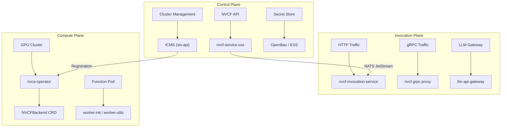

<!-- source: DeepWiki mcp.deepwiki.com · repo NVIDIA/nvcf · page 1 NVCF Overview · fetched 2026-10-26 -->

# NVCF Overview

Relevant source files

The following files were used as context for generating this wiki page:

- [.github/ISSUE_TEMPLATE/config.yml](.github/ISSUE_TEMPLATE/config.yml)
- [.github/PULL_REQUEST_TEMPLATE.md](.github/PULL_REQUEST_TEMPLATE.md)
- [.github/workflows/stale.yaml](.github/workflows/stale.yaml)
- [.rumdl.toml](.rumdl.toml)
- [AGENTS.md](AGENTS.md)
- [CONTRIBUTING.md](CONTRIBUTING.md)
- [README.md](README.md)
- [ai-tooling/AGENTS.md](ai-tooling/AGENTS.md)
- [ai-tooling/CLAUDE.md](ai-tooling/CLAUDE.md)
- [ai-tooling/README.md](ai-tooling/README.md)
- [ai-tooling/dev/skills/documentation-style/SKILL.md](ai-tooling/dev/skills/documentation-style/SKILL.md)
- [deploy/helm/nvca-operator/nvca-operator/Chart.yaml](deploy/helm/nvca-operator/nvca-operator/Chart.yaml)
- [deploy/helm/nvca-operator/nvca-operator/templates/cluster-validator-network-checks-cm.yaml](deploy/helm/nvca-operator/nvca-operator/templates/cluster-validator-network-checks-cm.yaml)
- [deploy/helm/nvca-operator/nvca-operator/templates/cronjob.yaml](deploy/helm/nvca-operator/nvca-operator/templates/cronjob.yaml)
- [deploy/helm/nvca-operator/nvca-operator/templates/rbac.yaml](deploy/helm/nvca-operator/nvca-operator/templates/rbac.yaml)
- [docs/dev/architecture.md](docs/dev/architecture.md)
- [docs/dev/assets/architecture-overview.svg](docs/dev/assets/architecture-overview.svg)
- [docs/user/cluster-management/nsight-profiling.md](docs/user/cluster-management/nsight-profiling.md)
- [docs/user/cluster-management/self-managed.md](docs/user/cluster-management/self-managed.md)
- [docs/user/image-mirroring.md](docs/user/image-mirroring.md)
- [docs/user/images/nvcf-gpu-cluster-targeting.svg](docs/user/images/nvcf-gpu-cluster-targeting.svg)
- [docs/user/images/nvcf-high-level-stack.svg](docs/user/images/nvcf-high-level-stack.svg)
- [docs/user/images/nvcf-multi-region-multi-cluster.svg](docs/user/images/nvcf-multi-region-multi-cluster.svg)
- [docs/user/manifest.md](docs/user/manifest.md)
- [docs/version-catalog/main.yaml](docs/version-catalog/main.yaml)
- [setup.sh](setup.sh)
- [tools/ci/check-doc-version-sync](tools/ci/check-doc-version-sync)
- [tools/ci/check-private-go-module-paths](tools/ci/check-private-go-module-paths)
- [tools/ci/preview-docs](tools/ci/preview-docs)
- [tools/docs-version-sync/catalog.go](tools/docs-version-sync/catalog.go)
- [tools/docs-version-sync/inline.go](tools/docs-version-sync/inline.go)
- [tools/docs-version-sync/main_test.go](tools/docs-version-sync/main_test.go)
- [tools/docs-version-sync/render.go](tools/docs-version-sync/render.go)
- [tools/scripts/cut-docs-version.sh](tools/scripts/cut-docs-version.sh)
- [tools/scripts/test/test-check-doc-version-sync](tools/scripts/test/test-check-doc-version-sync)
- [tools/scripts/test/test-cut-docs-version](tools/scripts/test/test-cut-docs-version)

NVIDIA Cloud Functions (NVCF) is a high-scale platform for deploying, managing, and running GPU-accelerated workloads. It provides the infrastructure to route inference, streaming, and other GPU-heavy tasks to distributed worker clusters, enabling seamless scaling of demanding AI workloads [README.md:7-12]().

The platform is designed to handle multiple protocols (HTTP, gRPC, and LLM-compatible gateways) and supports diverse workload types, from single-container functions to complex multi-container Helm-based deployments [README.md:39-66]().

## Three-Plane Architecture

NVCF follows a decoupled three-plane architecture to ensure scalability, resilience, and multi-cluster support [README.md:14-38]().

1.  **Control Plane**: The administrative hub. It exposes the NVCF API, manages the lifecycle of functions and deployments, handles secret management (via OpenBao), and maintains global state in Cassandra [README.md:24-25](), [docs/user/cluster-management/self-managed.md:10-15]().
2.  **Invocation Plane**: The request handling layer. It receives incoming traffic (HTTP, gRPC, or LLM requests), applies rate limiting and authorization, and routes work to the appropriate compute resources [README.md:26-27]().
3.  **Compute Plane**: The execution layer. Located on GPU clusters, this plane runs the **NVIDIA Cluster Agent (NVCA)**, which registers GPU resources and manages the lifecycle of worker pods [README.md:28-29](), [docs/user/cluster-management/self-managed.md:76-79]().

### System Component Map
The following diagram maps high-level system concepts to their primary code entities and service names.

**System to Code Mapping**

**Sources:** [README.md:88-98](), [docs/version-catalog/main.yaml:42-136](), [docs/user/cluster-management/self-managed.md:58-79]()

## Key Concepts

### Workload Types
NVCF distinguishes between two primary execution patterns:
*   **Functions**: Long-running, invokable workloads designed for inference or streaming. They provide persistent endpoints [README.md:41-47]().
*   **Tasks**: Asynchronous, run-to-completion jobs (e.g., fine-tuning or batch data prep) [README.md:48-54]().

Both types can be packaged as simple **Containers** or complex **Helm charts** [README.md:44-46]().

### Artifact Management
The platform uses a **Version Catalog** (`docs/version-catalog/main.yaml`) as the single source of truth for all qualified component versions [docs/user/manifest.md:13-16](). These artifacts (images and Helm charts) are typically mirrored from NVIDIA's NGC registry to local OCI-compatible registries for self-hosted deployments [docs/user/image-mirroring.md:3-12]().

### Cluster Registration
GPU clusters are not static; they register themselves with the Control Plane using `nvcf-cli`. During registration, the CLI discovers the cluster's OIDC issuer and JWKS, allowing the Control Plane to securely validate the **NVIDIA Cluster Agent (NVCA)** using Projected Service Account Tokens (PSAT) [docs/user/cluster-management/self-managed.md:58-69]().

## Navigation Guide

The wiki is organized into the following detailed sections:

| Section | Description |
| :--- | :--- |
| **[Architecture and System Planes](#1.1)** | Deep dive into the three planes, NATS messaging, and the request lifecycle. |
| **[Key Custom Resources and CRDs](#1.2)** | Technical details on `NVCFBackend`, `ICMSRequest`, and `MiniService`. |
| **[Getting Started and Quickstart](#1.3)** | One-click local setup using `nvcf-cli` and `k3d`. |
| **[Control Plane Services](#2)** | Details on `nvcf-service`, ICMS, and secret management. |
| **[Invocation Plane Services](#3)** | Routing, gRPC proxying, and the LLM API gateway. |
| **[Compute Plane Services](#4)** | NVCA, worker sidecars, and container caching. |
| **[nvcf-cli: Command-Line Interface](#6)** | Reference for the command-line interface used by operators and users. |

For a full list of terminology, see the **[Glossary](#12)**.

**Sources:** [README.md:88-98](), [AGENTS.md:5-13](), [docs/user/manifest.md:109-128]()

---

