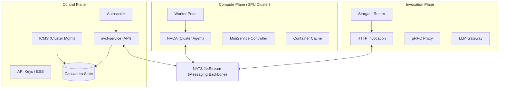
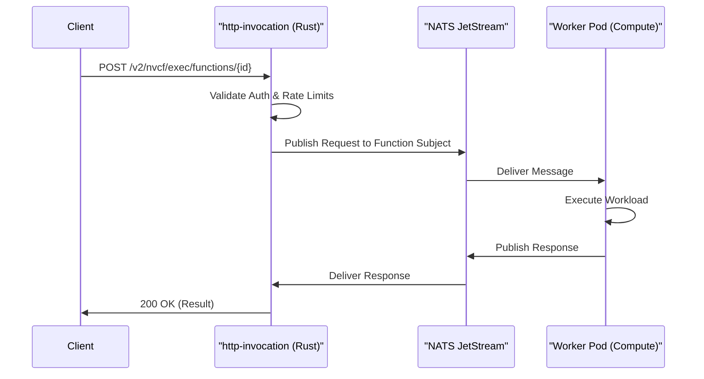
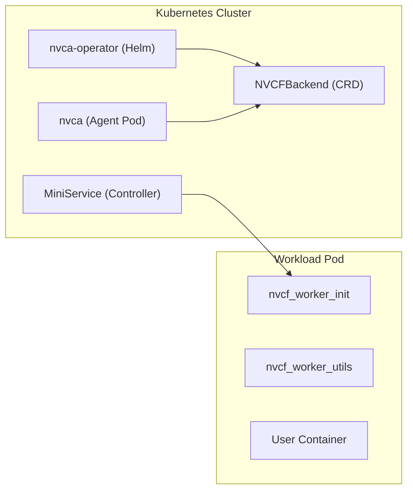

<!-- source: DeepWiki mcp.deepwiki.com · repo NVIDIA/nvcf · page 1.1 Architecture and System Planes · fetched 2026-10-26 -->

# Architecture and System Planes

Relevant source files

The following files were used as context for generating this wiki page:

- [.github/ISSUE_TEMPLATE/config.yml](.github/ISSUE_TEMPLATE/config.yml)
- [.github/PULL_REQUEST_TEMPLATE.md](.github/PULL_REQUEST_TEMPLATE.md)
- [.github/workflows/stale.yaml](.github/workflows/stale.yaml)
- [.rumdl.toml](.rumdl.toml)
- [AGENTS.md](AGENTS.md)
- [CONTRIBUTING.md](CONTRIBUTING.md)
- [README.md](README.md)
- [ai-tooling/AGENTS.md](ai-tooling/AGENTS.md)
- [ai-tooling/CLAUDE.md](ai-tooling/CLAUDE.md)
- [ai-tooling/README.md](ai-tooling/README.md)
- [ai-tooling/dev/skills/documentation-style/SKILL.md](ai-tooling/dev/skills/documentation-style/SKILL.md)
- [deploy/helm/nvca-operator/nvca-operator/Chart.yaml](deploy/helm/nvca-operator/nvca-operator/Chart.yaml)
- [deploy/helm/nvca-operator/nvca-operator/templates/cluster-validator-network-checks-cm.yaml](deploy/helm/nvca-operator/nvca-operator/templates/cluster-validator-network-checks-cm.yaml)
- [deploy/helm/nvca-operator/nvca-operator/templates/cronjob.yaml](deploy/helm/nvca-operator/nvca-operator/templates/cronjob.yaml)
- [deploy/helm/nvca-operator/nvca-operator/templates/rbac.yaml](deploy/helm/nvca-operator/nvca-operator/templates/rbac.yaml)
- [docs/dev/architecture.md](docs/dev/architecture.md)
- [docs/dev/assets/architecture-overview.svg](docs/dev/assets/architecture-overview.svg)
- [docs/user/cluster-management/nsight-profiling.md](docs/user/cluster-management/nsight-profiling.md)
- [docs/user/cluster-management/self-managed.md](docs/user/cluster-management/self-managed.md)
- [docs/user/image-mirroring.md](docs/user/image-mirroring.md)
- [docs/user/images/nvcf-gpu-cluster-targeting.svg](docs/user/images/nvcf-gpu-cluster-targeting.svg)
- [docs/user/images/nvcf-high-level-stack.svg](docs/user/images/nvcf-high-level-stack.svg)
- [docs/user/images/nvcf-multi-region-multi-cluster.svg](docs/user/images/nvcf-multi-region-multi-cluster.svg)
- [docs/user/manifest.md](docs/user/manifest.md)
- [docs/version-catalog/main.yaml](docs/version-catalog/main.yaml)
- [setup.sh](setup.sh)
- [tools/ci/check-doc-version-sync](tools/ci/check-doc-version-sync)
- [tools/ci/check-private-go-module-paths](tools/ci/check-private-go-module-paths)
- [tools/ci/preview-docs](tools/ci/preview-docs)
- [tools/docs-version-sync/catalog.go](tools/docs-version-sync/catalog.go)
- [tools/docs-version-sync/inline.go](tools/docs-version-sync/inline.go)
- [tools/docs-version-sync/main_test.go](tools/docs-version-sync/main_test.go)
- [tools/docs-version-sync/render.go](tools/docs-version-sync/render.go)
- [tools/scripts/cut-docs-version.sh](tools/scripts/cut-docs-version.sh)
- [tools/scripts/test/test-check-doc-version-sync](tools/scripts/test/test-check-doc-version-sync)
- [tools/scripts/test/test-cut-docs-version](tools/scripts/test/test-cut-docs-version)

This page provides a detailed technical explanation of the NVIDIA Cloud Functions (NVCF) three-plane architecture. NVCF is designed to manage GPU-accelerated workloads at scale by decoupling the management of functions, the routing of requests, and the execution of code on GPU resources [README.md:7-13]().

## Three-Plane Architecture Overview

NVCF is structured into three distinct logical planes: the **Control Plane**, the **Invocation Plane**, and the **Compute Plane**. This separation allows for independent scaling, multi-region deployments, and support for diverse GPU cluster types [README.md:14-22]().

### High-Level System Diagram

The following diagram illustrates the relationship between the three planes and the external entities they interact with.

**NVCF Three-Plane Architecture**

**Sources:** [README.md:16-38](), [docs/user/cluster-management/self-managed.md:56-84]()

---

## 1. Control Plane
The Control Plane is the "brain" of NVCF. It manages the lifecycle of functions, deployment states, secret management, and cluster registration [README.md:24-25]().

### Key Components
*   **nvcf-service**: The core Java/Spring Boot service providing the REST/gRPC APIs for function creation, deployment, and management [docs/version-catalog/main.yaml:96-98]().
*   **ICMS (Instance and Cluster Management Service)**: Responsible for registering GPU clusters, tracking OIDC/JWKS for authentication, and managing GPU reservations [docs/user/cluster-management/self-managed.md:66-69]().
*   **Autoscaler**: A Rust-based service that monitors active functions via VictoriaMetrics and adjusts the desired instance count to meet demand, including **scale-to-zero** [README.md:63-64]().
*   **ESS (Encrypted Secret Store)**: Manages tenant-scoped secrets injected into worker pods [docs/version-catalog/main.yaml:42-44]().

**Sources:** [README.md:24-25](), [docs/user/cluster-management/self-managed.md:66-84](), [docs/version-catalog/main.yaml:42-101]()

---

## 2. Invocation Plane
The Invocation Plane handles the routing of incoming requests to the appropriate worker instances. It supports multiple protocols including HTTP, gRPC, and OpenAI-compatible LLM streams [README.md:26-27]().

### Request Lifecycle (Sync HTTP)
When a client invokes a function, the request follows this sequence:

**Synchronous HTTP Invocation Sequence**

**Sources:** [README.md:72-80](), [docs/user/cluster-management/self-managed.md:120-122]()

### Key Components
*   **HTTP Invocation Service**: Handles standard RESTful execution requests [docs/version-catalog/main.yaml:51-53]().
*   **gRPC Proxy**: Directs gRPC calls to worker pods using a director pattern [docs/version-catalog/main.yaml:48-50]().
*   **Stargate Router**: A high-performance Rust router for LLM requests, utilizing Pylon for QUIC-HTTP tunneling [docs/version-catalog/main.yaml:114-116](), [docs/version-catalog/main.yaml:127-129]().

---

## 3. Compute Plane
The Compute Plane consists of the actual GPU clusters where workloads are executed. These clusters can be self-managed, NGC-managed, or Helm-managed [README.md:28-29]().

### The NVIDIA Cluster Agent (NVCA)
NVCA is the primary bridge between the GPU cluster and the NVCF Control Plane. It registers GPU resources and manages the execution of workloads on Kubernetes nodes [docs/user/cluster-management/self-managed.md:3-9]().

**Compute Plane Code Entities**

**Sources:** [docs/user/cluster-management/self-managed.md:56-84](), [docs/version-catalog/main.yaml:66-71](), [docs/version-catalog/main.yaml:102-109]()

### Workload Types
NVCF supports four primary workload shapes, defined by how they are packaged and their execution lifecycle:

| Workload Type | Packaging | Lifecycle |
| :--- | :--- | :--- |
| **Container Function** | Single OCI Image | Long-running, synchronous invocation |
| **Helm Function** | Helm Chart | Long-running, multi-container (MiniService) |
| **Container Task** | Single OCI Image | Asynchronous, run-to-completion |
| **Helm Task** | Helm Chart | Asynchronous, complex orchestration |

**Sources:** [README.md:41-55]()

---

## Messaging Backbone: NATS JetStream
NVCF uses **NATS JetStream** as the high-performance messaging backbone connecting all three planes.
*   **Control Plane to Compute Plane**: Deployment instructions and configuration updates are published to NATS subjects monitored by NVCA [docs/user/cluster-management/self-managed.md:120-122]().
*   **Invocation Plane to Compute Plane**: Invocation requests are distributed via NATS queues to ensure load balancing across available worker pods [docs/version-catalog/main.yaml:45-47]().

**Sources:** [README.md:123](), [docs/user/cluster-management/self-managed.md:75-76]()

---

## Multi-Cluster Routing
NVCF supports multi-region and multi-cluster topologies. The Control Plane maintains a global view of all registered clusters via ICMS. When a function is deployed, the Control Plane can target specific `clusterGroupIDs` or distribute the workload across multiple clusters for high availability and low-latency access [README.md:34-38](), [docs/user/cluster-management/self-managed.md:66-69]().

**Sources:** [README.md:37](), [docs/user/cluster-management/self-managed.md:96-122]()

---

