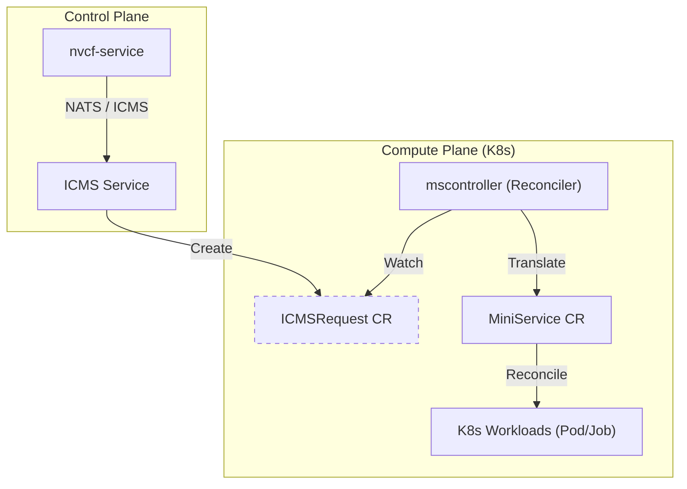
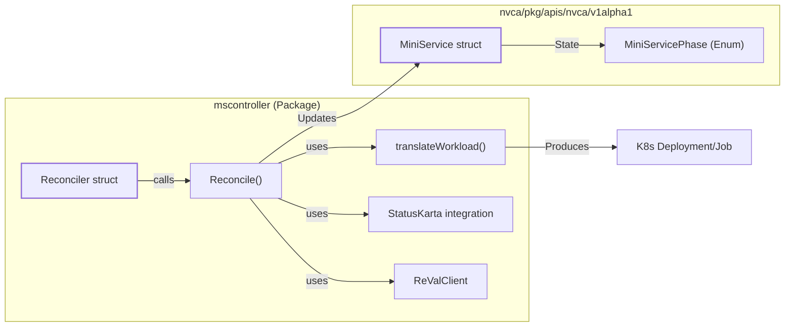

<!-- source: DeepWiki mcp.deepwiki.com · repo NVIDIA/nvcf · page 1.2 Key Custom Resources and CRDs · fetched 2026-10-26 -->

# Key Custom Resources and CRDs

Relevant source files

The following files were used as context for generating this wiki page:

- [deploy/helm/nvca-operator/nvca-operator/README.md](deploy/helm/nvca-operator/nvca-operator/README.md)
- [deploy/helm/nvca-operator/nvca-operator/templates/_helpers.tpl](deploy/helm/nvca-operator/nvca-operator/templates/_helpers.tpl)
- [deploy/helm/nvca-operator/nvca-operator/templates/deployment.yaml](deploy/helm/nvca-operator/nvca-operator/templates/deployment.yaml)
- [deploy/helm/nvca-operator/nvca-operator/values.schema.json](deploy/helm/nvca-operator/nvca-operator/values.schema.json)
- [deploy/helm/nvca-operator/nvca-operator/values.yaml](deploy/helm/nvca-operator/nvca-operator/values.yaml)
- [deploy/helm/nvca-operator/scripts/ci_vendor_nvca_operator_chart](deploy/helm/nvca-operator/scripts/ci_vendor_nvca_operator_chart)
- [deploy/helm/nvca-operator/scripts/render_release_supplemental_images.sh](deploy/helm/nvca-operator/scripts/render_release_supplemental_images.sh)
- [deploy/helm/nvca-operator/tests/release_image_manifest_test.sh](deploy/helm/nvca-operator/tests/release_image_manifest_test.sh)
- [deploy/helm/nvca-operator/tests/self_managed_nvca_image_reference_test.sh](deploy/helm/nvca-operator/tests/self_managed_nvca_image_reference_test.sh)
- [docs/user/cluster-management/gxcache.md](docs/user/cluster-management/gxcache.md)
- [src/compute-plane-services/nvca/deployments/nvca-operator/README.md](src/compute-plane-services/nvca/deployments/nvca-operator/README.md)
- [src/compute-plane-services/nvca/deployments/nvca-operator/templates/_helpers.tpl](src/compute-plane-services/nvca/deployments/nvca-operator/templates/_helpers.tpl)
- [src/compute-plane-services/nvca/deployments/nvca-operator/templates/deployment.yaml](src/compute-plane-services/nvca/deployments/nvca-operator/templates/deployment.yaml)
- [src/compute-plane-services/nvca/deployments/nvca-operator/values.schema.json](src/compute-plane-services/nvca/deployments/nvca-operator/values.schema.json)
- [src/compute-plane-services/nvca/deployments/nvca-operator/values.yaml](src/compute-plane-services/nvca/deployments/nvca-operator/values.yaml)
- [src/compute-plane-services/nvca/internal/miniservice/BUILD.bazel](src/compute-plane-services/nvca/internal/miniservice/BUILD.bazel)
- [src/compute-plane-services/nvca/internal/miniservice/reconcile.go](src/compute-plane-services/nvca/internal/miniservice/reconcile.go)
- [src/compute-plane-services/nvca/internal/miniservice/reconcile_test.go](src/compute-plane-services/nvca/internal/miniservice/reconcile_test.go)
- [src/compute-plane-services/nvca/internal/miniservice/reconcile_update_test.go](src/compute-plane-services/nvca/internal/miniservice/reconcile_update_test.go)
- [src/compute-plane-services/nvca/internal/miniservice/reval_client.go](src/compute-plane-services/nvca/internal/miniservice/reval_client.go)
- [src/compute-plane-services/nvca/internal/miniservice/reval_client_test.go](src/compute-plane-services/nvca/internal/miniservice/reval_client_test.go)
- [src/compute-plane-services/nvca/internal/miniservice/revision.go](src/compute-plane-services/nvca/internal/miniservice/revision.go)
- [src/compute-plane-services/nvca/internal/miniservice/revision_test.go](src/compute-plane-services/nvca/internal/miniservice/revision_test.go)
- [src/compute-plane-services/nvca/internal/miniservice/status.go](src/compute-plane-services/nvca/internal/miniservice/status.go)
- [src/compute-plane-services/nvca/internal/miniservice/status_karta.go](src/compute-plane-services/nvca/internal/miniservice/status_karta.go)
- [src/compute-plane-services/nvca/internal/miniservice/status_karta_test.go](src/compute-plane-services/nvca/internal/miniservice/status_karta_test.go)
- [src/compute-plane-services/nvca/internal/miniservice/status_test.go](src/compute-plane-services/nvca/internal/miniservice/status_test.go)
- [src/compute-plane-services/nvca/internal/miniservice/transport_tls.go](src/compute-plane-services/nvca/internal/miniservice/transport_tls.go)
- [src/compute-plane-services/nvca/internal/util/k8sutil/BUILD.bazel](src/compute-plane-services/nvca/internal/util/k8sutil/BUILD.bazel)
- [src/compute-plane-services/nvca/internal/util/k8sutil/affinity.go](src/compute-plane-services/nvca/internal/util/k8sutil/affinity.go)
- [src/compute-plane-services/nvca/internal/util/k8sutil/affinity_test.go](src/compute-plane-services/nvca/internal/util/k8sutil/affinity_test.go)
- [src/compute-plane-services/nvca/internal/util/k8sutil/pod.go](src/compute-plane-services/nvca/internal/util/k8sutil/pod.go)
- [src/compute-plane-services/nvca/internal/util/k8sutil/pod_test.go](src/compute-plane-services/nvca/internal/util/k8sutil/pod_test.go)
- [src/compute-plane-services/nvca/pkg/apis/nvca/v1alpha1/generated.openapi.go](src/compute-plane-services/nvca/pkg/apis/nvca/v1alpha1/generated.openapi.go)
- [src/compute-plane-services/nvca/pkg/apis/nvca/v1alpha1/miniservice_json.go](src/compute-plane-services/nvca/pkg/apis/nvca/v1alpha1/miniservice_json.go)
- [src/compute-plane-services/nvca/pkg/apis/nvca/v1alpha1/miniservice_json_test.go](src/compute-plane-services/nvca/pkg/apis/nvca/v1alpha1/miniservice_json_test.go)
- [src/compute-plane-services/nvca/pkg/apis/nvca/v1alpha1/zz_generated.deepcopy.go](src/compute-plane-services/nvca/pkg/apis/nvca/v1alpha1/zz_generated.deepcopy.go)
- [src/compute-plane-services/nvca/pkg/nvca/k8scomputebackend.go](src/compute-plane-services/nvca/pkg/nvca/k8scomputebackend.go)
- [src/compute-plane-services/nvca/pkg/nvca/k8scomputebackend_task_container.go](src/compute-plane-services/nvca/pkg/nvca/k8scomputebackend_task_container.go)
- [src/compute-plane-services/nvca/pkg/operator/reconcile/nvcaagent_reconcile.go](src/compute-plane-services/nvca/pkg/operator/reconcile/nvcaagent_reconcile.go)
- [src/compute-plane-services/nvca/pkg/operator/reconcile/nvcaagent_reconcile_test.go](src/compute-plane-services/nvca/pkg/operator/reconcile/nvcaagent_reconcile_test.go)
- [src/compute-plane-services/nvca/pkg/webhook/miniservice_mutating_webhook.go](src/compute-plane-services/nvca/pkg/webhook/miniservice_mutating_webhook.go)
- [src/compute-plane-services/nvca/pkg/webhook/miniservice_mutating_webhook_test.go](src/compute-plane-services/nvca/pkg/webhook/miniservice_mutating_webhook_test.go)
- [src/compute-plane-services/nvca/vendor/github.com/NVIDIA/nvcf/src/libraries/go/lib/pkg/types/nvca/config/types.go](src/compute-plane-services/nvca/vendor/github.com/NVIDIA/nvcf/src/libraries/go/lib/pkg/types/nvca/config/types.go)
- [src/compute-plane-services/nvca/vendor/github.com/NVIDIA/nvcf/src/libraries/go/lib/pkg/types/nvca/config/zz_generated.deepcopy.go](src/compute-plane-services/nvca/vendor/github.com/NVIDIA/nvcf/src/libraries/go/lib/pkg/types/nvca/config/zz_generated.deepcopy.go)
- [src/libraries/go/lib/pkg/types/nvca/config/config_test.go](src/libraries/go/lib/pkg/types/nvca/config/config_test.go)
- [src/libraries/go/lib/pkg/types/nvca/config/types.go](src/libraries/go/lib/pkg/types/nvca/config/types.go)
- [src/libraries/go/lib/pkg/types/nvca/config/types_additional_test.go](src/libraries/go/lib/pkg/types/nvca/config/types_additional_test.go)
- [src/libraries/go/lib/pkg/types/nvca/config/types_test.go](src/libraries/go/lib/pkg/types/nvca/config/types_test.go)
- [src/libraries/go/lib/pkg/types/nvca/config/zz_generated.deepcopy.go](src/libraries/go/lib/pkg/types/nvca/config/zz_generated.deepcopy.go)

This page documents the primary Kubernetes Custom Resource Definitions (CRDs) that drive the NVIDIA Cloud Functions (NVCF) compute plane. These resources allow the NVCF Control Plane to communicate desired workload states to the Compute Plane and allow the NVIDIA Cluster Agent (NVCA) to manage the lifecycle of functions and tasks.

## NVCFBackend

The `NVCFBackend` resource represents a specific compute backend (cluster) registered within the NVCF ecosystem. It is the primary mechanism for the **NVCA Operator** to configure and manage the **NVCA Agent** on a per-cluster basis.

### Purpose and Implementation
The `NVCFBackend` CRD is managed by the `nvca-operator` [deploy/helm/nvca-operator/nvca-operator/README.md:1-4](). It acts as a bridge between the global NVCF configuration and the local cluster environment. The operator uses this resource to determine which version of the NVCA agent to deploy, which OIDC discovery endpoints to use for authentication, and how to configure cluster-wide settings like GPU validation policies [deploy/helm/nvca-operator/nvca-operator/values.yaml:72-97]().

### Key Lifecycle States
The `NVCFBackend` lifecycle is tied to the `nvca-operator` reconciliation loop.
*   **Self-Managed vs. Helm-Managed**: Backends can be provisioned via NGC (managed) or directly via Helm for self-hosted environments [deploy/helm/nvca-operator/nvca-operator/values.yaml:72-79]().
*   **Configuration Merging**: The operator allows merging complex agent configurations (e.g., OTel sampling, log chunking) into the backend spec, which the operator then projects into the NVCA Agent's configuration [deploy/helm/nvca-operator/nvca-operator/values.yaml:92-128]().

**Sources:**
* [deploy/helm/nvca-operator/nvca-operator/values.yaml:68-128]()
* [deploy/helm/nvca-operator/nvca-operator/README.md:1-5]()

---

## ICMSRequest

The `ICMSRequest` (Instance and Cluster Management Service Request) is a resource used to signal deployment intents from the Control Plane to the Compute Plane.

### Purpose
When a user deploys a function or task, the Control Plane (specifically the `nvcf-service` and `ICMS`) creates an `ICMSRequest` in the target cluster. The `mscontroller` (MiniService Controller) watches these requests to initiate the deployment of the corresponding `MiniService` [src/compute-plane-services/nvca/internal/miniservice/reconcile.go:172-174]().

### Data Flow: ICMSRequest to MiniService
The `ICMSRequest` contains the raw workload manifest provided by the Control Plane. The `mscontroller` uses the `icms-translate` library to convert this request into a concrete `MiniService` specification [src/compute-plane-services/nvca/internal/miniservice/reconcile.go:36-39]().

**Sources:**
* [src/compute-plane-services/nvca/internal/miniservice/reconcile.go:172-175]()
* [src/compute-plane-services/nvca/internal/miniservice/reconcile.go:36-39]()

---

## MiniService

The `MiniService` is the core workload abstraction in NVCF. It encapsulates the deployment of a single function version or task execution, regardless of whether it is packaged as a raw container or a Helm chart.

### Technical Implementation
The `MiniService` lifecycle is managed by the `Reconciler` struct in the `mscontroller` package [src/compute-plane-services/nvca/internal/miniservice/reconcile.go:83-119](). It integrates with several sub-systems:
*   **ReVal Client**: Communicates with the Helm Revalidation service to fetch and validate charts [src/compute-plane-services/nvca/internal/miniservice/reconcile.go:91]().
*   **Karta Integration**: Uses the Karta library for advanced status reporting and resource tracking [src/compute-plane-services/nvca/internal/miniservice/reconcile.go:21]().
*   **Revision Management**: Tracks workload versions to avoid redundant rendering and updates [src/compute-plane-services/nvca/internal/miniservice/reconcile.go:116-118]().

### Lifecycle State Machine
The `MiniService` progresses through several phases defined in `v1alpha1.MiniServicePhase` [src/compute-plane-services/nvca/internal/miniservice/reconcile.go:130-136]().

| Phase | Description | Metric Value |
| :--- | :--- | :--- |
| `Installed` | The Helm chart or container resources have been applied to K8s. | 1 |
| `Running` | The workload is active and healthy. | 2 |
| `Completed` | The task (batch job) has finished successfully. | 2 |
| `InstallFailed` | Failure during the initial application of resources. | -1 |
| `Failed` | The workload crashed or failed health checks after installation. | -2 |

### Workload Translation and Mutation
The controller performs complex translations from the `MiniService` spec to Kubernetes primitives:
1.  **Translation**: Converts NVCF-specific requirements (like GPU counts and secrets) into Pod specs [src/compute-plane-services/nvca/internal/miniservice/reconcile.go:23-39]().
2.  **Mutation**: A Mutating Webhook (`miniservice_mutating_webhook.go`) injects standard NVCF sidecars, such as the `worker-utils` NATS proxy and `otel-collector` [src/compute-plane-services/nvca/pkg/webhook/miniservice_mutating_webhook.go:1-20]().
3.  **Transport TLS**: Injects certificates for secure communication between the invocation plane and the worker pods [src/compute-plane-services/nvca/internal/miniservice/transport_tls.go:1-20]().

### Code Entity Space Mapping
The following diagram maps the logical MiniService operations to the specific Go classes and functions responsible for them.

**Sources:**
* [src/compute-plane-services/nvca/internal/miniservice/reconcile.go:83-150]()
* [src/compute-plane-services/nvca/internal/miniservice/reconcile.go:130-136]()
* [src/compute-plane-services/nvca/internal/miniservice/BUILD.bazel:6-25]()
* [src/compute-plane-services/nvca/pkg/webhook/miniservice_mutating_webhook.go:1-20]()

---

