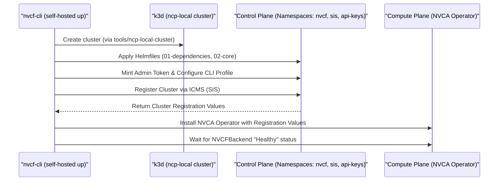
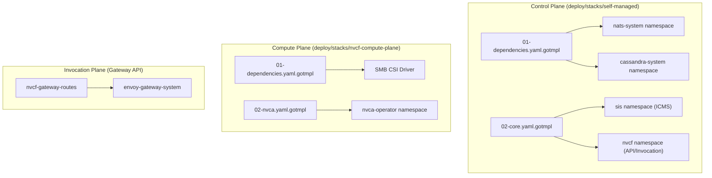

<!-- source: DeepWiki mcp.deepwiki.com · repo NVIDIA/nvcf · page 1.3 Getting Started and Quickstart · fetched 2026-10-26 -->

# Getting Started and Quickstart

<details>
<summary>Relevant source files</summary>

The following files were used as context for generating this wiki page:

- [ai-tooling/user/skills/BUILD.bazel](ai-tooling/user/skills/BUILD.bazel)
- [ai-tooling/user/skills/nvcf-self-managed-installation/SKILL.md](ai-tooling/user/skills/nvcf-self-managed-installation/SKILL.md)
- [ai-tooling/user/skills/nvcf-self-managed-installation/evals/evals.json](ai-tooling/user/skills/nvcf-self-managed-installation/evals/evals.json)
- [ai-tooling/user/skills/nvcf-self-managed-installation/examples.md](ai-tooling/user/skills/nvcf-self-managed-installation/examples.md)
- [ai-tooling/user/skills/nvcf-self-managed-installation/references/compute-plane-installation.md](ai-tooling/user/skills/nvcf-self-managed-installation/references/compute-plane-installation.md)
- [ai-tooling/user/skills/nvcf-self-managed-installation/references/debugging.md](ai-tooling/user/skills/nvcf-self-managed-installation/references/debugging.md)
- [ai-tooling/user/skills/nvcf-self-managed-installation/references/helmfile-structure.md](ai-tooling/user/skills/nvcf-self-managed-installation/references/helmfile-structure.md)
- [ai-tooling/user/skills/nvcf-self-managed-installation/references/nvcf-ui-addon.md](ai-tooling/user/skills/nvcf-self-managed-installation/references/nvcf-ui-addon.md)
- [ai-tooling/user/skills/nvcf-self-managed-installation/references/pull-secrets.md](ai-tooling/user/skills/nvcf-self-managed-installation/references/pull-secrets.md)
- [ai-tooling/user/skills/nvcf-self-managed-prerequisite/SKILL.md](ai-tooling/user/skills/nvcf-self-managed-prerequisite/SKILL.md)
- [ai-tooling/user/skills/nvcf-self-managed-prerequisite/references/kai-scheduler.md](ai-tooling/user/skills/nvcf-self-managed-prerequisite/references/kai-scheduler.md)
- [ai-tooling/user/skills/nvcf-self-managed-prerequisite/references/smb-csi.md](ai-tooling/user/skills/nvcf-self-managed-prerequisite/references/smb-csi.md)
- [deploy/stacks/self-managed/Makefile](deploy/stacks/self-managed/Makefile)
- [deploy/stacks/self-managed/tests/llm-router-worker-address.sh](deploy/stacks/self-managed/tests/llm-router-worker-address.sh)
- [docs/ngc-managed/cluster-management/container-cache.md](docs/ngc-managed/cluster-management/container-cache.md)
- [docs/ngc-managed/cluster-management/gxcache.md](docs/ngc-managed/cluster-management/gxcache.md)
- [docs/ngc-managed/cluster-management/kai-scheduler.md](docs/ngc-managed/cluster-management/kai-scheduler.md)
- [docs/ngc-managed/cluster-management/samples/kai-scheduler-queues.yaml](docs/ngc-managed/cluster-management/samples/kai-scheduler-queues.yaml)
- [docs/ngc-managed/cluster-management/samples/nvca-operator-values.yaml](docs/ngc-managed/cluster-management/samples/nvca-operator-values.yaml)
- [docs/ngc-managed/downloads/function-sharing-postman.json](docs/ngc-managed/downloads/function-sharing-postman.json)
- [docs/ngc-managed/function-lifecycle.md](docs/ngc-managed/function-lifecycle.md)
- [docs/ngc-managed/images/1-ngc-managed-from-helm-managed.png](docs/ngc-managed/images/1-ngc-managed-from-helm-managed.png)
- [docs/user/cluster-management/kai-scheduler.md](docs/user/cluster-management/kai-scheduler.md)
- [docs/user/control-plane-installation.md](docs/user/control-plane-installation.md)
- [docs/user/csp-end-to-end-example-installation.md](docs/user/csp-end-to-end-example-installation.md)
- [docs/user/gateway-routing.md](docs/user/gateway-routing.md)
- [docs/user/grpc-invocation-enablement.md](docs/user/grpc-invocation-enablement.md)
- [docs/user/helmfile-installation.md](docs/user/helmfile-installation.md)
- [docs/user/installation.md](docs/user/installation.md)
- [docs/user/quickstart.md](docs/user/quickstart.md)
- [docs/v0.5/cluster-management/kai-scheduler.md](docs/v0.5/cluster-management/kai-scheduler.md)
- [src/clis/nvcf-cli/internal/agentskill/BUILD.bazel](src/clis/nvcf-cli/internal/agentskill/BUILD.bazel)
- [src/clis/nvcf-cli/internal/agentskill/skilldatagen/BUILD.bazel](src/clis/nvcf-cli/internal/agentskill/skilldatagen/BUILD.bazel)
- [tests/bdd/features/single-cluster-up-oneclick.feature](tests/bdd/features/single-cluster-up-oneclick.feature)

</details>


This page serves as the primary onboarding guide for engineers and operators setting up NVIDIA Cloud Functions (NVCF). It covers the prerequisite tooling, the local development "one-click" quickstart, and the path toward full production Helmfile deployments.

## Prerequisites

Before deploying any NVCF components, the following tools must be installed and configured on the operator's workstation.

### Required Tooling
| Tool | Version Requirement | Purpose |
| :--- | :--- | :--- |
| `kubectl` | Within 1 minor version of cluster [docs/user/helmfile-installation.md:93-107]() | Kubernetes cluster management |
| `helm` | `>= 3.12` (Helm 4 not supported for some hooks) [ai-tooling/user/skills/nvcf-self-managed-prerequisite/SKILL.md:46-47]() | Package management |
| `helmfile` | `1.1.x` (Recommended for sequential mode) [ai-tooling/user/skills/nvcf-self-managed-installation/SKILL.md:61-61]() | Multi-chart orchestration |
| `helm-diff` | `>= 3.11` [ai-tooling/user/skills/nvcf-self-managed-installation/SKILL.md:63-63]() | Idempotency checks for Helmfile |
| `k3d` | `v5.x+` [docs/user/quickstart.md:29-29]() | Local Kubernetes clusters |
| `nvcf-cli` | Latest [docs/user/quickstart.md:34-35]() | NVCF lifecycle management |
| `Docker` | Latest [docs/user/quickstart.md:28-28]() | Container runtime for k3d |

### Registry Authentication
NVCF artifacts are hosted on the NVIDIA GPU Cloud (NGC). You must authenticate both Docker and Helm to `nvcr.io` using an NGC API Key.

```bash
# Both logins are required as helmfile uses helm for OCI charts
docker login nvcr.io -u '$oauthtoken' -p "${NGC_API_KEY}"
helm registry login nvcr.io -u '$oauthtoken' -p "${NGC_API_KEY}"
```
[ai-tooling/user/skills/nvcf-self-managed-installation/SKILL.md:121-128]()

**Sources:**
- [ai-tooling/user/skills/nvcf-self-managed-installation/SKILL.md:61-65]()
- [docs/user/helmfile-installation.md:93-107]()
- [docs/user/quickstart.md:28-36]()
- [ai-tooling/user/skills/nvcf-self-managed-prerequisite/SKILL.md:46-47]()

---

## Local Quickstart (k3d)

The fastest way to experience NVCF is via the `nvcf-cli self-hosted up` command. This "one-click" flow automates the creation of a local `k3d` cluster, installs the control plane, registers the cluster, and installs the compute plane (NVCA).

### Quickstart Data Flow
The following diagram illustrates how the `nvcf-cli` orchestrates the local stack setup.

**Diagram: Quickstart Execution Flow**

[docs/user/quickstart.md:109-216]()

### Execution Steps
1. **Bootstrap Cluster**: Uses `make` to provision the local environment including fake GPUs and Envoy Gateway.
   ```bash
   make -C tools/ncp-local-cluster build-and-deploy-cluster
   kubectl config use-context k3d-ncp-local
   ```
   [docs/user/quickstart.md:119-125]()

2. **Prepare Secrets**: Initialize the `local-secrets.yaml` with your base64-encoded NGC credentials.
   ```bash
   # Generates secrets for the local-secrets.yaml file
   BASE64_CRED="$(printf '%s' "\$oauthtoken:${NGC_API_KEY}" | base64 | tr -d '\n')"
   ```
   [docs/user/quickstart.md:173-181]()

3. **Deploy Stack**: Run the `up` command to automate the installation.
   ```bash
   nvcf-cli self-hosted up \
     --control-plane-stack=deploy/stacks/self-managed \
     --compute-plane-stack=deploy/stacks/nvcf-compute-plane \
     --env=local \
     --cluster-name=ncp-local
   ```
   [docs/user/quickstart.md:198-207]()

**Sources:**
- [docs/user/quickstart.md:109-216]()
- [docs/user/installation.md:5-12]()

---

## Production Helmfile Installation

For production or remote environments (e.g., AWS EKS, Azure AKS), the "one-click" CLI command is replaced by a structured Helmfile deployment. This provides granular control over the three system planes.

### System Plane Mapping
The following diagram maps the logical NVCF planes to the specific Helmfile stacks and Kubernetes namespaces used in the codebase.

**Diagram: Natural Language to Code Entity Mapping**

[ai-tooling/user/skills/nvcf-self-managed-installation/references/helmfile-structure.md:5-26](), [docs/user/helmfile-installation.md:41-51]()

### Deployment Phases
The control plane installation is split into phases to manage dependencies like Cassandra and OpenBao.

| Phase | Stack File | Primary Components |
| :--- | :--- | :--- |
| **01** | `01-dependencies.yaml.gotmpl` | NATS JetStream, Cassandra, OpenBao (Vault) |
| **02** | `02-core.yaml.gotmpl` | `nvcf-api`, `invocation-service`, `sis` (ICMS), `api-keys` |
| **03** | `03-observability.yaml.gotmpl` | Prometheus, Grafana, VictoriaMetrics |

[ai-tooling/user/skills/nvcf-self-managed-installation/references/helmfile-structure.md:35-70]()

### Values Flow and Precedence
Configuration is merged in the following order (highest index wins):
1. `environments/base.yaml` (Defaults)
2. `environments/<env>.yaml` (Environment overrides)
3. `global.yaml.gotmpl` (Go template logic)
4. `secrets/<env>-secrets.yaml` (Sensitive data)
5. Inline `values:` blocks in the Helmfile release definition.

[ai-tooling/user/skills/nvcf-self-managed-installation/SKILL.md:82-92]()

**Sources:**
- [docs/user/helmfile-installation.md:34-51]()
- [ai-tooling/user/skills/nvcf-self-managed-installation/SKILL.md:82-97]()
- [ai-tooling/user/skills/nvcf-self-managed-installation/references/helmfile-structure.md:1-125]()

---

## Post-Installation Verification

Once the stack is deployed, use the `nvcf-cli` to verify the health of the system.

### Health Checks
The `self-hosted check` command performs a suite of tests including:
- **Pre-flight**: Verifies tool versions and Kubernetes access.
- **Control Plane**: Checks service reachability and database connectivity.
- **Compute Plane**: Validates `NVCFBackend` CRD status and agent health.

```bash
# Run all health checks for a specific cluster
nvcf-cli self-hosted check --all --cluster-name=ncp-local
```
[docs/user/quickstart.md:223-225]()

### Key Code Entities for Verification
- **`NVCFBackend`**: A Custom Resource in the compute cluster whose `.status.conditions` indicate if the cluster is ready to receive workloads. [docs/user/quickstart.md:215-216]()
- **`sis.localhost`**: The local endpoint for the Instance and Cluster Management Service (ICMS), responsible for cluster registration. [docs/user/quickstart.md:147-147]()

**Sources:**
- [docs/user/quickstart.md:215-236]()
- [docs/user/installation.md:45-48]()

---

