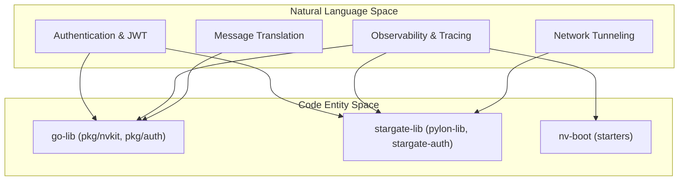
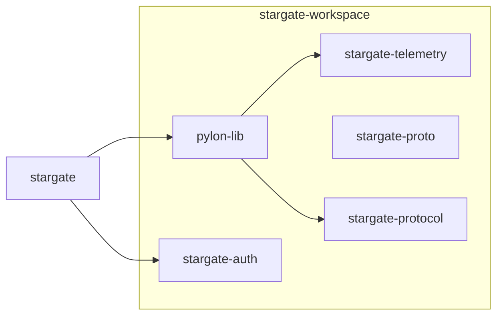

<!-- source: DeepWiki mcp.deepwiki.com · repo NVIDIA/nvcf · page 10 Shared Libraries · fetched 2026-10-26 -->

# Shared Libraries

Relevant source files

The following files were used as context for generating this wiki page:

- [src/clis/nvcf-cli/internal/apikeys/BUILD.bazel](src/clis/nvcf-cli/internal/apikeys/BUILD.bazel)
- [src/clis/nvcf-cli/internal/client/BUILD.bazel](src/clis/nvcf-cli/internal/client/BUILD.bazel)
- [src/clis/nvcf-cli/internal/openbao/BUILD.bazel](src/clis/nvcf-cli/internal/openbao/BUILD.bazel)
- [src/clis/nvcf-cli/scripts/admin-mock/BUILD.bazel](src/clis/nvcf-cli/scripts/admin-mock/BUILD.bazel)
- [src/libraries/go/lib/BUILD.bazel](src/libraries/go/lib/BUILD.bazel)
- [src/libraries/rust/stargate/Cargo.lock](src/libraries/rust/stargate/Cargo.lock)
- [src/libraries/rust/stargate/Cargo.toml](src/libraries/rust/stargate/Cargo.toml)
- [src/libraries/rust/stargate/Dockerfile](src/libraries/rust/stargate/Dockerfile)
- [src/libraries/rust/stargate/README.md](src/libraries/rust/stargate/README.md)
- [src/libraries/rust/stargate/crates/mock-dynamo/src/main.rs](src/libraries/rust/stargate/crates/mock-dynamo/src/main.rs)
- [src/libraries/rust/stargate/crates/mock-dynamo/src/openai.rs](src/libraries/rust/stargate/crates/mock-dynamo/src/openai.rs)
- [src/libraries/rust/stargate/crates/mock-dynamo/src/test_control.rs](src/libraries/rust/stargate/crates/mock-dynamo/src/test_control.rs)
- [src/libraries/rust/stargate/crates/mock-dynamo/src/tests.rs](src/libraries/rust/stargate/crates/mock-dynamo/src/tests.rs)
- [src/libraries/rust/stargate/crates/protocol/src/lib.rs](src/libraries/rust/stargate/crates/protocol/src/lib.rs)
- [src/libraries/rust/stargate/crates/stargate-telemetry/src/lib.rs](src/libraries/rust/stargate/crates/stargate-telemetry/src/lib.rs)
- [tools/ci/check-gazelle](tools/ci/check-gazelle)
- [tools/ci/test-check-gazelle](tools/ci/test-check-gazelle)

This page provides a high-level overview of the shared libraries and frameworks used across the NVIDIA Cloud Functions (NVCF) ecosystem. These libraries ensure consistency in authentication, telemetry, networking, and service lifecycle management across Go, Rust, and Java services.

NVCF utilizes a multi-language strategy where core control plane logic is often Java/Spring Boot, high-performance invocation routing is Rust, and Kubernetes operators or CLI tools are Go. Shared libraries facilitate cross-language compatibility, particularly for protocol framing and security.

## Library Ecosystem Overview

The following diagram illustrates how the shared libraries bridge the gap between high-level service requirements and the underlying code entities.

**Library-to-Code Mapping**

Sources: [src/libraries/go/lib/BUILD.bazel:18-28](), [src/libraries/rust/stargate/Cargo.toml:102-110](), [src/libraries/rust/stargate/crates/stargate-telemetry/src/lib.rs:44-49]()

## Go Shared Library (go-lib)

The Go shared library, located in `src/libraries/go/lib/`, provides the foundational building blocks for Go-based services like `helm-reval` and the `gRPC Proxy`. It is managed as a Bazel-enabled Go module.

Key components include:
*   **`pkg/nvkit`**: A service framework providing standardized configuration, logging, and metrics.
*   **`pkg/auth` & `pkg/oauth`**: Utilities for JWT validation and JWKS caching.
*   **`pkg/icms-translate`**: Logic for translating queue messages into workload manifests.
*   **`pkg/otelconfig`**: Helpers for rendering OpenTelemetry collector configurations.

For details, see [Go Shared Library (go-lib)](#10.1).

Sources: [src/libraries/go/lib/BUILD.bazel:18-28]()

## Rust Stargate Library and Pylon

The Rust libraries are primarily centered around the `stargate` workspace, which provides high-performance networking and routing primitives. These are used by the `http-invocation` service and the `Stargate` LLM router.

**Crate Architecture**

Sources: [src/libraries/rust/stargate/Cargo.toml:17-31](), [src/libraries/rust/stargate/README.md:75-84]()

Key components include:
*   **`pylon-lib`**: Implements the QUIC-HTTP tunnel and request observation logic [src/libraries/rust/stargate/README.md:78-78]().
*   **`stargate-telemetry`**: Standardizes OpenTelemetry initialization and trace propagation [src/libraries/rust/stargate/crates/stargate-telemetry/src/lib.rs:44-111]().
*   **`stargate-protocol`**: Defines the custom tunnel framing for backend communication [src/libraries/rust/stargate/README.md:82-82]().

For details, see [Rust Stargate Library and Pylon](#10.2).

## Java Libraries and nv-boot Framework

The Java ecosystem is built upon `nv-boot`, a custom Spring Boot framework that provides "starters" for NVCF-specific infrastructure. This ensures that all Java services (like `nvcf-service` and `ICMS`) behave consistently regarding database access and observability.

Key components include:
*   **`nv-boot` Starters**: Pre-configured modules for Cassandra, Audit logging, and Telemetry.
*   **Dependency Management**: Centralized via `nv_third_party_deps` using Bazel's `rules_jvm_external`.

For details, see [Java Libraries and nv-boot Framework](#10.3).

## Build and Quality Standards

All shared libraries are integrated into the Bazel build system to ensure hermeticity and reproducible testing.

| Language | Build Tool | Linting/Quality |
| :--- | :--- | :--- |
| **Go** | Bazel (rules_go) | `golangci-lint` via `sh_test` [src/libraries/go/lib/BUILD.bazel:41-62]() |
| **Rust** | Cargo / Bazel | `cargo fmt`, `clippy`, and `check_rust_lint.sh` [src/libraries/rust/stargate/README.md:98-103]() |
| **Java** | Bazel (rules_jvm_external) | Checkstyle and integration tests via TestContainers |

### Gazelle Maintenance
The Go libraries rely on `Gazelle` to automatically generate and update `BUILD.bazel` files. CI enforces that these files are kept up to date with source changes.
Sources: [tools/ci/check-gazelle:39-48](), [src/libraries/go/lib/BUILD.bazel:32-36]()

---

