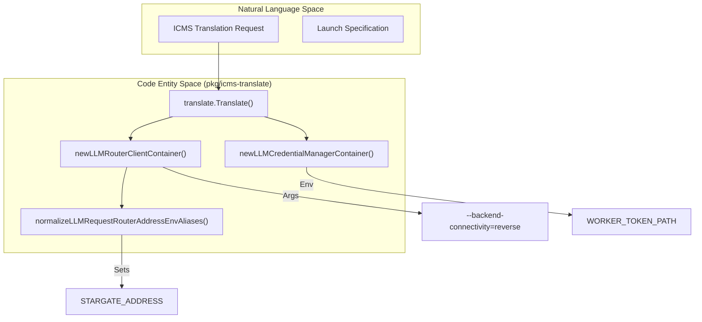
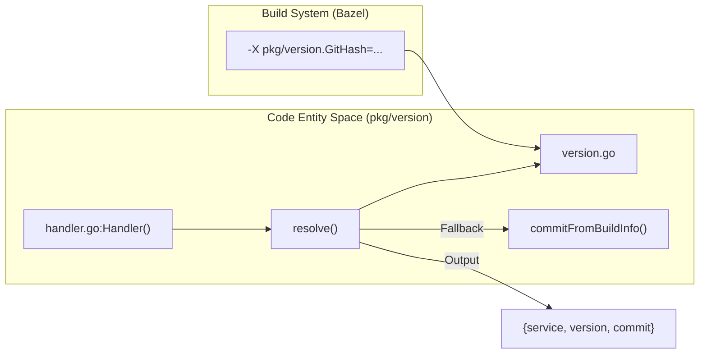

<!-- source: DeepWiki mcp.deepwiki.com · repo NVIDIA/nvcf · page 10.1 Go Shared Library (go-lib) · fetched 2026-10-26 -->

# Go Shared Library (go-lib)

Relevant source files

The following files were used as context for generating this wiki page:

- [BUILD.bazel](BUILD.bazel)
- [src/clis/nvcf-cli/internal/apikeys/BUILD.bazel](src/clis/nvcf-cli/internal/apikeys/BUILD.bazel)
- [src/clis/nvcf-cli/internal/client/BUILD.bazel](src/clis/nvcf-cli/internal/client/BUILD.bazel)
- [src/clis/nvcf-cli/internal/openbao/BUILD.bazel](src/clis/nvcf-cli/internal/openbao/BUILD.bazel)
- [src/clis/nvcf-cli/scripts/admin-mock/BUILD.bazel](src/clis/nvcf-cli/scripts/admin-mock/BUILD.bazel)
- [src/compute-plane-services/nvca/internal/miniservice/translate_workload_test.go](src/compute-plane-services/nvca/internal/miniservice/translate_workload_test.go)
- [src/compute-plane-services/nvca/pkg/nvca/k8scomputebackend_test.go](src/compute-plane-services/nvca/pkg/nvca/k8scomputebackend_test.go)
- [src/compute-plane-services/nvca/pkg/storage/BUILD.bazel](src/compute-plane-services/nvca/pkg/storage/BUILD.bazel)
- [src/compute-plane-services/nvca/pkg/storage/translate_workload_test.go](src/compute-plane-services/nvca/pkg/storage/translate_workload_test.go)
- [src/libraries/go/lib/BUILD.bazel](src/libraries/go/lib/BUILD.bazel)
- [src/libraries/go/lib/pkg/icms-translate/translate/cache/BUILD.bazel](src/libraries/go/lib/pkg/icms-translate/translate/cache/BUILD.bazel)
- [src/libraries/go/lib/pkg/icms-translate/translate/function/BUILD.bazel](src/libraries/go/lib/pkg/icms-translate/translate/function/BUILD.bazel)
- [src/libraries/go/lib/pkg/icms-translate/translate/function/llm.go](src/libraries/go/lib/pkg/icms-translate/translate/function/llm.go)
- [src/libraries/go/lib/pkg/icms-translate/translate/function/llm_test.go](src/libraries/go/lib/pkg/icms-translate/translate/function/llm_test.go)
- [src/libraries/go/lib/pkg/icms-translate/translate/function/translate.go](src/libraries/go/lib/pkg/icms-translate/translate/function/translate.go)
- [src/libraries/go/lib/pkg/icms-translate/translate/function/translate_tolerations_test.go](src/libraries/go/lib/pkg/icms-translate/translate/function/translate_tolerations_test.go)
- [src/libraries/go/lib/pkg/icms-translate/translate/task/BUILD.bazel](src/libraries/go/lib/pkg/icms-translate/translate/task/BUILD.bazel)
- [src/libraries/go/lib/pkg/icms-translate/translate/util/BUILD.bazel](src/libraries/go/lib/pkg/icms-translate/translate/util/BUILD.bazel)
- [src/libraries/go/lib/pkg/imagecredential/BUILD.bazel](src/libraries/go/lib/pkg/imagecredential/BUILD.bazel)
- [src/libraries/go/lib/pkg/nvkit/auth/BUILD.bazel](src/libraries/go/lib/pkg/nvkit/auth/BUILD.bazel)
- [src/libraries/go/lib/pkg/nvkit/servers/BUILD.bazel](src/libraries/go/lib/pkg/nvkit/servers/BUILD.bazel)
- [src/libraries/go/lib/pkg/nvkit/test/certs/BUILD.bazel](src/libraries/go/lib/pkg/nvkit/test/certs/BUILD.bazel)
- [src/libraries/go/lib/pkg/version/BUILD.bazel](src/libraries/go/lib/pkg/version/BUILD.bazel)
- [src/libraries/go/lib/pkg/version/handler.go](src/libraries/go/lib/pkg/version/handler.go)
- [src/libraries/go/lib/pkg/version/handler_test.go](src/libraries/go/lib/pkg/version/handler_test.go)
- [src/libraries/go/lib/pkg/version/version.go](src/libraries/go/lib/pkg/version/version.go)
- [src/libraries/go/lib/testdata/icms-translate/function/container/llm/exp.yaml](src/libraries/go/lib/testdata/icms-translate/function/container/llm/exp.yaml)
- [src/libraries/go/lib/testdata/icms-translate/function/helmchart/llm/exp.yaml](src/libraries/go/lib/testdata/icms-translate/function/helmchart/llm/exp.yaml)
- [src/libraries/go/lib/testdata/icms-translate/function/helmchart/llm/message.json](src/libraries/go/lib/testdata/icms-translate/function/helmchart/llm/message.json)
- [src/libraries/go/lib/testdata/icms-translate/function/helmchart/llm/worker.env](src/libraries/go/lib/testdata/icms-translate/function/helmchart/llm/worker.env)
- [tools/ci/check-gazelle](tools/ci/check-gazelle)
- [tools/ci/test-check-gazelle](tools/ci/test-check-gazelle)

The `go-lib` shared module (`src/libraries/go/lib/`) provides a unified foundation for all Go-based services within the NVCF ecosystem. It encapsulates core cross-cutting concerns including authentication, service bootstrapping (logging, metrics, tracing), Kubernetes workload translation for the compute plane, and versioning.

## Library Architecture

The library is organized into specialized packages that serve different layers of the NVCF architecture, from the control plane's request translation to the invocation plane's service framework.

### Workload Translation (`pkg/icms-translate`)

The `icms-translate` package is a critical component used by the **NVIDIA Cluster Agent (NVCA)** and **ICMS** to convert abstract NVCF function/task specifications into concrete Kubernetes manifests (Pods, Deployments, Secrets).

#### LLM Workload Translation
For LLM-type functions, the translator injects specialized sidecars to handle model routing and credential management.

*   **LLM Router Client**: Injected as the `llm-worker` container [src/libraries/go/lib/pkg/icms-translate/translate/function/llm.go:30-30](). It runs the `stargate-client` image [src/libraries/go/lib/pkg/icms-translate/translate/function/llm.go:37-37]() and facilitates reverse-connectivity to the Stargate router [src/libraries/go/lib/pkg/icms-translate/translate/function/llm.go:128-128]().
*   **Credential Manager**: Injected as the `llm-credential-manager` container [src/libraries/go/lib/pkg/icms-translate/translate/function/llm.go:217-217](). It manages the `NVCF_WORKER_TOKEN` and communicates with the gRPC control plane [src/libraries/go/lib/pkg/icms-translate/translate/function/llm.go:187-193]().

#### Data Flow: LLM Translation Logic
The following diagram illustrates how the `translate` package processes an LLM function request into a Kubernetes Pod specification.

*Sources: [src/libraries/go/lib/pkg/icms-translate/translate/function/llm.go:45-175](), [src/libraries/go/lib/pkg/icms-translate/translate/function/llm.go:177-214]()*

### Service Framework (`pkg/nvkit`)

`nvkit` is the standard library for building NVCF Go services. It provides high-level abstractions for common service requirements.

| Package | Purpose | Key Components |
| :--- | :--- | :--- |
| `pkg/nvkit/auth` | Authentication and TLS | `AuthnRefresher`, `TokenStore`, TLS config loaders [src/libraries/go/lib/pkg/nvkit/auth/BUILD.bazel:18-24]() |
| `pkg/nvkit/servers` | Server Bootstrapping | gRPC and HTTP server runners with OTel and Prometheus integration [src/libraries/go/lib/pkg/nvkit/servers/BUILD.bazel:18-24]() |
| `pkg/nvkit/tracing` | Observability | OpenTelemetry tracing wrappers and exporters |

The `servers` package specifically handles graceful shutdown and standard middleware injection (validators, recovery, and telemetry) [src/libraries/go/lib/pkg/nvkit/servers/BUILD.bazel:26-52]().

### Versioning and Metadata (`pkg/version`)

The `version` package provides a standardized way for services to report their identity, build commit, and version via an HTTP `/info` endpoint.

*   **Build Metadata**: Variables like `Service`, `Version`, and `GitHash` are typically injected via `ldflags` during the Bazel build process [src/libraries/go/lib/pkg/version/version.go:23-32]().
*   **Info Handler**: The `Handler()` function returns an `http.Handler` that serves a JSON object containing build metadata [src/libraries/go/lib/pkg/version/handler.go:39-41]().
*   **VCS Fallback**: If `GitHash` is not provided via `ldflags`, the package attempts to extract the VCS revision from the Go embedded build info [src/libraries/go/lib/pkg/version/handler.go:86-97]().

*Sources: [src/libraries/go/lib/pkg/version/version.go:23-51](), [src/libraries/go/lib/pkg/version/handler.go:29-82]()*

## Build and Tooling

The library is managed by **Bazel** using the `rules_go` toolchain.

*   **Gazelle Integration**: The `BUILD.bazel` file at the root of the library uses Gazelle to automatically manage Go dependencies and build targets [src/libraries/go/lib/BUILD.bazel:16-28]().
*   **Linting**: A specialized `sh_test` target runs `golangci-lint` in a non-hermetic fashion to ensure code quality across the module [src/libraries/go/lib/BUILD.bazel:41-62]().
*   **Testing**: Extensive use of `testdata` for golden file testing in `icms-translate`. For example, `llm/exp.yaml` defines the expected Kubernetes output for LLM workloads [src/libraries/go/lib/testdata/icms-translate/function/container/llm/exp.yaml:1-192]().

### Key Functions Reference

| Function | Path | Description |
| :--- | :--- | :--- |
| `newLLMRouterClientContainer` | `pkg/icms-translate/translate/function/llm.go` | Constructs the Pylon/Stargate client sidecar for LLM workloads. |
| `HandlerFor` | `pkg/version/handler.go` | Creates a version info HTTP handler with custom metadata overrides. |
| `normalizeLLMRequestRouterAddressEnvAliases` | `pkg/icms-translate/translate/function/llm.go` | Ensures compatibility between `LLM_REQUEST_ROUTER_ADDRESS` and legacy `STARGATE_ADDRESS` environment variables. |
| `Translate` | `pkg/icms-translate/translate/function/translate.go` | The entry point for converting NVCF messages into K8s objects. |

*Sources: [src/libraries/go/lib/pkg/icms-translate/translate/function/llm.go:61-175](), [src/libraries/go/lib/pkg/version/handler.go:47-64](), [src/libraries/go/lib/pkg/icms-translate/translate/function/llm.go:45-59]()*

---

