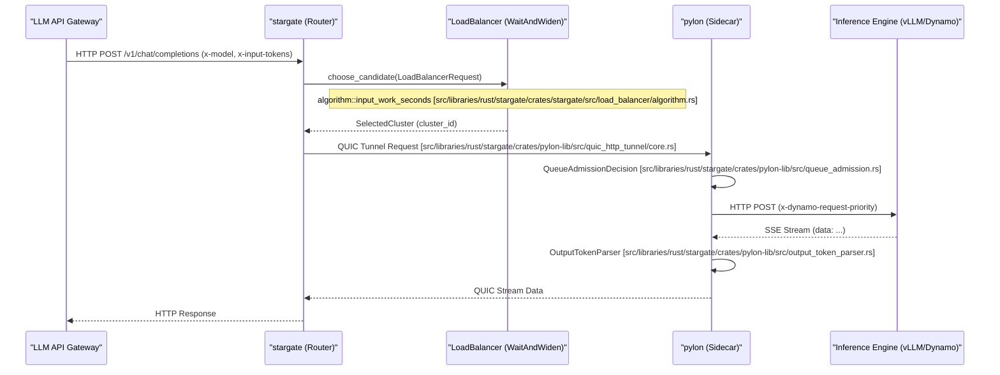

<!-- source: DeepWiki mcp.deepwiki.com · repo NVIDIA/nvcf · page 10.2 Rust Stargate Library and Pylon · fetched 2026-10-26 -->

# Rust Stargate Library and Pylon

<details>
<summary>Relevant source files</summary>

The following files were used as context for generating this wiki page:

- [docs/user/llm-function-enablement.md](docs/user/llm-function-enablement.md)
- [docs/user/llm-request-router-load-balancing.md](docs/user/llm-request-router-load-balancing.md)
- [src/libraries/rust/stargate/BUILD.bazel](src/libraries/rust/stargate/BUILD.bazel)
- [src/libraries/rust/stargate/Cargo.lock](src/libraries/rust/stargate/Cargo.lock)
- [src/libraries/rust/stargate/Cargo.toml](src/libraries/rust/stargate/Cargo.toml)
- [src/libraries/rust/stargate/Dockerfile](src/libraries/rust/stargate/Dockerfile)
- [src/libraries/rust/stargate/README.md](src/libraries/rust/stargate/README.md)
- [src/libraries/rust/stargate/crates/mock-dynamo/BUILD.bazel](src/libraries/rust/stargate/crates/mock-dynamo/BUILD.bazel)
- [src/libraries/rust/stargate/crates/mock-dynamo/src/main.rs](src/libraries/rust/stargate/crates/mock-dynamo/src/main.rs)
- [src/libraries/rust/stargate/crates/mock-dynamo/src/openai.rs](src/libraries/rust/stargate/crates/mock-dynamo/src/openai.rs)
- [src/libraries/rust/stargate/crates/mock-dynamo/src/test_control.rs](src/libraries/rust/stargate/crates/mock-dynamo/src/test_control.rs)
- [src/libraries/rust/stargate/crates/mock-dynamo/src/tests.rs](src/libraries/rust/stargate/crates/mock-dynamo/src/tests.rs)
- [src/libraries/rust/stargate/crates/proto/BUILD.bazel](src/libraries/rust/stargate/crates/proto/BUILD.bazel)
- [src/libraries/rust/stargate/crates/protocol/BUILD.bazel](src/libraries/rust/stargate/crates/protocol/BUILD.bazel)
- [src/libraries/rust/stargate/crates/protocol/src/lib.rs](src/libraries/rust/stargate/crates/protocol/src/lib.rs)
- [src/libraries/rust/stargate/crates/pylon-lib/BUILD.bazel](src/libraries/rust/stargate/crates/pylon-lib/BUILD.bazel)
- [src/libraries/rust/stargate/crates/pylon-lib/src/bringup/upstream.rs](src/libraries/rust/stargate/crates/pylon-lib/src/bringup/upstream.rs)
- [src/libraries/rust/stargate/crates/pylon-lib/src/lib.rs](src/libraries/rust/stargate/crates/pylon-lib/src/lib.rs)
- [src/libraries/rust/stargate/crates/pylon-lib/src/queue_admission.rs](src/libraries/rust/stargate/crates/pylon-lib/src/queue_admission.rs)
- [src/libraries/rust/stargate/crates/pylon-lib/src/quic_http_tunnel.rs](src/libraries/rust/stargate/crates/pylon-lib/src/quic_http_tunnel.rs)
- [src/libraries/rust/stargate/crates/pylon-lib/src/quic_http_tunnel/backend.rs](src/libraries/rust/stargate/crates/pylon-lib/src/quic_http_tunnel/backend.rs)
- [src/libraries/rust/stargate/crates/pylon-lib/src/quic_http_tunnel/core.rs](src/libraries/rust/stargate/crates/pylon-lib/src/quic_http_tunnel/core.rs)
- [src/libraries/rust/stargate/crates/pylon-lib/src/quic_http_tunnel/raw_quic.rs](src/libraries/rust/stargate/crates/pylon-lib/src/quic_http_tunnel/raw_quic.rs)
- [src/libraries/rust/stargate/crates/pylon-lib/src/quic_http_tunnel/tests.rs](src/libraries/rust/stargate/crates/pylon-lib/src/quic_http_tunnel/tests.rs)
- [src/libraries/rust/stargate/crates/pylon-lib/src/request_observer.rs](src/libraries/rust/stargate/crates/pylon-lib/src/request_observer.rs)
- [src/libraries/rust/stargate/crates/pylon-lib/src/request_observer/headers.rs](src/libraries/rust/stargate/crates/pylon-lib/src/request_observer/headers.rs)
- [src/libraries/rust/stargate/crates/pylon-lib/src/stats/collector.rs](src/libraries/rust/stargate/crates/pylon-lib/src/stats/collector.rs)
- [src/libraries/rust/stargate/crates/pylon/src/main.rs](src/libraries/rust/stargate/crates/pylon/src/main.rs)
- [src/libraries/rust/stargate/crates/pylon/src/startup.rs](src/libraries/rust/stargate/crates/pylon/src/startup.rs)
- [src/libraries/rust/stargate/crates/stargate-auth/BUILD.bazel](src/libraries/rust/stargate/crates/stargate-auth/BUILD.bazel)
- [src/libraries/rust/stargate/crates/stargate-bench/BUILD.bazel](src/libraries/rust/stargate/crates/stargate-bench/BUILD.bazel)
- [src/libraries/rust/stargate/crates/stargate-bench/src/config.rs](src/libraries/rust/stargate/crates/stargate-bench/src/config.rs)
- [src/libraries/rust/stargate/crates/stargate-bench/src/main.rs](src/libraries/rust/stargate/crates/stargate-bench/src/main.rs)
- [src/libraries/rust/stargate/crates/stargate-k8s-router/BUILD.bazel](src/libraries/rust/stargate/crates/stargate-k8s-router/BUILD.bazel)
- [src/libraries/rust/stargate/crates/stargate-telemetry/BUILD.bazel](src/libraries/rust/stargate/crates/stargate-telemetry/BUILD.bazel)
- [src/libraries/rust/stargate/crates/stargate-telemetry/src/lib.rs](src/libraries/rust/stargate/crates/stargate-telemetry/src/lib.rs)
- [src/libraries/rust/stargate/crates/stargate-tls/BUILD.bazel](src/libraries/rust/stargate/crates/stargate-tls/BUILD.bazel)
- [src/libraries/rust/stargate/crates/stargate/BUILD.bazel](src/libraries/rust/stargate/crates/stargate/BUILD.bazel)
- [src/libraries/rust/stargate/crates/stargate/src/load_balancer/config.rs](src/libraries/rust/stargate/crates/stargate/src/load_balancer/config.rs)
- [src/libraries/rust/stargate/crates/stargate/src/load_balancer/tests.rs](src/libraries/rust/stargate/crates/stargate/src/load_balancer/tests.rs)
- [src/libraries/rust/stargate/crates/stargate/src/main.rs](src/libraries/rust/stargate/crates/stargate/src/main.rs)
- [src/libraries/rust/stargate/crates/stargate/src/runtime.rs](src/libraries/rust/stargate/crates/stargate/src/runtime.rs)
- [src/libraries/rust/stargate/docs/README.md](src/libraries/rust/stargate/docs/README.md)
- [src/libraries/rust/stargate/docs/api-gateway-contract.md](src/libraries/rust/stargate/docs/api-gateway-contract.md)
- [src/libraries/rust/stargate/docs/load-balancer-configuration.md](src/libraries/rust/stargate/docs/load-balancer-configuration.md)
- [src/libraries/rust/stargate/docs/multi-backend-clusters.md](src/libraries/rust/stargate/docs/multi-backend-clusters.md)

</details>


The Rust Stargate library and Pylon form the core high-performance request routing and tunneling infrastructure for LLM functions within NVCF. This stack enables model-aware load balancing, QUIC-based HTTP tunneling, and advanced telemetry for inference workloads.

## Overview of Components

The architecture consists of several specialized Rust crates located in `src/libraries/rust/stargate/`.

| Component | Role |
| --- | --- |
| `stargate` | The LLM request router. It performs model-aware load balancing across distributed compute clusters [src/libraries/rust/stargate/crates/stargate/src/main.rs:56-61](). |
| `pylon-lib` | A sidecar library providing QUIC-HTTP tunneling, queue admission control, and request observation for worker pods [src/libraries/rust/stargate/crates/pylon-lib/src/lib.rs:1-15](). |
| `stargate-auth` | Handles authentication logic for Stargate components. |
| `stargate-tls` | Manages TLS identity and certificate handling for QUIC and gRPC [src/libraries/rust/stargate/crates/pylon-lib/src/quic_http_tunnel/tests.rs:54-54](). |
| `stargate-telemetry` | Provides OpenTelemetry integration, trace context injection, and metrics [src/libraries/rust/stargate/crates/stargate-telemetry/src/lib.rs:1-10](). |
| `mock-dynamo` | A test server simulating the "Dynamo" engine interface for local development and BDD testing [src/libraries/rust/stargate/crates/mock-dynamo/src/main.rs:1-20](). |

**Sources:** [src/libraries/rust/stargate/crates/stargate/src/main.rs:56-61](), [src/libraries/rust/stargate/crates/pylon-lib/src/lib.rs:1-15](), [src/libraries/rust/stargate/crates/stargate-telemetry/src/lib.rs:1-10](), [src/libraries/rust/stargate/crates/mock-dynamo/src/main.rs:1-20]().

## Stargate: LLM Request Router

`stargate` acts as the entry point for LLM inference requests. It maintains a registry of active backends and selects the optimal candidate based on a configurable load-balancing algorithm.

### Load Balancing Algorithms
Stargate supports several algorithms defined in `LoadBalancerAlgorithm` [src/libraries/rust/stargate/crates/stargate/src/load_balancer/config.rs:48-60]():
*   **Power of Two:** The default algorithm, sampling two candidates and choosing the least loaded [src/libraries/rust/stargate/crates/stargate/src/load_balancer/config.rs:52-52]().
*   **Wait and Widen:** Minimizes estimated Time to First Token (TTFT) by grouping candidates into buckets based on RTT, queue delay, and prefill time [src/libraries/rust/stargate/docs/load-balancer-configuration.md:118-134]().
*   **Pulsar:** Uses weighted rendezvous hashing for stable affinity to specific clusters based on their input TPS capacity [src/libraries/rust/stargate/docs/load-balancer-configuration.md:157-165]().
*   **Pulsar-Wait-and-Widen:** A hybrid that maintains Pulsar affinity but escapes to lower-latency clusters if the primary cluster's queue is too long [src/libraries/rust/stargate/docs/load-balancer-configuration.md:112-112]().

### Configuration and Routing Contract
The router is configured via `lb-config.json` [src/libraries/rust/stargate/docs/load-balancer-configuration.md:1-10](). It expects specific trusted headers from the upstream `llm-api-gateway`:
*   `x-model`: The exact Stargate model ID [src/libraries/rust/stargate/docs/api-gateway-contract.md:129-129]().
*   `x-input-tokens`: Estimated token count for prefill calculation [src/libraries/rust/stargate/docs/api-gateway-contract.md:130-130]().
*   `x-routing-key`: Scope for multi-tenant isolation [src/libraries/rust/stargate/docs/api-gateway-contract.md:136-136]().

**Sources:** [src/libraries/rust/stargate/crates/stargate/src/load_balancer/config.rs:48-60](), [src/libraries/rust/stargate/docs/load-balancer-configuration.md:118-134](), [src/libraries/rust/stargate/docs/api-gateway-contract.md:124-140]().

## Pylon: Worker Sidecar Library

`pylon` runs as a sidecar in worker pods, acting as a bridge between the Stargate router and the local inference engine (e.g., vLLM or TRT-LLM).

### QUIC-HTTP Tunneling
Pylon establishes QUIC tunnels to Stargate. This provides several advantages over standard TCP:
1.  **Reverse Tunneling:** Allows workers in private clusters to register with a central Stargate without exposing public endpoints [src/libraries/rust/stargate/crates/pylon/src/startup.rs:118-121]().
2.  **Multiplexing:** Multiple HTTP requests are multiplexed over a single QUIC connection [src/libraries/rust/stargate/crates/stargate/src/main.rs:137-145]().

### Request Lifecycle and Observation
Pylon tracks every request through its lifecycle using the `RequestObserver` [src/libraries/rust/stargate/crates/pylon-lib/src/request_observer.rs:143-155]().

**Pylon Request State Machine**
```mermaid
graph TD
    "Init[RequestObserver::from_required]" --> "Queued[RequestObservationState::Queued]"
    "Queued" --> "Connecting[RequestObservationState::UpstreamConnecting]"
    "Connecting" --> "Input[RequestObservationState::InputProcessing]"
    "Input" --> "Output[RequestObservationState::OutputGeneration]"
    "Output" --> "Complete[RequestObservationState::Complete]"
    "Input" --> "Failed[RequestObservationState::Failed]"
    "Output" --> "Cancelled[RequestObservationState::Cancelled]"

    subgraph "Observation Events"
    "Input" -- "on_upstream_response_headers" --> "Output"
    "Output" -- "observe_output_message" --> "Output"
    end
```
**Sources:** [src/libraries/rust/stargate/crates/pylon-lib/src/request_observer.rs:33-41](), [src/libraries/rust/stargate/crates/pylon-lib/src/request_observer.rs:158-188](), [src/libraries/rust/stargate/crates/pylon-lib/src/request_observer.rs:198-225]().

### Queue Admission and Priority
Pylon implements priority-aware queue admission. It translates NVCF priorities into engine-specific headers. For the "Dynamo" backend, it emits `x-dynamo-request-priority` based on a configurable `priority_ceiling` [src/libraries/rust/stargate/docs/api-gateway-contract.md:152-161]().

**Sources:** [src/libraries/rust/stargate/crates/pylon-lib/src/quic_http_tunnel/core.rs:108-112](), [src/libraries/rust/stargate/docs/api-gateway-contract.md:147-168]().

## Data Flow: Request Invocations

The following diagram illustrates the flow of a request from the Gateway to the final inference engine, highlighting the key Rust entities involved.

**Stargate/Pylon Request Flow**

**Sources:** [src/libraries/rust/stargate/crates/stargate/src/load_balancer/tests.rs:41-55](), [src/libraries/rust/stargate/crates/pylon-lib/src/quic_http_tunnel/core.rs:139-156](), [src/libraries/rust/stargate/docs/api-gateway-contract.md:114-131]().

## Telemetry and Stats Collection

The `StatsCollector` in `pylon-lib` aggregates performance metrics from the inference engine and individual request observations.

*   **Engine Stats:** Pylon polls the engine (e.g., `/metrics` or `/stats` endpoints) to get KV cache utilization and TPS [src/libraries/rust/stargate/crates/pylon-lib/src/stats/collector.rs:41-54]().
*   **Smoothing:** Stats are smoothed over a window (default size 8) to prevent routing oscillations [src/libraries/rust/stargate/crates/pylon-lib/src/stats/collector.rs:30-30]().
*   **Aggregator:** The `StatsAggregator` combines request-level counters with engine-level snapshots to produce `CurrentModelStats` [src/libraries/rust/stargate/crates/pylon-lib/src/stats/collector.rs:116-130]().

**Sources:** [src/libraries/rust/stargate/crates/pylon-lib/src/stats/collector.rs:29-38](), [src/libraries/rust/stargate/crates/pylon-lib/src/stats/collector.rs:196-200]().

## Mock Dynamo Test Server

The `mock-dynamo` crate is a critical tool for validating the Stargate stack without requiring a full GPU-backed inference engine. It implements:
*   **OpenAI Compatibility:** Simulates `/v1/chat/completions` and `/v1/embeddings` [src/libraries/rust/stargate/crates/mock-dynamo/src/openai.rs:1-10]().
*   **Latency Simulation:** Configurable delays to test `wait-and-widen` bucket logic.
*   **Error Injection:** Can be commanded to return specific HTTP error codes to test Stargate's retry and failover policies [src/libraries/rust/stargate/crates/mock-dynamo/src/test_control.rs:1-10]().

**Sources:** [src/libraries/rust/stargate/crates/mock-dynamo/src/main.rs:1-20](), [src/libraries/rust/stargate/crates/mock-dynamo/src/openai.rs:1-10]().

---

