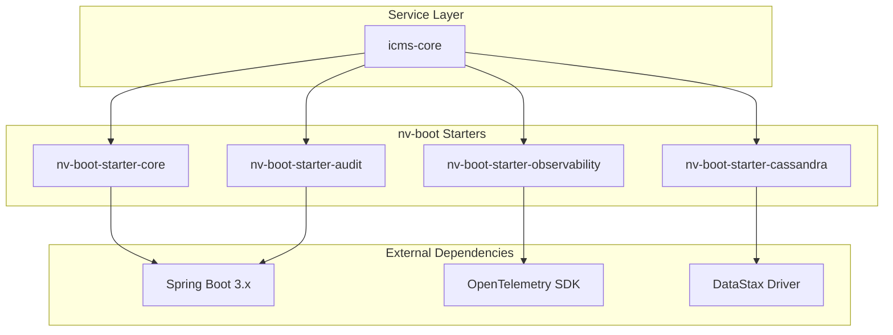
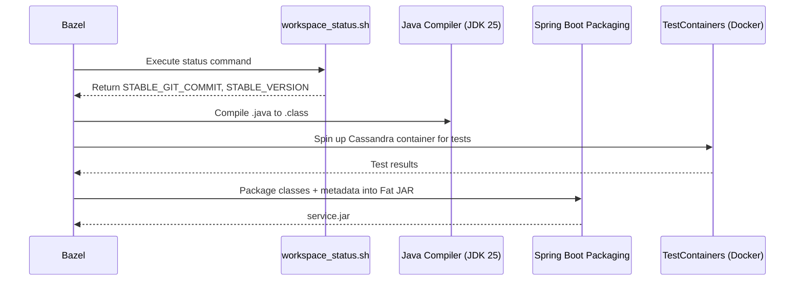

<!-- source: DeepWiki mcp.deepwiki.com · repo NVIDIA/nvcf · page 10.3 Java Libraries and nv-boot Framework · fetched 2026-10-26 -->

# Java Libraries and nv-boot Framework

<details>
<summary>Relevant source files</summary>

The following files were used as context for generating this wiki page:

- [.bazelignore](.bazelignore)
- [.bazelrc](.bazelrc)
- [.bazelversion](.bazelversion)
- [.github/workflows/chart-push-manual.yml](.github/workflows/chart-push-manual.yml)
- [.github/workflows/image-push-manual.yml](.github/workflows/image-push-manual.yml)
- [BAZEL.md](BAZEL.md)
- [MODULE.bazel](MODULE.bazel)
- [MODULE.bazel.lock](MODULE.bazel.lock)
- [maven_install.json](maven_install.json)
- [src/clis/nvcf-cli/test/e2e/README.md](src/clis/nvcf-cli/test/e2e/README.md)
- [src/control-plane-services/helm-reval/go.mod](src/control-plane-services/helm-reval/go.mod)
- [src/control-plane-services/helm-reval/go.sum](src/control-plane-services/helm-reval/go.sum)
- [src/control-plane-services/helm-reval/pkg/reval/config/config.go](src/control-plane-services/helm-reval/pkg/reval/config/config.go)
- [src/control-plane-services/helm-reval/pkg/reval/service/models.go](src/control-plane-services/helm-reval/pkg/reval/service/models.go)
- [src/control-plane-services/helm-reval/pkg/reval/service/service.go](src/control-plane-services/helm-reval/pkg/reval/service/service.go)
- [src/control-plane-services/helm-reval/reval/BUILD.bazel](src/control-plane-services/helm-reval/reval/BUILD.bazel)
- [src/control-plane-services/helm-reval/reval/helm_template.go](src/control-plane-services/helm-reval/reval/helm_template.go)
- [src/control-plane-services/helm-reval/reval/helm_template_test.go](src/control-plane-services/helm-reval/reval/helm_template_test.go)
- [src/control-plane-services/helm-reval/reval/run.go](src/control-plane-services/helm-reval/reval/run.go)
- [src/control-plane-services/helm-reval/reval/run_test.go](src/control-plane-services/helm-reval/reval/run_test.go)
- [src/control-plane-services/instance-cluster-management/BAZEL.md](src/control-plane-services/instance-cluster-management/BAZEL.md)
- [src/control-plane-services/instance-cluster-management/icms-core/BUILD.bazel](src/control-plane-services/instance-cluster-management/icms-core/BUILD.bazel)
- [src/invocation-plane-services/grpc-proxy/proxy/h2.go](src/invocation-plane-services/grpc-proxy/proxy/h2.go)
- [src/invocation-plane-services/grpc-proxy/proxy/info_test.go](src/invocation-plane-services/grpc-proxy/proxy/info_test.go)
- [tools/bazel/BUILD.bazel](tools/bazel/BUILD.bazel)
- [tools/bazel/patches/gazelle_go_work_dev_dependency.patch](tools/bazel/patches/gazelle_go_work_dev_dependency.patch)
- [tools/ci/check-oci-pins](tools/ci/check-oci-pins)
- [tools/scripts/test/test-workspace-status.sh](tools/scripts/test/test-workspace-status.sh)
- [tools/workspace_status.sh](tools/workspace_status.sh)

</details>


This page documents the Java shared libraries and the `nv-boot` Spring Boot framework used by the NVIDIA Cloud Functions (NVCF) control plane services. It covers dependency management via Bazel, the core framework starters, and the build patterns for producing production-ready Spring Boot artifacts.

## Overview and Purpose

The NVCF Java ecosystem is built around a standardized Spring Boot framework called `nv-boot`. This framework provides a set of "starters" that encapsulate cross-cutting concerns such as observability, security, database connectivity (Cassandra), and audit logging. By using these starters, services like `nvcf-service`, `icms`, and `api-keys` maintain a consistent operational profile.

The entire Java codebase is integrated into the root Bazel module, allowing for unified dependency management and hermetic builds using Java 25 [BAZEL.md:78-82]().

## Dependency Management

Java dependencies are managed through `rules_jvm_external` and the `nv_third_party_deps` hub [BAZEL.md:138-142](). This ensures that all services share a consistent set of third-party libraries, preventing version skew.

### Maven Artifact Resolution
Artifacts are declared in `MODULE.bazel` and locked in `maven_install.json` [BAZEL.md:131-133](). The resolution process uses a pinned version of the Maven coordinates to generate a Bazel-accessible dependency graph.

| Component | Role | File Reference |
|---|---|---|
| **BOM Imports** | Standardizes versions for Spring Boot and Cloud | `MODULE.bazel` |
| **Artifact Lock** | Checksummed list of resolved jars | `maven_install.json` |
| **Dependency Hub** | The `@nv_third_party_deps` repository | `MODULE.bazel` |

Sources: [BAZEL.md:131-142](), [maven_install.json:1-123]()

## nv-boot Framework Starters

The `nv-boot-parent` directory contains the core framework components. These are distributed as `nv_boot_library` targets that services consume as dependencies [src/control-plane-services/instance-cluster-management/icms-core/BUILD.bazel:14-22]().

### Core Starters and Functions

*   **nv-boot-starter-core**: Provides the base Spring Boot configuration, including standard error handling and common utility classes [src/control-plane-services/instance-cluster-management/icms-core/BUILD.bazel:17-17]().
*   **nv-boot-starter-observability**: Configures Micrometer, Prometheus, and OpenTelemetry for uniform metrics and tracing [src/control-plane-services/instance-cluster-management/icms-core/BUILD.bazel:20-20]().
*   **nv-boot-starter-cassandra**: Encapsulates the DataStax Java driver configuration, including connection pooling, retry policies, and integration with `ShedLock` for distributed locking [src/control-plane-services/instance-cluster-management/icms-core/BUILD.bazel:16-16](), [src/control-plane-services/instance-cluster-management/icms-core/BUILD.bazel:58-60]().
*   **nv-boot-starter-audit**: Standardizes audit log formats for compliance and security tracking [src/control-plane-services/instance-cluster-management/icms-core/BUILD.bazel:15-15]().
*   **nv-boot-starter-telemetry**: Specifically handles OTLP exporter configuration and span propagation [src/control-plane-services/instance-cluster-management/icms-core/BUILD.bazel:22-22]().

### Framework Integration Diagram
The following diagram illustrates how a control plane service (like ICMS) consumes the `nv-boot` starters to interact with external systems.

**ICMS Framework Dependency Flow**

Sources: [src/control-plane-services/instance-cluster-management/icms-core/BUILD.bazel:14-22](), [BAZEL.md:14-24]()

## Build Patterns and Bazel Integration

The Java build system uses custom Starlark rules to bridge the gap between Bazel's hermeticity and Spring Boot's fat-JAR requirements.

### Build Rules
*   `nv_boot_library`: A wrapper around `java_library` that ensures standard compiler flags and dependencies are applied [src/control-plane-services/instance-cluster-management/icms-core/BUILD.bazel:2-2]().
*   `spring_boot_jar`: (Referenced via `//rules/java:spring.bzl`) Packages the service into an executable JAR. It utilizes the `STABLE_*` workspace status keys to stamp the JAR with build metadata like `git.properties` [tools/workspace_status.sh:46-55]().

### Stamping and Metadata
Bazel's `workspace_status_command` provides the metadata used by Spring Boot Actuator:
*   `STABLE_VERSION`: The application version [tools/workspace_status.sh:38-38]().
*   `STABLE_GIT_COMMIT`: The short SHA of the current commit [tools/workspace_status.sh:39-39]().
*   `STABLE_BUILD_DATE`: The ISO-8601 build timestamp [tools/workspace_status.sh:68-68]().

### Integration Testing with TestContainers
Java services utilize `TestContainers` for integration testing against real Cassandra or NATS instances.
*   These tests require a running Docker daemon on the host [BAZEL.md:93-95]().
*   Bazel executes these as `java_test` targets, typically within the `nv_boot_library_test` macro [src/control-plane-services/instance-cluster-management/icms-core/BUILD.bazel:2-2]().

**Java Build and Test Lifecycle**

Sources: [BAZEL.md:78-82](), [BAZEL.md:93-95](), [tools/workspace_status.sh:38-55]()

## Usage and Local Development

To build or test Java components locally, developers must use the root-level Bazel commands.

### Environment Setup
1.  **Java 25**: The repository is pinned to Java 25. Developers should point `JAVA_HOME` to a JDK 25 installation [BAZEL.md:78-91]().
2.  **Bazel Output Root**: To avoid conflicts and manage disk space, a custom output root is recommended [BAZEL.md:148-151]().

### Common Commands
```bash
# Build all components in the nv-boot framework
bazel build //src/libraries/java/nv-boot-parent/...

# Run tests for a specific service (e.g., ICMS)
bazel test //src/control-plane-services/instance-cluster-management/... --test_output=errors
```
Sources: [BAZEL.md:160-178]()

---

