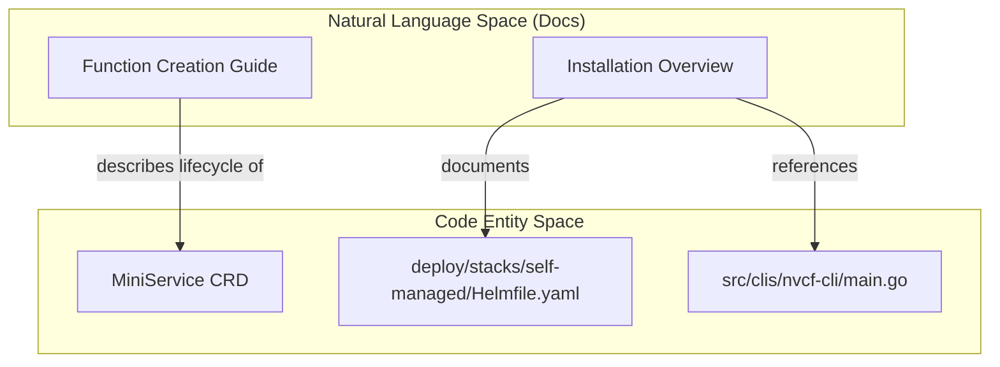
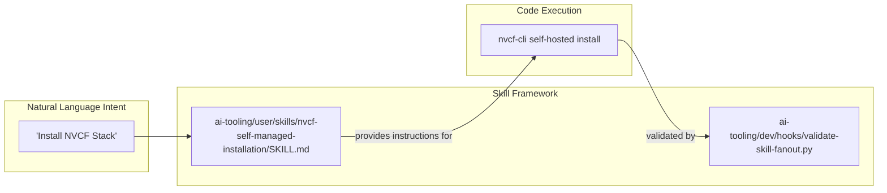

<!-- source: DeepWiki mcp.deepwiki.com · repo NVIDIA/nvcf · page 11 Documentation System and AI Tooling · fetched 2026-10-26 -->

# Documentation System and AI Tooling

Relevant source files

The following files were used as context for generating this wiki page:

- [.github/ISSUE_TEMPLATE/config.yml](.github/ISSUE_TEMPLATE/config.yml)
- [.github/PULL_REQUEST_TEMPLATE.md](.github/PULL_REQUEST_TEMPLATE.md)
- [.github/workflows/stale.yaml](.github/workflows/stale.yaml)
- [.rumdl.toml](.rumdl.toml)
- [AGENTS.md](AGENTS.md)
- [CONTRIBUTING.md](CONTRIBUTING.md)
- [README.md](README.md)
- [ai-tooling/AGENTS.md](ai-tooling/AGENTS.md)
- [ai-tooling/CLAUDE.md](ai-tooling/CLAUDE.md)
- [ai-tooling/README.md](ai-tooling/README.md)
- [ai-tooling/dev/skills/documentation-style/SKILL.md](ai-tooling/dev/skills/documentation-style/SKILL.md)
- [deploy/helm/cassandra/docs/upgrade-from-bitnami.md](deploy/helm/cassandra/docs/upgrade-from-bitnami.md)
- [docs/user/cluster-management/configuration.md](docs/user/cluster-management/configuration.md)
- [docs/user/cluster-management/index.md](docs/user/cluster-management/index.md)
- [docs/user/cluster-management/multi-tenancy.md](docs/user/cluster-management/multi-tenancy.md)
- [docs/user/release-notes/index.md](docs/user/release-notes/index.md)
- [fern/docs.yml](fern/docs.yml)
- [fern/versions/dev.yml](fern/versions/dev.yml)
- [setup.sh](setup.sh)
- [tools/ci/check-private-go-module-paths](tools/ci/check-private-go-module-paths)

This section provides an overview of the systems used to publish NVIDIA Cloud Functions (NVCF) documentation and the framework for AI agent skills. The NVCF project maintains a monorepo-native documentation strategy where user guides, API references, and developer guidance are co-located with the service code [AGENTS.md:28-32]().

## Documentation Publishing System

NVCF uses **Fern** to publish its public-facing documentation to [docs.nvidia.com/nvcf](https://docs.nvidia.com/nvcf) [fern/docs.yml:6-6](). The system supports multi-version navigation, allowing users to switch between stable releases (e.g., v0.5, v0.6.1) and the current development state [fern/docs.yml:25-40]().

### Versioned Navigation
Documentation structure is defined through YAML configuration files in the `fern/versions/` directory. These files map logical page titles to physical Markdown files located in `docs/user/` [fern/versions/dev.yml:4-15]().

### Documentation Style Guide
To ensure consistency and compatibility with command-line tools (like `grep` and `diff`), all documentation must adhere to a strict style:
*   **Plain ASCII:** No typographic Unicode (smart quotes, em-dashes, or emojis) [ai-tooling/dev/skills/documentation-style/SKILL.md:58-64]().
*   **No Bold Emphasis:** Markdown bold (`**text**`) is prohibited for emphasis; use headings or backticks instead [ai-tooling/dev/skills/documentation-style/SKILL.md:52-54]().
*   **Succinctness:** Short, direct sentences are preferred to facilitate easier consumption by both humans and AI agents [ai-tooling/dev/skills/documentation-style/SKILL.md:65-67]().

For details on the publishing pipeline and style enforcement, see [Fern Documentation Publishing](#11.1).

---

## AI Agent Skill Framework

The repository includes a comprehensive system for guiding AI coding agents (such as Cursor, Claude Code, and GitHub Copilot). This system relies on `AGENTS.md` files for local guidance and a structured "Skills" library for reusable workflows [AGENTS.md:87-102]().

### Guidance System (AGENTS.md & CLAUDE.md)
Every major subtree contains an `AGENTS.md` file providing build commands, test instructions, and ownership context [AGENTS.md:89-92](). Claude Code specific `CLAUDE.md` files act as pointers that import the adjacent `AGENTS.md` content [AGENTS.md:100-107]().

### Skill Library
Skills are on-demand instructions for specific tasks like installing the self-managed stack or managing functions via the CLI [ai-tooling/README.md:7-14]().
*   **User Skills:** Located in `ai-tooling/user/skills/` for public-facing operations [AGENTS.md:165-165]().
*   **Dev Skills:** Located in `ai-tooling/dev/skills/` for internal repository maintenance [AGENTS.md:166-166]().

### Skill Integration
The `nvcf-cli` tool embeds these skills into its binary via `skilldata_generated.go`, enabling the CLI to provide agentic assistance even in air-gapped or standalone environments [ai-tooling/AGENTS.md:170-170]().

For details on authoring skills and the symlink fanout system, see [AI Agent Skills and AGENTS.md System](#11.2).

---

## System Relationships

The following diagrams illustrate how documentation and AI tooling bridge the gap between natural language guidance and the underlying code entities.

### Documentation to Code Mapping
Documentation refers to high-level concepts which map directly to Kubernetes resources and service implementations.

Sources: [fern/versions/dev.yml:28-33](), [fern/versions/dev.yml:119-120](), [README.md:94-98]()

### AI Skill Execution Flow
This diagram shows how an agent's intent is translated into repository actions using the Skill framework.

Sources: [ai-tooling/README.md:11-11](), [ai-tooling/AGENTS.md:25-26](), [AGENTS.md:121-122]()

## Child Pages
- [Fern Documentation Publishing](#11.1)
- [AI Agent Skills and AGENTS.md System](#11.2)

Sources: [AGENTS.md:1-112](), [README.md:86-99](), [fern/docs.yml:1-41](), [ai-tooling/README.md:1-14](), [ai-tooling/dev/skills/documentation-style/SKILL.md:1-88]()

---

