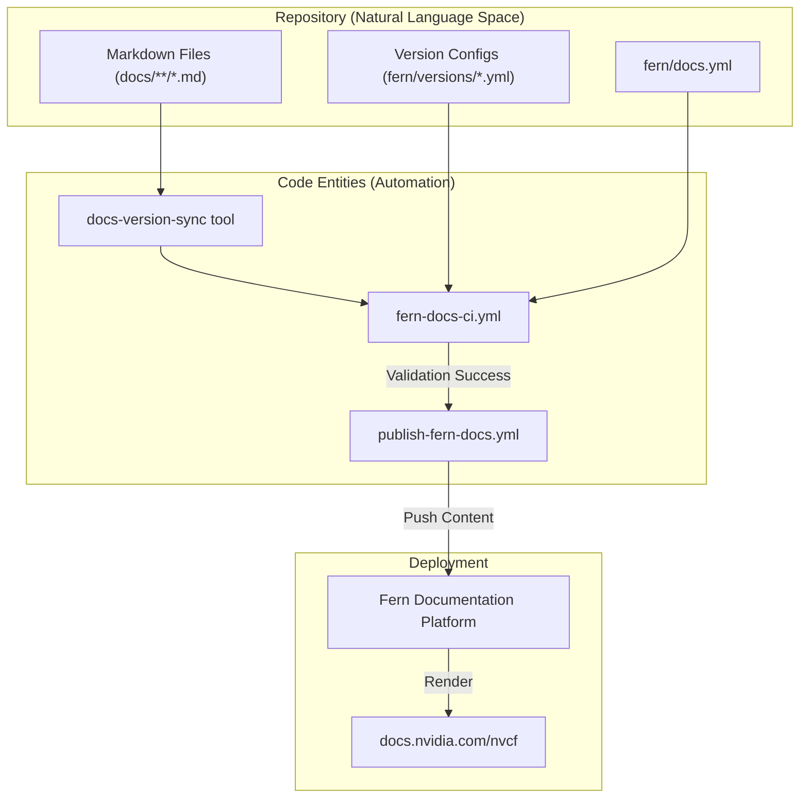
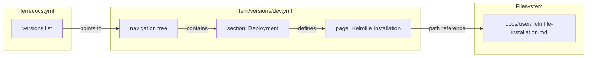

<!-- source: DeepWiki mcp.deepwiki.com · repo NVIDIA/nvcf · page 11.1 Fern Documentation Publishing · fetched 2026-10-26 -->

# Fern Documentation Publishing

Relevant source files

The following files were used as context for generating this wiki page:

- [.github/workflows/fern-docs-ci.yml](.github/workflows/fern-docs-ci.yml)
- [.github/workflows/fern-docs-preview-build.yml](.github/workflows/fern-docs-preview-build.yml)
- [.github/workflows/fern-docs-preview-comment.yml](.github/workflows/fern-docs-preview-comment.yml)
- [.github/workflows/publish-fern-docs.yml](.github/workflows/publish-fern-docs.yml)
- [deploy/helm/cassandra/docs/upgrade-from-bitnami.md](deploy/helm/cassandra/docs/upgrade-from-bitnami.md)
- [docs/user/cluster-management/configuration.md](docs/user/cluster-management/configuration.md)
- [docs/user/cluster-management/index.md](docs/user/cluster-management/index.md)
- [docs/user/cluster-management/multi-tenancy.md](docs/user/cluster-management/multi-tenancy.md)
- [docs/user/infrastructure-sizing.md](docs/user/infrastructure-sizing.md)
- [docs/user/release-notes/index.md](docs/user/release-notes/index.md)
- [docs/v0.6.0/cluster-management/configuration.md](docs/v0.6.0/cluster-management/configuration.md)
- [docs/v0.6.0/csp-end-to-end-example-installation.md](docs/v0.6.0/csp-end-to-end-example-installation.md)
- [docs/v0.6.0/gateway-routing.md](docs/v0.6.0/gateway-routing.md)
- [docs/v0.6.0/helmfile-installation.md](docs/v0.6.0/helmfile-installation.md)
- [docs/v0.6.0/image-mirroring.md](docs/v0.6.0/image-mirroring.md)
- [docs/v0.6.0/images/nvcf-http-invocation-path.svg](docs/v0.6.0/images/nvcf-http-invocation-path.svg)
- [docs/v0.6.0/images/nvcf-llm-invocation-path.svg](docs/v0.6.0/images/nvcf-llm-invocation-path.svg)
- [docs/v0.6.0/installation.md](docs/v0.6.0/installation.md)
- [docs/v0.6.0/manifest.md](docs/v0.6.0/manifest.md)
- [docs/v0.6.0/optional-enhancements.md](docs/v0.6.0/optional-enhancements.md)
- [docs/v0.6.1/cluster-management/configuration.md](docs/v0.6.1/cluster-management/configuration.md)
- [docs/v0.6.1/manifest.md](docs/v0.6.1/manifest.md)
- [docs/v0.6.1/optional-enhancements.md](docs/v0.6.1/optional-enhancements.md)
- [fern/docs.yml](fern/docs.yml)
- [fern/versions/dev.yml](fern/versions/dev.yml)

The NVIDIA Cloud Functions (NVCF) documentation system is powered by **Fern**, a documentation-as-code platform that generates the public-facing documentation site hosted at `docs.nvidia.com/nvcf`. This system enables versioned navigation, multi-source content aggregation, and automated publishing via GitHub Actions.

## Documentation Configuration

The core of the documentation system is defined in the `fern/` directory. The primary configuration file, `fern/docs.yml`, specifies the site structure, branding, and versioning strategy.

### Site Metadata and Domain
The documentation is configured to use a custom domain and a specific URL structure:
*   **Custom Domain:** `docs.nvidia.com/nvcf` [fern/docs.yml:6-6]()
*   **Instance URL:** `nvidia-nvcf.docs.buildwithfern.com/nvcf` [fern/docs.yml:5-5]()
*   **Navigation Logo:** Links to `/nvcf/overview` with the text "Cloud Functions" [fern/docs.yml:16-18]()

### Versioned Navigation
NVCF documentation supports multiple concurrent versions, allowing users to view documentation for specific releases or the latest development branch. Each version is defined by a YAML file in `fern/versions/`.

| Version Slug | Display Name | Configuration File |
| :--- | :--- | :--- |
| `""` (Default) | Latest (0.6.1) | `fern/versions/v0.6.1.yml` |
| `dev` | dev | `fern/versions/dev.yml` |
| `v0.6.1` | 0.6.1 | `fern/versions/v0.6.1.yml` |
| `v0.6.0` | 0.6.0 | `fern/versions/v0.6.0.yml` |
| `v0.5` | 0.5.0 | `fern/versions/v0.5.yml` |

Sources: [fern/docs.yml:25-40]()

## Content Structure

The documentation content is primarily located in the `docs/` directory. Fern aggregates these Markdown files based on the navigation tree defined in the version files.

### Development Branch (`dev`)
The `dev` version tracks the `main` branch and includes sections for:
*   **Release Notes:** Overview of changes [fern/versions/dev.yml:11-15]().
*   **Deployment:** Installation guides for Helmfile and CSP-specific examples [fern/versions/dev.yml:25-37]().
*   **GPU Cluster Setup:** NVCA configuration and self-managed cluster registration [fern/versions/dev.yml:39-48]().
*   **Observability:** Metrics for services like Cassandra, ESS, and the Invocation Service [fern/versions/dev.yml:157-176]().

### Redirect Management
To maintain link integrity across version updates, `fern/docs.yml` contains an extensive list of redirects. This ensures that legacy URLs (e.g., `/nvcf/v0.6.0-rc/index.html`) point to the correct permanent locations [fern/docs.yml:46-62]().

## CI/CD Workflows

Documentation publishing is fully automated using GitHub Actions, ensuring that the live site stays in sync with the codebase.

### Publishing Pipeline
The system utilizes two primary workflows:
1.  **`fern-docs-ci`**: Triggered on pull requests to validate documentation changes, check for broken links, and ensure the Fern configuration is valid.
2.  **`publish-fern-docs`**: Triggered on merges to the `main` branch or when new release tags are created. This workflow pushes the updated content to the Fern platform for deployment to `docs.nvidia.com/nvcf`.

### Version Sync Tooling
The `docs-version-sync` tool is used within the Markdown files to dynamically inject content, such as artifact versions in the Manifest page [docs/v0.6.1/manifest.md:107-107](). This ensures that the documentation always reflects the actual versions defined in the `version-catalog`.

## Documentation Style Guide

To ensure consistency and readability across all NVCF documentation, the following style rules are enforced:
*   **Plain ASCII Markdown:** Avoid non-standard Markdown extensions to ensure compatibility with the Fern renderer.
*   **No Bold Emphasis:** Per project style guidelines, bold text should not be used for emphasis. Use headers or lists to structure information instead.
*   **Standard Components:** Use Fern-specific components like `<Warning>`, `<Info>`, `<Note>`, and `<Accordion>` for callouts [docs/v0.6.1/manifest.md:10-18](), [docs/v0.6.0/helmfile-installation.md:8-32]().

## Implementation Diagrams

### Documentation Data Flow
This diagram illustrates how content flows from the repository to the public documentation site.

"Documentation Data Flow"

Sources: [fern/docs.yml:1-7](), [fern/versions/dev.yml:1-10](), [.github/workflows/fern-docs-ci.yml](), [.github/workflows/publish-fern-docs.yml]()

### Navigation Mapping Logic
This diagram shows how the `docs.yml` and version files map file system paths to the web navigation structure.

"Navigation Entity Mapping"

Sources: [fern/docs.yml:25-40](), [fern/versions/dev.yml:25-33]()

---

