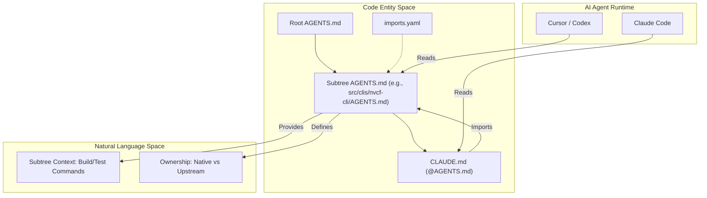
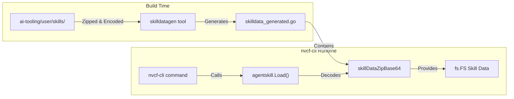

<!-- source: DeepWiki mcp.deepwiki.com · repo NVIDIA/nvcf · page 11.2 AI Agent Skills and AGENTS.md System · fetched 2026-10-26 -->

# AI Agent Skills and AGENTS.md System

Relevant source files

The following files were used as context for generating this wiki page:

- [.github/ISSUE_TEMPLATE/config.yml](.github/ISSUE_TEMPLATE/config.yml)
- [.github/PULL_REQUEST_TEMPLATE.md](.github/PULL_REQUEST_TEMPLATE.md)
- [.github/workflows/stale.yaml](.github/workflows/stale.yaml)
- [.gitignore](.gitignore)
- [.rumdl.toml](.rumdl.toml)
- [AGENTS.md](AGENTS.md)
- [CONTRIBUTING.md](CONTRIBUTING.md)
- [README.md](README.md)
- [ai-tooling/AGENTS.md](ai-tooling/AGENTS.md)
- [ai-tooling/CLAUDE.md](ai-tooling/CLAUDE.md)
- [ai-tooling/README.md](ai-tooling/README.md)
- [ai-tooling/dev/skills/documentation-style/SKILL.md](ai-tooling/dev/skills/documentation-style/SKILL.md)
- [ai-tooling/dev/skills/nvcf-explore-stack/SKILL.md](ai-tooling/dev/skills/nvcf-explore-stack/SKILL.md)
- [ai-tooling/user/skills/BUILD.bazel](ai-tooling/user/skills/BUILD.bazel)
- [ai-tooling/user/skills/nvcf-self-managed-cli/SKILL.md](ai-tooling/user/skills/nvcf-self-managed-cli/SKILL.md)
- [ai-tooling/user/skills/nvcf-self-managed-cli/prompts/deploy-and-invoke.md](ai-tooling/user/skills/nvcf-self-managed-cli/prompts/deploy-and-invoke.md)
- [ai-tooling/user/skills/nvcf-self-managed-cli/reference/commands.md](ai-tooling/user/skills/nvcf-self-managed-cli/reference/commands.md)
- [ai-tooling/user/skills/nvcf-self-managed-cli/reference/flags.md](ai-tooling/user/skills/nvcf-self-managed-cli/reference/flags.md)
- [ai-tooling/user/skills/nvcf-self-managed-installation/SKILL.md](ai-tooling/user/skills/nvcf-self-managed-installation/SKILL.md)
- [ai-tooling/user/skills/nvcf-self-managed-installation/evals/evals.json](ai-tooling/user/skills/nvcf-self-managed-installation/evals/evals.json)
- [ai-tooling/user/skills/nvcf-self-managed-installation/examples.md](ai-tooling/user/skills/nvcf-self-managed-installation/examples.md)
- [ai-tooling/user/skills/nvcf-self-managed-installation/references/compute-plane-installation.md](ai-tooling/user/skills/nvcf-self-managed-installation/references/compute-plane-installation.md)
- [ai-tooling/user/skills/nvcf-self-managed-installation/references/debugging.md](ai-tooling/user/skills/nvcf-self-managed-installation/references/debugging.md)
- [ai-tooling/user/skills/nvcf-self-managed-installation/references/helmfile-structure.md](ai-tooling/user/skills/nvcf-self-managed-installation/references/helmfile-structure.md)
- [ai-tooling/user/skills/nvcf-self-managed-installation/references/nvcf-ui-addon.md](ai-tooling/user/skills/nvcf-self-managed-installation/references/nvcf-ui-addon.md)
- [ai-tooling/user/skills/nvcf-self-managed-installation/references/pull-secrets.md](ai-tooling/user/skills/nvcf-self-managed-installation/references/pull-secrets.md)
- [ai-tooling/user/skills/nvcf-self-managed-prerequisite/SKILL.md](ai-tooling/user/skills/nvcf-self-managed-prerequisite/SKILL.md)
- [ai-tooling/user/skills/nvcf-self-managed-prerequisite/references/kai-scheduler.md](ai-tooling/user/skills/nvcf-self-managed-prerequisite/references/kai-scheduler.md)
- [ai-tooling/user/skills/nvcf-self-managed-prerequisite/references/smb-csi.md](ai-tooling/user/skills/nvcf-self-managed-prerequisite/references/smb-csi.md)
- [docs/ngc-managed/cluster-management/container-cache.md](docs/ngc-managed/cluster-management/container-cache.md)
- [docs/ngc-managed/cluster-management/gxcache.md](docs/ngc-managed/cluster-management/gxcache.md)
- [docs/ngc-managed/cluster-management/kai-scheduler.md](docs/ngc-managed/cluster-management/kai-scheduler.md)
- [docs/ngc-managed/cluster-management/samples/kai-scheduler-queues.yaml](docs/ngc-managed/cluster-management/samples/kai-scheduler-queues.yaml)
- [docs/ngc-managed/cluster-management/samples/nvca-operator-values.yaml](docs/ngc-managed/cluster-management/samples/nvca-operator-values.yaml)
- [docs/ngc-managed/downloads/function-sharing-postman.json](docs/ngc-managed/downloads/function-sharing-postman.json)
- [docs/ngc-managed/function-lifecycle.md](docs/ngc-managed/function-lifecycle.md)
- [docs/ngc-managed/images/1-ngc-managed-from-helm-managed.png](docs/ngc-managed/images/1-ngc-managed-from-helm-managed.png)
- [docs/user/cli.md](docs/user/cli.md)
- [docs/user/cluster-management/kai-scheduler.md](docs/user/cluster-management/kai-scheduler.md)
- [docs/user/function-creation.md](docs/user/function-creation.md)
- [docs/user/llm-gateway.md](docs/user/llm-gateway.md)
- [docs/v0.5/cluster-management/kai-scheduler.md](docs/v0.5/cluster-management/kai-scheduler.md)
- [setup.sh](setup.sh)
- [src/clis/nvcf-cli/README.md](src/clis/nvcf-cli/README.md)
- [src/clis/nvcf-cli/USAGE-GUIDE.md](src/clis/nvcf-cli/USAGE-GUIDE.md)
- [src/clis/nvcf-cli/cmd/function.go](src/clis/nvcf-cli/cmd/function.go)
- [src/clis/nvcf-cli/cmd/function_llm_model_test.go](src/clis/nvcf-cli/cmd/function_llm_model_test.go)
- [src/clis/nvcf-cli/internal/agentskill/BUILD.bazel](src/clis/nvcf-cli/internal/agentskill/BUILD.bazel)
- [src/clis/nvcf-cli/internal/agentskill/skilldata_generated.go](src/clis/nvcf-cli/internal/agentskill/skilldata_generated.go)
- [src/clis/nvcf-cli/internal/agentskill/skilldatagen/BUILD.bazel](src/clis/nvcf-cli/internal/agentskill/skilldatagen/BUILD.bazel)
- [src/clis/nvcf-cli/internal/client/client.go](src/clis/nvcf-cli/internal/client/client.go)
- [src/clis/nvcf-cli/internal/client/client_test.go](src/clis/nvcf-cli/internal/client/client_test.go)
- [src/compute-plane-services/byoo-otel-collector/AGENTS.md](src/compute-plane-services/byoo-otel-collector/AGENTS.md)
- [src/compute-plane-services/byoo-otel-collector/scripts/update-collector-version.sh](src/compute-plane-services/byoo-otel-collector/scripts/update-collector-version.sh)
- [src/compute-plane-services/ess-agent/AGENTS.md](src/compute-plane-services/ess-agent/AGENTS.md)
- [src/compute-plane-services/image-credential-helper/AGENTS.md](src/compute-plane-services/image-credential-helper/AGENTS.md)
- [src/control-plane-services/function-autoscaler/AGENTS.md](src/control-plane-services/function-autoscaler/AGENTS.md)
- [src/control-plane-services/nats-auth-callout/AGENTS.md](src/control-plane-services/nats-auth-callout/AGENTS.md)
- [src/invocation-plane-services/grpc-proxy/AGENTS.md](src/invocation-plane-services/grpc-proxy/AGENTS.md)
- [src/invocation-plane-services/http-invocation/AGENTS.md](src/invocation-plane-services/http-invocation/AGENTS.md)
- [src/invocation-plane-services/llm-api-gateway/AGENTS.md](src/invocation-plane-services/llm-api-gateway/AGENTS.md)
- [src/invocation-plane-services/ratelimiter/AGENTS.md](src/invocation-plane-services/ratelimiter/AGENTS.md)
- [src/libraries/go/lib/AGENTS.md](src/libraries/go/lib/AGENTS.md)
- [src/libraries/go/worker/AGENTS.md](src/libraries/go/worker/AGENTS.md)
- [tools/ci/check-private-go-module-paths](tools/ci/check-private-go-module-paths)
- [tools/ncp-local-cluster/AGENTS.md](tools/ncp-local-cluster/AGENTS.md)

This page documents the framework used to provide structured guidance and executable "skills" to AI coding agents (such as Cursor, Claude Code, and GitHub Copilot) within the NVCF repository. The system bridges natural language instructions with technical implementation details to ensure agents operate safely and effectively across the monorepo's three-plane architecture.

## Guidance Architecture: AGENTS.md and CLAUDE.md

The NVCF repository utilizes a distributed guidance system where every major subtree contains context-specific instructions for AI agents [AGENTS.md:88-91](). This system ensures that agents understand local build commands, testing patterns, and ownership boundaries (e.g., whether a service is monorepo-native or pinned from an upstream repository via `imports.yaml`) [AGENTS.md:7-13, 34-38]().

### Guidance Files
*   **`AGENTS.md`**: The primary source of truth for agent guidance. It contains build/test commands, code style, and subtree-specific conventions [AGENTS.md:97-98]().
*   **`CLAUDE.md`**: A sibling file to `AGENTS.md` used specifically by Claude Code. It contains a single `@AGENTS.md` import line to ensure all tools consume the same content without duplication [AGENTS.md:99-106]().

### Guidance Data Flow
The following diagram illustrates how natural language guidance is propagated from the repository structure to the AI Agent's runtime context.

**Diagram: Guidance Propagation to AI Agents**

Sources: [AGENTS.md:7-13](), [AGENTS.md:97-106]()

---

## AI Agent Skill Framework

Skills are reusable, on-demand instructions for specific complex workflows, such as installing a self-managed stack or registering a GPU cluster [AGENTS.md:110-112](). Unlike `AGENTS.md` files, which are auto-applied based on the directory, skills are invoked when an agent detects relevant "trigger keywords" in a user's request [AGENTS.md:115-116, 154-156]().

### Skill Directory Structure
Skills are categorized by their intended audience and visibility [AGENTS.md:161-165]():
*   **`ai-tooling/user/skills/`**: Public, user-facing NVCF skills (e.g., `nvcf-self-managed-cli`).
*   **`ai-tooling/dev/skills/`**: Public developer-facing skills (e.g., `nvcf-explore-stack`).

Each skill directory follows a standard structure [AGENTS.md:127-135]():
*   `SKILL.md`: Required instruction file containing YAML frontmatter and Markdown content.
*   `prompts/`: (Optional) Reusable prompt templates.
*   `reference/`: (Optional) Technical reference documents.
*   `examples/`: (Optional) Detailed usage examples.

### Skill Fanout via Symlinks
To make skills discoverable by IDE-based agents like Cursor, the system uses a "fanout" mechanism where skills are symlinked into the `.cursor/skills/` directory [AGENTS.md:21-22](). A specialized hook, `validate-skill-fanout.py`, ensures that all defined skills are correctly linked and accessible to the agents.

Sources: [AGENTS.md:110-135](), [AGENTS.md:161-165]()

---

## Skill Embedding in nvcf-cli

To provide offline guidance and ensure the `nvcf-cli` can assist users even without repository access, the skill data is embedded directly into the CLI binary using Go's `embed` capabilities (or generated equivalents) [src/clis/nvcf-cli/internal/agentskill/skilldata_generated.go:18-20]().

### Implementation: `skilldata_generated.go`
The file `skilldata_generated.go` contains a Base64-encoded ZIP archive of the skill definitions [src/clis/nvcf-cli/internal/agentskill/skilldata_generated.go:31-106](). This includes:
*   `data/manifest.json`: Metadata about all embedded skills [src/clis/nvcf-cli/internal/agentskill/skilldata_generated.go:32-35]().
*   `SKILL.md` files for core skill sets like `nvcf-self-managed-cli` and `nvcf-self-managed-installation` [src/clis/nvcf-cli/internal/agentskill/skilldata_generated.go:35-37, 80-82]().

**Diagram: Skill Embedding and Resolution**

Sources: [src/clis/nvcf-cli/internal/agentskill/skilldata_generated.go:20-31](), [src/clis/nvcf-cli/internal/agentskill/skilldata_generated.go:106-107]()

---

## Primary Skill Sets

The system defines three primary skill sets for managing the NVCF lifecycle.

### 1. NVCF Self-Managed CLI (`nvcf-self-managed-cli`)
This skill focuses on the operational use of `nvcf-cli` for managing functions, tasks, and clusters [ai-tooling/user/skills/nvcf-self-managed-cli/SKILL.md:2-14]().
*   **Trigger Keywords**: `nvcf-cli`, `NVCFBackend`, `NVCA`, `ICMS`, `deploy-function`, `register-cluster` [ai-tooling/user/skills/nvcf-self-managed-cli/SKILL.md:8-14]().
*   **Key Operations**: Token generation (`init`), function deployment, and cluster health checks [ai-tooling/user/skills/nvcf-self-managed-cli/SKILL.md:132-140]().

### 2. Self-Managed Installation (`nvcf-self-managed-installation`)
Focuses on the Helmfile-based deployment of the control plane and compute plane stacks [ai-tooling/user/skills/nvcf-self-managed-installation/SKILL.md:3-10]().
*   **Concepts**: Value precedence (base vs. env vs. secrets), `global.yaml.gotmpl` pass-throughs, and split-plane installation [ai-tooling/user/skills/nvcf-self-managed-installation/SKILL.md:78-96]().
*   **Structure**: Documents the `01-dependencies`, `02-core`, and `03-observability` stack layers [ai-tooling/user/skills/nvcf-self-managed-installation/references/helmfile-structure.md:35-70]().

### 3. Installation Prerequisites (`nvcf-self-managed-prerequisite`)
Covers the cluster-level components required before the NVIDIA Cluster Agent (NVCA) can be installed [ai-tooling/user/skills/nvcf-self-managed-prerequisite/SKILL.md:3-14]().
*   **Components**: KAI Scheduler (for quota management) and SMB CSI driver (for shared storage sidecars) [ai-tooling/user/skills/nvcf-self-managed-prerequisite/SKILL.md:35-41]().
*   **Validation**: Ensures Helm 3.x is used, as Helm 4 is explicitly unsupported due to hook hang issues [ai-tooling/user/skills/nvcf-self-managed-prerequisite/SKILL.md:46-61]().

Sources: [ai-tooling/user/skills/nvcf-self-managed-cli/SKILL.md:1-17](), [ai-tooling/user/skills/nvcf-self-managed-installation/SKILL.md:1-25](), [ai-tooling/user/skills/nvcf-self-managed-prerequisite/SKILL.md:1-29]()

---

