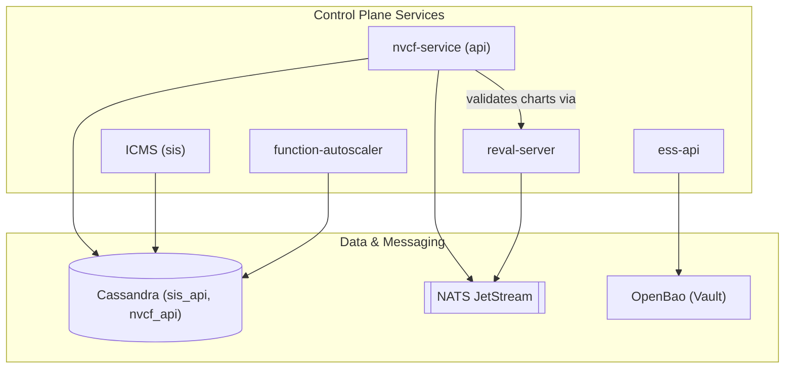
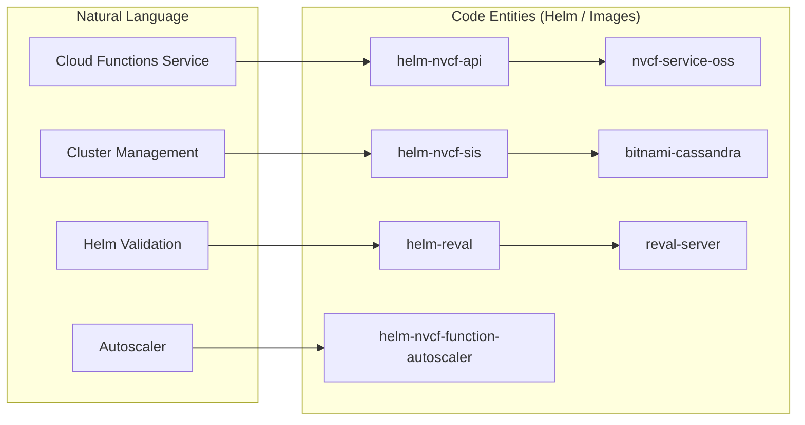

<!-- source: DeepWiki mcp.deepwiki.com · repo NVIDIA/nvcf · page 2 Control Plane Services · fetched 2026-10-26 -->

# Control Plane Services

Relevant source files

The following files were used as context for generating this wiki page:

- [deploy/helm/nvca-operator/nvca-operator/Chart.yaml](deploy/helm/nvca-operator/nvca-operator/Chart.yaml)
- [deploy/helm/nvca-operator/nvca-operator/templates/cluster-validator-network-checks-cm.yaml](deploy/helm/nvca-operator/nvca-operator/templates/cluster-validator-network-checks-cm.yaml)
- [deploy/helm/nvca-operator/nvca-operator/templates/cronjob.yaml](deploy/helm/nvca-operator/nvca-operator/templates/cronjob.yaml)
- [deploy/helm/nvca-operator/nvca-operator/templates/rbac.yaml](deploy/helm/nvca-operator/nvca-operator/templates/rbac.yaml)
- [deploy/stacks/self-managed/Makefile.dist](deploy/stacks/self-managed/Makefile.dist)
- [deploy/stacks/self-managed/environments/base.yaml](deploy/stacks/self-managed/environments/base.yaml)
- [deploy/stacks/self-managed/global.yaml.gotmpl](deploy/stacks/self-managed/global.yaml.gotmpl)
- [deploy/stacks/self-managed/helmfile-docker.mk](deploy/stacks/self-managed/helmfile-docker.mk)
- [deploy/stacks/self-managed/helmfile.d/01-dependencies.yaml.gotmpl](deploy/stacks/self-managed/helmfile.d/01-dependencies.yaml.gotmpl)
- [deploy/stacks/self-managed/helmfile.d/02-core.yaml.gotmpl](deploy/stacks/self-managed/helmfile.d/02-core.yaml.gotmpl)
- [deploy/stacks/self-managed/helmfile.d/03-observability.yaml.gotmpl](deploy/stacks/self-managed/helmfile.d/03-observability.yaml.gotmpl)
- [deploy/stacks/self-managed/secrets/secrets.yaml.template](deploy/stacks/self-managed/secrets/secrets.yaml.template)
- [docs/user/cluster-management/nsight-profiling.md](docs/user/cluster-management/nsight-profiling.md)
- [docs/user/cluster-management/self-managed.md](docs/user/cluster-management/self-managed.md)
- [docs/user/image-mirroring.md](docs/user/image-mirroring.md)
- [docs/user/manifest.md](docs/user/manifest.md)
- [docs/version-catalog/main.yaml](docs/version-catalog/main.yaml)
- [tools/docs-version-sync/catalog.go](tools/docs-version-sync/catalog.go)
- [tools/docs-version-sync/inline.go](tools/docs-version-sync/inline.go)
- [tools/docs-version-sync/main_test.go](tools/docs-version-sync/main_test.go)
- [tools/docs-version-sync/render.go](tools/docs-version-sync/render.go)

The NVCF Control Plane is a collection of microservices responsible for managing the lifecycle of functions, handling cluster registrations, managing secrets, and coordinating autoscaling across the Compute Plane. These services provide the administrative and operational APIs that allow users to deploy workloads and operators to manage infrastructure.

## Service Catalog Overview

The Control Plane is composed of several specialized services, most of which are deployed via Helm charts defined in the `deploy/helm/` directory and orchestrated using the `02-core.yaml.gotmpl` Helmfile stack [deploy/stacks/self-managed/helmfile.d/02-core.yaml.gotmpl:43-211]().

### Core Management Services
*   **Cloud Functions Service (`nvcf-service` / `api`)**: The central orchestrator for function versions, deployments, and state.
*   **Instance and Cluster Management Service (ICMS / `sis`)**: Manages GPU cluster registrations and identity providers.
*   **Helm Revalidation Service (`reval`)**: A Go-based service that validates and templates Helm charts before they are deployed to GPU clusters.
*   **Tenant API (`nvct-api`)**: Handles tenant-scoped operations and metadata.

### Security and Supporting Services
*   **API Keys Service**: Manages the lifecycle of NVCF API keys used for authentication.
*   **Encrypted Secret Store (ESS)**: Provides secure, tenant-scoped secret management for function workloads.
*   **NATS Auth Callout**: Handles authorization for the NATS JetStream messaging backbone.
*   **Notary Service**: Responsible for signing and validating artifacts.

### Operational Services
*   **Function Autoscaler**: A Rust-based service that monitors demand and adjusts the number of active function instances.
*   **State Metrics**: Exports real-time function information for Prometheus scraping [deploy/stacks/self-managed/helmfile.d/03-observability.yaml.gotmpl:60-68]().

## System Interaction Diagram

The following diagram illustrates how the primary Control Plane services interact with the shared data and messaging layers.

### Control Plane Service Architecture

**Sources:** [deploy/stacks/self-managed/helmfile.d/02-core.yaml.gotmpl:43-153](), [deploy/stacks/self-managed/environments/base.yaml:146-188]()

## Code Entity Mapping

This diagram maps the high-level service names to their specific Helm releases and container image identifiers used in the codebase.

### Service to Code Entity Mapping

**Sources:** [docs/version-catalog/main.yaml:49-113](), [deploy/stacks/self-managed/helmfile.d/02-core.yaml.gotmpl:46-153]()

## Deployment Dependencies

The Control Plane services rely on a foundation of "Dependency" services (NATS, Cassandra, OpenBao) that must be healthy before core logic services start.

| Service Group | Components | Purpose |
| :--- | :--- | :--- |
| **Dependencies** | `nats`, `cassandra`, `openbao-server`, `cert-manager` | Foundational data, messaging, and security layers [deploy/stacks/self-managed/helmfile.d/01-dependencies.yaml.gotmpl:44-72](). |
| **Core Services** | `api`, `sis`, `nvct-api`, `reval`, `ess-api` | Primary business logic for function and cluster management [deploy/stacks/self-managed/helmfile.d/02-core.yaml.gotmpl:46-153](). |
| **Observability** | `state-metrics`, `function-autoscaler` | Monitoring and dynamic scaling of workloads [deploy/stacks/self-managed/helmfile.d/03-observability.yaml.gotmpl:57-78](). |

**Sources:** [deploy/stacks/self-managed/helmfile.d/01-dependencies.yaml.gotmpl:1-72](), [deploy/stacks/self-managed/helmfile.d/02-core.yaml.gotmpl:1-228]()

---

## Child Pages

For detailed technical documentation on specific service groups, refer to the following pages:

*   **[Cloud Functions Service (nvcf-service)](#2.1)**: Core Java/Spring Boot service for function lifecycle.
*   **[Instance and Cluster Management Service (ICMS)](#2.2)**: GPU cluster registration and OIDC management.
*   **[Helm Revalidation Service (helm-reval)](#2.3)**: Secure Helm chart templating and validation.
*   **[API Keys, ESS, and Supporting Services](#2.4)**: Secret management, API keys, and NATS authorization.
*   **[Function Autoscaler](#2.5)**: Rust-based scaling logic driven by PromQL metrics.

---

