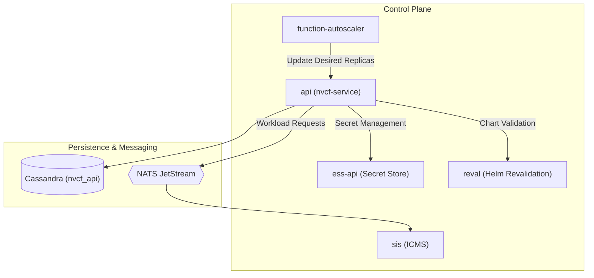

<!-- source: DeepWiki mcp.deepwiki.com · repo NVIDIA/nvcf · page 2.1 Cloud Functions Service (nvcf-service) · fetched 2026-10-26 -->

# Cloud Functions Service (nvcf-service)

<details>
<summary>Relevant source files</summary>

The following files were used as context for generating this wiki page:

- [.bazelignore](.bazelignore)
- [.bazelrc](.bazelrc)
- [.bazelversion](.bazelversion)
- [MODULE.bazel](MODULE.bazel)
- [MODULE.bazel.lock](MODULE.bazel.lock)
- [deploy/stacks/self-managed/Makefile.dist](deploy/stacks/self-managed/Makefile.dist)
- [deploy/stacks/self-managed/environments/base.yaml](deploy/stacks/self-managed/environments/base.yaml)
- [deploy/stacks/self-managed/global.yaml.gotmpl](deploy/stacks/self-managed/global.yaml.gotmpl)
- [deploy/stacks/self-managed/helmfile-docker.mk](deploy/stacks/self-managed/helmfile-docker.mk)
- [deploy/stacks/self-managed/helmfile.d/01-dependencies.yaml.gotmpl](deploy/stacks/self-managed/helmfile.d/01-dependencies.yaml.gotmpl)
- [deploy/stacks/self-managed/helmfile.d/02-core.yaml.gotmpl](deploy/stacks/self-managed/helmfile.d/02-core.yaml.gotmpl)
- [deploy/stacks/self-managed/helmfile.d/03-observability.yaml.gotmpl](deploy/stacks/self-managed/helmfile.d/03-observability.yaml.gotmpl)
- [deploy/stacks/self-managed/secrets/secrets.yaml.template](deploy/stacks/self-managed/secrets/secrets.yaml.template)
- [maven_install.json](maven_install.json)
- [migrations/cassandra/README.md](migrations/cassandra/README.md)
- [migrations/cassandra/execute_sqls.sh](migrations/cassandra/execute_sqls.sh)
- [migrations/cassandra/keyspaces/README.md](migrations/cassandra/keyspaces/README.md)
- [migrations/cassandra/keyspaces/api_keys_api/01_init_keyspace.up.sql](migrations/cassandra/keyspaces/api_keys_api/01_init_keyspace.up.sql)
- [migrations/cassandra/keyspaces/ess_api/01_init_keyspace.up.sql](migrations/cassandra/keyspaces/ess_api/01_init_keyspace.up.sql)
- [migrations/cassandra/keyspaces/event_ledger/01_init_keyspace.up.sql](migrations/cassandra/keyspaces/event_ledger/01_init_keyspace.up.sql)
- [migrations/cassandra/keyspaces/event_ledger/02_init_roles.up.sql](migrations/cassandra/keyspaces/event_ledger/02_init_roles.up.sql)
- [migrations/cassandra/keyspaces/event_ledger/03_init_tables.up.sql](migrations/cassandra/keyspaces/event_ledger/03_init_tables.up.sql)
- [migrations/cassandra/keyspaces/nvcf_api/01_init_keyspace.up.sql](migrations/cassandra/keyspaces/nvcf_api/01_init_keyspace.up.sql)
- [migrations/cassandra/keyspaces/nvcf_api/03_init_tables.up.sql](migrations/cassandra/keyspaces/nvcf_api/03_init_tables.up.sql)
- [migrations/cassandra/keyspaces/nvcf_api/07_drop_gpu_spec.up.sql](migrations/cassandra/keyspaces/nvcf_api/07_drop_gpu_spec.up.sql)
- [migrations/cassandra/keyspaces/nvcf_api/08_add_llm_config.up.sql](migrations/cassandra/keyspaces/nvcf_api/08_add_llm_config.up.sql)
- [migrations/cassandra/keyspaces/sis_api/01_init_keyspace.up.sql](migrations/cassandra/keyspaces/sis_api/01_init_keyspace.up.sql)
- [migrations/cassandra/keyspaces/sis_api/06_add_cluster_auth_client_id.up.sql](migrations/cassandra/keyspaces/sis_api/06_add_cluster_auth_client_id.up.sql)
- [src/control-plane-services/helm-reval/go.mod](src/control-plane-services/helm-reval/go.mod)
- [src/control-plane-services/helm-reval/go.sum](src/control-plane-services/helm-reval/go.sum)
- [src/control-plane-services/helm-reval/pkg/reval/config/config.go](src/control-plane-services/helm-reval/pkg/reval/config/config.go)
- [src/control-plane-services/helm-reval/pkg/reval/service/models.go](src/control-plane-services/helm-reval/pkg/reval/service/models.go)
- [src/control-plane-services/helm-reval/pkg/reval/service/service.go](src/control-plane-services/helm-reval/pkg/reval/service/service.go)
- [src/control-plane-services/helm-reval/reval/BUILD.bazel](src/control-plane-services/helm-reval/reval/BUILD.bazel)
- [src/control-plane-services/helm-reval/reval/helm_template.go](src/control-plane-services/helm-reval/reval/helm_template.go)
- [src/control-plane-services/helm-reval/reval/helm_template_test.go](src/control-plane-services/helm-reval/reval/helm_template_test.go)
- [src/control-plane-services/helm-reval/reval/run.go](src/control-plane-services/helm-reval/reval/run.go)
- [src/control-plane-services/helm-reval/reval/run_test.go](src/control-plane-services/helm-reval/reval/run_test.go)
- [src/control-plane-services/instance-cluster-management/BAZEL.md](src/control-plane-services/instance-cluster-management/BAZEL.md)
- [src/control-plane-services/instance-cluster-management/icms-core/BUILD.bazel](src/control-plane-services/instance-cluster-management/icms-core/BUILD.bazel)
- [tools/bazel/BUILD.bazel](tools/bazel/BUILD.bazel)
- [tools/bazel/patches/gazelle_go_work_dev_dependency.patch](tools/bazel/patches/gazelle_go_work_dev_dependency.patch)
- [tools/ci/check-oci-pins](tools/ci/check-oci-pins)

</details>


The Cloud Functions Service (internally referred to as `nvcf-service` or `api`) is the primary Control Plane component responsible for managing the lifecycle of functions, deployments, and account-level resources. It provides the RESTful interface for users to create and manage workloads and integrates with NATS for asynchronous communication with the Compute Plane.

## Service Overview

The `nvcf-service` is a Java Spring Boot application that serves as the central orchestrator for NVIDIA Cloud Functions. It manages metadata for functions, versions, deployments, and account quotas. It interacts with the Instance and Cluster Management Service (ICMS) to bridge the Control Plane's desired state with the Compute Plane's actual resources.

### Key Responsibilities
*   **Function Lifecycle Management:** Handles creation, versioning, and deletion of functions (Container and Helm-based) [migrations/cassandra/keyspaces/nvcf_api/03_init_tables.up.sql:73-102]().
*   **Deployment Orchestration:** Manages `functions_deployment_v2` and `gpu_specifications` to define how and where functions should run [migrations/cassandra/keyspaces/nvcf_api/03_init_tables.up.sql:114-150]().
*   **Account & Quota Management:** Tracks `nca_id` (NVIDIA Cloud Account) limits for functions, tasks, and telemetries [migrations/cassandra/keyspaces/nvcf_api/03_init_tables.up.sql:48-59]().
*   **Compute Plane Integration:** Issues requests to ICMS via NATS to trigger workload deployments on GPU clusters [deploy/stacks/self-managed/helmfile.d/02-core.yaml.gotmpl:58-65]().

**Sources:** [deploy/stacks/self-managed/helmfile.d/02-core.yaml.gotmpl:58-65](), [migrations/cassandra/keyspaces/nvcf_api/03_init_tables.up.sql:1-192]()

---

## Architecture and Data Flow

The service follows a standard Spring Boot architecture, utilizing a Cassandra backend for persistent state and NATS JetStream for event-driven orchestration.

### System Interaction Diagram
This diagram shows how `nvcf-service` (labeled as `api` in the codebase) interacts with other Control Plane components.


**Sources:** [deploy/stacks/self-managed/helmfile.d/02-core.yaml.gotmpl:52-106](), [deploy/stacks/self-managed/helmfile.d/03-observability.yaml.gotmpl:70-77]()

---

## Data Model (Cassandra)

The service utilizes the `nvcf_api` keyspace. The schema is designed for high-throughput metadata management and tracking deployment status across distributed backends.

### Primary Tables

| Table | Purpose | Key Columns |
| :--- | :--- | :--- |
| `accounts` | Provisions customer/partner accounts and defines limits. | `nca_id`, `max_functions_allowed` |
| `functions_v3` | The primary store for function versions, including container images and Helm charts. | `function_id`, `function_version_id`, `nca_id` |
| `functions_deployment_v2` | Tracks the deployment state and health of a specific function version. | `function_version_id`, `deployment_id` |
| `gpu_specifications` | Defines hardware requirements (GPU type, min/max instances) per deployment. | `gpu_specification_id`, `nca_id`, `backend` |
| `sis_requests_by_function_v2` | Tracks active SIS (ICMS) requests for deployment orchestration. | `function_version_id`, `sis_request_id` |

### User-Defined Types (UDTs)
The schema utilizes several UDTs to handle complex configurations:
*   `ratelimit_udt_v2`: Manages per-NCA and per-user rate limits [migrations/cassandra/keyspaces/nvcf_api/03_init_tables.up.sql:29-35]().
*   `health_udt`: Defines liveness/readiness probe protocols and ports [migrations/cassandra/keyspaces/nvcf_api/03_init_tables.up.sql:21-27]().
*   `resource_udt`: Tracks external resources (URLs/versions) associated with a function [migrations/cassandra/keyspaces/nvcf_api/03_init_tables.up.sql:7-11]().

**Sources:** [migrations/cassandra/keyspaces/nvcf_api/03_init_tables.up.sql:7-169]()

---

## Implementation Details

### Module Structure
The service is built using the `nv-boot` framework, a custom Spring Boot starter provided in `src/libraries/java/`.
*   **nvcf-core:** Contains shared business logic, data models, and Cassandra repositories used across control plane Java services.
*   **nvcf-service:** The main Spring Boot application containing REST controllers and NATS publishers.

### Build System (Bazel)
The Java components are built using Bazel, pinning to **Java 25** and using the `local_jdk` runtime [.bazelrc:78-82]().
*   Dependency management is handled via `rules_jvm_external` and documented in `maven_install.json` [maven_install.json:1-123]().
*   Lombok is supported, but requires `java_header_compilation=false` due to compatibility issues with Bazel's Turbine compiler [.bazelrc:82]().

### Local Development Setup
For local development, the service can be run against a k3d cluster managed by `nvcf-cli`.
1.  **Dependencies:** Requires Cassandra and NATS to be running. These are typically deployed in the `cassandra-system` and `nats-system` namespaces [deploy/stacks/self-managed/helmfile.d/01-dependencies.yaml.gotmpl:47-72]().
2.  **Configuration:** Service endpoints are injected via environment variables such as `NVCF_FQDN` and `NVCF_FQDN_NATS` [deploy/stacks/self-managed/environments/base.yaml:52-58]().
3.  **Migrations:** Cassandra schemas are applied using the `nvcf-cassandra-migrations` image, which executes SQL files in `migrations/cassandra/keyspaces/nvcf_api/` [deploy/stacks/self-managed/global.yaml.gotmpl:51-54]().

**Sources:** [.bazelrc:78-82](), [deploy/stacks/self-managed/helmfile.d/01-dependencies.yaml.gotmpl:47-72](), [deploy/stacks/self-managed/environments/base.yaml:52-58]()

---

## Deployment Configuration

The service is deployed via Helm using the `nvcf/helm-nvcf-api` chart [deploy/stacks/self-managed/helmfile.d/02-core.yaml.gotmpl:58-62]().

### Helm Release Definition
```yaml
  - name: api
    version: 1.23.9
    namespace: nvcf
    inherit:
      - template: service
    needs:
      - ess/ess-api
```
The service depends on `ess-api` for bootstrapping account secrets [deploy/stacks/self-managed/helmfile.d/02-core.yaml.gotmpl:63-65]().

### Resource Presets
In self-managed environments, Cassandra (the primary backend) is configured with the `xlarge` resource preset (1 CPU, 3072Mi memory request) to prevent OOM errors during migration [deploy/stacks/self-managed/environments/base.yaml:173-187]().

**Sources:** [deploy/stacks/self-managed/helmfile.d/02-core.yaml.gotmpl:58-65](), [deploy/stacks/self-managed/environments/base.yaml:173-187]()

---

