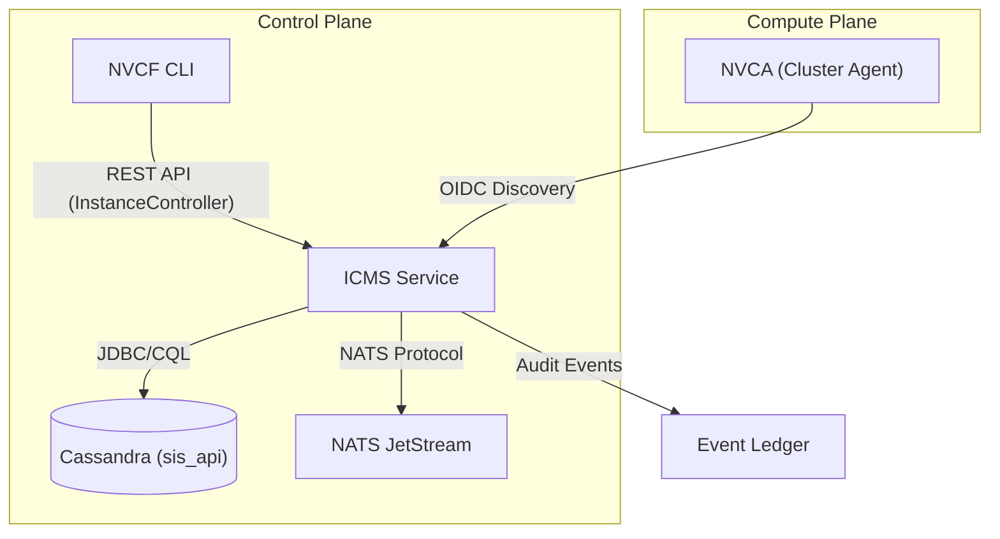
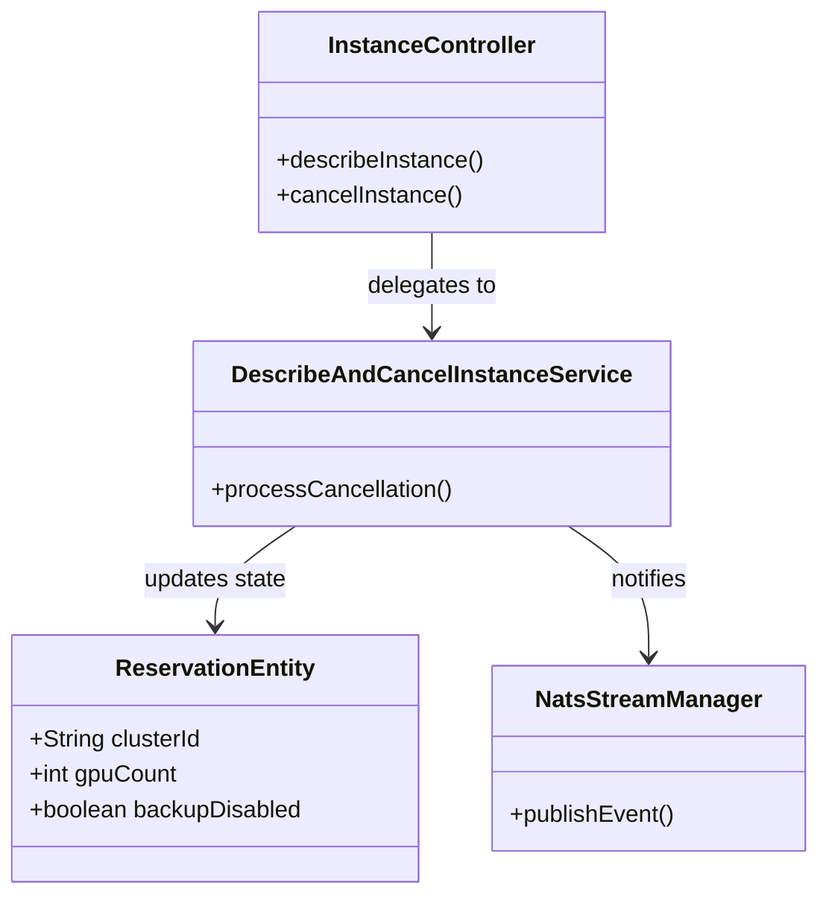

<!-- source: DeepWiki mcp.deepwiki.com · repo NVIDIA/nvcf · page 2.2 Instance and Cluster Management Service (ICMS) · fetched 2026-10-26 -->

# Instance and Cluster Management Service (ICMS)

<details>
<summary>Relevant source files</summary>

The following files were used as context for generating this wiki page:

- [.bazelignore](.bazelignore)
- [.bazelrc](.bazelrc)
- [.bazelversion](.bazelversion)
- [MODULE.bazel](MODULE.bazel)
- [MODULE.bazel.lock](MODULE.bazel.lock)
- [maven_install.json](maven_install.json)
- [migrations/cassandra/keyspaces/sis_api/03_init_tables.up.sql](migrations/cassandra/keyspaces/sis_api/03_init_tables.up.sql)
- [migrations/cassandra/keyspaces/sis_api/09_add_reservation_backup_disabled.up.sql](migrations/cassandra/keyspaces/sis_api/09_add_reservation_backup_disabled.up.sql)
- [src/clis/nvcf-cli/cmd/cluster_registration_test.go](src/clis/nvcf-cli/cmd/cluster_registration_test.go)
- [src/clis/nvcf-cli/cmd/cluster_utils.go](src/clis/nvcf-cli/cmd/cluster_utils.go)
- [src/control-plane-services/helm-reval/go.mod](src/control-plane-services/helm-reval/go.mod)
- [src/control-plane-services/helm-reval/go.sum](src/control-plane-services/helm-reval/go.sum)
- [src/control-plane-services/helm-reval/pkg/reval/config/config.go](src/control-plane-services/helm-reval/pkg/reval/config/config.go)
- [src/control-plane-services/helm-reval/pkg/reval/service/models.go](src/control-plane-services/helm-reval/pkg/reval/service/models.go)
- [src/control-plane-services/helm-reval/pkg/reval/service/service.go](src/control-plane-services/helm-reval/pkg/reval/service/service.go)
- [src/control-plane-services/helm-reval/reval/BUILD.bazel](src/control-plane-services/helm-reval/reval/BUILD.bazel)
- [src/control-plane-services/helm-reval/reval/helm_template.go](src/control-plane-services/helm-reval/reval/helm_template.go)
- [src/control-plane-services/helm-reval/reval/helm_template_test.go](src/control-plane-services/helm-reval/reval/helm_template_test.go)
- [src/control-plane-services/helm-reval/reval/run.go](src/control-plane-services/helm-reval/reval/run.go)
- [src/control-plane-services/helm-reval/reval/run_test.go](src/control-plane-services/helm-reval/reval/run_test.go)
- [src/control-plane-services/instance-cluster-management/BAZEL.md](src/control-plane-services/instance-cluster-management/BAZEL.md)
- [src/control-plane-services/instance-cluster-management/icms-core/BUILD.bazel](src/control-plane-services/instance-cluster-management/icms-core/BUILD.bazel)
- [src/control-plane-services/instance-cluster-management/icms-core/src/main/java/com/nvidia/icms/inbound/rest/controllers/InstanceController.java](src/control-plane-services/instance-cluster-management/icms-core/src/main/java/com/nvidia/icms/inbound/rest/controllers/InstanceController.java)
- [src/control-plane-services/instance-cluster-management/icms-core/src/main/java/com/nvidia/icms/inbound/rest/model/cluster/GpuReservation.java](src/control-plane-services/instance-cluster-management/icms-core/src/main/java/com/nvidia/icms/inbound/rest/model/cluster/GpuReservation.java)
- [src/control-plane-services/instance-cluster-management/icms-core/src/main/java/com/nvidia/icms/outbound/cassandra/reservation/entity/ReservationEntity.java](src/control-plane-services/instance-cluster-management/icms-core/src/main/java/com/nvidia/icms/outbound/cassandra/reservation/entity/ReservationEntity.java)
- [src/control-plane-services/instance-cluster-management/icms-core/src/main/java/com/nvidia/icms/service/DescribeAndCancelInstanceService.java](src/control-plane-services/instance-cluster-management/icms-core/src/main/java/com/nvidia/icms/service/DescribeAndCancelInstanceService.java)
- [src/control-plane-services/instance-cluster-management/icms-core/src/main/java/com/nvidia/icms/service/internal/ReservationCapacityValidationHelper.java](src/control-plane-services/instance-cluster-management/icms-core/src/main/java/com/nvidia/icms/service/internal/ReservationCapacityValidationHelper.java)
- [src/control-plane-services/instance-cluster-management/icms-core/src/test/java/com/nvidia/icms/inbound/rest/controllers/InstanceControllerTest.java](src/control-plane-services/instance-cluster-management/icms-core/src/test/java/com/nvidia/icms/inbound/rest/controllers/InstanceControllerTest.java)
- [src/control-plane-services/instance-cluster-management/icms-core/src/test/java/com/nvidia/icms/integration/IcmsTest.java](src/control-plane-services/instance-cluster-management/icms-core/src/test/java/com/nvidia/icms/integration/IcmsTest.java)
- [src/control-plane-services/instance-cluster-management/icms-core/src/test/java/com/nvidia/icms/outbound/cassandra/reservation/entity/ReservationEntityTest.java](src/control-plane-services/instance-cluster-management/icms-core/src/test/java/com/nvidia/icms/outbound/cassandra/reservation/entity/ReservationEntityTest.java)
- [src/control-plane-services/instance-cluster-management/icms-core/src/test/java/com/nvidia/icms/outbound/nats/NatsStreamManagerTest.java](src/control-plane-services/instance-cluster-management/icms-core/src/test/java/com/nvidia/icms/outbound/nats/NatsStreamManagerTest.java)
- [tools/bazel/BUILD.bazel](tools/bazel/BUILD.bazel)
- [tools/bazel/patches/gazelle_go_work_dev_dependency.patch](tools/bazel/patches/gazelle_go_work_dev_dependency.patch)
- [tools/ci/check-oci-pins](tools/ci/check-oci-pins)

</details>


The Instance and Cluster Management Service (ICMS) is a core Control Plane service responsible for the lifecycle management of compute clusters and GPU reservations within NVIDIA Cloud Functions (NVCF). It serves as the source of truth for cluster registration, OIDC/JWKS security metadata, and the inventory of available GPU resources.

## Service Overview

ICMS is a Java-based application built on the `nv-boot` Spring Boot framework [src/control-plane-services/instance-cluster-management/icms-core/BUILD.bazel:15-22](). It manages the state of compute clusters and their associated GPU capacities, providing a REST API for the NVCF CLI and other control plane components to query and reserve resources.

### Key Responsibilities
*   **Cluster Registration:** Handling the onboarding of new compute clusters, including OIDC discovery and JWKS tracking for secure communication [src/clis/nvcf-cli/cmd/cluster_registration_test.go:38-55]().
*   **GPU Reservation Management:** Tracking and enforcing GPU quotas and reservations across different cluster groups [src/control-plane-services/instance-cluster-management/icms-core/src/main/java/com/nvidia/icms/service/internal/ReservationCapacityValidationHelper.java:1-5]().
*   **Instance Controller API:** Providing REST endpoints for managing function instances and their deployment state [src/control-plane-services/instance-cluster-management/icms-core/src/main/java/com/nvidia/icms/inbound/rest/controllers/InstanceController.java:1-5]().
*   **Persistence:** Utilizing Cassandra (`sis_api` keyspace) for storing cluster metadata and reservation state [src/control-plane-services/instance-cluster-management/icms-core/BUILD.bazel:16]().
*   **Messaging:** Integrating with NATS for event streaming and inter-service notifications [src/control-plane-services/instance-cluster-management/icms-core/src/test/java/com/nvidia/icms/outbound/nats/NatsStreamManagerTest.java:1-5]().

Sources: [src/control-plane-services/instance-cluster-management/icms-core/BUILD.bazel:1-110](), [src/control-plane-services/instance-cluster-management/BAZEL.md:1-183](), [src/clis/nvcf-cli/cmd/cluster_registration_test.go:38-55]()

## Architecture and Data Flow

ICMS operates as a multi-module Java project consisting of `icms-core` (business logic, entities, and repositories) and `icms-service` (the executable Spring Boot application) [src/control-plane-services/instance-cluster-management/BAZEL.md:3-6]().

### Component Interaction Diagram
This diagram illustrates how ICMS interacts with external entities and internal storage.


Sources: [src/control-plane-services/instance-cluster-management/icms-core/src/main/java/com/nvidia/icms/inbound/rest/controllers/InstanceController.java:1-5](), [src/control-plane-services/instance-cluster-management/icms-core/BUILD.bazel:15-18](), [src/clis/nvcf-cli/cmd/cluster_registration_test.go:143-161]()

## Cluster Registration and Security

A critical function of ICMS is the secure registration of clusters. This involves discovering the cluster's OIDC (OpenID Connect) configuration to validate tokens issued by the cluster-side agents (NVCA).

### OIDC Discovery Flow
When a cluster is registered via `nvcf-cli`, ICMS performs the following steps:
1.  **Discovery:** Fetches the `.well-known/openid-configuration` from the cluster's issuer URL [src/clis/nvcf-cli/cmd/cluster_registration_test.go:143-151]().
2.  **JWKS Retrieval:** Extracts the `jwks_uri` to fetch the public keys used for signing tokens [src/clis/nvcf-cli/cmd/cluster_registration_test.go:152-161]().
3.  **Validation:** Ensures the issuer in the discovery document matches the requested issuer [src/clis/nvcf-cli/cmd/cluster_registration_test.go:183-201]().

### Code Entity Mapping: Registration
| Logic | Code Entity |
| :--- | :--- |
| REST Controller | `InstanceController` [src/control-plane-services/instance-cluster-management/icms-core/src/main/java/com/nvidia/icms/inbound/rest/controllers/InstanceController.java:1-5]() |
| Reservation Logic | `DescribeAndCancelInstanceService` [src/control-plane-services/instance-cluster-management/icms-core/src/main/java/com/nvidia/icms/service/DescribeAndCancelInstanceService.java:1-5]() |
| Capacity Validation | `ReservationCapacityValidationHelper` [src/control-plane-services/instance-cluster-management/icms-core/src/main/java/com/nvidia/icms/service/internal/ReservationCapacityValidationHelper.java:1-5]() |

Sources: [src/clis/nvcf-cli/cmd/cluster_registration_test.go:1-205](), [src/control-plane-services/instance-cluster-management/icms-core/src/main/java/com/nvidia/icms/inbound/rest/controllers/InstanceController.java:1-5]()

## Data Model (Cassandra sis_api)

ICMS persists cluster and reservation data in the `sis_api` keyspace. The schema is managed via migrations located in `migrations/cassandra/keyspaces/sis_api/` [migrations/cassandra/keyspaces/sis_api/03_init_tables.up.sql:1-5]().

### Key Entities
*   **ReservationEntity:** Tracks GPU reservations, including cluster IDs, GPU types, and counts [src/control-plane-services/instance-cluster-management/icms-core/src/main/java/com/nvidia/icms/outbound/cassandra/reservation/entity/ReservationEntity.java:1-5]().
*   **Cluster Metadata:** Stores OIDC issuer URLs and JWKS data for registered compute backends.

### Reservation Schema Updates
The schema supports advanced reservation features, such as disabling backup reservations:
*   **Field:** `reservation_backup_disabled` added to the reservation table [migrations/cassandra/keyspaces/sis_api/09_add_reservation_backup_disabled.up.sql:1-5]().

Sources: [src/control-plane-services/instance-cluster-management/icms-core/src/main/java/com/nvidia/icms/outbound/cassandra/reservation/entity/ReservationEntity.java:1-5](), [migrations/cassandra/keyspaces/sis_api/09_add_reservation_backup_disabled.up.sql:1-5]()

## Implementation Details

### Build System
ICMS is built using Bazel. The build definition utilizes `nv_boot_library` for Spring Boot compatibility [src/control-plane-services/instance-cluster-management/icms-core/BUILD.bazel:1-2](). 

*   **Executable Jar:** The service is packaged as a Spring Boot executable jar named `app.jar` [src/control-plane-services/instance-cluster-management/BAZEL.md:77-83]().
*   **Integration Testing:** Tests use `Testcontainers` to orchestrate Cassandra and NATS instances during the build process [src/control-plane-services/instance-cluster-management/BAZEL.md:88-93]().

### NATS Integration
ICMS uses NATS JetStream for reliable messaging. The `NatsStreamManager` handles the creation and management of streams used to broadcast cluster status changes and reservation updates [src/control-plane-services/instance-cluster-management/icms-core/src/test/java/com/nvidia/icms/outbound/nats/NatsStreamManagerTest.java:1-5]().

### Code Entity Mapping: Core Logic

Sources: [src/control-plane-services/instance-cluster-management/icms-core/src/main/java/com/nvidia/icms/inbound/rest/controllers/InstanceController.java:1-5](), [src/control-plane-services/instance-cluster-management/icms-core/src/main/java/com/nvidia/icms/service/DescribeAndCancelInstanceService.java:1-5](), [src/control-plane-services/instance-cluster-management/icms-core/src/main/java/com/nvidia/icms/outbound/cassandra/reservation/entity/ReservationEntity.java:1-5](), [src/control-plane-services/instance-cluster-management/icms-core/src/test/java/com/nvidia/icms/outbound/nats/NatsStreamManagerTest.java:1-5]()

## Development and Testing

### Local Setup
Developers can run ICMS locally using the `local` Spring profile. This requires a local Docker environment to host the backing services defined in the `local_env` compose bundle [src/control-plane-services/instance-cluster-management/BAZEL.md:160-170]().

```bash
# Start local Cassandra and NATS
docker compose -f src/control-plane-services/instance-cluster-management/local_env/docker-compose.yml up -d

# Run ICMS with local profile
bazel run //src/control-plane-services/instance-cluster-management/icms-service:app -- --spring.profiles.active=local
```

### Integration Tests
The `IcmsTest` class provides comprehensive integration testing, covering the full flow from REST request to database persistence [src/control-plane-services/instance-cluster-management/icms-core/src/test/java/com/nvidia/icms/integration/IcmsTest.java:1-5]().

Sources: [src/control-plane-services/instance-cluster-management/BAZEL.md:88-100](), [src/control-plane-services/instance-cluster-management/icms-core/src/test/java/com/nvidia/icms/integration/IcmsTest.java:1-5]()

---

