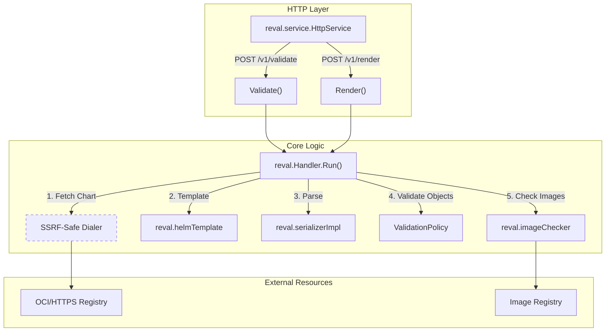
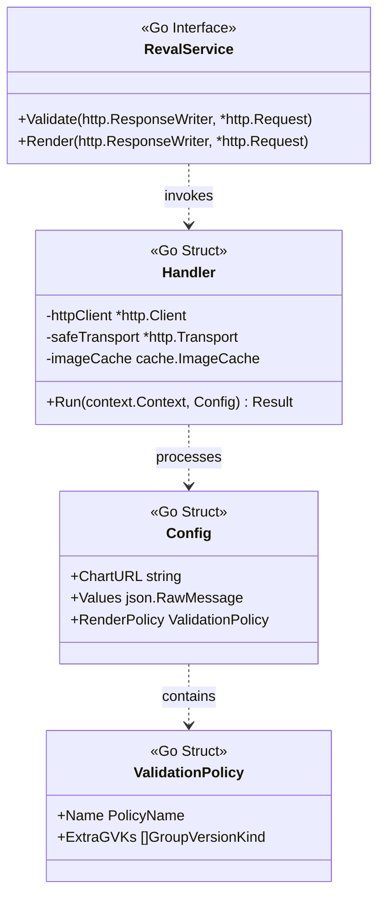

<!-- source: DeepWiki mcp.deepwiki.com · repo NVIDIA/nvcf · page 2.3 Helm Revalidation Service (helm-reval) · fetched 2026-10-26 -->

# Helm Revalidation Service (helm-reval)

Relevant source files

The following files were used as context for generating this wiki page:

- [.bazelignore](.bazelignore)
- [.bazelrc](.bazelrc)
- [.bazelversion](.bazelversion)
- [MODULE.bazel](MODULE.bazel)
- [MODULE.bazel.lock](MODULE.bazel.lock)
- [maven_install.json](maven_install.json)
- [src/control-plane-services/helm-reval/cmd/reval-service/BUILD.bazel](src/control-plane-services/helm-reval/cmd/reval-service/BUILD.bazel)
- [src/control-plane-services/helm-reval/cmd/reval-service/image_entrypoint_mode_test.sh](src/control-plane-services/helm-reval/cmd/reval-service/image_entrypoint_mode_test.sh)
- [src/control-plane-services/helm-reval/cmd/reval-service/main.go](src/control-plane-services/helm-reval/cmd/reval-service/main.go)
- [src/control-plane-services/helm-reval/cmd/reval/cli/BUILD.bazel](src/control-plane-services/helm-reval/cmd/reval/cli/BUILD.bazel)
- [src/control-plane-services/helm-reval/cmd/reval/cli/server.go](src/control-plane-services/helm-reval/cmd/reval/cli/server.go)
- [src/control-plane-services/helm-reval/cmd/reval/cli/server_internal_test.go](src/control-plane-services/helm-reval/cmd/reval/cli/server_internal_test.go)
- [src/control-plane-services/helm-reval/go.mod](src/control-plane-services/helm-reval/go.mod)
- [src/control-plane-services/helm-reval/go.sum](src/control-plane-services/helm-reval/go.sum)
- [src/control-plane-services/helm-reval/pkg/reval/config/config.go](src/control-plane-services/helm-reval/pkg/reval/config/config.go)
- [src/control-plane-services/helm-reval/pkg/reval/service/models.go](src/control-plane-services/helm-reval/pkg/reval/service/models.go)
- [src/control-plane-services/helm-reval/pkg/reval/service/service.go](src/control-plane-services/helm-reval/pkg/reval/service/service.go)
- [src/control-plane-services/helm-reval/reval/BUILD.bazel](src/control-plane-services/helm-reval/reval/BUILD.bazel)
- [src/control-plane-services/helm-reval/reval/helm_template.go](src/control-plane-services/helm-reval/reval/helm_template.go)
- [src/control-plane-services/helm-reval/reval/helm_template_test.go](src/control-plane-services/helm-reval/reval/helm_template_test.go)
- [src/control-plane-services/helm-reval/reval/run.go](src/control-plane-services/helm-reval/reval/run.go)
- [src/control-plane-services/helm-reval/reval/run_test.go](src/control-plane-services/helm-reval/reval/run_test.go)
- [src/control-plane-services/instance-cluster-management/BAZEL.md](src/control-plane-services/instance-cluster-management/BAZEL.md)
- [src/control-plane-services/instance-cluster-management/icms-core/BUILD.bazel](src/control-plane-services/instance-cluster-management/icms-core/BUILD.bazel)
- [tools/bazel/BUILD.bazel](tools/bazel/BUILD.bazel)
- [tools/bazel/patches/gazelle_go_work_dev_dependency.patch](tools/bazel/patches/gazelle_go_work_dev_dependency.patch)
- [tools/ci/check-oci-pins](tools/ci/check-oci-pins)

The Helm Revalidation Service (`helm-reval`) is a Go-based microservice within the NVCF Control Plane responsible for the secure acquisition, templating, and validation of Helm charts. It ensures that workloads intended for the Compute Plane adhere to security policies, contain valid Kubernetes manifests, and reference accessible container images before they are deployed as `MiniService` or `NVCFBackend` resources.

## Service Architecture and Pipeline

`helm-reval` operates as a stateless validation engine. It exposes a REST API used primarily by `nvcf-service` and the `MiniService` controller to verify that a function's deployment artifacts are sound.

### Chart Acquisition and Validation Flow

The service implements a multi-stage pipeline for processing Helm charts:
1.  **Acquisition**: Fetches charts from remote HTTPS or OCI registries using an SSRF-safe dialer.
2.  **Rendering**: Templates the chart using provided values via the Helm SDK.
3.  **Manifest Validation**: Parses the resulting YAML into Kubernetes objects and validates them against specific `ValidationPolicy` sets.
4.  **Image Verification**: Extracts image references from the manifests and checks their existence/accessibility in remote registries.

### Data Flow Diagram

The following diagram illustrates the internal processing flow when a request hits the `/v1/validate` or `/v1/render` endpoints.

**Internal ReVal Processing Pipeline**

Sources: [src/control-plane-services/helm-reval/pkg/reval/service/service.go:151-152](), [src/control-plane-services/helm-reval/reval/run.go:74-88](), [src/control-plane-services/helm-reval/reval/run.go:209-225]()

## Key Implementation Details

### SSRF-Safe Dialer
To prevent Server-Side Request Forgery (SSRF), `helm-reval` uses a custom `net.Dialer` that validates destination IP addresses before establishing a connection. It explicitly blocks access to loopback addresses, link-local addresses, and private network ranges (RFC1918) unless specifically configured otherwise. This dialer is used for both chart downloads and OCI registry interactions.

Sources: [src/control-plane-services/helm-reval/reval/run.go:209-232]()

### Validation Policies
The service supports two primary levels of validation defined in `reval.ValidationPolicy`:
*   **Default Policy**: Applies strict checks, ensuring that only a subset of allowed Kubernetes Kind/GVKs (e.g., `Deployment`, `Service`, `ConfigMap`) are present in the chart.
*   **Unrestricted Policy**: Allows a broader set of Kubernetes resources, typically used for internal or trusted system components.

Sources: [src/control-plane-services/helm-reval/reval/run.go:136-147]()

### Image Checker
The `imageChecker` component identifies all container images referenced in `PodSpec` fields (including init containers). It performs a "head" check against the remote registry using credentials provided in the request (`ImageRegistryAuthConfig`) to confirm the image exists and the compute plane will be able to pull it.

Sources: [src/control-plane-services/helm-reval/reval/run.go:126-127](), [src/control-plane-services/helm-reval/reval/run.go:74-88]()

## Code Entity Map

This diagram bridges the conceptual service components to their specific Go implementations.

**Entity Mapping**

Sources: [src/control-plane-services/helm-reval/pkg/reval/service/service.go:151-152](), [src/control-plane-services/helm-reval/reval/run.go:74-88](), [src/control-plane-services/helm-reval/reval/run.go:103-134]()

## API Endpoints

| Endpoint | Method | Description |
| :--- | :--- | :--- |
| `/v1/validate` | `POST` | Fetches, templates, and validates a chart against policies and image checks. Returns a `Result` object. |
| `/v1/render` | `POST` | Similar to validate, but returns the rendered Kubernetes manifests in the response. |
| `/info` | `GET` | Returns service version, git commit, and build timestamp. |
| `/healthz` | `GET` | Liveness and readiness probe (returns `OK`). |

Sources: [src/control-plane-services/helm-reval/cmd/reval/cli/server.go:151-155](), [src/control-plane-services/helm-reval/cmd/reval/cli/server.go:177-188]()

## Configuration and Deployment

`helm-reval` is configured via `viper` and environment variables. Key configuration parameters include:
*   `SkipValidateObjects`: Disables GVK-based manifest validation.
*   `SkipValidateImages`: Disables remote registry image checks.
*   `PreserveLabels` / `PreserveAnnotations`: A whitelist of metadata keys that should not be stripped during the sanitization phase.

The service is packaged as a multi-arch OCI image using Bazel's `go_oci_image` rule, based on a distroless base image for a minimal security footprint.

Sources: [src/control-plane-services/helm-reval/pkg/reval/config/config.go](), [src/control-plane-services/helm-reval/cmd/reval-service/BUILD.bazel:42-49](), [src/control-plane-services/helm-reval/cmd/reval/cli/server.go:106-112]()

---

