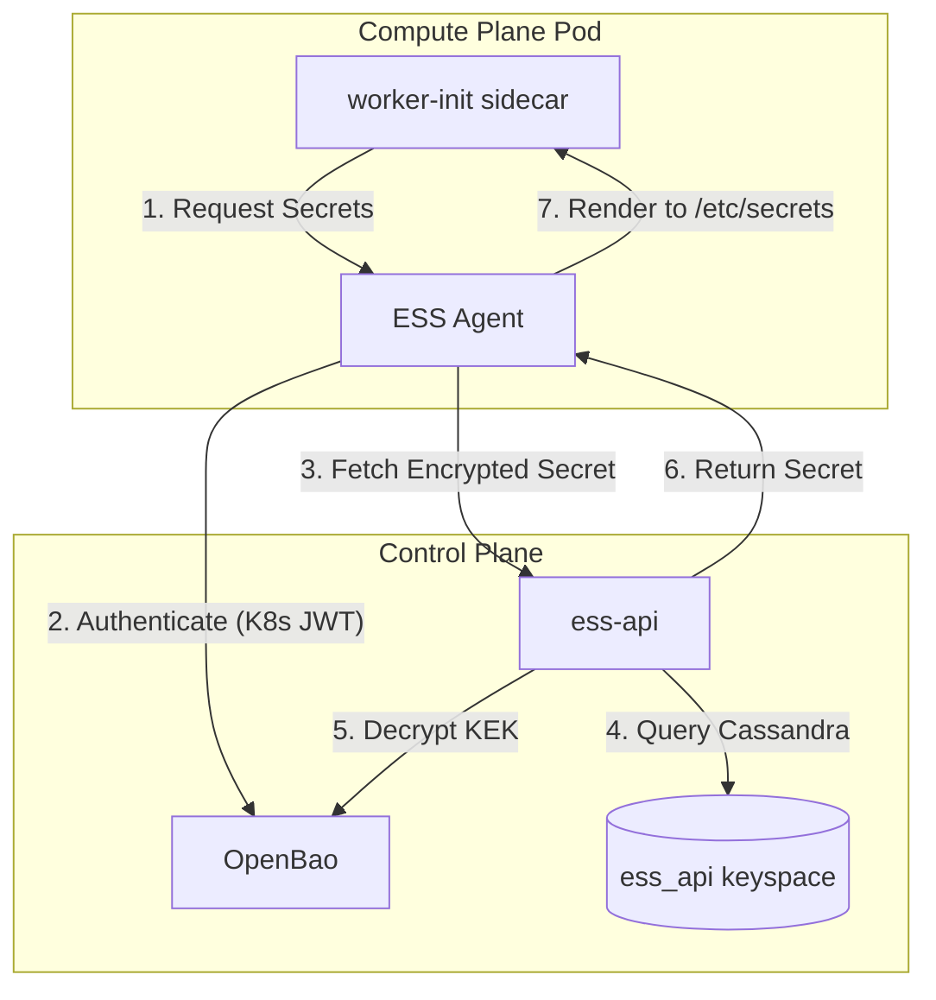

<!-- source: DeepWiki mcp.deepwiki.com · repo NVIDIA/nvcf · page 2.4 API Keys, ESS, and Supporting Services · fetched 2026-10-26 -->

# API Keys, ESS, and Supporting Services

Relevant source files

The following files were used as context for generating this wiki page:

- [deploy/helm/api-keys-colocated/api-keys/templates/deployment.yaml](deploy/helm/api-keys-colocated/api-keys/templates/deployment.yaml)
- [deploy/helm/encrypted-secret-store/ess-api/Chart.yaml](deploy/helm/encrypted-secret-store/ess-api/Chart.yaml)
- [deploy/helm/encrypted-secret-store/ess-api/values.yaml](deploy/helm/encrypted-secret-store/ess-api/values.yaml)
- [docs/v0.5/cluster-management/samples/nvca-operator-values.yaml](docs/v0.5/cluster-management/samples/nvca-operator-values.yaml)
- [docs/v0.5/cluster-management/self-managed.md](docs/v0.5/cluster-management/self-managed.md)
- [docs/v0.5/image-mirroring.md](docs/v0.5/image-mirroring.md)
- [docs/v0.5/manifest.md](docs/v0.5/manifest.md)
- [migrations/cassandra/keyspaces/ess_api/03_init_tables.up.sql](migrations/cassandra/keyspaces/ess_api/03_init_tables.up.sql)
- [migrations/cassandra/keyspaces/ess_api/04_init_ncp_namespace.up.sql](migrations/cassandra/keyspaces/ess_api/04_init_ncp_namespace.up.sql)
- [migrations/cassandra/keyspaces/ess_api/06_fix_nvcf_api_notary_issuer.up.sql](migrations/cassandra/keyspaces/ess_api/06_fix_nvcf_api_notary_issuer.up.sql)
- [migrations/cassandra/keyspaces/ess_api/07_alter_table_namespace.up.sql](migrations/cassandra/keyspaces/ess_api/07_alter_table_namespace.up.sql)
- [migrations/cassandra/keyspaces/ess_api/08_add_oauth_authorizations.up.sql](migrations/cassandra/keyspaces/ess_api/08_add_oauth_authorizations.up.sql)
- [migrations/openbao/migrations/07_setup_api-keys.sh](migrations/openbao/migrations/07_setup_api-keys.sh)
- [migrations/openbao/migrations/22_setup_event-ledger.sh](migrations/openbao/migrations/22_setup_event-ledger.sh)
- [src/clis/nvcf-cli/cmd/apikey.go](src/clis/nvcf-cli/cmd/apikey.go)
- [src/clis/nvcf-cli/cmd/apikey_test.go](src/clis/nvcf-cli/cmd/apikey_test.go)
- [src/clis/nvcf-cli/internal/apikeys/client.go](src/clis/nvcf-cli/internal/apikeys/client.go)
- [src/compute-plane-services/ess-agent/api/go.mod](src/compute-plane-services/ess-agent/api/go.mod)
- [src/compute-plane-services/ess-agent/api/go.sum](src/compute-plane-services/ess-agent/api/go.sum)
- [src/compute-plane-services/ess-agent/go.mod](src/compute-plane-services/ess-agent/go.mod)
- [src/control-plane-services/nats-auth-callout/cmd/nvcf-nats-auth-callout-service/BUILD.bazel](src/control-plane-services/nats-auth-callout/cmd/nvcf-nats-auth-callout-service/BUILD.bazel)
- [src/control-plane-services/nats-auth-callout/go.mod](src/control-plane-services/nats-auth-callout/go.mod)
- [src/control-plane-services/nats-auth-callout/go.sum](src/control-plane-services/nats-auth-callout/go.sum)
- [src/control-plane-services/nats-auth-callout/internal/router/BUILD.bazel](src/control-plane-services/nats-auth-callout/internal/router/BUILD.bazel)
- [src/control-plane-services/nats-auth-callout/internal/router/info_test.go](src/control-plane-services/nats-auth-callout/internal/router/info_test.go)
- [src/control-plane-services/nats-auth-callout/internal/router/router.go](src/control-plane-services/nats-auth-callout/internal/router/router.go)

This section documents the supporting services of the NVCF Control Plane responsible for identity, secret management, and secure communication. These include the API Keys service, the Encrypted Secret Store (ESS), the NATS Auth Callout service, the Event Ledger, and the Notary service.

## API Keys Service

The API Keys service manages the lifecycle of NVCF API keys, providing authentication for users and services. It is a Java-based service that integrates with OpenBao for key generation and Cassandra for persistence.

### Key Configuration and Provisioning
During deployment, the `openbao-migrations` job configures the API Keys service. It generates a 136-byte `data-domain-key` and registers internal services (nvcf-api, nvct-api, event-ledger) that are allowed to authenticate using these keys [migrations/openbao/migrations/07_setup_api-keys.sh:83-93]().

### API Keys CLI Integration
The `nvcf-cli` provides commands to manage API keys, including creation, listing, and revocation [src/clis/nvcf-cli/cmd/apikey.go:1-20](). The CLI communicates with the API Keys service via a dedicated client [src/clis/nvcf-cli/internal/apikeys/client.go:1-15]().

**Sources:** [migrations/openbao/migrations/07_setup_api-keys.sh:1-94](), [src/clis/nvcf-cli/cmd/apikey.go:1-20](), [src/clis/nvcf-cli/internal/apikeys/client.go:1-15]()

---

## Encrypted Secret Store (ESS)

ESS provides tenant-scoped secret management. It allows functions to access sensitive data (like API tokens or database credentials) without exposing them in the function definition.

### Architecture and Data Flow
ESS is implemented as a Spring Boot application (`ess-api`) [deploy/helm/encrypted-secret-store/ess-api/values.yaml:35-35](). It uses a multi-layered encryption approach where secret values are encrypted with a Key Encryption Key (KEK) managed within the `ess_api` keyspace.

#### ESS Secret Retrieval Flow

**Sources:** [docs/v0.5/cluster-management/self-managed.md:53-55](), [deploy/helm/encrypted-secret-store/ess-api/Chart.yaml:1-23]()

### Cassandra Schema: ess_api
The ESS schema is designed for multi-tenancy using namespaces and hash-bucketed entities to ensure scalability.

| Table | Purpose | Key Columns |
| :--- | :--- | :--- |
| `namespaces` | Top-level registry scoping secrets and auth. | `namespace` (PK), `oauth_authorizations`, `notary_authorizations` |
| `entities` | Registry of entities (functions/tasks) within a namespace. | `(namespace, entity_type, hash_bucket)` (Partition Key) |
| `secret_paths_by_entity` | Directory-style index of secret paths. | `(namespace, entity)` (Partition Key), `path` (Clustering) |
| `secret_versions_by_entity_and_path` | Versioned secret values (encrypted). | `(namespace, entity, secret_path)` (Partition Key), `version` (Clustering DESC) |
| `encryption_keys_by_kid` | Lookup for KEKs by Key ID. | `(namespace)` (Partition Key), `kid` (Clustering) |

**Sources:** [migrations/cassandra/keyspaces/ess_api/03_init_tables.up.sql:27-110](), [migrations/cassandra/keyspaces/ess_api/04_init_ncp_namespace.up.sql:1-18]()

---

## NATS Auth Callout Service

The `nvcf-nats-auth-callout-service` is a Go-based microservice that implements the NATS Auth Callout protocol. It validates NATS connection requests by verifying JWTs against the system's identity providers.

### Implementation Details
The service uses the `gin` framework [src/control-plane-services/nats-auth-callout/internal/router/router.go:63-63]() and integrates with OpenTelemetry for tracing and Prometheus for metrics [src/control-plane-services/nats-auth-callout/internal/router/router.go:76-85]().

#### Service Entry Points
| Route | Function | Description |
| :--- | :--- | :--- |
| `/healthz` | `handleHealthz` | Basic liveness check [src/control-plane-services/nats-auth-callout/internal/router/router.go:201-205](). |
| `/info` | `golibversion.Handler` | Returns build information (version, git commit) [src/control-plane-services/nats-auth-callout/internal/router/router.go:135-135](). |
| `/v1/ping` | `handlePing` | Connectivity test returning a timestamp [src/control-plane-services/nats-auth-callout/internal/router/router.go:180-186](). |

### Build and Deployment
The service is built using Bazel, with versioning information injected at build time from the workspace status [src/control-plane-services/nats-auth-callout/cmd/nvcf-nats-auth-callout-service/BUILD.bazel:32-39](). It is deployed as a distroless OCI image [src/control-plane-services/nats-auth-callout/cmd/nvcf-nats-auth-callout-service/BUILD.bazel:59-66]().

**Sources:** [src/control-plane-services/nats-auth-callout/cmd/nvcf-nats-auth-callout-service/main.go:1-25](), [src/control-plane-services/nats-auth-callout/internal/router/router.go:128-165](), [src/control-plane-services/nats-auth-callout/cmd/nvcf-nats-auth-callout-service/BUILD.bazel:20-77]()

---

## Event Ledger and Notary

### Event Ledger
The Event Ledger provides an auditable record of system events. It is a Java service that persists events to Cassandra.
- **Auth Provisioning:** The `openbao-migrations` job sets up JWT roles for `sis-api` and `nvca` to allow them to create and archive events [migrations/openbao/migrations/22_setup_event-ledger.sh:68-100]().
- **Cassandra Storage:** Uses the `event_ledger_app_v0` user for database operations [migrations/openbao/migrations/22_setup_event-ledger.sh:44-44]().

### Notary Service
The Notary service provides cryptographic signing for workload manifests. It ensures that only authorized workloads are executed on the compute plane.
- **Integration with ESS:** The `nvcf` namespace in ESS is pre-configured to trust the Notary service (`nvcf-api` client) for authorization [migrations/cassandra/keyspaces/ess_api/04_init_ncp_namespace.up.sql:17-17]().

**Sources:** [migrations/openbao/migrations/22_setup_event-ledger.sh:1-107](), [migrations/cassandra/keyspaces/ess_api/04_init_ncp_namespace.up.sql:1-18]()

---

