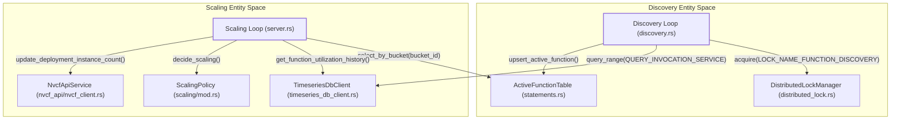
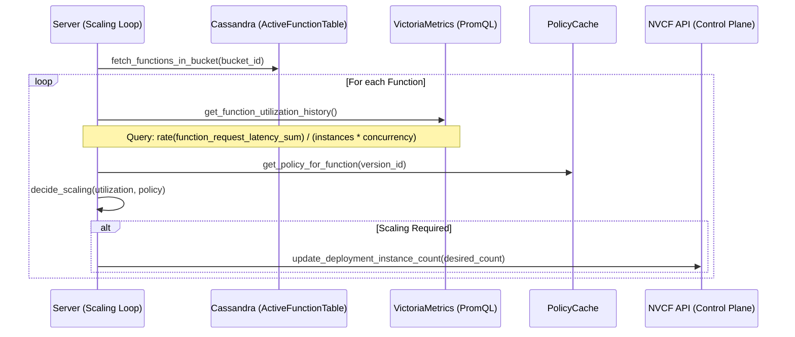

<!-- source: DeepWiki mcp.deepwiki.com · repo NVIDIA/nvcf · page 2.5 Function Autoscaler · fetched 2026-10-26 -->

# Function Autoscaler

Relevant source files

The following files were used as context for generating this wiki page:

- [deploy/helm/function-autoscaler/Chart.yaml](deploy/helm/function-autoscaler/Chart.yaml)
- [deploy/helm/function-autoscaler/values.yaml](deploy/helm/function-autoscaler/values.yaml)
- [deploy/helm/function-autoscaler/vault-agent-templates/secrets.json.tmpl](deploy/helm/function-autoscaler/vault-agent-templates/secrets.json.tmpl)
- [deploy/stacks/self-managed/tests/observability-autoscaler.sh](deploy/stacks/self-managed/tests/observability-autoscaler.sh)
- [migrations/openbao/migrations/21_setup_autoscaler.sh](migrations/openbao/migrations/21_setup_autoscaler.sh)
- [src/compute-plane-services/nvca/vendor/github.com/NVIDIA/nvcf/src/libraries/go/lib/pkg/otelconfig/config/render.go](src/compute-plane-services/nvca/vendor/github.com/NVIDIA/nvcf/src/libraries/go/lib/pkg/otelconfig/config/render.go)
- [src/control-plane-services/function-autoscaler/Cargo.lock](src/control-plane-services/function-autoscaler/Cargo.lock)
- [src/control-plane-services/function-autoscaler/crates/server/Cargo.toml](src/control-plane-services/function-autoscaler/crates/server/Cargo.toml)
- [src/control-plane-services/function-autoscaler/crates/server/proto/nvcf.proto](src/control-plane-services/function-autoscaler/crates/server/proto/nvcf.proto)
- [src/control-plane-services/function-autoscaler/crates/server/resources/settings-local.yaml](src/control-plane-services/function-autoscaler/crates/server/resources/settings-local.yaml)
- [src/control-plane-services/function-autoscaler/crates/server/src/cassandra/cassandra_service.rs](src/control-plane-services/function-autoscaler/crates/server/src/cassandra/cassandra_service.rs)
- [src/control-plane-services/function-autoscaler/crates/server/src/cassandra/distributed_lock.rs](src/control-plane-services/function-autoscaler/crates/server/src/cassandra/distributed_lock.rs)
- [src/control-plane-services/function-autoscaler/crates/server/src/cassandra/statements.rs](src/control-plane-services/function-autoscaler/crates/server/src/cassandra/statements.rs)
- [src/control-plane-services/function-autoscaler/crates/server/src/health/mod.rs](src/control-plane-services/function-autoscaler/crates/server/src/health/mod.rs)
- [src/control-plane-services/function-autoscaler/crates/server/src/models/mod.rs](src/control-plane-services/function-autoscaler/crates/server/src/models/mod.rs)
- [src/control-plane-services/function-autoscaler/crates/server/src/nvcf_api/mod.rs](src/control-plane-services/function-autoscaler/crates/server/src/nvcf_api/mod.rs)
- [src/control-plane-services/function-autoscaler/crates/server/src/nvcf_api/nvcf_client.rs](src/control-plane-services/function-autoscaler/crates/server/src/nvcf_api/nvcf_client.rs)
- [src/control-plane-services/function-autoscaler/crates/server/src/nvcf_api/oauth2_client.rs](src/control-plane-services/function-autoscaler/crates/server/src/nvcf_api/oauth2_client.rs)
- [src/control-plane-services/function-autoscaler/crates/server/src/scaling/mod.rs](src/control-plane-services/function-autoscaler/crates/server/src/scaling/mod.rs)
- [src/control-plane-services/function-autoscaler/crates/server/src/scaling/policy_cache.rs](src/control-plane-services/function-autoscaler/crates/server/src/scaling/policy_cache.rs)
- [src/control-plane-services/function-autoscaler/crates/server/src/scaling/policy_client.rs](src/control-plane-services/function-autoscaler/crates/server/src/scaling/policy_client.rs)
- [src/control-plane-services/function-autoscaler/crates/server/src/secrets/secrets_config.rs](src/control-plane-services/function-autoscaler/crates/server/src/secrets/secrets_config.rs)
- [src/control-plane-services/function-autoscaler/crates/server/src/server.rs](src/control-plane-services/function-autoscaler/crates/server/src/server.rs)
- [src/control-plane-services/function-autoscaler/crates/server/src/startup.rs](src/control-plane-services/function-autoscaler/crates/server/src/startup.rs)
- [src/control-plane-services/function-autoscaler/crates/server/src/timeseries_db/mod.rs](src/control-plane-services/function-autoscaler/crates/server/src/timeseries_db/mod.rs)
- [src/control-plane-services/function-autoscaler/crates/server/src/timeseries_db/timeseries_db_client.rs](src/control-plane-services/function-autoscaler/crates/server/src/timeseries_db/timeseries_db_client.rs)
- [src/control-plane-services/function-autoscaler/crates/server/src/tracing_init.rs](src/control-plane-services/function-autoscaler/crates/server/src/tracing_init.rs)
- [src/control-plane-services/function-autoscaler/crates/server/src/work/discovery.rs](src/control-plane-services/function-autoscaler/crates/server/src/work/discovery.rs)
- [src/control-plane-services/function-autoscaler/crates/server/src/work/mod.rs](src/control-plane-services/function-autoscaler/crates/server/src/work/mod.rs)
- [src/control-plane-services/function-autoscaler/local_env/AGENTS.md](src/control-plane-services/function-autoscaler/local_env/AGENTS.md)

The Function Autoscaler is a Rust-based service [src/control-plane-services/function-autoscaler/crates/server/Cargo.toml:17-21]() responsible for dynamically adjusting the number of instances for NVIDIA Cloud Functions (NVCF). It operates by continuously monitoring function utilization via PromQL queries against a Time Series Database (TSDB) and updating the desired instance counts through the NVCF Control Plane API.

## Architecture and Control Flow

The autoscaler is designed as a distributed system that uses Cassandra for state persistence and leader election. It splits its responsibilities into two primary loops: the **Discovery Loop** and the **Scaling Loop**.

### System Components Overview

| Component | Responsibility |
| :--- | :--- |
| **Discovery Loop** | Scans VictoriaMetrics for functions with recent traffic and registers them in Cassandra [src/control-plane-services/function-autoscaler/crates/server/src/work/discovery.rs:159-222](). |
| **Scaling Loop** | Processes "buckets" of active functions, calculates utilization, and applies scaling policies [src/control-plane-services/function-autoscaler/crates/server/src/work/mod.rs:232-315](). |
| **Cassandra** | Stores the `ActiveFunctionTable` and provides distributed locking via `DistributedLockManager` [src/control-plane-services/function-autoscaler/crates/server/src/cassandra/distributed_lock.rs:1-18](). |
| **VictoriaMetrics** | Acts as the `TimeseriesDb` source for utilization metrics (PromQL) [src/control-plane-services/function-autoscaler/crates/server/src/timeseries_db/timeseries_db_client.rs:18-26](). |
| **NVCF API Client** | Writes the calculated `desired_instance_count` back to the NVCF core service [src/control-plane-services/function-autoscaler/crates/server/src/nvcf_api/nvcf_client.rs:1-23](). |

### Code-to-Entity Mapping: Discovery and Scaling

The following diagram maps the logical scaling process to the specific Rust structs and functions that implement them.

**Sources:** [src/control-plane-services/function-autoscaler/crates/server/src/work/discovery.rs:35-40](), [src/control-plane-services/function-autoscaler/crates/server/src/work/mod.rs:67-116](), [src/control-plane-services/function-autoscaler/crates/server/src/server.rs:169-210]()

---

## Discovery Loop

The discovery loop is a leader-elected process that identifies functions requiring autoscaling. It queries VictoriaMetrics for functions that have received requests within the last `lookback_minutes` (default: 5) [src/control-plane-services/function-autoscaler/crates/server/src/work/discovery.rs:37-40]().

1.  **Distributed Locking**: The service attempts to acquire a lock named `function_discovery` in Cassandra [src/control-plane-services/function-autoscaler/crates/server/src/work/discovery.rs:35]().
2.  **Sharded Queries**: To handle high cardinality, queries are split into shards using regex on the `function_id` (e.g., `[0-3].*`, `[4-7].*`) [src/control-plane-services/function-autoscaler/crates/server/src/work/discovery.rs:50-79]().
3.  **Metric Sources**: It scans both `function_request` (HTTP) and `function_request_total` (gRPC) metrics [src/control-plane-services/function-autoscaler/crates/server/src/work/discovery.rs:109-127]().
4.  **State Sync**: Functions found in metrics are added to the `active_functions` table in Cassandra, while functions that have been idle longer than the `scale_to_zero_idle_timeout` are marked for removal [src/control-plane-services/function-autoscaler/crates/server/src/scaling/mod.rs:90-94]().

**Sources:** [src/control-plane-services/function-autoscaler/crates/server/src/work/discovery.rs:159-222](), [src/control-plane-services/function-autoscaler/crates/server/src/scaling/mod.rs:71-76]()

---

## Scaling Loop and Sharding

Scaling is performed in parallel across multiple replicas. Each function is assigned to one of 1024 buckets based on its `function_id` hash [src/control-plane-services/function-autoscaler/crates/server/src/work/mod.rs:232-240](). Replicas coordinate to ensure only one instance processes a specific bucket at a time using a distributed lock [src/control-plane-services/function-autoscaler/crates/server/src/work/mod.rs:63-64]().

### Scaling Logic Flow

### Utilization Calculation
The autoscaler supports two metric sources for utilization [src/control-plane-services/function-autoscaler/crates/server/src/work/mod.rs:88-105]():
*   **Control Plane Metrics**: Calculated as `rate(latency_sum) / (current_instances * concurrency)`.
*   **Worker Metrics**: Calculated as `increase(worker_thread_busy_seconds) / window / worker_thread_count`.

**Sources:** [src/control-plane-services/function-autoscaler/crates/server/src/work/mod.rs:88-105](), [src/control-plane-services/function-autoscaler/crates/server/src/server.rs:220-250]()

---

## Configuration and Scaling Policies

The service is configured via `settings-local.yaml` (or environment-specific overrides) [src/control-plane-services/function-autoscaler/crates/server/resources/settings-local.yaml:4-28]().

### Policy Types
The `ScalingSettings` struct defines how the autoscaler behaves [src/control-plane-services/function-autoscaler/crates/server/src/scaling/mod.rs:64-113]():
1.  **Static Policy**: A global set of thresholds applied to all functions (e.g., Scale Up at 70%, Scale Down at 30%) [src/control-plane-services/function-autoscaler/crates/server/resources/settings-local.yaml:69-74]().
2.  **Custom Policy**: Fetches function-specific thresholds from an external gRPC service, with a local `PolicyCache` for performance [src/control-plane-services/function-autoscaler/crates/server/src/scaling/mod.rs:159-170]().

### Key Parameters
*   **`scaling_loop_interval_seconds`**: Frequency of the scaling check (default 15s) [src/control-plane-services/function-autoscaler/crates/server/src/scaling/mod.rs:28-30]().
*   **`lookback_seconds`**: Duration of historical data used for decisions (default 600s) [src/control-plane-services/function-autoscaler/crates/server/src/scaling/mod.rs:34-36]().
*   **`scale_to_zero_idle_timeout_seconds`**: Time a function must be idle before scaling to zero (default 1800s) [src/control-plane-services/function-autoscaler/crates/server/src/scaling/mod.rs:40-42]().

**Sources:** [src/control-plane-services/function-autoscaler/crates/server/src/scaling/mod.rs:28-113](), [src/control-plane-services/function-autoscaler/crates/server/resources/settings-local.yaml:61-75]()

---

## Observability and Health

The autoscaler provides several endpoints for monitoring its internal state:
*   **Liveness/Readiness**: `/admin/health/liveness` and `/admin/health/readiness` on port `8181` [src/control-plane-services/function-autoscaler/crates/server/src/server.rs:102-107](). Readiness depends on successful connections to Cassandra and VictoriaMetrics [src/control-plane-services/function-autoscaler/crates/server/src/server.rs:97-98]().
*   **Metrics**: A Prometheus exporter runs on port `41338` [src/control-plane-services/function-autoscaler/crates/server/resources/settings-local.yaml:12]().
*   **Tracing**: Integrated with OpenTelemetry via gRPC (OTLP) [src/control-plane-services/function-autoscaler/crates/server/src/tracing_init.rs:32-58]().

### Health Checks
The `Health` struct tracks the status of critical dependencies [src/control-plane-services/function-autoscaler/crates/server/src/health/mod.rs:18-20](). If Cassandra or the TSDB client fails, the service reports itself as unhealthy to Kubernetes [src/control-plane-services/function-autoscaler/crates/server/src/server.rs:129-160]().

**Sources:** [src/control-plane-services/function-autoscaler/crates/server/src/server.rs:92-123](), [src/control-plane-services/function-autoscaler/crates/server/src/tracing_init.rs:100-103]()

---

