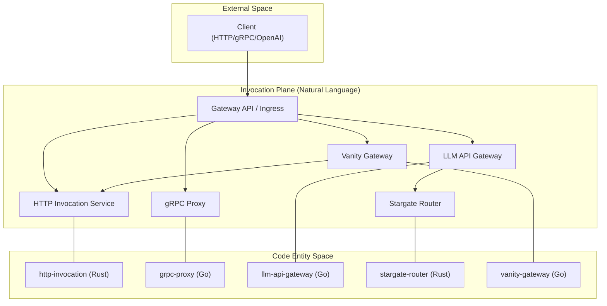
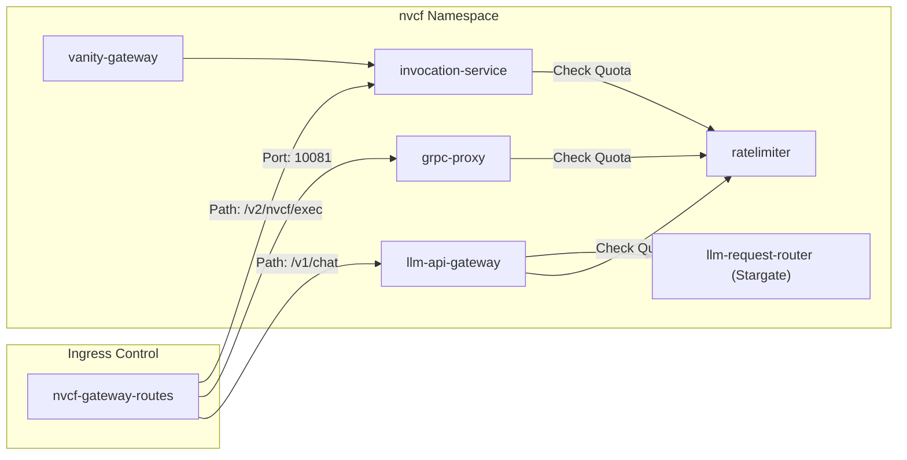

<!-- source: DeepWiki mcp.deepwiki.com · repo NVIDIA/nvcf · page 3 Invocation Plane Services · fetched 2026-10-26 -->

# Invocation Plane Services

Relevant source files

The following files were used as context for generating this wiki page:

- [ai-tooling/user/skills/nvcf-self-managed-cli/reference/troubleshooting.md](ai-tooling/user/skills/nvcf-self-managed-cli/reference/troubleshooting.md)
- [deploy/stacks/self-managed/Makefile.dist](deploy/stacks/self-managed/Makefile.dist)
- [deploy/stacks/self-managed/environments/base.yaml](deploy/stacks/self-managed/environments/base.yaml)
- [deploy/stacks/self-managed/global.yaml.gotmpl](deploy/stacks/self-managed/global.yaml.gotmpl)
- [deploy/stacks/self-managed/helmfile-docker.mk](deploy/stacks/self-managed/helmfile-docker.mk)
- [deploy/stacks/self-managed/helmfile.d/01-dependencies.yaml.gotmpl](deploy/stacks/self-managed/helmfile.d/01-dependencies.yaml.gotmpl)
- [deploy/stacks/self-managed/helmfile.d/02-core.yaml.gotmpl](deploy/stacks/self-managed/helmfile.d/02-core.yaml.gotmpl)
- [deploy/stacks/self-managed/helmfile.d/03-observability.yaml.gotmpl](deploy/stacks/self-managed/helmfile.d/03-observability.yaml.gotmpl)
- [deploy/stacks/self-managed/secrets/secrets.yaml.template](deploy/stacks/self-managed/secrets/secrets.yaml.template)
- [docs/user/generic-http-function-invocation.md](docs/user/generic-http-function-invocation.md)
- [docs/user/grpc-function-invocation.md](docs/user/grpc-function-invocation.md)
- [docs/user/images/nvcf-grpc-invocation-path.svg](docs/user/images/nvcf-grpc-invocation-path.svg)
- [docs/user/images/nvcf-grpc-multicluster-invocation.svg](docs/user/images/nvcf-grpc-multicluster-invocation.svg)
- [docs/user/images/nvcf-http-invocation-path.svg](docs/user/images/nvcf-http-invocation-path.svg)
- [docs/user/images/nvcf-http-multicluster-invocation.svg](docs/user/images/nvcf-http-multicluster-invocation.svg)
- [docs/user/images/nvcf-llm-invocation-path.svg](docs/user/images/nvcf-llm-invocation-path.svg)
- [docs/user/images/nvcf-llm-multicluster-invocation.svg](docs/user/images/nvcf-llm-multicluster-invocation.svg)
- [docs/user/streaming-functions.md](docs/user/streaming-functions.md)
- [docs/user/third-party-registries.md](docs/user/third-party-registries.md)
- [docs/user/troubleshooting.md](docs/user/troubleshooting.md)

The Invocation Plane is the request-handling layer of NVIDIA Cloud Functions (NVCF). It is responsible for receiving client requests, performing authentication and rate limiting, and routing traffic to the appropriate function workers in the Compute Plane. This plane supports multiple protocols including standard HTTP, gRPC, and OpenAI-compatible LLM APIs.

The services in this plane act as the "front door" for all function executions, translating external requests into internal messaging via NATS or direct proxy connections to worker pods.

### Invocation Architecture Overview

The following diagram illustrates how external requests flow through the various Invocation Plane services to reach function workers.

**Diagram: Request Routing and Service Association**

Sources: [deploy/stacks/self-managed/helmfile.d/02-core.yaml.gotmpl:73-201](), [docs/user/images/nvcf-llm-invocation-path.svg:73-91]()

---

## 3.1 HTTP Invocation Service
The **HTTP Invocation Service** (`invocation-service`) is a Rust-based high-performance service that handles standard RESTful function executions. It exposes the primary execution endpoints, such as `/v2/nvcf/exec/functions/{id}`, and manages the lifecycle of synchronous and asynchronous (pexec) requests. It integrates with the Rate Limiter to enforce tenant quotas and publishes requests to NATS for consumption by the Compute Plane.

For details, see [HTTP Invocation Service](#3.1).

**Sources:** [deploy/stacks/self-managed/helmfile.d/02-core.yaml.gotmpl:73-80](), [docs/user/images/nvcf-http-invocation-path.svg:1-113]()

---

## 3.2 gRPC Proxy
The **gRPC Proxy** (`grpc-proxy`) is a Go-based service designed for low-latency, stateful streaming connections. Unlike the HTTP service, it uses a "director" pattern to hijack gRPC calls and route them to specific worker pods. It supports session resumption via the `nvcf-reqid` metadata, allowing clients to reconnect to the same worker after network interruptions.

For details, see [gRPC Proxy](#3.2).

**Sources:** [deploy/stacks/self-managed/helmfile.d/02-core.yaml.gotmpl:81-88](), [docs/user/grpc-function-invocation.md:1-150]()

---

## 3.3 LLM API Gateway and Stargate Router
This sub-system provides specialized handling for Large Language Model (LLM) workloads.
*   **LLM API Gateway**: A Go service that provides OpenAI-compatible endpoints (e.g., `/v1/chat/completions`). It handles model ID mapping and initial request validation.
*   **Stargate Router**: A Rust-based router that receives traffic from the LLM Gateway and performs advanced load balancing across multiple backend clusters. It uses the Pylon QUIC-HTTP tunnel to maintain efficient communication with LLM workers.

For details, see [LLM API Gateway and Stargate Router](#3.3).

**Sources:** [deploy/stacks/self-managed/helmfile.d/02-core.yaml.gotmpl:167-190](), [docs/user/images/nvcf-llm-invocation-path.svg:83-95]()

---

## 3.4 Vanity Gateway and Rate Limiter
*   **Vanity Gateway**: Provides customizable "vanity" URLs and supports OpenAI-compatible routes that shadow traffic to the standard HTTP invocation service. It acts as a lightweight translation layer for specific deployment aliases.
*   **Rate Limiter**: A dedicated service that tracks and enforces request limits across the invocation plane. It uses a gRPC-based protocol to provide real-time quota checks for the other invocation services.

For details, see [Vanity Gateway and Rate Limiter](#3.4).

**Sources:** [deploy/stacks/self-managed/helmfile.d/02-core.yaml.gotmpl:89-100](), [deploy/stacks/self-managed/helmfile.d/02-core.yaml.gotmpl:191-201]()

---

## Service Interactions

The following diagram maps the high-level service names to their specific implementation names and deployment namespaces used in the Helm stacks.

**Diagram: Service Implementation Mapping**

Sources: [deploy/stacks/self-managed/helmfile.d/02-core.yaml.gotmpl:73-228](), [deploy/stacks/self-managed/environments/base.yaml:52-72]()

---

