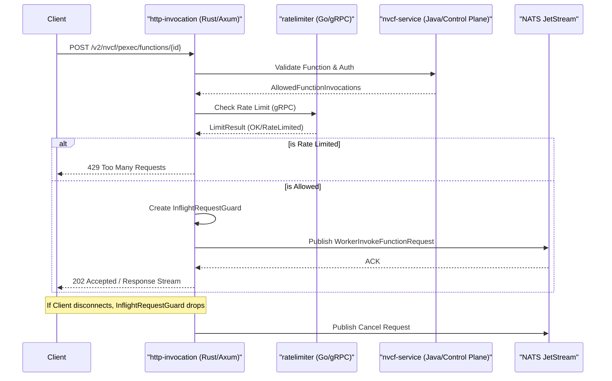
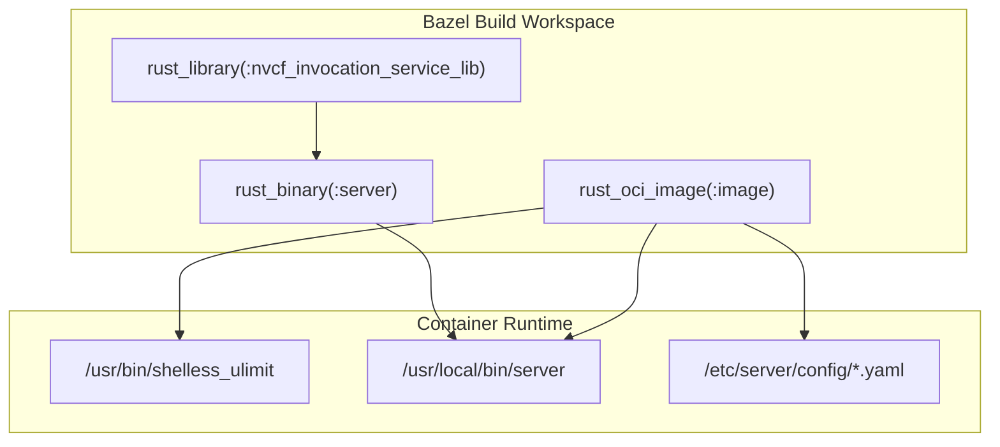

<!-- source: DeepWiki mcp.deepwiki.com · repo NVIDIA/nvcf · page 3.1 HTTP Invocation Service · fetched 2026-10-26 -->

# HTTP Invocation Service

Relevant source files

The following files were used as context for generating this wiki page:

- [src/control-plane-services/function-autoscaler/crates/server/BUILD.bazel](src/control-plane-services/function-autoscaler/crates/server/BUILD.bazel)
- [src/invocation-plane-services/http-invocation/.cargo/config.toml](src/invocation-plane-services/http-invocation/.cargo/config.toml)
- [src/invocation-plane-services/http-invocation/.gitignore](src/invocation-plane-services/http-invocation/.gitignore)
- [src/invocation-plane-services/http-invocation/crates/server/BUILD.bazel](src/invocation-plane-services/http-invocation/crates/server/BUILD.bazel)
- [src/invocation-plane-services/http-invocation/crates/server/resources/settings.yaml](src/invocation-plane-services/http-invocation/crates/server/resources/settings.yaml)
- [src/invocation-plane-services/http-invocation/crates/server/src/metrics/mod.rs](src/invocation-plane-services/http-invocation/crates/server/src/metrics/mod.rs)
- [src/invocation-plane-services/http-invocation/crates/server/src/routes/app_error.rs](src/invocation-plane-services/http-invocation/crates/server/src/routes/app_error.rs)
- [src/invocation-plane-services/http-invocation/crates/server/src/routes/get_pexec.rs](src/invocation-plane-services/http-invocation/crates/server/src/routes/get_pexec.rs)
- [src/invocation-plane-services/http-invocation/crates/server/src/routes/post_pexec.rs](src/invocation-plane-services/http-invocation/crates/server/src/routes/post_pexec.rs)
- [src/invocation-plane-services/http-invocation/crates/server/src/telemetry/mod.rs](src/invocation-plane-services/http-invocation/crates/server/src/telemetry/mod.rs)
- [src/invocation-plane-services/ratelimiter/cmd/BUILD.bazel](src/invocation-plane-services/ratelimiter/cmd/BUILD.bazel)
- [src/invocation-plane-services/ratelimiter/cmd/info_test.go](src/invocation-plane-services/ratelimiter/cmd/info_test.go)
- [src/invocation-plane-services/ratelimiter/cmd/main.go](src/invocation-plane-services/ratelimiter/cmd/main.go)
- [src/invocation-plane-services/ratelimiter/go.mod](src/invocation-plane-services/ratelimiter/go.mod)
- [src/invocation-plane-services/ratelimiter/go.sum](src/invocation-plane-services/ratelimiter/go.sum)
- [src/invocation-plane-services/vanity-gateway/gateway/vanity_director.go](src/invocation-plane-services/vanity-gateway/gateway/vanity_director.go)
- [src/invocation-plane-services/vanity-gateway/gateway/vanity_director_test.go](src/invocation-plane-services/vanity-gateway/gateway/vanity_director_test.go)
- [src/libraries/go/lib/cmd/icms-translate/BUILD.bazel](src/libraries/go/lib/cmd/icms-translate/BUILD.bazel)
- [src/libraries/go/lib/pkg/auth/BUILD.bazel](src/libraries/go/lib/pkg/auth/BUILD.bazel)
- [src/libraries/go/lib/pkg/core/BUILD.bazel](src/libraries/go/lib/pkg/core/BUILD.bazel)
- [src/libraries/go/lib/pkg/nvkit/config/BUILD.bazel](src/libraries/go/lib/pkg/nvkit/config/BUILD.bazel)
- [src/libraries/go/lib/pkg/nvkit/encrypt/BUILD.bazel](src/libraries/go/lib/pkg/nvkit/encrypt/BUILD.bazel)
- [src/libraries/go/lib/pkg/oauth/BUILD.bazel](src/libraries/go/lib/pkg/oauth/BUILD.bazel)

The HTTP Invocation Service (`http-invocation`) is a high-performance Rust-based component within the NVCF Invocation Plane. Its primary responsibility is to receive incoming HTTP requests from users, validate them against the NVCF API (Control Plane), enforce rate limits, and publish the invocation tasks to NATS JetStream for execution by the Compute Plane [src/invocation-plane-services/http-invocation/crates/server/src/routes/post_pexec.rs:179-188]().

## System Architecture and Data Flow

The service acts as the entry point for synchronous and asynchronous function executions. It handles complex request lifecycles, including large payload streaming and early client disconnect management.

### Request Lifecycle Diagram
The following diagram illustrates the flow of a request through the `http-invocation` service.

**HTTP Invocation Flow**

Sources: [src/invocation-plane-services/http-invocation/crates/server/src/routes/post_pexec.rs:179-210](), [src/invocation-plane-services/http-invocation/crates/server/src/routes/post_pexec.rs:116-176](), [src/invocation-plane-services/http-invocation/crates/server/src/rate_limit/mod.rs:31-31]()

## Key Implementation Details

### Invocation Endpoints
The service implements the following primary routes using the Axum framework:
*   **`pexec` (POST)**: The main entry point for function execution. It performs authentication, asset reference resolution, and NATS publishing [src/invocation-plane-services/http-invocation/crates/server/src/routes/post_pexec.rs:179-188]().
*   **`get_pexec` (GET)**: Used for polling or retrieving status/results for specific invocation types [src/invocation-plane-services/http-invocation/crates/server/src/routes/get_pexec.rs:1-10]().

### Inflight Request Management
A critical feature of the service is the `InflightRequestGuard`. This RAII (Resource Acquisition Is Initialization) guard tracks the lifecycle of an active request [src/invocation-plane-services/http-invocation/crates/server/src/routes/post_pexec.rs:74-84]().

If a client disconnects before the request is fulfilled, the guard's `Drop` implementation:
1.  Records a `499 Client Closed Request` metric [src/invocation-plane-services/http-invocation/crates/server/src/routes/post_pexec.rs:128-140]().
2.  Spawns an async task to publish a cancellation message to NATS, ensuring compute resources are not wasted on abandoned requests [src/invocation-plane-services/http-invocation/crates/server/src/routes/post_pexec.rs:145-173]().

### Rate Limit Integration
The service integrates with the `ratelimiter` service via gRPC. Before publishing to NATS, it calls `RateLimitService` to verify if the tenant/function has exceeded its quota [src/invocation-plane-services/http-invocation/crates/server/src/routes/post_pexec.rs:31-31]().

Sources: [src/invocation-plane-services/http-invocation/crates/server/src/routes/post_pexec.rs:1-176](), [src/invocation-plane-services/ratelimiter/cmd/main.go:225-230]()

## Telemetry and Observability

The service uses a custom telemetry stack based on `tracing` and `opentelemetry-rust` [src/invocation-plane-services/http-invocation/crates/server/src/telemetry/mod.rs:51-56]().

### Metrics
Prometheus metrics are exposed on a dedicated port (default `41337`) [src/invocation-plane-services/http-invocation/crates/server/src/metrics/mod.rs:171-183](). Key metrics include:
*   `function.request.latency`: Histogram of request durations [src/invocation-plane-services/http-invocation/crates/server/src/metrics/mod.rs:70-73]().
*   `app.invocation.error`: Counter for errors, including the internal `499` status for client disconnects [src/invocation-plane-services/http-invocation/crates/server/src/metrics/mod.rs:75-78](), [src/invocation-plane-services/http-invocation/crates/server/src/metrics/mod.rs:32-36]().
*   `nats.jetstream.publish`: Counter for successful NATS message handoffs [src/invocation-plane-services/http-invocation/crates/server/src/metrics/mod.rs:105-108]().

### Tracing
W3C Trace Context propagation is implemented to ensure distributed traces flow from the caller through `http-invocation` and into the NATS backbone [src/invocation-plane-services/http-invocation/crates/server/src/telemetry/mod.rs:127-132]().

Sources: [src/invocation-plane-services/http-invocation/crates/server/src/metrics/mod.rs:1-170](), [src/invocation-plane-services/http-invocation/crates/server/src/telemetry/mod.rs:1-120]()

## Build and Deployment

The service is built using Bazel and packaged as a multi-arch OCI image.

### OCI Image Configuration
The image is based on `distroless/cc` to provide the necessary C standard libraries for `jemalloc` and `openssl` while maintaining a minimal security footprint [src/invocation-plane-services/http-invocation/crates/server/BUILD.bazel:115-120]().

**Component Mapping**

The image uses a specialized entrypoint `/usr/bin/shelless_ulimit` with `ULIMIT_FLAG=1` to ensure the file descriptor limit is raised to 65536, preventing "Too many open files" errors under high concurrency [src/invocation-plane-services/http-invocation/crates/server/BUILD.bazel:128-145]().

Sources: [src/invocation-plane-services/http-invocation/crates/server/BUILD.bazel:1-150]()

---

