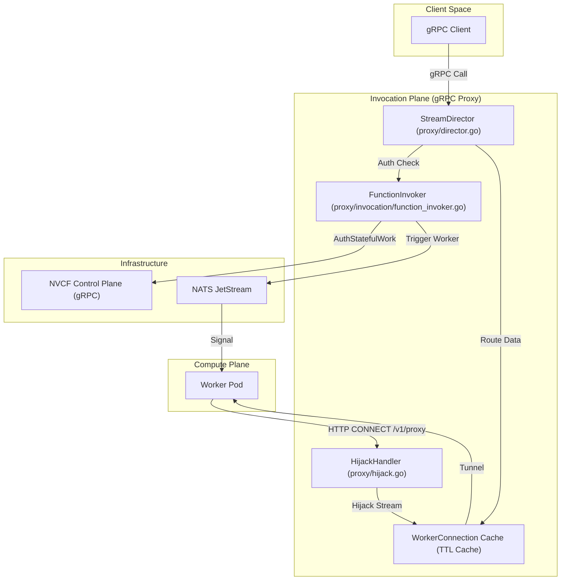
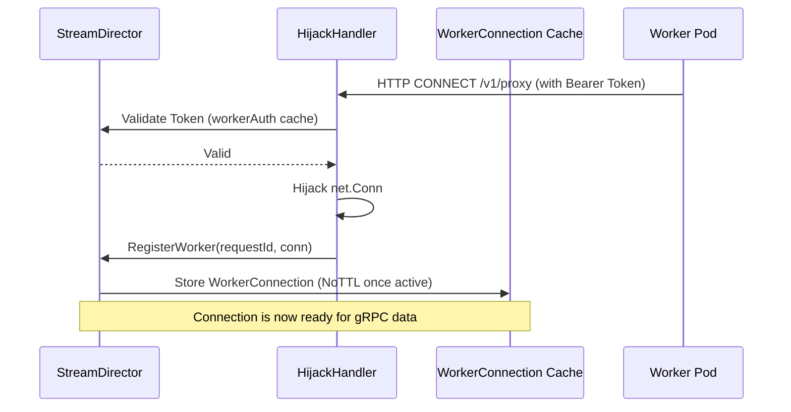

<!-- source: DeepWiki mcp.deepwiki.com · repo NVIDIA/nvcf · page 3.2 gRPC Proxy · fetched 2026-10-26 -->

# gRPC Proxy

Relevant source files

The following files were used as context for generating this wiki page:

- [src/invocation-plane-services/grpc-proxy/BUILD.bazel](src/invocation-plane-services/grpc-proxy/BUILD.bazel)
- [src/invocation-plane-services/grpc-proxy/go.mod](src/invocation-plane-services/grpc-proxy/go.mod)
- [src/invocation-plane-services/grpc-proxy/go.sum](src/invocation-plane-services/grpc-proxy/go.sum)
- [src/invocation-plane-services/grpc-proxy/main.go](src/invocation-plane-services/grpc-proxy/main.go)
- [src/invocation-plane-services/grpc-proxy/proxy/BUILD.bazel](src/invocation-plane-services/grpc-proxy/proxy/BUILD.bazel)
- [src/invocation-plane-services/grpc-proxy/proxy/credentials/bearer.go](src/invocation-plane-services/grpc-proxy/proxy/credentials/bearer.go)
- [src/invocation-plane-services/grpc-proxy/proxy/credentials/bearer_test.go](src/invocation-plane-services/grpc-proxy/proxy/credentials/bearer_test.go)
- [src/invocation-plane-services/grpc-proxy/proxy/director.go](src/invocation-plane-services/grpc-proxy/proxy/director.go)
- [src/invocation-plane-services/grpc-proxy/proxy/director_test.go](src/invocation-plane-services/grpc-proxy/proxy/director_test.go)
- [src/invocation-plane-services/grpc-proxy/proxy/geo/BUILD.bazel](src/invocation-plane-services/grpc-proxy/proxy/geo/BUILD.bazel)
- [src/invocation-plane-services/grpc-proxy/proxy/geo/glps.go](src/invocation-plane-services/grpc-proxy/proxy/geo/glps.go)
- [src/invocation-plane-services/grpc-proxy/proxy/health.go](src/invocation-plane-services/grpc-proxy/proxy/health.go)
- [src/invocation-plane-services/grpc-proxy/proxy/hijack.go](src/invocation-plane-services/grpc-proxy/proxy/hijack.go)
- [src/invocation-plane-services/grpc-proxy/proxy/invocation/BUILD.bazel](src/invocation-plane-services/grpc-proxy/proxy/invocation/BUILD.bazel)
- [src/invocation-plane-services/grpc-proxy/proxy/invocation/function_invoker.go](src/invocation-plane-services/grpc-proxy/proxy/invocation/function_invoker.go)
- [src/invocation-plane-services/grpc-proxy/proxy/metrics/metrics.go](src/invocation-plane-services/grpc-proxy/proxy/metrics/metrics.go)
- [src/invocation-plane-services/grpc-proxy/proxy/proxy.go](src/invocation-plane-services/grpc-proxy/proxy/proxy.go)
- [src/invocation-plane-services/grpc-proxy/proxy/proxy_test.go](src/invocation-plane-services/grpc-proxy/proxy/proxy_test.go)
- [src/invocation-plane-services/grpc-proxy/proxy/worker/connections.go](src/invocation-plane-services/grpc-proxy/proxy/worker/connections.go)
- [src/invocation-plane-services/grpc-proxy/proxy/worker/connections_test.go](src/invocation-plane-services/grpc-proxy/proxy/worker/connections_test.go)
- [src/invocation-plane-services/grpc-proxy/proxy/worker/worker.go](src/invocation-plane-services/grpc-proxy/proxy/worker/worker.go)
- [src/invocation-plane-services/http-invocation/crates/server/proto/ratelimiter.proto](src/invocation-plane-services/http-invocation/crates/server/proto/ratelimiter.proto)
- [src/invocation-plane-services/http-invocation/crates/server/src/rate_limit/mod.rs](src/invocation-plane-services/http-invocation/crates/server/src/rate_limit/mod.rs)
- [src/invocation-plane-services/http-invocation/crates/server/tests/test_pexec.rs](src/invocation-plane-services/http-invocation/crates/server/tests/test_pexec.rs)
- [src/invocation-plane-services/ratelimiter/BUILD.bazel](src/invocation-plane-services/ratelimiter/BUILD.bazel)
- [src/invocation-plane-services/ratelimiter/README.md](src/invocation-plane-services/ratelimiter/README.md)
- [src/invocation-plane-services/ratelimiter/cmd/main_test.go](src/invocation-plane-services/ratelimiter/cmd/main_test.go)
- [src/invocation-plane-services/ratelimiter/cmd/nvcf_api_server_mock.go](src/invocation-plane-services/ratelimiter/cmd/nvcf_api_server_mock.go)
- [src/invocation-plane-services/ratelimiter/credentials/bearer.go](src/invocation-plane-services/ratelimiter/credentials/bearer.go)
- [src/invocation-plane-services/ratelimiter/credentials/bearer_test.go](src/invocation-plane-services/ratelimiter/credentials/bearer_test.go)
- [src/invocation-plane-services/ratelimiter/nvcf/pb/nvcf.pb.go](src/invocation-plane-services/ratelimiter/nvcf/pb/nvcf.pb.go)
- [src/invocation-plane-services/ratelimiter/nvcf/pb/nvcf.proto](src/invocation-plane-services/ratelimiter/nvcf/pb/nvcf.proto)
- [src/invocation-plane-services/ratelimiter/pb/ratelimiter.pb.go](src/invocation-plane-services/ratelimiter/pb/ratelimiter.pb.go)
- [src/invocation-plane-services/ratelimiter/pb/ratelimiter.proto](src/invocation-plane-services/ratelimiter/pb/ratelimiter.proto)
- [src/invocation-plane-services/ratelimiter/rate_limiter.go](src/invocation-plane-services/ratelimiter/rate_limiter.go)
- [src/invocation-plane-services/ratelimiter/version.go](src/invocation-plane-services/ratelimiter/version.go)
- [src/invocation-plane-services/ratelimiter/version_test.go](src/invocation-plane-services/ratelimiter/version_test.go)

The gRPC Proxy is a high-performance Go-based service within the NVCF Invocation Plane. Its primary purpose is to route gRPC calls from clients to function worker pods by acting as a bidirectional stream director. It implements the "director pattern," where incoming gRPC requests trigger the allocation of a worker, and the worker subsequently "dials back" to the proxy to establish a persistent tunnel for the request duration.

## Architecture and Data Flow

The gRPC Proxy does not simply forward packets; it manages a complex lifecycle involving authentication, geo-routing, and connection hijacking.

### Invocation Sequence

1.  **Client Request**: A client sends a gRPC request to the proxy.
2.  **Authentication & Authorization**: The proxy calls the NVCF Control Plane (`AuthStatefulWork`) to validate the client's token and retrieve function metadata [src/invocation-plane-services/grpc-proxy/proxy/invocation/function_invoker.go:115-122]().
3.  **Worker Signaling**: The proxy publishes a message to NATS JetStream to trigger a worker pod [src/invocation-plane-services/grpc-proxy/proxy/invocation/function_invoker.go:145]().
4.  **Worker Dial-back (Hijacking)**: The worker pod receives the signal and initiates an HTTP `CONNECT` request back to the proxy's `/v1/proxy` endpoint [src/invocation-plane-services/grpc-proxy/proxy/hijack.go:38-45]().
5.  **Tunneling**: The proxy hijacks the `CONNECT` stream (supporting HTTP/1.1, HTTP/2, and HTTP/3) and pairs it with the original client gRPC stream [src/invocation-plane-services/grpc-proxy/proxy/hijack.go:140-151]().

### Component Interaction Diagram

**Sources:** [src/invocation-plane-services/grpc-proxy/proxy/director.go:72-79](), [src/invocation-plane-services/grpc-proxy/proxy/invocation/function_invoker.go:104-154](), [src/invocation-plane-services/grpc-proxy/proxy/hijack.go:38-62]()

## Key Implementation Details

### Stream Director and Connection Hijacking
The `StreamDirector` is the central coordinator. It maintains a `ttlcache` of `WorkerConnection` objects [src/invocation-plane-services/grpc-proxy/proxy/director.go:76](). When a worker pod connects via `HijackHandler`, the proxy validates the `workerAuthToken` and uses `http.Hijacker` (for H1/H2) or `http3.HTTPStreamer` (for H3) to take control of the underlying network socket [src/invocation-plane-services/grpc-proxy/proxy/hijack.go:55-56]().

*   **HTTP/3 Support**: The proxy uses `quic-go` to support QUIC-based tunnels, which are more resilient to packet loss in multi-region environments [src/invocation-plane-services/grpc-proxy/proxy/quicconn/quicconn.go]().
*   **Token Management**: The `workerAuth` cache stores minted tokens with a TTL defined by `consts.Timeout` (default 30s) to ensure workers connect promptly or the request fails [src/invocation-plane-services/grpc-proxy/proxy/director.go:94-98]().

### Geo-Routing (GLPS)
The proxy integrates with a Geo-IP lookup service to ensure low-latency routing.
*   **Lookup**: It uses `geo.NewGeoIPLookupService` to determine the best region for a worker based on the client's IP [src/invocation-plane-services/grpc-proxy/proxy/geo/geo.go]().
*   **GLPS Integration**: The proxy can query Global Load Positioning System (GLPS) endpoints to refine routing decisions [src/invocation-plane-services/grpc-proxy/proxy/geo/glps.go]().

### Rate Limiting
The proxy implements a `rateLimiter` interface that interacts with the `ratelimiter` service [src/invocation-plane-services/grpc-proxy/proxy/ratelimit/ratelimit.go](). It checks limits per `ClientNcaId` and `FunctionId` before triggering worker pods [src/invocation-plane-services/grpc-proxy/proxy/invocation/function_invoker.go:137-141]().

## Code Structure and Entities

| Entity | File Path | Responsibility |
| :--- | :--- | :--- |
| `StreamDirector` | [src/invocation-plane-services/grpc-proxy/proxy/director.go:72]() | Manages worker connection lifecycle and cache. |
| `FunctionInvoker` | [src/invocation-plane-services/grpc-proxy/proxy/invocation/function_invoker.go:57]() | Handles NATS signaling and NVCF auth integration. |
| `WorkerConnection` | [src/invocation-plane-services/grpc-proxy/proxy/worker/worker.go]() | Represents the hijacked tunnel to a specific worker pod. |
| `HijackHandler` | [src/invocation-plane-services/grpc-proxy/proxy/hijack.go:38]() | Entry point for workers to upgrade HTTP to a tunnel. |
| `NVCFProxy` | [src/invocation-plane-services/grpc-proxy/proxy/proxy.go:84]() | Main server struct aggregating H2C and H3 servers. |

### Logic Flow: Worker Registration

**Sources:** [src/invocation-plane-services/grpc-proxy/proxy/hijack.go:92-177](), [src/invocation-plane-services/grpc-proxy/proxy/director.go:123-134]()

## Observability and Endpoints

### Metrics
The service exports Prometheus metrics under the `nvcf_grpc_proxy_service` namespace [src/invocation-plane-services/grpc-proxy/proxy/metrics/metrics.go:33]().
*   `worker_connections_active`: Current number of open tunnels [src/invocation-plane-services/grpc-proxy/proxy/metrics/metrics.go:146]().
*   `worker_connection_closed_total`: Counter partitioned by reason (e.g., `client_closed`, `worker_closed`, `ttl_expired`) [src/invocation-plane-services/grpc-proxy/proxy/metrics/metrics.go:160]().
*   `session_init_seconds_total`: Latency for setting up the stateful session [src/invocation-plane-services/grpc-proxy/proxy/metrics/metrics.go:56]().

### Endpoints
*   **Health**: `/health` provides service readiness and liveness checks [src/invocation-plane-services/grpc-proxy/proxy/health.go]().
*   **Info**: `/info` returns version information and build metadata [src/invocation-plane-services/grpc-proxy/proxy/proxy.go]().
*   **Proxy Tunnel**: `/v1/proxy` (CONNECT method only) used by workers [src/invocation-plane-services/grpc-proxy/proxy/hijack.go:41]().

## Build and Deployment
The service is built using Bazel and produces a multi-arch OCI image (amd64/arm64) [src/invocation-plane-services/grpc-proxy/BUILD.bazel:82]().
*   **Base Image**: Uses `distroless/go` for a minimal attack surface [src/invocation-plane-services/grpc-proxy/BUILD.bazel:94]().
*   **Ulimit Shim**: Includes a `shelless_ulimit` shim to increase `RLIMIT_NOFILE`, essential for handling thousands of concurrent gRPC streams [src/invocation-plane-services/grpc-proxy/BUILD.bazel:97-101]().

**Sources:** [src/invocation-plane-services/grpc-proxy/BUILD.bazel:1-104](), [src/invocation-plane-services/grpc-proxy/proxy/metrics/metrics.go:1-200]()

---

