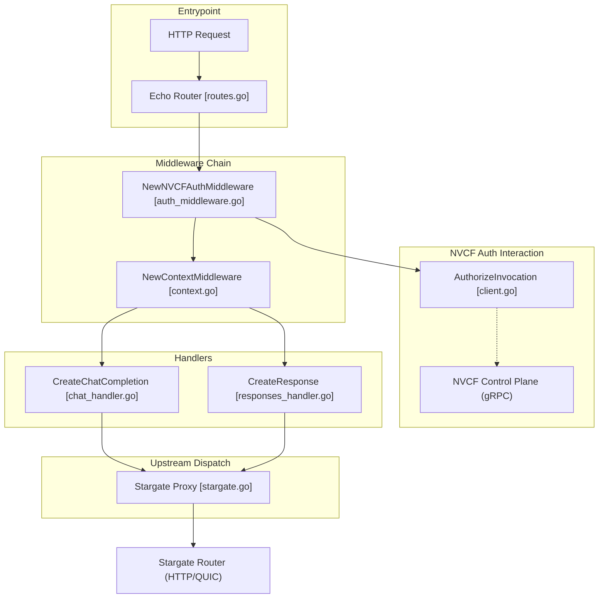
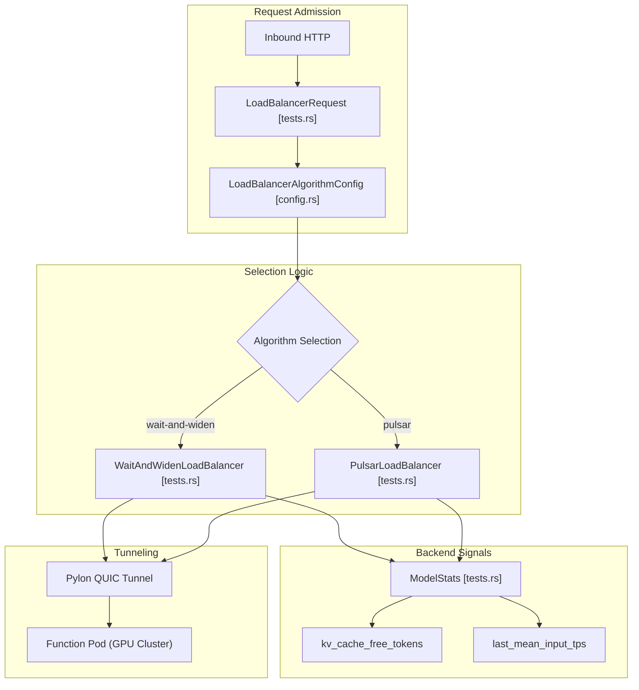

<!-- source: DeepWiki mcp.deepwiki.com · repo NVIDIA/nvcf · page 3.3 LLM API Gateway and Stargate Router · fetched 2026-10-26 -->

# LLM API Gateway and Stargate Router

<details>
<summary>Relevant source files</summary>

The following files were used as context for generating this wiki page:

- [docs/user/llm-function-enablement.md](docs/user/llm-function-enablement.md)
- [docs/user/llm-request-router-load-balancing.md](docs/user/llm-request-router-load-balancing.md)
- [src/invocation-plane-services/llm-api-gateway/README.md](src/invocation-plane-services/llm-api-gateway/README.md)
- [src/invocation-plane-services/llm-api-gateway/api/BUILD.bazel](src/invocation-plane-services/llm-api-gateway/api/BUILD.bazel)
- [src/invocation-plane-services/llm-api-gateway/api/auth_middleware.go](src/invocation-plane-services/llm-api-gateway/api/auth_middleware.go)
- [src/invocation-plane-services/llm-api-gateway/api/auth_middleware_test.go](src/invocation-plane-services/llm-api-gateway/api/auth_middleware_test.go)
- [src/invocation-plane-services/llm-api-gateway/api/chat_handler.go](src/invocation-plane-services/llm-api-gateway/api/chat_handler.go)
- [src/invocation-plane-services/llm-api-gateway/api/embeddings_handler_test.go](src/invocation-plane-services/llm-api-gateway/api/embeddings_handler_test.go)
- [src/invocation-plane-services/llm-api-gateway/api/handlers.go](src/invocation-plane-services/llm-api-gateway/api/handlers.go)
- [src/invocation-plane-services/llm-api-gateway/api/info_test.go](src/invocation-plane-services/llm-api-gateway/api/info_test.go)
- [src/invocation-plane-services/llm-api-gateway/api/middleware.go](src/invocation-plane-services/llm-api-gateway/api/middleware.go)
- [src/invocation-plane-services/llm-api-gateway/api/middleware_telemetry_test.go](src/invocation-plane-services/llm-api-gateway/api/middleware_telemetry_test.go)
- [src/invocation-plane-services/llm-api-gateway/api/model_ids.go](src/invocation-plane-services/llm-api-gateway/api/model_ids.go)
- [src/invocation-plane-services/llm-api-gateway/api/model_ids_test.go](src/invocation-plane-services/llm-api-gateway/api/model_ids_test.go)
- [src/invocation-plane-services/llm-api-gateway/api/model_uris.go](src/invocation-plane-services/llm-api-gateway/api/model_uris.go)
- [src/invocation-plane-services/llm-api-gateway/api/model_uris_test.go](src/invocation-plane-services/llm-api-gateway/api/model_uris_test.go)
- [src/invocation-plane-services/llm-api-gateway/api/observability.go](src/invocation-plane-services/llm-api-gateway/api/observability.go)
- [src/invocation-plane-services/llm-api-gateway/api/openai_endpoint_handlers.go](src/invocation-plane-services/llm-api-gateway/api/openai_endpoint_handlers.go)
- [src/invocation-plane-services/llm-api-gateway/api/openai_routes_test.go](src/invocation-plane-services/llm-api-gateway/api/openai_routes_test.go)
- [src/invocation-plane-services/llm-api-gateway/api/priority_guard.go](src/invocation-plane-services/llm-api-gateway/api/priority_guard.go)
- [src/invocation-plane-services/llm-api-gateway/api/priority_guard_test.go](src/invocation-plane-services/llm-api-gateway/api/priority_guard_test.go)
- [src/invocation-plane-services/llm-api-gateway/api/responses_handler.go](src/invocation-plane-services/llm-api-gateway/api/responses_handler.go)
- [src/invocation-plane-services/llm-api-gateway/api/responses_handler_test.go](src/invocation-plane-services/llm-api-gateway/api/responses_handler_test.go)
- [src/invocation-plane-services/llm-api-gateway/api/routes.go](src/invocation-plane-services/llm-api-gateway/api/routes.go)
- [src/invocation-plane-services/llm-api-gateway/api/routing_key_case_test.go](src/invocation-plane-services/llm-api-gateway/api/routing_key_case_test.go)
- [src/invocation-plane-services/llm-api-gateway/cmd/llm-api-gateway/BUILD.bazel](src/invocation-plane-services/llm-api-gateway/cmd/llm-api-gateway/BUILD.bazel)
- [src/invocation-plane-services/llm-api-gateway/cmd/llm-api-gateway/main.go](src/invocation-plane-services/llm-api-gateway/cmd/llm-api-gateway/main.go)
- [src/invocation-plane-services/llm-api-gateway/config/config.go](src/invocation-plane-services/llm-api-gateway/config/config.go)
- [src/invocation-plane-services/llm-api-gateway/config/config_test.go](src/invocation-plane-services/llm-api-gateway/config/config_test.go)
- [src/invocation-plane-services/llm-api-gateway/go.mod](src/invocation-plane-services/llm-api-gateway/go.mod)
- [src/invocation-plane-services/llm-api-gateway/go.sum](src/invocation-plane-services/llm-api-gateway/go.sum)
- [src/invocation-plane-services/llm-api-gateway/kustomize/overlays/local/gateway.env](src/invocation-plane-services/llm-api-gateway/kustomize/overlays/local/gateway.env)
- [src/invocation-plane-services/llm-api-gateway/nvcf/BUILD.bazel](src/invocation-plane-services/llm-api-gateway/nvcf/BUILD.bazel)
- [src/invocation-plane-services/llm-api-gateway/nvcf/client.go](src/invocation-plane-services/llm-api-gateway/nvcf/client.go)
- [src/invocation-plane-services/llm-api-gateway/nvcf/client_test.go](src/invocation-plane-services/llm-api-gateway/nvcf/client_test.go)
- [src/invocation-plane-services/llm-api-gateway/nvcf/pb/llm_gateway.pb.go](src/invocation-plane-services/llm-api-gateway/nvcf/pb/llm_gateway.pb.go)
- [src/invocation-plane-services/llm-api-gateway/nvcf/pb/llm_gateway.proto](src/invocation-plane-services/llm-api-gateway/nvcf/pb/llm_gateway.proto)
- [src/invocation-plane-services/llm-api-gateway/nvcf/pb/llm_gateway_grpc.pb.go](src/invocation-plane-services/llm-api-gateway/nvcf/pb/llm_gateway_grpc.pb.go)
- [src/invocation-plane-services/llm-api-gateway/nvcf/types.go](src/invocation-plane-services/llm-api-gateway/nvcf/types.go)
- [src/invocation-plane-services/llm-api-gateway/provider/BUILD.bazel](src/invocation-plane-services/llm-api-gateway/provider/BUILD.bazel)
- [src/invocation-plane-services/llm-api-gateway/provider/stargate.go](src/invocation-plane-services/llm-api-gateway/provider/stargate.go)
- [src/invocation-plane-services/llm-api-gateway/provider/stargate_test.go](src/invocation-plane-services/llm-api-gateway/provider/stargate_test.go)
- [src/invocation-plane-services/llm-api-gateway/telemetry/BUILD.bazel](src/invocation-plane-services/llm-api-gateway/telemetry/BUILD.bazel)
- [src/invocation-plane-services/llm-api-gateway/telemetry/auth_metrics_test.go](src/invocation-plane-services/llm-api-gateway/telemetry/auth_metrics_test.go)
- [src/invocation-plane-services/llm-api-gateway/telemetry/metrics.go](src/invocation-plane-services/llm-api-gateway/telemetry/metrics.go)
- [src/invocation-plane-services/llm-api-gateway/telemetry/metrics_test.go](src/invocation-plane-services/llm-api-gateway/telemetry/metrics_test.go)
- [src/invocation-plane-services/llm-api-gateway/telemetry/runtime.go](src/invocation-plane-services/llm-api-gateway/telemetry/runtime.go)
- [src/libraries/rust/stargate/Cargo.lock](src/libraries/rust/stargate/Cargo.lock)
- [src/libraries/rust/stargate/Cargo.toml](src/libraries/rust/stargate/Cargo.toml)
- [src/libraries/rust/stargate/Dockerfile](src/libraries/rust/stargate/Dockerfile)
- [src/libraries/rust/stargate/README.md](src/libraries/rust/stargate/README.md)
- [src/libraries/rust/stargate/crates/mock-dynamo/src/main.rs](src/libraries/rust/stargate/crates/mock-dynamo/src/main.rs)
- [src/libraries/rust/stargate/crates/mock-dynamo/src/openai.rs](src/libraries/rust/stargate/crates/mock-dynamo/src/openai.rs)
- [src/libraries/rust/stargate/crates/mock-dynamo/src/test_control.rs](src/libraries/rust/stargate/crates/mock-dynamo/src/test_control.rs)
- [src/libraries/rust/stargate/crates/mock-dynamo/src/tests.rs](src/libraries/rust/stargate/crates/mock-dynamo/src/tests.rs)
- [src/libraries/rust/stargate/crates/protocol/src/lib.rs](src/libraries/rust/stargate/crates/protocol/src/lib.rs)
- [src/libraries/rust/stargate/crates/pylon-lib/src/bringup/upstream.rs](src/libraries/rust/stargate/crates/pylon-lib/src/bringup/upstream.rs)
- [src/libraries/rust/stargate/crates/pylon-lib/src/lib.rs](src/libraries/rust/stargate/crates/pylon-lib/src/lib.rs)
- [src/libraries/rust/stargate/crates/pylon-lib/src/queue_admission.rs](src/libraries/rust/stargate/crates/pylon-lib/src/queue_admission.rs)
- [src/libraries/rust/stargate/crates/pylon-lib/src/quic_http_tunnel.rs](src/libraries/rust/stargate/crates/pylon-lib/src/quic_http_tunnel.rs)
- [src/libraries/rust/stargate/crates/pylon-lib/src/quic_http_tunnel/backend.rs](src/libraries/rust/stargate/crates/pylon-lib/src/quic_http_tunnel/backend.rs)
- [src/libraries/rust/stargate/crates/pylon-lib/src/quic_http_tunnel/core.rs](src/libraries/rust/stargate/crates/pylon-lib/src/quic_http_tunnel/core.rs)
- [src/libraries/rust/stargate/crates/pylon-lib/src/quic_http_tunnel/raw_quic.rs](src/libraries/rust/stargate/crates/pylon-lib/src/quic_http_tunnel/raw_quic.rs)
- [src/libraries/rust/stargate/crates/pylon-lib/src/quic_http_tunnel/tests.rs](src/libraries/rust/stargate/crates/pylon-lib/src/quic_http_tunnel/tests.rs)
- [src/libraries/rust/stargate/crates/pylon-lib/src/request_observer.rs](src/libraries/rust/stargate/crates/pylon-lib/src/request_observer.rs)
- [src/libraries/rust/stargate/crates/pylon-lib/src/request_observer/headers.rs](src/libraries/rust/stargate/crates/pylon-lib/src/request_observer/headers.rs)
- [src/libraries/rust/stargate/crates/pylon-lib/src/stats/collector.rs](src/libraries/rust/stargate/crates/pylon-lib/src/stats/collector.rs)
- [src/libraries/rust/stargate/crates/pylon/src/main.rs](src/libraries/rust/stargate/crates/pylon/src/main.rs)
- [src/libraries/rust/stargate/crates/pylon/src/startup.rs](src/libraries/rust/stargate/crates/pylon/src/startup.rs)
- [src/libraries/rust/stargate/crates/stargate-bench/src/config.rs](src/libraries/rust/stargate/crates/stargate-bench/src/config.rs)
- [src/libraries/rust/stargate/crates/stargate-bench/src/main.rs](src/libraries/rust/stargate/crates/stargate-bench/src/main.rs)
- [src/libraries/rust/stargate/crates/stargate-telemetry/src/lib.rs](src/libraries/rust/stargate/crates/stargate-telemetry/src/lib.rs)
- [src/libraries/rust/stargate/crates/stargate/src/load_balancer/config.rs](src/libraries/rust/stargate/crates/stargate/src/load_balancer/config.rs)
- [src/libraries/rust/stargate/crates/stargate/src/load_balancer/tests.rs](src/libraries/rust/stargate/crates/stargate/src/load_balancer/tests.rs)
- [src/libraries/rust/stargate/crates/stargate/src/main.rs](src/libraries/rust/stargate/crates/stargate/src/main.rs)
- [src/libraries/rust/stargate/crates/stargate/src/runtime.rs](src/libraries/rust/stargate/crates/stargate/src/runtime.rs)
- [src/libraries/rust/stargate/docs/README.md](src/libraries/rust/stargate/docs/README.md)
- [src/libraries/rust/stargate/docs/api-gateway-contract.md](src/libraries/rust/stargate/docs/api-gateway-contract.md)
- [src/libraries/rust/stargate/docs/load-balancer-configuration.md](src/libraries/rust/stargate/docs/load-balancer-configuration.md)
- [src/libraries/rust/stargate/docs/multi-backend-clusters.md](src/libraries/rust/stargate/docs/multi-backend-clusters.md)

</details>


The LLM (Large Language Model) invocation stack provides OpenAI-compatible endpoints for NVCF functions. It consists of the **LLM API Gateway** (a Go-based service for request validation, authentication, and protocol translation) and the **Stargate Router** (a Rust-based high-performance request router). Together, they enable model-aware routing, session affinity, and sophisticated load balancing across heterogeneous GPU clusters.

## LLM API Gateway

The LLM API Gateway is the entry point for OpenAI-compatible requests. It translates standard LLM payloads (Chat Completions, Embeddings) into internal NVCF routing primitives.

### Request Lifecycle and Middleware
The gateway uses the Echo framework to process requests through a series of specialized middlewares:
1.  **Context Middleware**: Initializes the `GatewayContext` and extracts basic request metadata [src/invocation-plane-services/llm-api-gateway/api/BUILD.bazel:23-25]().
2.  **NVCF Auth Middleware**: Calls the NVCF Control Plane via gRPC to authorize the token against the requested `routingKey`. It enriches the request context with `OrgID`, `ProjectID`, and model-specific rate limits [src/invocation-plane-services/llm-api-gateway/api/auth_middleware.go:73-92]().
3.  **Model ID Parsing**: Extracts the `function-id` and `model-name` from the OpenAI `model` field (e.g., `fn-id/model-name`) [docs/user/llm-function-enablement.md:18-20]().
4.  **Priority Guard**: Resolves and propagates the `x-priority` header based on authenticated metadata [src/invocation-plane-services/llm-api-gateway/api/auth_middleware_test.go:167-202]().

### OpenAI Endpoint Handlers
The gateway implements standard OpenAI routes [src/invocation-plane-services/llm-api-gateway/api/openai_routes_test.go:48-52]():
*   `POST /v1/chat/completions`: Handles stateful or stateless chat requests.
*   `POST /v1/responses`: A native NVCF extension for optimized LLM interaction.
*   `POST /v1/embeddings`: Routes embedding requests without session affinity [docs/user/llm-request-router-load-balancing.md:130-132]().

### LLM API Gateway Entity Mapping
The following diagram maps the logical request flow to specific Go entities and files.

**LLM API Gateway Request Flow**

Sources: [src/invocation-plane-services/llm-api-gateway/api/routes.go:39-42](), [src/invocation-plane-services/llm-api-gateway/api/auth_middleware.go:44-77](), [src/invocation-plane-services/llm-api-gateway/api/responses_handler.go:62-104]().

## Stargate LLM Request Router

Stargate is a Rust-based service responsible for selecting the optimal backend cluster for an LLM request. It uses real-time statistics (KV cache utilization, RTT, queue depth) to perform load balancing.

### Load Balancing Algorithms
Stargate supports several sophisticated algorithms configured via `lb-config.json` [src/libraries/rust/stargate/docs/load-balancer-configuration.md:37-39]():

| Algorithm | Description | Key Signals |
| :--- | :--- | :--- |
| `wait-and-widen` | Estimates Time to First Token (TTFT) and groups candidates into buckets. | RTT, Queue Delay, Prefill Time [src/libraries/rust/stargate/docs/load-balancer-configuration.md:118-128](). |
| `pulsar` | Stable weighted rendezvous ranking based on cluster capacity. | `last_mean_input_tps` [src/libraries/rust/stargate/docs/load-balancer-configuration.md:159-163](). |
| `pulsar-wait-and-widen` | Combines Pulsar affinity with latency-based escaping for overloaded clusters. | Hybrid of Pulsar and TTFT metrics [src/libraries/rust/stargate/docs/load-balancer-configuration.md:112-113](). |
| `power-of-two` | Default algorithm; picks two random candidates and selects the better one. | Random sampling [src/libraries/rust/stargate/docs/load-balancer-configuration.md:114-115](). |

### Pylon Sidecar and QUIC Tunnel
On the compute plane, LLM worker pods run a **Pylon** sidecar. Pylon establishes a QUIC-based HTTP tunnel back to the Stargate router [docs/user/llm-function-enablement.md:31-32](). This tunnel allows Stargate to:
1.  Receive health and capacity telemetry from the model container.
2.  Route requests directly to the `inferencePort` of the function container [docs/user/llm-function-enablement.md:31-32]().
3.  Implement model-aware admission control [src/libraries/rust/stargate/docs/load-balancer-configuration.md:84-87]().

### Stargate Routing Entity Mapping
The following diagram maps the Rust routing logic to the codebase.

**Stargate Routing Logic**

Sources: [src/libraries/rust/stargate/crates/stargate/src/load_balancer/tests.rs:86-95](), [src/libraries/rust/stargate/crates/stargate/src/load_balancer/config.rs:50-60](), [src/libraries/rust/stargate/crates/stargate/src/load_balancer/tests.rs:177-187]().

## Configuration and Deployment

### Load Balancer Configuration (`lb-config.json`)
Operators can define global or per-model routing policies. The configuration is managed via Helm and mounted as a ConfigMap to the Stargate StatefulSet [docs/user/llm-request-router-load-balancing.md:38-40]().

```json
{
  "default": "power-of-two",
  "models": {
    "foundation/llama-3-70b": {
      "algorithm": "wait-and-widen",
      "require_cache_affinity_key": true,
      "max_input_work_seconds": 30.0
    }
  }
}
```
Sources: [src/libraries/rust/stargate/docs/load-balancer-configuration.md:48-79]().

### Trusted Headers
The Gateway communicates with Stargate using a set of trusted `x-` headers. These must be stripped at the ingress edge to prevent spoofing [docs/user/llm-request-router-load-balancing.md:76-88]().

| Header | Description |
| :--- | :--- |
| `x-routing-key` | Authorized NVCF routing key. |
| `x-model` | Normalized model name. |
| `x-routing-method` | Algorithm selected by the function metadata. |
| `x-input-tokens` | Estimated token count for prefill calculation. |
| `x-cache-affinity-key` | Key used for consistent hashing/session stickiness. |
| `x-priority` | Request priority (0-3). |

Sources: [docs/user/llm-request-router-load-balancing.md:76-88](), [src/invocation-plane-services/llm-api-gateway/api/responses_handler.go:46-56]().

### Multi-Cluster Support
Stargate supports routing across multiple backend clusters. The `RoutedClusterSnapshot` contains the health status and RTT for each cluster, allowing the router to "widen" its search to remote clusters if local ones are congested [src/libraries/rust/stargate/crates/stargate/src/load_balancer/tests.rs:177-193]().

Sources: [docs/user/llm-function-enablement.md:1-13](), [src/invocation-plane-services/llm-api-gateway/config/config.go:33-50](), [src/libraries/rust/stargate/docs/load-balancer-configuration.md:1-25]().

---

