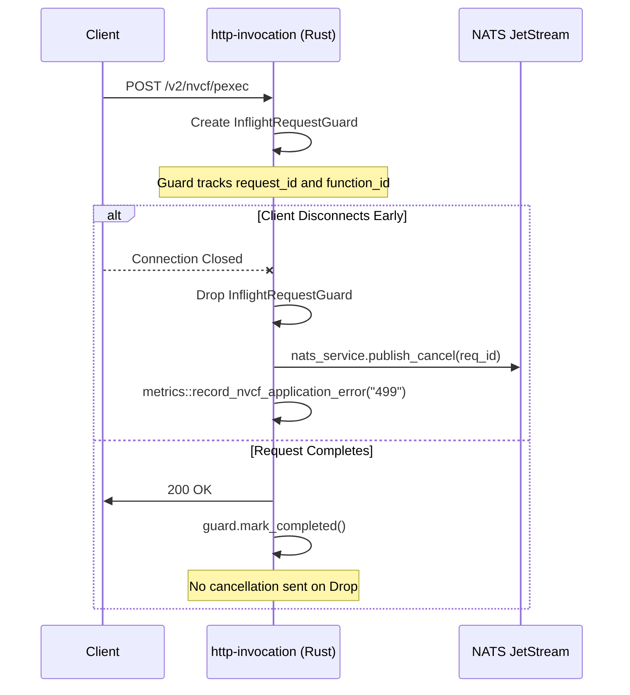

<!-- source: DeepWiki mcp.deepwiki.com · repo NVIDIA/nvcf · page 3.4 Vanity Gateway and Rate Limiter · fetched 2026-10-26 -->

# Vanity Gateway and Rate Limiter

<details>
<summary>Relevant source files</summary>

The following files were used as context for generating this wiki page:

- [docs/user/metrics/llm-api-gateway/metrics.md](docs/user/metrics/llm-api-gateway/metrics.md)
- [docs/user/runbooks/index.md](docs/user/runbooks/index.md)
- [docs/user/runbooks/update-nvcf-account-quota-limits.md](docs/user/runbooks/update-nvcf-account-quota-limits.md)
- [src/compute-plane-services/ess-agent/KNOWN_TEST_ISSUES.md](src/compute-plane-services/ess-agent/KNOWN_TEST_ISSUES.md)
- [src/invocation-plane-services/http-invocation/crates/server/src/metrics/mod.rs](src/invocation-plane-services/http-invocation/crates/server/src/metrics/mod.rs)
- [src/invocation-plane-services/http-invocation/crates/server/src/routes/app_error.rs](src/invocation-plane-services/http-invocation/crates/server/src/routes/app_error.rs)
- [src/invocation-plane-services/http-invocation/crates/server/src/routes/get_pexec.rs](src/invocation-plane-services/http-invocation/crates/server/src/routes/get_pexec.rs)
- [src/invocation-plane-services/http-invocation/crates/server/src/routes/post_pexec.rs](src/invocation-plane-services/http-invocation/crates/server/src/routes/post_pexec.rs)
- [src/invocation-plane-services/vanity-gateway/BUILD.bazel](src/invocation-plane-services/vanity-gateway/BUILD.bazel)
- [src/invocation-plane-services/vanity-gateway/README.md](src/invocation-plane-services/vanity-gateway/README.md)
- [src/invocation-plane-services/vanity-gateway/gateway/BUILD.bazel](src/invocation-plane-services/vanity-gateway/gateway/BUILD.bazel)
- [src/invocation-plane-services/vanity-gateway/gateway/gateway.go](src/invocation-plane-services/vanity-gateway/gateway/gateway.go)
- [src/invocation-plane-services/vanity-gateway/gateway/h2.go](src/invocation-plane-services/vanity-gateway/gateway/h2.go)
- [src/invocation-plane-services/vanity-gateway/gateway/h2_test.go](src/invocation-plane-services/vanity-gateway/gateway/h2_test.go)
- [src/invocation-plane-services/vanity-gateway/gateway/info_test.go](src/invocation-plane-services/vanity-gateway/gateway/info_test.go)
- [src/invocation-plane-services/vanity-gateway/gateway/openai_director.go](src/invocation-plane-services/vanity-gateway/gateway/openai_director.go)
- [src/invocation-plane-services/vanity-gateway/gateway/openai_director_test.go](src/invocation-plane-services/vanity-gateway/gateway/openai_director_test.go)
- [src/invocation-plane-services/vanity-gateway/gateway/shadow.go](src/invocation-plane-services/vanity-gateway/gateway/shadow.go)
- [src/invocation-plane-services/vanity-gateway/gateway/shadow_test.go](src/invocation-plane-services/vanity-gateway/gateway/shadow_test.go)
- [src/invocation-plane-services/vanity-gateway/gateway/tracing_attrs.go](src/invocation-plane-services/vanity-gateway/gateway/tracing_attrs.go)
- [src/invocation-plane-services/vanity-gateway/gateway/vanity_director.go](src/invocation-plane-services/vanity-gateway/gateway/vanity_director.go)
- [src/invocation-plane-services/vanity-gateway/gateway/vanity_director_test.go](src/invocation-plane-services/vanity-gateway/gateway/vanity_director_test.go)
- [src/invocation-plane-services/vanity-gateway/gateway_config/gateway_config.go](src/invocation-plane-services/vanity-gateway/gateway_config/gateway_config.go)
- [src/invocation-plane-services/vanity-gateway/gateway_config/gateway_config_test.go](src/invocation-plane-services/vanity-gateway/gateway_config/gateway_config_test.go)
- [src/invocation-plane-services/vanity-gateway/go.mod](src/invocation-plane-services/vanity-gateway/go.mod)
- [src/invocation-plane-services/vanity-gateway/go.sum](src/invocation-plane-services/vanity-gateway/go.sum)
- [src/invocation-plane-services/vanity-gateway/main.go](src/invocation-plane-services/vanity-gateway/main.go)
- [src/invocation-plane-services/vanity-gateway/middleware/BUILD.bazel](src/invocation-plane-services/vanity-gateway/middleware/BUILD.bazel)
- [src/invocation-plane-services/vanity-gateway/middleware/metrics.go](src/invocation-plane-services/vanity-gateway/middleware/metrics.go)
- [src/invocation-plane-services/vanity-gateway/middleware/metrics_test.go](src/invocation-plane-services/vanity-gateway/middleware/metrics_test.go)
- [src/invocation-plane-services/vanity-gateway/middleware/middleware.go](src/invocation-plane-services/vanity-gateway/middleware/middleware.go)

</details>


The Vanity Gateway and Rate Limiter are critical components of the NVCF Invocation Plane. The Vanity Gateway (Go) provides OpenAI-compatible endpoints and vanity URL routing for NVIDIA Cloud Functions, while also managing "shadow traffic" for model evaluation. The Rate Limiter (Rust) enforces throughput policies for incoming requests.

## Vanity Gateway Architecture

The Vanity Gateway acts as a reverse proxy that translates incoming public-facing routes into internal NVCF `pexec` or standard execution calls. It is built using the `chi` router and utilizes a `SwappableRouter` to allow for zero-downtime configuration reloads when model mappings change.

### System Components and Data Flow

The following diagram illustrates the relationship between the Gateway's internal directors and the upstream NVCF services.

**Vanity Gateway Component Mapping**
```mermaid
graph TD
    subgraph "Vanity Gateway (Go)"
        [main.go] --> [gateway/h2.go]
        [gateway/h2.go] -- "OpenAI Routes" --> [OpenAIDirector]
        [gateway/h2.go] -- "Vanity Routes" --> [VanityDirector]
        [OpenAIDirector] -- "Shadow Traffic" --> [TrafficShadower]
        [OpenAIDirector] -- "Primary Traffic" --> [VanityDirector]
        [VanityDirector] -- "ReverseProxy" --> [httputil.ReverseProxy]
    end

    subgraph "Invocation Plane"
        [httputil.ReverseProxy] -- "v2/nvcf/pexec" --> [http-invocation]
    end

    [gateway_config.go] -- "YAML Mapping" --> [OpenAIDirector]
    [gateway_config.go] -- "YAML Mapping" --> [VanityDirector]
```
Sources: `[src/invocation-plane-services/vanity-gateway/gateway/h2.go:49-116]()`, `[src/invocation-plane-services/vanity-gateway/gateway/openai_director.go:61-78]()`, `[src/invocation-plane-services/vanity-gateway/gateway/vanity_director.go:119-123]()`

### OpenAI Director
The `OpenAIDirector` handles requests to `/v1/chat/completions`, `/v1/completions`, `/v1/embeddings`, and other OpenAI-standard endpoints. 

*   **Model Mapping**: It maintains a `ModelMapping` struct that correlates OpenAI model names to NVCF `FunctionID` and `FunctionVersionID`. `[src/invocation-plane-services/vanity-gateway/gateway/openai_director.go:108-111]()`
*   **Body Extraction**: It parses incoming JSON or Multipart bodies to identify the requested model before forwarding. `[src/invocation-plane-services/vanity-gateway/gateway/openai_director_test.go:77-149]()`
*   **Shadow Traffic**: It can mirror a percentage of traffic to a "shadow" model for testing purposes without affecting the primary response. `[src/invocation-plane-services/vanity-gateway/gateway/openai_director.go:71-72]()`

### Vanity Director
The `VanityDirector` manages general pass-through routes defined in the configuration. 

*   **Path Rewriting**: It can override the outgoing path and inject custom headers (e.g., `function-id`, `function-version-id`) based on the `VanityExecRequest` configuration. `[src/invocation-plane-services/vanity-gateway/gateway/vanity_director.go:170-191]()`
*   **Protocol Support**: Supports both standard NVCF execution and `pexec` (Post-Execution) routes. `[src/invocation-plane-services/vanity-gateway/gateway/vanity_director.go:133-142]()`
*   **Polling**: Handles status polling for asynchronous requests via `/v1/status/{requestId}`. `[src/invocation-plane-services/vanity-gateway/gateway/h2.go:150]()`

## Rate Limiting and Error Handling

The system integrates rate limiting and handles specific termination scenarios like client disconnects and End-of-Life (EOL) models.

### Client Disconnects (499 Status)
The Gateway and the HTTP Invocation service explicitly track client disconnects. If a client closes a connection before a response is produced, the system records a `499 Client Closed Request` status for telemetry, distinguishing it from upstream `502 Bad Gateway` errors.

*   **Gateway Implementation**: `writeProxyError` in `vanity_director.go` checks `request.Context().Err()` for `context.Canceled`. `[src/invocation-plane-services/vanity-gateway/gateway/vanity_director.go:91-105]()`
*   **Invocation Service Implementation**: The Rust-based `http-invocation` service uses an `InflightRequestGuard` to publish a NATS cancellation message if the request is dropped before completion. `[src/invocation-plane-services/http-invocation/crates/server/src/routes/post_pexec.rs:74-114]()`

### Implementation of Inflight Guard
**Inflight Request Lifecycle**

Sources: `[src/invocation-plane-services/http-invocation/crates/server/src/routes/post_pexec.rs:117-176]()`, `[src/invocation-plane-services/http-invocation/crates/server/src/metrics/mod.rs:32-36]()`

## Middleware and Metrics

The Vanity Gateway uses a suite of middleware for observability and security:

| Middleware | Purpose | File Reference |
| :--- | :--- | :--- |
| `ServerTelemetryMiddleware` | Captures RED metrics (Rate, Errors, Duration) for all routes. | `[src/invocation-plane-services/vanity-gateway/gateway/h2.go:108]()` |
| `RejectSpoofedShadowRequests` | Ensures external clients cannot manually trigger shadow headers. | `[src/invocation-plane-services/vanity-gateway/gateway/h2.go:96]()` |
| `HostRouter` | Dispatches requests to specific handlers based on the `Host` header (OpenAI vs. Vanity). | `[src/invocation-plane-services/vanity-gateway/gateway/h2.go:107-113]()` |
| `TracedRoundTripper` | Propagates OpenTelemetry trace contexts to upstream services. | `[src/invocation-plane-services/vanity-gateway/gateway/h2.go:69-73]()` |

Sources: `[src/invocation-plane-services/vanity-gateway/gateway/h2.go:95-116]()`

## Configuration and Deployment

The gateway is configured via a YAML file defined by the `MAPPING_PATH` environment variable. 

### Key Configuration Fields
*   **v2config.openai**: Defines the host and mappings for OpenAI-compatible routes. `[src/invocation-plane-services/vanity-gateway/README.md:125-151]()`
*   **v2config.vanity**: Defines custom host and path mappings. `[src/invocation-plane-services/vanity-gateway/README.md:152-167]()`
*   **Shadow Configuration**: Per-model settings for `shadowPercentage` and `shadowSamplingMethod` (e.g., `perBearerKey`). `[src/invocation-plane-services/vanity-gateway/README.md:138-141]()`

### Build and Containerization
The service is built using Bazel and packaged as a multi-arch OCI image. It uses a `distroless/go` base with a custom entrypoint `shelless_ulimit` to ensure high file descriptor limits for high-concurrency proxying. `[src/invocation-plane-services/vanity-gateway/BUILD.bazel:23-44]()`

Sources: `[src/invocation-plane-services/vanity-gateway/README.md:3-26]()`, `[src/invocation-plane-services/vanity-gateway/BUILD.bazel:32-44]()`

---

